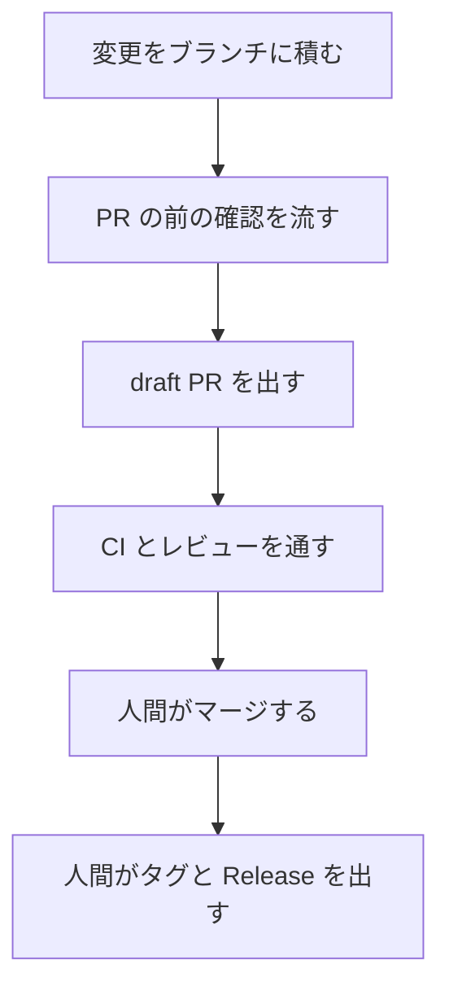
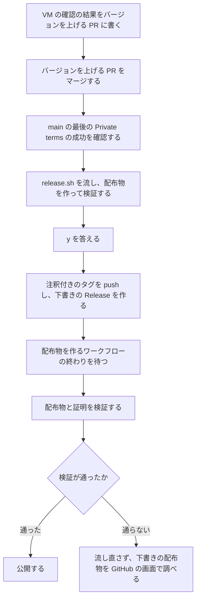

# 変更の進め方

原本への変更は PR にし、人のレビューと CI を通す。マージ、配るタグの作成と移動の判断は人間が行う。

エージェントは draft PR と検証結果を渡す。タグは動かさず、修正は新しいタグにする。

## 決まりの要約

この文書は、変更を出す前から配るまでの決まりを、節ごとに並べる。要点は次の表のとおりである。

| 節 | 要点 |
| --- | --- |
| 原本と正本 | 「原本」はこのキットだけを指し、決まりや情報の拠り所は「正本」と書く |
| 手順を足す条件 | 導入先で読まれる手順を足す変更に、防ぐ失敗と働いた跡を書く |
| 手順を見直す | 跡のない手順のうち、人間が承認したものだけを削る |
| PR の前の確認とテスト | PR の前に流すコマンドと、関連テストの選び方 |
| テストを流す | `tests/run.sh` の使い方と、テストを書く決まり |
| テストで確認する範囲 | 自動テストで確認する範囲と、人が実機で確認する範囲 |
| 画面に出す文 | `lib/ui.sh` の部品で出し、マークと配置で状態を示す |
| 出力を変える PR で画面の画像を作る | `scripts/release.sh` の出力を変える PR に、前と後の画像を載せる |
| 文書の書き方 | STYLE.md を正本とする |
| ファイルとディレクトリの名前 | ASCII だけで書く |
| MANIFEST と混入の検査 | MANIFEST を作り直し、混入は CI が検査する |
| バージョンを出す前に VM で確認する | 人が Mac と Windows の実機で確認する |
| タグと Release を出す | 人間が `scripts/release.sh` で出す |
| リポジトリの設定 | 管理者が Release とタグ、main と Actions を保護する |

変更は、ブランチと draft PR から始まる。CI とレビューを通し、人間がマージしたあと、人間がタグと Release を出す。



## 原本と正本

原本は、この配布するキット（`multica-squad-kit` とそのファイル）だけを指す。正本は、決まりや情報の拠り所になる一つの場所を指す。正本は、原本の中にも、導入先のプロジェクトにもある。

文書や指示で「原本」と書くのは、このキットを指すときだけにする。決まりや情報の拠り所を指すときは「正本」と書く。

## 手順を足す条件

導入先でエージェントが読む原本の手順には、足す条件と[見直しの手順](#手順を見直す)を当てる。範囲は、次のファイルである。

| まとまり | ファイル |
| --- | --- |
| 役のひな形 | `common/agents/*.md`（`FORMAT` を除く） |
| 共通スキルとリーダーの手順の参照ファイル | `common/skills/squad-handoff/` の下の `*.md` |
| スクワッドとオートパイロットの指示 | `common/squad.md`、`common/autopilots.md` |

このリポジトリの `AGENTS.md`・作業別のルール・`CONTRIBUTING.md`、導入先が記入する `skeleton/`、`docs/`、スクリプトとテストは範囲に入れない。

範囲のファイルに手順を足す変更は、その設計に次の 2 つを書く。設計がない変更では、PR の本文に書く。

1. 防ぐ失敗。どのタスクで何が起きたかを言葉で書き、失敗の記録をたどれるようにする
2. 働いた跡。手順が働いたときに、コメント・状態の変化・実行の記録のどれに何が残るかを書く

合意された要件で新しい機能を入れる手順は、要件を合意したタスクを根拠にして、失敗の記録に代えられる。この場合も、働いた跡を書く。

失敗のタスクの識別子は、設計の承認を頼むタスクのコメントに書く。PR の本文で示すときは、その PR を紐付けたタスクのコメントに書く。要件の合意を根拠にする場合も、そのタスクの識別子を同じ場所に書く。公開の設計や PR の本文には識別子を持ち出さず、失敗や要件を言葉で書き、「失敗の記録はタスクのコメントにある」などと置き場所を示す。

手順を足すとは、役に何かをさせる・確認させる・止まらせる文を新しく入れることである。既存の手順に条件や分岐を足し、役がすることが増える変更も当たる。言い換え、誤りの修正、削除、参照先の変更は当たらない。

### 足す条件をレビューで確認する

code-reviewer は、[手順のルール](.agents/rules/procedures.md)に従って、範囲のファイルの差分を確認する。手順を足す変更があれば、次のいずれかに 2 つ（または要件の根拠と跡）があるかを確認する。

- 同じ PR の設計の差分
- PR に示された設計
- PR の本文

ないときは、この条件か手順のルールを示し、必須の指摘にする。

設計と実装の担当も同じルールを読み、設計のフェーズで書く。人間が直接作る PR では、PR テンプレートの確認の項目で書き漏れを確認する。

## 手順を見直す

見直しは、[足す条件の範囲](#手順を足す条件)の手順について行う。手順の単位・跡・守る手順の分類を決め、スナップショットから一覧を出し、人間が承認したものだけを削る。

1. 見直しの元にするコミットを決め、範囲のファイルの手順を JSON の跡の定義に並べる。手順ごとに、跡・守る手順の分類・跡を決められないこと・手順でないことのいずれかを書く
2. 跡の定義を渡して、`scripts/metrics.py collect` でプロジェクトのスナップショットを取る。コメントは本文を残さず、合った跡の ID の一覧だけを残す
3. 同じ跡の定義と元のコミットを使い、`scripts/metrics.py traces` で最近の 20 件の跡を数え、判定の一覧を出す
4. 跡の定義・スナップショット・判定の一覧を見直しのタスクに添付する。人間に、削る候補のうち削るものと、判定できない手順を残すか削るかの判断を頼む
5. 人間が手順の ID を並べて承認したものだけを削る。削る PR の本文に、承認のコメントへのリンクを置く
6. 削った手順を参照する他の役の指示・スキル・テスト・文書を `git grep` で探して直す。関連テストと markdownlint を通す

跡の定義・スナップショット・一覧は、手元の `tmp/` に置き、公開のリポジトリにはコミットしない。添付する前に、[記録の置き場所と公開の範囲](docs/metrics.md#置き場所と公開の範囲)に従い、エージェントの名前を別名に置き換える。跡の定義とスナップショットの形式は、[見直しの設計](docs/procedure-review.md#見直しの手順)を参照する。

### 手順の単位と跡

手順の単位は、範囲のファイルの最も小さい見出しの節とする。別々に働く手順は、節の中の段落か箇条書きの項目の先頭の文を目印にして分けてよい。説明や定義だけで役に何もさせない節は、「手順でない」として分ける。

跡の定義は、元のコミットの範囲のファイルのすべての見出しを覆うように書く。目印の文は、その節の中にちょうど 1 回現れるものにする。`traces` は、覆わない見出し、目印の不一致、スナップショットと跡の定義の SHA-256 の不一致があれば止まる。

跡は、記録だけで数えられる次のいずれかの形にする。

| 形 | 数えるもの |
| --- | --- |
| コメント | 本文が正規表現に合うコメント（書き手の種類で絞れる） |
| 状態の変化 | 変化の前と後の状態が合う変化 |
| 実行 | 役と状態が合う実行（役の分け方は [記録を数える設計](docs/metrics.md#数える)に従う） |

### 判定と人間に示す一覧

スナップショットの `collected_at` の時点のタスクを、作られた時刻が新しい順に 20 件選ぶ。同じ時刻のタスクは ID の順にする。その 20 件のコメント・状態の変化・実行について、手順ごとに跡に合う記録の数を数える。

| 判定 | 条件 |
| --- | --- |
| 効いた | 跡が 1 回以上 |
| 削る候補 | 跡が 0 回で、守る手順ではない |
| 守る手順で残す | 秘密・書き込み先の制限・関所・取り消せない操作のどれかを守る手順（跡の回数によらない） |
| 判定できない | 跡を決められない手順 |
| 手順でない | 説明や定義だけの節 |

守る手順の分類は、跡の定義を書く人が手順ごとに書き、一覧で人間が確認する。守る手順は、跡が 0 回でも削る候補にしない。跡を決められない手順は、判定できないものとして分け、人間が残すか削るかを決める。

一覧は手順の ID の順に並べ、ファイル・節・目印・跡・20 件での回数・判定・守る手順の分類・足したコミットを示す。削る候補・判定できない・守る手順には、目印の文を最初に足したコミットと件名を添え、理由をたどれるかを判断の材料にする。同じスナップショット・跡の定義・元のコミットから出し直した一覧は、1 バイトも違わないものとする。

### 見直しを始める時機

見直しは、人間が必要と判断したときに見直しのタスクを起票し、この手順で行う。最近の 20 件は、見直しを始める時点のプロジェクトのタスクから選ぶ。見直しを自動で起票するオートパイロットや見張りは足さない。

## PR の前の確認とテスト

変更はブランチに積んで PR にする。PR を出す前に、原本のルートで次を流す。

```bash
bash scripts/check.sh
bash scripts/manifest.sh
bash tests/terms-test.sh                    # すべての変更で流す
bash tests/run.sh tests/webhooks-test.sh     # 関連テスト。選び方は下に書く
npx markdownlint-cli2 '**/*.md' '#tmp/**'    # Markdown を変えたとき
bash tests/check-content.sh --public       # 一覧を持たないとき
SQUAD_KIT_FORBIDDEN_FILE=/path/outside/terms.txt bash tests/check-content.sh  # 一覧を持つとき
```

手元では、変更の大きさによらず、次を流す。

- 構文の確認
- MANIFEST の作り直し
- 関連テスト
- Markdown を変えたときの markdownlint

用語の検査 `tests/terms-test.sh` は、関連テストに選ばれなくても、すべての変更で流す。テストの全件は、PR の CI が macOS と Ubuntu で流す。

関連テストは、変えたテストのファイルと、変えたファイルの名前（パスの最後の部分）を含むテストのファイルである。`MANIFEST` は、作り直すと毎回変わるので、変えたファイルに数えない。Markdown を変えたときは、`tests/style-test.sh` と `tests/links-test.sh` も流す。関連テストが 1 本も選べないときは、選べなかったことを PR の確認に書き、CI で確認する。

次のどれかに当たるときは、関連テストの代わりに、手元で `bash tests/run.sh` の全件を流す。

| 条件 | 当たるファイル |
| --- | --- |
| テストの仕組み | `tests/run.sh`・`tests/run-one.sh`・`tests/run-hook.sh` |
| 多くのテストが共有するスタブと補助 | `tests/` の直下で、名前に `fixture` か `lib` を含み、`-test.sh` で終わらないファイル。`tests/fixtures/` の下のすべて |
| 多くのテストが読む共通の部品 | `setup.sh`・`lib/ui.sh`・`lib/check.sh`・`lib/project.sh`・`lib/render.sh`・`common/monitor/squad-cli-lib` |
| CI の定義 | `.github/workflows/` の下のすべて |
| 数と自信 | 関連テストが 10 本を超えるとき。または、選び方に自信が持てないとき（名前を含まずに読み込まれるファイルを変えたときなど） |

手元で流さなかった全件は、PR の確認に「CI で確認する」と書く。エージェントは、検証スキルの同じ条件に従う。条件を変えるときは、検証スキルとそろえる。

同じ PR で手元の全件を一度流したら、その後の直しでは、全件の条件に当たっても全件を流し直さない。全件を流したコミットを PR の確認に書き、そこからの直しは、変えたファイルの関連テストと変えたスタブや補助を読むテストで確認し、全件は CI に任せる。直しのたびに手元で全件を流すより、選び漏れを CI の全件で見つけて直すほうが小さいためである。一度全件を流したあとに壊れうるのは、直しが届く範囲だけである。

## テストを流す

`bash tests/run.sh` は、`tests/*-test.sh` を並べて流す。すべて通れば 0、1 本でも失敗すれば 1 で終わる。終了コードが 0 でも、テスト自身のログに bash の展開のエラー（`<ファイル>: line <数>: <名前>: unbound variable`）の行があれば失敗になる。

手元では、[変更の進め方](#変更の進め方)に従って関連テストを選んで流す。全件は CI が流す。

```bash
bash tests/run.sh                            # 並べて流す
SQUAD_KIT_TEST_JOBS=4 bash tests/run.sh      # 並列数を 4 にする
SQUAD_KIT_TEST_JOBS=1 bash tests/run.sh      # 1 本ずつ流す
bash tests/run.sh tests/project-create-test.sh   # 選んだファイルだけ流す
SQUAD_KIT_TEST_SHARD=2/4 bash tests/run.sh   # 4 つに分けた 2 つ目だけ流す
```

並列数は、指定しなければ論理 CPU の数になる。1 本ずつ流しても、起こす順と出力は並べたときと同じで、途中で失敗しても最後まで流す。並べたときだけ失敗するかを確認するときに使う。

CI は、テストをシャードごとのジョブに分けて流す。

失敗したファイルのログは最後にまとめて出て、失敗した場所と直前に通ったケースが添えられる。流している間の出力を見たいときは、`bash tests/project-create-test.sh` のようにファイルを直接流す。

仕組みは、`tests/run.sh` の冒頭のコメントを参照する。

### コンフリクトを解消したときに流すテスト

コンフリクトを解消したときは、テスト全体を手元で流さず、関わるテストだけを流す。テスト全体は CI で確認する。

関わるテストは、衝突したファイルと PR が変えたファイルのそれぞれについて、次の和にする。

1. 変えたテストのファイル（`tests/*-test.sh`）そのもの
2. ファイルの名前から拡張子を除いた語を含むテストのファイル（`grep -lF -- <語> tests/*-test.sh`）
3. テストの補助（`tests/*-lib.sh` など）を変えたときは、それを読み込むテストのファイル。2 の探し方で当たる

テストは、確認するスクリプトや文書を名前で読むので、名前で探せば当たる。どれにも当たらないファイルは、関わるテストがないと報告し、CI で確認する。

手元で全件を流す条件（上の表）に当たるファイルを PR が変えていても、コンフリクトの解消では全件を流さず、CI に任せる。引き継ぎに、条件に当たったファイルと、全件を CI に任せたことを書く。

選んだファイルを流し、あわせて静的な確認と `MANIFEST` の確認を流す。

```bash
bash tests/run.sh <選んだファイル>
bash scripts/check.sh
bash scripts/manifest.sh && git diff --exit-code -- MANIFEST
```

### テスト 1 本ごとの時間の上限

`tests/run.sh` は、テストのファイル 1 本に経過時間で 450 秒の上限を設ける。超えたファイルは、`done TIMEOUT <ファイル> <上限>s` を出して止め、時間切れの失敗として扱う。上限は、環境変数 `SQUAD_KIT_TEST_TIMEOUT` に秒数で指定して変えられる。

```bash
SQUAD_KIT_TEST_TIMEOUT=600 bash tests/run.sh tests/release-test.sh   # 上限を 600 秒にする
```

止まったテストは、流し直さずに失敗として扱う。流し直しても通るなら、並べたときだけ起きる不具合や、負荷による遅れを隠すため。原因を直すか、テストのファイルを分ける。

### テストを書く決まり

テストは、ファイルごとに別の `HOME` と `TMPDIR` で流れる。テストのファイルは、次を守る。

- 一時ファイルとディレクトリは、置き場所を明示して作る
  - `tmp/` の下に `mktemp -d` で作った自分のディレクトリか、`mktemp "$TMPDIR/名前.XXXXXX"` のように `TMPDIR` の下に作る
  - 置き場所を指定しない `mktemp` と `mktemp -t` は使わない
- `HOME` の下の利用者の設定に頼らない
  - Git の名前とメールが要るときは、`git -c user.name=… -c user.email=…` で渡す
- 原本の `tmp/` 以外のファイルを書き換えない
  - 決まった名前のファイルを共有の場所に作らず、プロセスを名前で止めない
- `set -u` のテストでは、空になりうる配列を `${args[@]+"${args[@]}"}` の形で展開する。macOS の bash 3.2 は、空の配列の `"${args[@]}"` で止まるため
- テストのファイルを足したら、`tests/test-weights` に重み（macOS の CI での秒数の目安）を書く
  - テスト 1 本の macOS の CI での目安は 150 秒にする。目安は機械では確認しない
  - 1 本の上限は 450 秒で、超えたファイルは `tests/run.sh` が時間切れの失敗にする。重みのないファイルがあると、`tests/test-runner-test.sh` が失敗する
  - 分けたファイルを足したときと、CI の秒数が目安から 2 倍以上ずれたときは、macOS の `tests/run.sh` の `==== PASS` の行の秒数を写して直す。手で小さくして目安に収めず、超えたテストを速くするか分ける
- CLI の出力のデータは実物から取る。取り方とバージョンの記録は [CLI の実物の見本](tests/fixtures/cli/README.md)に従い、CLI のバージョンを上げたら取り直す
- 見張りが読む欄は、先に `common/monitor/squad-cli-lib` の約束に必須・条件付き・省略可能の分類を書く。`// 既定値` や `--compact` で欄の欠けを隠さない
- 見張りに、欄がないか `null` のときに動作を変える読み方を足したら、欄があって確認が効くケースをテストに足す。欄が約束から落ちると、そのケースが失敗して気づける
- `tests/agent-templates-test.sh` は、ひな形の契約だけを確認する。構成ごとに残る役・役の欄・差し込みとマーク・大きさ・機械やほかのファイルが読む文字列・構成による出し分けである
  - 役の指示・共通スキル・参照の文や句は、固定の文字列で確認しない。役が文に従うかは `tests/leader-eval/` の範囲である
  - 構成による出し分けは、ひな形の条件の塊ごとに、テストの中の出し分けの表に行を置いて確認する。文や語を目印にしない
  - 機械やほかのファイルが読む文字列を確認するときは、読む側の名前をコメントで添える

## テストで確認する範囲

自動テストで確認する範囲は、次のとおりである。

- macOS と Ubuntu 24.04 のセットアップ・再実行
- ホストのデーモンの起動入口と配置、セットアップ・VM・入口の起動環境の照合
- 導入の確認
- Webhook の登録・配信確認
- 起票
- 関所の許可と拒否
- 見張り
- シェル設定と時刻の読み取り
- VM を作るスクリプトの引数と閉じ込めの設定
- 実行の始めの確認
- ランタイムのコマンドの組み立てをまねた PATH の復元
- 入口のスクリプト（`install.sh`）の検証と展開
- README の 1 行のコマンドの擬似端末での実行
- 配布物を作るスクリプトと、発行のコマンド（`scripts/release.sh`）
- 発行のワークフローの定義の決まり

CI でも両 OS に同じテストを流す。外部 CLI とサーバー、`limactl` と `wsl.exe` はスタブを使う。

CI が apt・brew で足りないツールだけを取得する `scripts/ci-install.sh` は、スタブで次を確認する。

- 署名の確認を含むキャッシュの検証と破棄
- 再試行
- 取得後の確認

署名つきのパッケージ情報は `tests/fixtures/ci-install/` に置き、作り直すときは同じ場所の `generate.sh` を実行する。

発行のワークフローの実行と、本物の GitHub での証明の検証は、最初のバージョンを出すときに人が確認する。

認証済みのデーモン・ランタイムの実行と、WSL 実機の動作は、VM を使わない普段のユーザーでは未確認である。WSL 2 は Linux との互換性と各ツールの公式対応に基づく対応である。

VM を使わない Mac では、人が PC の再起動後に入口を流し、ランタイムとタスクの動作を確認する。入口の再実行と、そのあとのセットアップの流し直しで、デーモンを起動し直さないことも確認する。

Mac の Lima の VM と WSL の専用のディストリは、[バージョンを出す前に VM で確認する](#バージョンを出す前に-vm-で確認する)で人が実機で確認する。

## 画面に出す文

セットアップと `scripts/release.sh` の画面に出す文は、`manual.md` の[表示の色とマーク](manual.md#表示の色とマーク)の記号と種類のどれかに当てる。色の制御文字と記号の文字を直接書かず、種類ごとの色、色を付けるかの判定、行の書き換えを一か所にまとめた `lib/ui.sh` の部品で出す。部品と、記号と色の決まりは、`docs/screens.md` の[表示の部品](docs/screens.md#表示の部品libuish)と[記号と色](docs/screens.md#記号と色)にある。

状態は、「成功」「一致」「新規」のような結果の語ではなく、マークと配置で示す。画面を変えたら、その画面を説明している `manual.md` の節も合わせる。マークの行（`✔`・`✖`・`!`・`+`・`~`・`·`・`-`）は、色の有無によらず同じ文字と配置で出す。止まるときの `エラー:` の行と、`警告:` の行も、色の有無によらず同じ文字を出す。

コマンド置換で受け取る文や、タスク・答え・ログに入る文は、色を付けずに作る。

端末に依る確認は、[端末に依るテスト](docs/terminal-tests.md#確認の分け方)の層に分ける。描き方は端末と時計の境界をスタブに替え、本物の端末の条件と対話は `tests/tty-session.py` で確認する。確認ごとの行き先は[対応表](docs/terminal-tests-map.md)を参照する。

`lib/` やエージェントの指示は、`manual.md` の節を名前やリンクで指している。節の名前を変えるときは、`grep -rn 'manual.md' .` で参照を探して合わせる。

起票するタスクの本文（`common/setup-issues.json`）は、取り出したタグの `manual.md` の節へリンクする。

## 出力を変える PR で画面の画像を作る

`scripts/release.sh` の出力を変える PR では、変える前と後の画面を、同じ場面・同じ入力で PNG にして、見比べられるようにする。テストの文字列の一致に加えて、人が見た目で確認するためである。設計は `docs/release.md` の[画面を画像で見比べる](docs/release.md#画面を画像で見比べる)にある。

前は変える前の `main` の `scripts/release.sh`、後は PR の `scripts/release.sh` を、同じ仕組みで流す。`lib/ui.sh` などのほかのファイルは、作業ツリーのものを使う。

```bash
python3 -m venv tmp/screens-venv
tmp/screens-venv/bin/pip install -r tests/release-screens-requirements.txt
git fetch origin main
git show origin/main:scripts/release.sh >tmp/release-before.sh
RELEASE_SCREENS_PYTHON=tmp/screens-venv/bin/python bash tests/release-screens.sh tmp/release-before.sh tmp/screens/before
RELEASE_SCREENS_PYTHON=tmp/screens-venv/bin/python bash tests/release-screens.sh scripts/release.sh tmp/screens/after
```

- `RELEASE_SCREENS_PYTHON` は、描くときの Python のパスである。指定がなければ `python3` を使い、Pillow がなければ、入れ方を出して止まる
- `--capture-only` を付けると、出力を取るところまでで終わり、PNG を描かない。CI と、描く道具のない手元で使う
- 画像は、リポジトリに入れない。`tmp/` は Git に入れない

PR のコメントに、場面ごとの前と後の画像の組、上のコマンド、前に使った `main` のコミットを書く。画像は、作った人が `gh pr comment <PR> --body-file <本文> --attach '<画像>#<説明>'` で、前 10 枚と後 10 枚の合計 20 枚を 1 つのコメントに載せる。載せたあとに `gh pr view <PR> --json comments` で、コメントに画像の URL があり、手元のパスが残っていないことを確認する。載せられなかったときだけ、画像を Multica のタスクのコメントに添え、試したコマンドと終了コードと出力も添えて、人に頼む。

## 文書の書き方

人間が読む文書の書き方は、[STYLE.md](STYLE.md) を正本とする。

## ファイルとディレクトリの名前

原本に置くファイルとディレクトリの名前は、印字できる ASCII（空白の `0x20` から `~` の `0x7E` まで）だけで書き、バックスラッシュ（`\`）は使わない。漢字やかなは、ファイルの中身には書いてよいが、名前には使わない。

ASCII 以外の名前があると、配布物を作れず、バージョンを出せない。PR の CI の `assets` のジョブと、`scripts/release.sh` がこの決まりを確認する。手元では、次で同じ検証を流せる。

```bash
bash scripts/build-assets.sh --commit HEAD tmp/assets
```

止まったら、出た名前を ASCII に替えて、参照する文書とテストと `MANIFEST` を合わせる。

## MANIFEST と混入の検査

`MANIFEST` はファイル不足と改変を、登録前に検出するために残す。変更したらスクリプトで作り直す。

CI は同じ生成をして、コミットした `MANIFEST` と照合する。Git の管理領域と `tmp/` は一覧から除く。

混入の検査の一覧は、公開リポジトリに置かない。管理者が Environment `private-terms` の Secret `FORBIDDEN_TERMS` に一行一語で設定する。Environment は main のブランチだけに限り、main にマージ済みの検査コードだけが一覧を読む。設定と確認の方法は[リポジトリの設定](#リポジトリの設定)に従う。

PR の CI は、一覧を受け取らず、公開の検査だけを流す。公開の検査は UUID の混入とシンボリックリンクを調べ、秘密の語は見ない。fork の PR も同じ公開の検査を流す。

秘密の語は、マージの直後の main で、`Private terms` が検出する。毎週と手での実行でも、main の今の中身を検査できる。一覧は一時ファイルへ渡し、値や検出した行を表示しない。一覧が空のときは失敗する。

秘密の語が見つかったら、その語を除く PR を作ってマージする。語は main の履歴に入ってから見つかるので、発行の前には最後の検査の成功を確認する。

## バージョンを出す前に VM で確認する

VM を作るスクリプト（`vm/lima.sh` と `vm/wsl.ps1`）と、中で流すセットアップは、スタブを使う自動テストでは、実機の動作を確認しきれない。バージョンを出す前に、人が Mac と Windows の実機で次を確認し、結果をバージョンを上げる PR に書く。

`manual.md` の「閉じ込めて動かす」の手順を使う。まだタグがないバージョンを確認するので、中では確認するコミットを取り出して `bash setup.sh --no-checkout` で流す。

1. スクリプトで VM を作り、中でセットアップを最後まで流す
2. 中のエージェントが、許したリポジトリの checkout と PR の作成までできる。次の 3 つも確認する
   - 関所のディレクトリを含まない PATH で、セットアップの外からデーモンを起動し直す
   - その状態でも、Claude と Codex のエージェントの実行で `command -v gh` が関所の `gh` を返す。`squad-dispatch-pick`・`squad-pr-watch`・`squad-review-wait` が名前で解決する
   - 最上位の役（Claude の `claude-principal` と Codex の `codex-principal`）のエージェントの実行でも、同じく名前で解決する
3. `verify` が通る。中で MySQL のコンテナを立てたあとも通る
4. VM を止めて起動し直したあと、中に入らずに、デーモンがオンラインになってタスクが動く。WSL では、窓をすべて閉じたあとも動く
5. VM を消したあと、ホストのホームに、セットアップが書いたファイル（`~/.multica-agent`・`~/.multica`・`~/multica_workspaces`）がない

Mac は Lima、Windows は WSL の専用のディストリで、それぞれ確認する。片方の実機が使えないときは、確認しなかった側と理由を PR に書き、そのままバージョンを出すかを人が決める。

## タグと Release を出す

人間が、バージョンを上げる PR のマージのあとに、原本のリポジトリのルートで次を流す。タグの名前は `VERSION` から読む。`gh` は 2.102.0 以上が要る。

発行の前に、main の最後の `Private terms` の実行が成功していることを確認する。

```bash
git switch main
git pull --ff-only origin main
bash scripts/release.sh
```

発行は、次の順に進む。



タグを付ける前に配布物を作って検証し、名前の決まりに合わないと、タグも下書きの Release も作らずに止まる。この検証で止まり、タグがすでにあるときは、そのタグは使わず、直したコミットを新しいバージョンで出す。

コマンドは、確認を求める前に、次を出す。

- 確認した項目の一覧
- Release の本文（`CHANGELOG.md` のそのバージョンの節）
- バージョンとタグを付けるコミットの要約
- 手順のチェックリスト

確認は端末で答えるので、端末から流す。パイプや自動の実行では、公開されない。

`y` を答えたときだけ、注釈付きのタグを作って `origin` に push し、下書きの Release を作る。そのあと、配布物を作るワークフローの終わりを待ち、配布物と証明を検証して、検証が通ったときだけ公開する。

公開の手順は、チェックリストのマークをスピナー・`✔` の順に変えて進む。外のコマンドの出力は、失敗したときだけそのまま出る。

公開したら、次を終わりの表示に出す。

- バージョン
- コミット
- Release の URL
- 配布物
- 発行のワークフローの実行の URL

画面の例は写さない。確認の前の画面は `docs/release.md` の[確認](docs/release.md#確認)に、手順と終わりの表示は[手順の表示](docs/release.md#手順の表示)と[終わりの表示](docs/release.md#終わりの表示)にある。

止まったときは、出た理由に従って直してから、流し直す。未公開のコミットがあるときや、`VERSION` と `CHANGELOG.md` の先頭のバージョンが違うときは、変更を PR でレビュー・マージしてからやり直す。

下書きの作成、ワークフロー、公開のどこで失敗したときも、同じコマンドを流し直す。タグは作り直さず、続きから進む。

配布物の検証で止まったときは、流し直さない。下書きの配布物を GitHub の画面で見て、差し替えられていないかを調べる。

発行済みのタグは動かさない。修正は新しいタグで配る。

### リポジトリの設定

管理者が、[Release とタグの保護](#release-とタグの保護)と [main と Actions の保護](#main-と-actions-の保護)を設定する。

### Release とタグの保護

README の 1 行のコマンドは、入口のスクリプト（`install.sh`）を検証せずに流す。入口は公開した Release にあるので、公開したあとに差し替えられると、そのまま流れてしまう。

これを防ぐため、リポジトリの管理者が、公開したあとの Release の配布物とタグを差し替えられない次の 2 つを設定する。最初のバージョンを出す前に行う。不変の Release は、有効にしたあとに公開した Release にだけ効くため。

| 設定 | 値 |
| --- | --- |
| Settings → Releases の「Enable release immutability」 | 有効にする |
| タグの ruleset（Target tags は `v*`） | 「Restrict updates」と「Restrict deletions」を有効にし、「Restrict creations」は付けない。bypass の一覧は空にする |

ruleset は、タグを作ることを止めない。`scripts/release.sh` が、タグを push できるようにするため。

設定のあと、最初のバージョンを出したら、公開済みの Release とそのタグが、差し替えられないことを確認する。`V` には、公開したバージョンのタグを入れる。

```bash
V=v1.0.0
D=$(mktemp -d)
gh release download "$V" --repo drecom/multica-squad-kit --pattern SHA256SUMS --dir "$D"
gh release upload "$V" "$D/SHA256SUMS" --repo drecom/multica-squad-kit --clobber
git push --force origin "refs/tags/$V^{commit}:refs/tags/$V"
```

どちらも、拒まれれば設定が効いている。通ってしまったら、設定が効いていないので、直す。`git push` が通ったときは、`git push --force origin "refs/tags/$V:refs/tags/$V"` で、注釈付きのタグに戻す。

### main と Actions の保護

原本の main と Actions を保護するため、管理者が次の順に設定する。各手順の確認の方法は、`gh` が管理者の認証でログインした端末で流す。

> [!WARNING]
> この保護は、管理者の権限を持つエージェントなら ruleset ごと外せるので、誤った push と、外からの指示による直接の push を止めるだけである。

| 手順 | 時点 |
| --- | --- |
| 1. Environment を作り、一覧を移す | 最初のマージの前 |
| 3. ruleset を足す | 空の最初のコミットを push したあと、最初のマージの前 |
| 4. SHA の固定を強制する | 最初のマージの後、最初の公開の前 |
| 5. Dependabot を有効にする | 最初のマージの後、最初の公開の前 |
| 6. コードの解析を確認する | 最初のマージの後、最初の公開の前 |

#### 1. Environment を作り、一覧を移す

1. リポジトリの Settings → Environments → New environment で、名前に `private-terms` を入れ、Configure environment を押す
2. Deployment branches and tags で「Selected branches and tags」を選ぶ。Add deployment branch or tag rule で、Ref type を Branch、パターンを `main` にして Add rule を押す
3. Required reviewers と Wait timer は付けない
4. Environment secrets の Add environment secret で、名前を `FORBIDDEN_TERMS`、値を今の一覧（一行一語）にして保存する。Repository secrets には作らない

確認の方法: 次の 3 つの出力を見る。1 つ目は `["branch:main"]` になり、2 つ目は `FORBIDDEN_TERMS` を含む。Secret の値は出ない。

```bash
gh api repos/drecom/multica-squad-kit/environments/private-terms/deployment-branch-policies --jq '[.branch_policies[] | .type + ":" + .name]'
gh secret list --repo drecom/multica-squad-kit --env private-terms
gh api repos/drecom/multica-squad-kit/environments/private-terms --jq '.deployment_branch_policy'
```

3 つ目は `{"custom_branch_policies":true,"protected_branches":false}` になる。

#### 3. ruleset を足す

1. Settings → Rules → Rulesets で New ruleset → New branch ruleset を押す
2. Ruleset Name に `base-branch-rules` を入れ、Enforcement status を Active にする
3. Bypass list は空のままにする。ロールやアプリを足さない
4. Target branches の Add target → Include default branch で、既定のブランチ（`main`）を対象にする
5. Branch rules の「Restrict deletions」と「Block force pushes」にチェックを入れる
6. 「Require a pull request before merging」にチェックを入れ、Required approvals を 0 にする。その下の小項目はすべて外す
7. 「Require status checks to pass」にチェックを入れる。「Require branches to be up to date before merging」は外す
8. Add checks で `checks-passed` を入れ、ソースを GitHub Actions にする。実行履歴がなくて選べないときは、画面で作らず、下の「実行履歴がないときの作り方」で作る
9. Create を押す

実行履歴がないときの作り方: 画面の手順 1〜9 の代わりに、次の API で、同じ中身の ruleset を作る。`required_status_checks` に、名前の `checks-passed` と、発行元の GitHub Actions の `integration_id`（`15368`）を並べる。発行元を指定するので、実行履歴がなくても、最初から同じ保護になる。作ったら、下の確認の方法を流す。

```bash
gh api /apps/github-actions --jq .id   # 15368 になる。ならないときは、次の JSON の integration_id をこの値に替える
gh api repos/drecom/multica-squad-kit/rulesets --method POST --input - <<'JSON'
{
  "name": "base-branch-rules",
  "target": "branch",
  "enforcement": "active",
  "bypass_actors": [],
  "conditions": { "ref_name": { "include": ["~DEFAULT_BRANCH"], "exclude": [] } },
  "rules": [
    { "type": "deletion" },
    { "type": "non_fast_forward" },
    {
      "type": "pull_request",
      "parameters": {
        "required_approving_review_count": 0,
        "dismiss_stale_reviews_on_push": false,
        "require_code_owner_review": false,
        "require_last_push_approval": false,
        "required_review_thread_resolution": false
      }
    },
    {
      "type": "required_status_checks",
      "parameters": {
        "strict_required_status_checks_policy": false,
        "required_status_checks": [{ "context": "checks-passed", "integration_id": 15368 }]
      }
    }
  ]
}
JSON
```

確認の方法: 1 つ目のコマンドで ruleset の ID を調べ、`R` に入れる。そのあとの出力が、それぞれ `["deletion","non_fast_forward","pull_request","required_status_checks"]`・`[]`・`0`・`[{"context":"checks-passed","integration_id":15368}]` になる。最後は、名前だけでなく、発行元の ID（GitHub Actions の `15368`）まで合っていることを見る。画面で作ったときも、API で作ったときも、この出力で確認する。

```bash
gh api repos/drecom/multica-squad-kit/rulesets --jq '.[] | [.id, .name] | @tsv'   # ruleset の ID を調べる
R=repos/drecom/multica-squad-kit/rulesets/<調べた ID>
gh api "$R" --jq '[.rules[].type] | sort'
gh api "$R" --jq '.bypass_actors'
gh api "$R" --jq '.rules[] | select(.type == "pull_request") | .parameters.required_approving_review_count'
gh api "$R" --jq '.rules[] | select(.type == "required_status_checks") | .parameters.required_status_checks | map({context, integration_id})'
```

動作は、次の 2 つで確認する。

1. 原本の手元で、main から空のコミットを作り、main へ直接 push する。`GH013` の決まりの違反で拒まれれば効いている

    ```bash
    git switch --detach origin/main
    git commit --allow-empty -m 'ruleset の確認'
    git push origin HEAD:main
    git switch -
    ```

    通ってしまったら、空のコミットが main に残る。害はないので残し、手順 3 をやり直す。

2. 次の PR で、Checks が終わる前の `gh pr view <PR> --json mergeStateStatus` が `BLOCKED` になり、終わって通ったあとは承認なしでマージできる

#### 4. SHA の固定を強制する

1. Settings → Actions → General の Actions permissions を開く
2. 「Require actions to be pinned to a full-length commit SHA」を有効にする
3. Save を押す

確認の方法: 1 つ目の出力が `true` になる。そのあと、main の `Checks`・`Scan`・`Private terms` の最新の実行が `success` のままであることを、2 つ目で見る。

```bash
gh api repos/drecom/multica-squad-kit/actions/permissions --jq '.sha_pinning_required'
for w in check.yml scan.yml private-terms.yml; do gh run list --repo drecom/multica-squad-kit --workflow "$w" --branch main --limit 1 --json workflowName,conclusion; done
```

強制が効くことは、`actions/checkout@v4` の手順を足した確認用の PR を作り、Checks が始まらずに失敗することで見る。確認したら、その PR はマージせずに閉じ、ブランチを消す。

#### 5. Dependabot を有効にする

1. Settings の Security の欄にある「Advanced Security」（画面によっては「Code security」）を開く
2. Dependency graph が有効であることを見る。公開のリポジトリでは常に有効である
3. 「Dependabot alerts」の Enable を押す
4. 「Dependabot security updates」の Enable を押す

確認の方法: 1 つ目が 403 ではなく、件数（0 でもよい）を返す。2 つ目が `true` を返す。

```bash
gh api 'repos/drecom/multica-squad-kit/dependabot/alerts?per_page=100' --jq 'length'
gh api repos/drecom/multica-squad-kit/automated-security-fixes --jq '.enabled'
```

あわせて、Insights → Dependency graph → Dependabot に `.github/dependabot.yml` の `github-actions` が並び、最後の確認の時刻にエラーがないことを見る。

SHA で固定したアクションには、Dependabot の警告もセキュリティの更新も出ない。原本には、固定したアクションと、画像を描くための Pillow の依存がある。Dependabot の対象はアクションだけなので、警告の一覧は 0 件のままでよい。固定したアクションの脆弱性は、`Scan` の `action-advisories` が見つける（[固定したアクションの既知の脆弱性](docs/supply-chain.md#固定したアクションの既知の脆弱性)）。

依存を足すか外す PR では、[依存の脆弱性の監査](docs/dependency-audit.md)の対象と手順も直す。

#### 6. コードの解析を確認する

1. 手順 5 と同じ画面の「Code scanning」で、CodeQL analysis の既定の設定（Default）を有効にしない。有効だと、ワークフローからの CodeQL の結果の登録が拒まれる
2. Security → Code scanning を開き、Tool の絞り込みに `CodeQL` と `action-advisories` の 2 つが並ぶことを見る
3. 開いた警告がないことを見る。あれば、固定したアクションの警告は直ったバージョンの SHA へ上げる PR で、CodeQL の警告は書き方を直す PR で片付ける

確認の方法: 次の出力に、`/language:actions`・`/language:python`・`action-advisories` の 3 つの解析が、`refs/heads/main` で、main への push の後の時刻で並ぶ。

```bash
gh api 'repos/drecom/multica-squad-kit/code-scanning/analyses?ref=refs/heads/main&per_page=20' --jq '.[] | [.category, .tool.name, .created_at] | @tsv'
```

定期の実行は、最初の月曜のあとに確認する。Actions → Scan と Actions → Private terms に、イベントが `schedule` の実行が出て、`Scan` の `action-advisories` のジョブが成功していることを見る。次の出力の先頭が `schedule success` になる。

```bash
gh run list --repo drecom/multica-squad-kit --workflow scan.yml --event schedule --limit 1 --json event,conclusion --jq '.[] | [.event, .conclusion] | @tsv'
```

検出が動くことは、設計文書の[確認用の PR](docs/supply-chain.md#検出が動くことの確認) で確認する。
