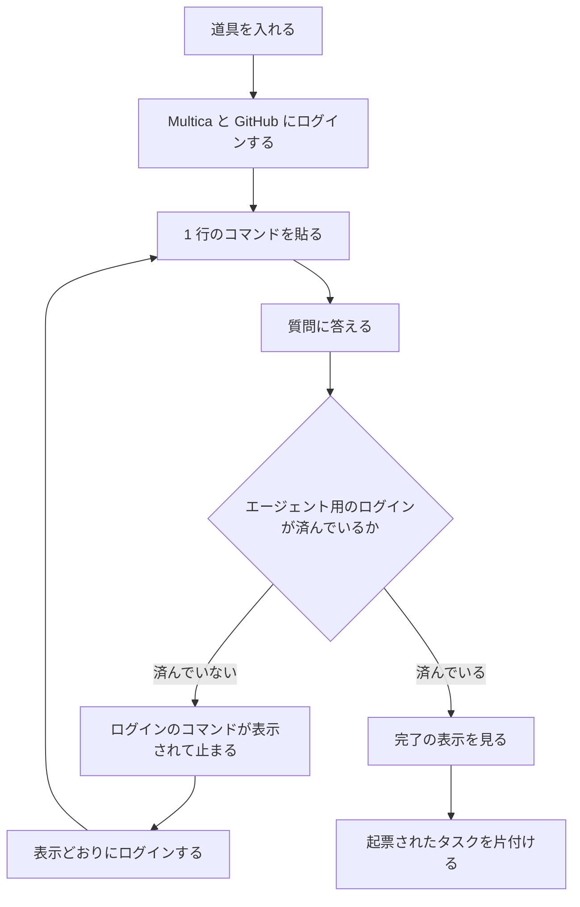

# multica-squad-kit

Multica のスクワッドを、プロジェクトごとに導入して更新するための原本である。`bash setup.sh` で質問に答えると、役ごとのエージェントとスクワッド、オートパイロットと共通スキル、ホストの関所と見張りがそろう。

## 必要なもの

導入する人のアカウントに、次の環境と道具、連携先がそろっている必要がある。

- macOS か Linux（WSL 2 を含む）の環境
- `multica`・`jq`・`gh`・Python 3.11 以上・Git などの標準の道具
- エージェントのランタイムとして、`claude`（Claude Code）と `codex` の一方または両方
- 導入先の Multica のワークスペースと、そこで GitHub 連携を許可したプロジェクトのリポジトリ

詳しい条件と Linux での入れ方は [受け取る人の準備](manual.md#受け取る人の準備) にある。

## クイックスタート

1 行のコマンドでセットアップを流し、質問に答えて導入する。人間に残る作業は、対象のプロジェクトにタスクとして起票される。

次の図は、道具のログインから完了の表示までの流れと、エージェント用のログインで止まったときの流し直しを示す。



1. 道具を入れて、Multica と GitHub にログインする。Claude Code と Codex は、利用する組織の手順で入れる

   次は macOS の例である。

   ```bash
   brew install multica-ai/tap/multica jq gh python
   multica login
   gh auth login
   ```

2. 次の 1 行のコマンドを貼って、セットアップを流す

   ```bash
   curl -fsSL https://github.com/drecom/multica-squad-kit/releases/latest/download/install.sh | bash
   ```

   コマンドは、最新の [Release](https://github.com/drecom/multica-squad-kit/releases) の入口のスクリプトを取ってきて流す。入口は、最新のバージョンを読んで画面に出し、配布物の取得・検証・展開・セットアップまでを行う。途中のどこかで失敗したら、その先は流れない。

   macOS の zsh と Linux の bash のどちらに貼っても同じに動く。`gh` は 2.102.0 以上が必要で、ログインも済ませておく。Ubuntu の標準の apt の `gh` は古いので、入れ方は [受け取る人の準備](manual.md#受け取る人の準備) を参照する。

   特定のバージョンを入れるときは、末尾を `| bash -s -- v1.0.0` にする。プロジェクトの拡張を使うときは、`| bash -s -- --extension <拡張のディレクトリ>` にする。両方を使うときは、`| bash -s -- v1.0.0 --extension <拡張のディレクトリ>` にする。

   質問には、端末から答える。端末のない環境では、何も取らずに止まるので、入口のスクリプトをファイルに取ってから `bash install.sh` で流す。入口のスクリプトを置いた一時のディレクトリは、入口が消す。

   この 1 行は、入口のスクリプト自身を検証せずに流す。入口まで検証したいときは、後の「手動の手順」を使う。

3. 質問に答える。最初の拡張のディレクトリは、使わなければ Enter で進める

   ワークスペースは番号で選び、ほかは既定値でよければ Enter で進める。最後の確認で、作るものと直すものの一覧を見て `yes` と答える。各質問の意味は [質問への答え方](manual.md#質問への答え方) にある。

4. エージェント用のログインが済んでいないと、セットアップは止まってログインのコマンドを表示する。表示どおりにログインして、同じコマンドを流し直す
5. 完了の表示で、導入の確認の結果と起票したタスクを見る。起票された「プロジェクトの説明と検証スキルを記入する」と「スクワッドの動きを試す」を先に片付ける

   終わったら「OWNER/REPO に AGENTS.md と作業別のルールを置く」を todo にしてスクワッドへ渡す。

完了の表示と起票されるタスクの一覧は [導入後に自動で行うことと、起票するタスク](manual.md#導入後に自動で行うことと起票するタスク) にある。

## 更新する

クイックスタートの 1 行のコマンドを、もう一度流す。最新のバージョンを読んで入れるので、バージョンを選ぶ必要はない。

前回の答えが既定になるので、ワークスペースの番号のほかは Enter で進められる。途中で止まったときも、直してから同じコマンドを流し直す。

新しいバージョンの通知を受けるには、GitHub でこのリポジトリの Watch を「Custom」の「Releases」にする。詳しくは [更新と、途中で止まったあとの再実行](manual.md#更新と途中で止まったあとの再実行) を参照する。

ZIP で導入済みの場合は、人がその関所・見張り・シェル設定と、対象プロジェクトの保存済み回答を消してから入れ直す。回答の既定の保存先は `~/.multica-agent/template/answers/<workspace-id>/<project-key>.json` である。

対象の確認と手順は [導入済みの配布物を入れ直す](manual.md#導入済みの配布物を入れ直す) を参照する。

## 手動の手順

1 行のコマンドを流す前に中身を見たいときと、入口のスクリプトを使いたくないときは、次の手順を 1 つずつ流す。入口のスクリプトと同じ検証を、人が行う手順である。

どの手順も、前の手順で取ってきたファイルをそのまま使い、取り直さない。読んだファイルと流すファイルが同じになる。

先に次のコマンドを流して、`gh` が 2.102.0 以上であることを確認する。続く手順は、同じシェルで順に流す。

```bash
gh --version
```

1. 使うバージョンと、取ってくる置き場を決める。特定のバージョンを入れるときは、`V=` にタグを書く（例: `V=v1.0.0`）

   ```bash
   V=$(gh release view --repo drecom/multica-squad-kit --json tagName --jq .tagName)
   D=$(mktemp -d)
   echo "使うバージョン: $V"
   ```

2. 配布物と `SHA256SUMS` を取ってくる

   ```bash
   gh release download "$V" --repo drecom/multica-squad-kit --pattern "multica-squad-kit-$V.tar.gz" --pattern SHA256SUMS --dir "$D"
   ```

3. `SHA256SUMS` と配布物の証明を検証する。どちらも、4 つの指定をそろえて流す

   ```bash
   gh attestation verify "$D/SHA256SUMS" --repo drecom/multica-squad-kit --signer-workflow drecom/multica-squad-kit/.github/workflows/release-assets.yml --source-ref "refs/tags/$V" --deny-self-hosted-runners
   gh attestation verify "$D/multica-squad-kit-$V.tar.gz" --repo drecom/multica-squad-kit --signer-workflow drecom/multica-squad-kit/.github/workflows/release-assets.yml --source-ref "refs/tags/$V" --deny-self-hosted-runners
   ```

4. 配布物のチェックサムを、`SHA256SUMS` の配布物の行と照合する。`OK` と出れば合っている

   ```bash
   (cd "$D" && grep " multica-squad-kit-$V.tar.gz\$" SHA256SUMS | shasum -a 256 -c -)
   ```

5. 配布物の一覧を出し、`multica-squad-kit-<バージョン>/` の下のファイルとディレクトリだけであることを目で確認する

   ```bash
   tar -tvzf "$D/multica-squad-kit-$V.tar.gz"
   ```

6. 新しい空のディレクトリを作って、展開する

   ```bash
   W=$(mktemp -d)
   tar -xzf "$D/multica-squad-kit-$V.tar.gz" -C "$W"
   ```

7. 展開した `setup.sh` と、気になるファイルを読む

   ```bash
   less "$W/multica-squad-kit-$V/setup.sh"
   ```

8. 読んだのと同じ `setup.sh` を流す。プロジェクトの拡張を使うときは、末尾に `--extension <拡張のディレクトリ>` を足す

   ```bash
   bash "$W/multica-squad-kit-$V/setup.sh"
   ```

どれかが失敗したら、そこで止めて、その先は流さない。取り直すときは、手順 1 からやり直して、新しい置き場に取ってくる。

## 対応する範囲

対応するのは、macOS と Linux（WSL 2 を含む）、標準の bash・zsh、GitHub と日本語での利用である。ランタイムは、Claude Code と Codex の一方または両方に対応する。WSL 1、WSL を使わない Windows、英語、GitHub 以外は対象外である。

Webhook は既定では使わず、Dependabot の PR は週次のスケジュールだけで扱う。Dependabot の役を残して Webhook を使うと答えたときだけ、セットアップが Webhook を登録して配信を確認する。

自動テストで確認する範囲と、人が実機で確認する範囲は [テストで確認する範囲](CONTRIBUTING.md#テストで確認する範囲) にある。

### 防げることと残るリスク

公開したあとの配布物と入口のスクリプトの差し替えは、GitHub の不変の Release と `v*` のタグの設定で防ぐ。入口が行う配布物の検証では、次のことを防ぐ。

- Release の外で作った配布物を紛れ込ませること
- 取得の途中で書き換えること
- 別のリポジトリやワークフローで作ったものを通すこと

展開の前の検証で、展開先の外へ書かせることも防ぐ。

次のリスクは残る。

- 1 行のコマンドは、入口のスクリプト自身を検証せずに流す。信頼するのは HTTPS と GitHub の Release までで、入口まで検証したいときは手動の手順を使う
- 公開や管理の権限を取られたときは防げない。新しいバージョンを公開されると、最新を読む 1 行のコマンドがそれを流す
- 発行のワークフローを書き換えられたときも防げない。証明は、決まったワークフローで作ったことを示すだけである
- 不変の Release を有効にする前に公開したバージョンと、公開の前の下書きは守れない。設定は、最初のバージョンを出す前に行う
- 公開の前に中身を読み落とすこと。手動の手順で中身を読めるが、読む人の判断に任せる
- セットアップは、流した人の普段の権限で動くこと。エージェントは、ホームの SSH の鍵や普段の `gh` の認証を読める

鍵を分けたいときは、次の「閉じ込めて動かす」の VM の手順を使う。

### 閉じ込めて動かす

普段のユーザーでセットアップすると、エージェントはそのユーザーで動くので、ホームの SSH の鍵や、普段の `gh` と Git の認証も読める。これを避けたいときは、軽い VM を作って、その中でクイックスタートを流す。

VM はホームを共有しないので、中のエージェントはホストのファイルを読めない。VM を消せば、ホストはセットアップの前に戻る。ネットワークは閉じ込めない。

割くリソースの目安は、CPU 4、メモリ 8 GiB、ディスク 100 GiB である。Mac は Lima 1.0.0 以上、Windows は WSL 2.6.1 以上を使い、手動の手順の 1 から 6 で展開した `multica-squad-kit-<バージョン>` のディレクトリに移って、次を流す。

```bash
bash vm/lima.sh create
```

```powershell
powershell -ExecutionPolicy Bypass -File vm\wsl.ps1 create
```

中への入り方、止め方・消し方は [閉じ込めて動かす](manual.md#閉じ込めて動かす) に、設計は [docs/vm.md](docs/vm.md) にある。

## 次に読むもの

読む人ごとに、次の文書を読む。

| 読む人 | 文書 |
| --- | --- |
| 導入・更新する人 | [導入と更新](manual.md)。準備から、質問の答え方、起票されるタスク、止まったときまで |
| 導入したプロジェクトの担当 | [プロジェクトごとの指示の書き方](skeleton/README.md)。起票されたタスクで記入するひな形 |
| プロジェクトの拡張を作る人 | [拡張の形式](EXTENSIONS.md) |
| この原本を変える人 | [変更の進め方](CONTRIBUTING.md)。設計の理由は [docs/](docs/) |
| この原本の文書を書く人 | [文書の書き方](STYLE.md) |
| 変更点を知りたい人 | [CHANGELOG.md](CHANGELOG.md) |
