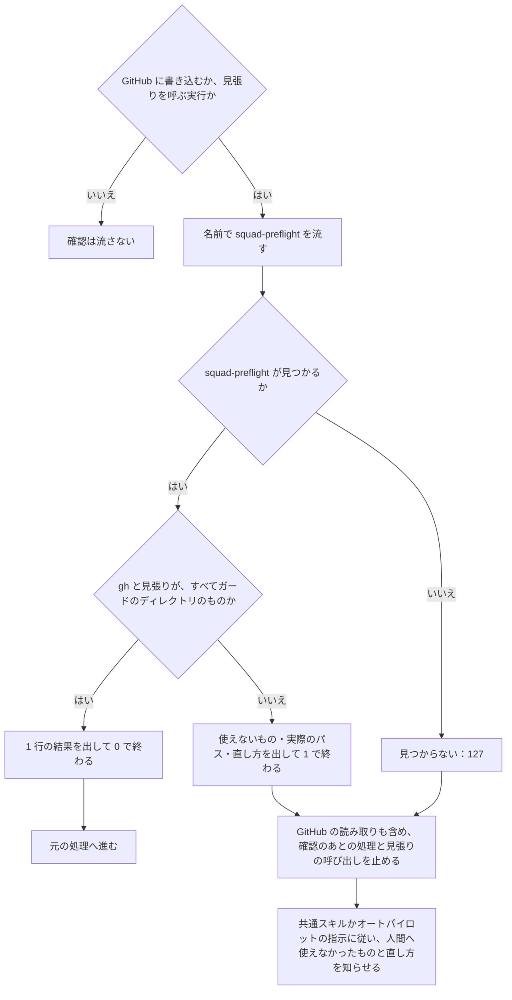

# エージェントの実行でガードと見張りを PATH から選ぶ

ガードは、エージェントの実行で、許可していないリポジトリへの `gh` の書き込みと `git push` を止める仕組みである。エージェントの実行のシェルで、`gh` がガードに解決し、見張りのスクリプトを名前で呼べるようにする。デーモンの起動のしかたや、ランタイムが PATH を組み替えるかどうかによらず、そうなるようにする。あわせて、ガードか見張りが使えない実行は、始めの確認で止まり、人間を呼ぶ。

この文書は、原本を変える人に向けて、その仕組みと理由を書く。使う人への手順は `manual.md` に、テストの範囲とバージョンを出す前の確認は `CONTRIBUTING.md` に書く。

## 目的と範囲

ガードのディレクトリ（`~/.multica-agent/bin`）を PATH の先頭に置くのは、セットアップが起動したデーモンの環境と、プロジェクトのシェル起動ファイルの 2 つである。この 2 つは、次のときに崩れる。崩れると、エージェントの `gh` は本物の `gh` になってガードを通らず、見張りは名前で見つからない。

- デーモンをセットアップの外で起動した。`multica daemon start` を手で流した、ログインの PATH のまま起動し直したなど
- ランタイムが、起動ファイルのあとで PATH を上書きした。Claude Code のシェルのスナップショットがこれに当たる

ここでは、PATH の直し方を Claude と Codex のそれぞれで決め、ガードと見張りを使う実行の始めに確認を置く。どちらもセットアップの流し直しで反映する。次は対象にしない。

- 見張りや `gh` を絶対パスで呼ぶように、指示を変えること。名前で呼ぶ指示と、ガードを迂回しない決まりを保つ
- デーモンを誰が起動し直したかを突き止めること
- `git push` のガード（`pre-push`）を変えること。Git の設定の環境変数で効くので、PATH に頼らない
- セットアップの外で起動したデーモンで、Codex のログインと設定がエージェント用に分かれないこと。これはデーモンの `CODEX_HOME` に頼り、セットアップの確認（`daemon_has_agent_env`）で直す

## 崩れる仕組み

Claude Code は、Bash の道具のコマンドごとに `zsh -c` を起動する。zsh は `$ZDOTDIR/.zshenv` を読んでガードを先頭に置くが、そのあとで Claude Code がシェルのスナップショットを読み込む。スナップショットは、セッションの始めに読み取った PATH を `export PATH=...` で書き戻すので、ガードを外した PATH に戻る。デーモンの PATH にガードがなければ、スナップショットにも入らない。

Codex は、シェルのスナップショットの機能（`shell_snapshot`）を既定で使う。スナップショットは、利用者のログインシェルを対話で起動して読み取り、コマンドの前に PATH ごと書き戻す。

Codex が使うシェルは `$SHELL` ではなく、OS の利用者の情報のシェルである。Ubuntu では bash になり、ログインの bash は `BASH_ENV` も `ZDOTDIR` も読まないので、ガードが入らない。macOS の zsh でも、`/etc/zprofile` の `path_helper` が PATH を並べ替える。

Codex のログインシェルを止める `allow_login_shell = false` は、エージェント用の `CODEX_HOME` の設定にある。Multica はタスクごとの `CODEX_HOME` を、デーモンの `CODEX_HOME` から作り、なければ利用者の `~/.codex` から作る。セットアップの外で起動したデーモンでは、この設定が効かない。

Multica は、エージェントの環境変数（custom_env）のうち、`PATH`・`HOME`・`SHELL`・`CODEX_HOME` などを受け付けない。そのため、custom_env で PATH を直接渡す方法は使えない。

## PATH の直し方

Claude と Codex のどちらも、エージェントごとの設定で直す。エージェントの設定はセットアップが Multica に書き、デーモンの起動のしかたに左右されない。

| ランタイム | 直し方 | 効く理由 |
| --- | --- | --- |
| Claude | custom_env の `CLAUDE_ENV_FILE` が、プロジェクトのシェル起動ファイル `env.sh` を指す | Claude Code は、コマンドごとに、スナップショットのあとでこのファイルを読む |
| Codex | エージェントの custom_args に `-c allow_login_shell=false` と `-c features.shell_snapshot=false` を置く | ログインシェルとスナップショットを使わなくなり、起動ファイルの `.zshenv` か `BASH_ENV` が最後に PATH を決める |

### Claude

Claude のモデルの役の custom_env は、`CLAUDE_ENV_FILE=<プロジェクトのシェルのディレクトリ>/env.sh` を持つ。`CLAUDE_CODE_SHELL` と同じく、Claude のモデルの役にだけ付く。

Claude Code は、Bash の道具のコマンドを、スナップショットの読み込み・`CLAUDE_ENV_FILE` の内容・コマンドの順に組み立てる。`env.sh` はガードのディレクトリが先頭になければ先頭に置くので、スナップショットが PATH を書き戻したあとでも、ガードが先頭になる。`env.sh` は POSIX のシェルの書き方だけを使うので、zsh でも bash でも読める。

専用のファイルは持たず、`env.sh` を使う。中身が同じで、セットアップの確認（`host_check_guards`）が、すでに `env.sh` の動きを確認しているため。マークのない既存の `env.sh` を残すときも、この扱いにする。

Claude Code は、`CLAUDE_ENV_FILE` の内容をセッションごとに覚える。`env.sh` の中身は実行の途中で変わらないので、困らない。サンドボックスで認証情報の環境変数を消す設定のときは読まないが、エージェントはこの設定を使わない。

### Codex

Codex のモデルの役の custom_args は、次の 2 組を持つ。Multica は custom_args を `codex app-server` にそのまま渡し、`-c` の上書きはタスクごとの `config.toml` より優先する。

- `-c allow_login_shell=false`。Codex が `config.toml` を利用者の `~/.codex` から作ったときも、ログインシェルを使わない
- `-c features.shell_snapshot=false`。スナップショットを読み取らず、書き戻さない

この 2 つで、Codex のコマンドは非ログインの `zsh -c` か `bash -c` で動く。zsh は custom_env の `ZDOTDIR` の `.zshenv` を、bash は `BASH_ENV` の `env.sh` を読み、ガードを先頭に置く。OS の利用者のシェルが zsh でも bash でも、同じになる。

スナップショットを止めると、利用者の別名と関数はエージェントのコマンドに入らない。エージェントには不要で、ガードを迂回する別名も入らなくなる。

`common/codex/config.toml` の `allow_login_shell = false` と、それを確認するセットアップの処理もある。セットアップが起動したデーモンでは、両方が同じ値になる。

### custom_args の合わせ方

セットアップは、custom_env と同じ考えで、custom_args もセットアップが持つ値だけを合わせる。

- 今の custom_args を読み、`allow_login_shell` と `features.shell_snapshot` を上書きする `-c` と `--config` の組を除く。`-c key=value` の 2 語と、`--config=key=value` の 1 語の形を、どちらも除く
- スナップショットを有効にする `--enable shell_snapshot` と `--enable=shell_snapshot` も除く。ほかの機能の有効化は残す
- Codex のモデルの役には、除いたあとに 2 組を足す。Claude のモデルの役には足さない
- ほかの引数は、順も含めて残す。結果が変わらなければ書かない
- エージェントを作るときも、同じ値を渡す

使うランタイムを変えて、役が Claude から Codex に移るときは足し、Codex から Claude に移るときは除く。custom_env の `CLAUDE_ENV_FILE` も、Claude の変数と同じく、合わせる前に除いてから付け直す。

## 実行の始めの確認

ガードか見張りを使う実行は、ほかの処理より先に `squad-preflight` を流す。確認が通らなければ、GitHub への書き込みも見張りの呼び出しもせずに止まり、人間を呼ぶ。PATH の直し方が効かない構成や、見張りの欠けを、書き込みの前に見つけるため。

確認を流す実行の判定と、通らなかったときの止まり方を、次の図に示す。

### 確認するもの

`squad-preflight` は、ほかの見張りと同じく `common/monitor/` に置き、セットアップがガードのディレクトリに置く。タスクの ID を任意の引数に取り、自分が置かれたディレクトリをガードのディレクトリとして、次を確認する。

1. `command -v gh` が、ガードのディレクトリの `gh` である
2. セットアップが置く見張り（`squad-` で始まる、`squad-preflight` を除くもの）のそれぞれで、`command -v` がガードのディレクトリのそのファイルを返す
3. 1 と 2 が通ったあとに、Multica CLI の読み取り（`squad-list`・`agent-get`。タスクの ID があれば、タスクのコメントなども）が使える

確認する見張りの一覧は、`squad-preflight` の中に書く。テストで `common/monitor/` のファイルと照らし合わせ、見張りを足したときの書き忘れを防ぐ。

確認の入口には POSIX sh を使う。Bash の起動時に `BASH_ENV` が PATH を直す影響を受けず、呼び出し元から渡された PATH をそのまま判定するため。

すべて通れば、1 行の結果を出して 0 で終わる。どれかが通らなければ、通らなかったものごとに、使えないもの・実際に解決したパス（なければ「見つからない」）・直し方を出し、1 で終わる。

`squad-preflight` は名前で呼ぶ。ガードのディレクトリが PATH にないときは、シェルが「コマンドが見つからない」で 127 を返す。これも通らなかったと扱う。絶対パスで呼ばないのは、ガードを迂回しない決まりと揃え、PATH の崩れそのものを確認で見つけるため。

### 直し方の案内

通らなかったものごとに、セットアップの流し直しか設定の確認を案内する。

| 通らなかったもの | 案内する直し方 |
| --- | --- |
| `squad-preflight` が見つからない | ガードのディレクトリが PATH にない。動いているタスクがないときに、同じプロジェクトでセットアップを流し直す |
| `gh` がガードでない | 実行のシェルがガードより先に別の `gh` を選んでいるので、同じくセットアップを流し直す。直らなければ、エージェントの custom_env の `CLAUDE_ENV_FILE`（Claude）か custom_args（Codex）を確認する |
| 見張りが見つからない、ガードのディレクトリのものでない | 見張りが欠けたか、別の同じ名前のものが先にある。同じくセットアップを流し直して、見張りを置き直す |

案内は `squad-preflight` の出力に書き、見つからないときの案内は共通スキルに書く。人間を呼ぶ報告には、出力をそのまま添える。

### 置き場所と対象の役

確認の手順は、共通スキル squad-handoff の節に書く。GitHub に書き込む、または `squad-` の見張りを呼ぶ実行は、その最初にこの節に従う。要件を決める役のように、どちらもしない実行では流さない。

役の指示では、見張りを呼ぶ役に、確認を先に流すことを書く。

| 役 | 指示に書くこと |
| --- | --- |
| リーダー | 「受け取ったら確認すること」の先頭で、squad-handoff の確認の節に従う。返事を待つ処理の分かれ道より先に流す |
| CI の見張り、Dependabot のマージ、使用上限の見張り | 共通スキルを持たないので、見張りを呼ぶ前に `squad-preflight` を流し、通らなければ止まって呼ぶ人間に知らせることを、指示に直接書く |

ほかの役（設計・実装・修正・レビュー・QA）は、共通スキルの節で確認する。共通スキルの更新を飛ばしたプロジェクトでは、更新するまで、これらの役は確認を流さない。PATH の直し方そのものは、役の指示と同じくセットアップで反映する。

### 止まるときの扱い

確認が通らなかった実行は、次のとおりにする。

1. 確認のあとの処理は、GitHub の読み取りも含めて流さない。見張りも呼ばない
2. squad-handoff の「人間を呼んで止まるとき」に従い、呼ぶ人間をメンションしてタスクを `in_review` にする
3. コメントに、使えなかったものと直し方を書く。`squad-preflight` の出力があれば、そのまま添える

Multica へのコメントと状態の変更は、`multica` の CLI で行い、ガードを通らないので、確認が通らなくても行える。

タスクのない見張り（オートパイロットの実行）は、オートパイロットの指示の報告のしかたで、呼ぶ人間に知らせる。

## セットアップの流し直しで反映する

同じプロジェクトでセットアップを流し直すと、次が反映される。既存の導入先に、手で足すものはない。

- `squad-preflight` を、ほかの見張りと同じくガードのディレクトリに置く
- 各役の custom_env と custom_args を、上のとおり合わせる
- 役の指示と共通スキルを更新する

custom_env と custom_args は、エージェントの次の実行から効く。デーモンを起動し直す必要はない。

## テストと実機の確認

受け入れ条件のうち、仕組みの判定はスタブを使う自動テストで、実際のランタイムの動きは人が実機で確認する。

| テスト | 確認すること |
| --- | --- |
| `tests/squad-preflight-test.sh` | すべて使えるとき 0 で終わること。`gh` がガードより後ろのとき、見張りが 1 つ欠けたときに、使えないものと直し方を出して 1 で終わること |
| `tests/shell-test.sh` | Claude Code のコマンドの組み立てをまねて、ガードのない PATH を書き戻すスナップショットのあとに `env.sh` を読むと、`gh` がガードに、見張りが名前で解決すること。zsh と bash の両方 |
| `tests/project-create-test.sh`・`tests/project-runtimes-test.sh` | Claude のモデルの役にだけ `CLAUDE_ENV_FILE` が付くこと。Codex のモデルの役にだけ custom_args の 2 組が付き、ほかの引数を残すこと |
| `tests/agent-templates-test.sh` | リーダーと 3 つの見張りの指示、共通スキルに、確認の手順があること |

`tests/squad-preflight-test.sh` は、確認する見張りの一覧を `common/monitor/` と照らし合わせる。

`tests/project-create-test.sh` と `tests/project-runtimes-test.sh` は、既存の上書きを除いて重ねないことも確認する。ランタイムを変えたときに付け外しすることと、流し直しで変わらなければ書かないことも確認する。

実機では、認証済みのデーモンとランタイムで、次を確認する。スタブでは、Claude Code と Codex の実際のコマンドの組み立てを確認しきれないため。

1. ガードのない PATH で、`multica daemon start` をセットアップの外で流す。Claude と Codex の役の実行で、`command -v gh` がガードに解決し、`squad-dispatch-pick`・`squad-pr-watch`・`squad-review-wait` が名前で解決する
2. セットアップが起動したデーモンで、1 と同じ結果になる
3. 見張りを 1 つ外したホストで、リーダーの実行が書き込みと見張りの呼び出しをせずに止まる。人間を呼び、使えないものと直し方を書く
4. 既存の導入先で、同じプロジェクトのセットアップを流し直したあと、1 から 3 が成り立つ

マージの前に人が 1 から 4 を確認し、結果を PR に書く。バージョンを出す前の VM の確認でも 1 を確認する。

## 検討した案

PATH はエージェントごとの設定で直し、ガードと見張りを使う実行の始めに確認する。デーモンの起動のしかたに左右されないようにするためである。

| 案 | 選ばなかった理由 |
| --- | --- |
| 指示で、見張りと `gh` を絶対パスで呼ぶ | 依頼の対象外。`gh` を名前で呼ぶ道具や見張りの中の `gh` は、ガードを通らないまま残る |
| custom_env で `PATH` か `CODEX_HOME` を渡す | Multica が受け付けない |
| ZDOTDIR に `.zprofile` と `.zlogin` を置き、ログインの zsh でもガードを先頭に戻す | ログインの bash（Ubuntu の Codex）に効かない。Claude のスナップショットにも効かない |
| Claude Code のスナップショットを止める | 止める設定が公開されていない。`CLAUDE_ENV_FILE` で足りる |
| 実行の始めの確認を、指示の中のシェルの 1 行にする | 確認する見張りの一覧と直し方が役の指示ごとに散り、テストで照らし合わせにくい |
| 確認を、セットアップのデーモンの確認だけで済ませる | セットアップの外でデーモンを起動し直したあとは流れない |
| デーモンをセットアップの外で起動できないようにする | Multica の CLI の起動を止められない。起動のしかたによらずに直すほうが確か |
