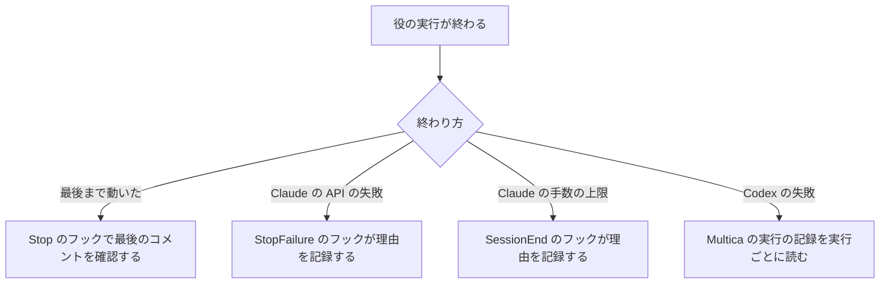

# 役の実行の上限と止まった理由の記録

無人の役の実行が、上限なしに続いたり、理由を残さずに終わったりしないようにする。手数の上限、止まった理由の記録、ログインの期限の見張りを足す。

この文書は、原本を変える人に向けて、決めたことと理由と実機の結果を書く。使う人への手順は `manual.md` に書く。

## 目的と範囲

Multica の役の実行には、時間の上限がない。使用上限や認証の失敗で終わった理由は、Multica のタスクの自由な文にしか残らない。ログインが切れると、その系統の役はすべて失敗し、人は失敗の通知で初めて気づく。

ここでは、セットアップの流し直しで次のものを入れる。再試行と出力の長さは既定のままにし、コマンドの時間切れだけ既定を変える。

| 入れるもの | 置き場 | 効く範囲 |
| --- | --- | --- |
| 手数の上限（`CLAUDE_CODE_MAX_TURNS`） | Claude のモデルの役の custom_env | 流し直したプロジェクトの役だけ |
| コマンドの時間切れの既定（`BASH_DEFAULT_TIMEOUT_MS`） | Claude のモデルの役の custom_env | 流し直したプロジェクトの役だけ |
| 止まった理由を記録する 3 つのフック | 共有の `settings.json` のキットの項目 | 同じホストのすべてのプロジェクトの Claude の役 |
| Claude Code の最低のバージョンの確認 | セットアップの道具の確認 | Claude を使うセットアップ |
| ログインの行 | 使用上限の見張り（`squad-usage-check`） | 流し直したプロジェクトの見張り |

役の実行の終わり方ごとに、理由が残る場所は次のとおりになる。Codex には失敗を受けるフックがないので、Multica の実行の記録で読む。



## 再試行と時間切れと出力の長さ

コマンドの時間切れの既定だけを書き、ほかは既定に上限があるので書かない。値を書くと、Claude Code と Codex の既定の見直しを受けなくなるためである。

| 項目 | 既定（このホストで確認） | 扱い |
| --- | --- | --- |
| `CLAUDE_CODE_MAX_RETRIES` | 10 回。15 回で頭打ちになる | 書かない |
| `API_TIMEOUT_MS` | 600000（10 分） | 書かない |
| `BASH_DEFAULT_TIMEOUT_MS` | 120000（2 分） | 600000 を書く |
| `BASH_MAX_TIMEOUT_MS` | 600000（10 分） | 書かない |
| `BASH_MAX_OUTPUT_LENGTH` | 文脈に入る量には効かず、読み返す範囲だけを決める | 書かない |
| 設定の `bashOutputMaxChars` | 30000 字。4000 から 128000 の間に収める | 書かない |
| Codex の再試行と流れの時間切れ | ChatGPT のログインでは上書きを受け付けない。既定で 5 回つなぎ直す | 書けない |
| Codex のコマンドの時間切れ | 呼ぶたびにモデルが決める。既定を変えるキーは見つからなかった | 書けない。役の指示の決まりで受ける |
| Codex の `tool_output_token_limit`・`background_terminal_max_timeout` | 上書きを受け付ける。時間の既定は 300000 | 書かない |

共通スキルの `review-reply.md` は、コマンドの時間切れを 600 秒以上にすると決めている。今は役が呼ぶたびに守る必要があり、忘れると 2 分で切れる。既定を 600000 にすれば、呼び方によらず決まりを満たす。

600000 は `BASH_MAX_TIMEOUT_MS` の既定と同じで、上限の内にある。付け外しは手数の上限と同じにする（[値の付け外し](#値の付け外し)）。

`BASH_MAX_OUTPUT_LENGTH` は、棚卸しでは出力の長さの上限としていた。今のバージョンでは、文脈に入る長さを決めるのは設定の `bashOutputMaxChars` である。

## 手数の上限

Claude のモデルの役の custom_env に `CLAUDE_CODE_MAX_TURNS` を付け、1 回の実行のターンの数に上限を置く。既定には上限がなく、抜けられない繰り返しが使用上限まで続くためである。

| 役 | 値 | 理由 |
| --- | --- | --- |
| 使用上限の見張り・CI の見張り・Dependabot のマージ | 300 | 決まった手順だけを動かす。観測した最大の 3 倍ほどにする |
| ほかの Claude のモデルの役 | 2500 | 長い実行を切らない。観測した最大の 2 倍ほどにする |

値は、このホストの Multica の記録にある、役ごとの道具の呼び出しの数から決めた（[要確認の項目](#要確認の項目)）。1 ターンで道具を並べて呼べるので、ターンの数は道具の呼び出しの数を超えない見込みである。Dependabot のマージは記録がないので、流し直しのあとに実機で確認する。

### 値の付け外し

今の `CLAUDE_CONFIG_DIR` などと同じく、Claude のモデルの役にだけ付け、流し直しで付け外しする。`CLAUDE_CODE_MAX_TURNS` と `BASH_DEFAULT_TIMEOUT_MS` を、付け外しする変数の一覧に足す。

人が上げた値は、流し直しで残す。流し直す前の custom_env の値が、キットの値より大きい正の整数なら、その値を書く。そうでなければキットの値を書く。

ランタイムを Codex に替えた役からは、人が上げた値も外す。Codex は 2 つの変数を読まないためである。

### 上限に達したとき

上限に達した実行は、`error_max_turns` の結果と終了コード 1 で終わる。Stop のフックは届かないので、最後のコメントの確認は流れない。

最後のコメントがないまま、実行は失敗で終わる。Multica は失敗の通知を受信箱に送る見込みで、流し直しのあとに人が確認する（[テストと実機の確認](#テストと実機の確認)）。理由は、次の節の記録に `max_turns` で残る。

## 止まった理由の記録

Claude の役の実行が API の失敗か手数の上限で終わったとき、理由を 1 行の JSON で状態の置き場に残す。Multica の記録は自由な文で、理由の種類で探せないためである。

| 終わり方 | 届くフック | 記録する理由 |
| --- | --- | --- |
| 使用上限・認証・過負荷などの API の失敗 | StopFailure | 入力の `error` の値 |
| 手数の上限 | SessionEnd だけ。SessionStart で始めの長さを残す | `max_turns` |
| 最後まで動いた | Stop | 記録しない |
| Codex の失敗 | なし | 記録しない。[Codex の止まった理由](#codex-の止まった理由)のとおりに読む |

StopFailure・SessionStart・SessionEnd の 3 つのフックは、今の PreToolUse と Stop と同じく扱う。共有の `settings.json` にキットの項目として書く。スクリプトはガードの置き場に写す。`MULTICA_TASK_ID` がない実行では、何もせずに終わる。

3 つのフックの項目には、`timeout` を 10 秒で書く。SessionEnd の時間切れの既定は 1.5 秒と短く、遅いディスクで記録が切れうるためである。規模と許容時間は、`agent-guards.md` の[想定する規模と許容時間](agent-guards.md#想定する規模と許容時間)に置く。

### 記録の形

記録は、状態の置き場の `run-stops/<年>-<月>.jsonl` に 1 行ずつ足す。状態の置き場は、Stop のガードと同じく `SQUAD_KIT_STATE_DIR`、なければガードの置き場の `state/` である。

| 欄 | 値 |
| --- | --- |
| `time` | 記録した時刻（UTC） |
| `task` | `MULTICA_TASK_ID` |
| `agent` | `MULTICA_AGENT_ID`。ないときは空 |
| `session` | 入力の `session_id` |
| `reason` | 下の表の値 |
| `source` | `claude` |

`reason` は、StopFailure の `error` の 13 の値と `max_turns` のどれかにする。知らない値は `unknown` にする。13 の値は次のとおりである。

| 種類 | 値 |
| --- | --- |
| 認証とアカウント | `authentication_failed`・`oauth_org_not_allowed`・`account_on_hold`・`verification_required`・`cloud_credential_error` |
| 使用上限と課金 | `rate_limit`・`billing_error` |
| サービスの状態 | `overloaded`・`server_error` |
| 依頼の誤り | `invalid_request`・`model_not_found`・`max_output_tokens` |
| そのほか | `unknown` |

入力の `last_assistant_message` は、モデルの出力で、作業先の内容を含みうるので書かない。置き場は権限 700、ファイルは 600 にし、1 行を 1 回の書き込みで足す。

状態の置き場から記録と始めの長さのファイルまで、フックが開くものには次の規則を当てる。ここに名前を挙げていないディレクトリとファイルにも当てる。パスの各部分は、シンボリックリンクをたどらずに、確認した親のディレクトリを起点に開く。

状態の置き場そのものは、パスの最後の部分だけをたどらずに開き、その親より上は確認しない。macOS では `/tmp` と `/var` がリンクなので、親より上まで確認すると置き場を使えないためである。

開いたディレクトリは、フックを動かす利用者の持ち物で、グループと他人に権限がないときだけ使う。ファイルは、それに加えて通常のファイルで、リンクの数が 1 のときだけ使う。ないものは権限 700 か 600 で作り、ほかの実行が先に作っていたら開き直して同じく確認する。

合わないときは、読まず書かずに 0 で終わる。役の子プロセスが置いたシンボリックリンクやハードリンクを通して、置き場の外に書かないためである。

書けないときは、何も出さずに 0 で終わる。StopFailure では、フックの出力と終了コードは実行の結果に効かなかった。記録の失敗で、実行の終わり方を変えないためである。

### SessionEnd での手数の上限の見分け

SessionEnd の入力には、終わった理由の区別がない。上限で終わった実行の記録には、型が `max_turns_reached` の添付の行が残るので、これを読む。今回の実行で足された行だけを見るため、SessionStart のフックで実行の始めの記録の長さを残す。

SessionStart のフックは、次のとおりに始めの長さを残す。

1. 入力の `hook_event_name` が `SessionStart` で、`session_id` が UUID の形かを見る
2. `transcript_path` を、下の SessionEnd の手順 2 と同じく確認する。ファイルがまだないときは、長さを 0 とする
3. 状態の置き場の `run-stops/start/<session_id>` に、`MULTICA_TASK_ID` と、そのときのファイルの長さをバイトの数で、空白で区切った 1 行に書く。同じディレクトリの一時ファイルに書いてから名前を替え、書きかけを読ませない

SessionEnd のフックは、次のとおりに見分ける。

1. 入力の `hook_event_name` が `SessionEnd` で、`session_id` が UUID の形かを見る
2. `transcript_path` の実体が、`CLAUDE_CONFIG_DIR` の `projects` の下にあり、名前が `<session_id>.jsonl` の通常のファイルかを見る
3. `run-stops/start/<session_id>` から、タスクと始めの長さを読む。タスクが今の `MULTICA_TASK_ID` と同じで、長さが数のときだけ使う
4. ファイルの末尾の 64 KiB から、`uuid` の欄を持つ最後の行を探す
5. その行の始まりが、始めの長さより後ろにあるかを見る
6. その行が添付の型 `max_turns_reached` で、`sessionId` が入力の `session_id` と同じかを見る
7. その行の `timestamp` が、フックの時刻の 10 分前より後かを見る

すべて合うときだけ、`max_turns` で記録する。始めの長さがないか読めないときは、今回の実行との対応が取れないので記録しない。どれかが合わなければ、記録せずに 0 で終わる。

始めの長さにタスクを添えるのは、ファイルの名前が `session_id` だけで決まるためである。同じ OS の利用者のプロセスが書けるので、別のタスクの実行が残した長さでは見分けない。

SessionEnd は、合うかどうかによらず、そのセッションの始めの長さのファイルを消す。SessionStart は、7 日より古い始めの長さのファイルを消す。SessionEnd が届かずに終わった実行の分を、ためないためである。始めの長さのファイルは、記録のファイルと同じく権限 600 にする。

上限で終わった実行では、添付の行のあとに `uuid` のない管理の行だけが続いた。再開した実行の SessionStart では、`source` が `resume` で、`session_id` は前と同じだった。そのときの長さは、新しい行を足す前の長さだった。そのため、再開してすぐ終わり、新しい `uuid` の行がない実行では、前の上限を記録し直さない。

Claude Code の資料では、SessionStart は会話の圧縮のあとにも届く。始めの長さは今の長さに書き直されるが、上限の添付は圧縮よりあとに足されるので、見分けは変わらない。

### 記録の読み方

記録は、人が `manual.md` の手順で `jq` を使って読む。使用上限の見張りは読まない。実行の失敗は、Multica が通知を送るためである。

### Codex の止まった理由

Codex の役の理由は、キットの記録ではなく、Multica の実行の記録で実行ごとに読む。Codex には失敗を受けるフックがなく、認証の失敗では Stop も届かなかったためである。

Multica の実行の記録は、`multica agent tasks <役の ID> --output json` の `failure_reason` と `error` の欄に出る。失敗した実行ごとに、先に構造化した理由の `failure_reason` を読み、次の表で理由を決める。

| 理由 | `failure_reason` | このホストでの確認 |
| --- | --- | --- |
| 認証の失敗 | `agent_error.provider_auth_or_access` | Multica の記録は実機の確認 6 で確認する |
| 使用上限 | `agent_error.provider_quota_limit` | Multica の記録は実機の確認 8 で確認する |
| 起動の失敗など | ほかの値か、ない | `agent_error.process_failure` を確認した |

`failure_reason` が起動の失敗などの行のときだけ、`error` の文を手がかりに読む。`error` が `hit your usage limit` だけを含めば使用上限、`401 Unauthorized` だけを含めば認証の失敗と見込む。両方を含むか、どちらも含まなければ、起動の失敗などのままにする。`error` はツールの出力を含み、別の依頼の 401 の文が入りうるので、構造化した理由より先に読まない。

`error` に照合する文は、Codex 0.172.0 のものである。このホストの `codex exec` で、401 の文と、使用上限の 429 を返す手元のサーバーでの文を確認した。Codex の文は引用符に `’` を使うので、その後ろの `hit your usage limit` から照合する。

見張りの行とタスクは、実行の理由を決める根拠にしない。見張りの limited は定期に見た枠の状態で、個々の実行との対応がないためである。ログインの error と使用上限の limited のタスクは、同じころの別の失敗に気づく手がかりとして読む。

受け入れ条件 1 の記録は、Claude の役では理由の記録のファイルとし、Codex の役では Multica の実行の記録とする。どちらも、止まった実行ごとに理由を読める。

## ログインの見張り

使用上限の見張りに、Claude Code のログインの期限と、Codex のログインの状態の行を足す。切れる前に、見張りのタスクで担当者に知らせる。

行は、見張るランタイム（`USAGE_CHECK_RUNTIMES`）にあるツールだけに作る。使わないツールのログインを、見張りのタスクにしないためである。

見張りは、役と同じ資格の置き場で読む。見張りの役の custom_env の `CLAUDE_CONFIG_DIR` と、デーモンが渡す `CODEX_HOME` である。人のログインは読まない。

### 状態の決め方

ログインの行の状態は、ok・warn・error・確認失敗の 4 つにする。確かにログインしていないことと、確認できなかったことを分ける。

| ツール | ok | warn | error | 確認失敗 |
| --- | --- | --- | --- | --- |
| Claude Code | `loggedIn` が true で、期限まで 10 日より長いか、期限がない | 期限まで 10 日以内 | 終了コード 1 で `loggedIn` が false か、期限を過ぎた | バージョンが最低より古い、ほかの終了コード、JSON として読めない、時間切れ |
| Codex | `codex login status` が 0 | なし | 終了コード 1 で、出力が `Not logged in` | ほかの終了コード、時間切れ |

Claude Code は、`claude --version` で最低のバージョン以上かを先に見る。古いバージョンでは、期限の欄がなくても期限がないと読めないためである。

2 つの読み取りは、どちらもローカルの状態だけを見る。資格が無効になっていても、ok に見える。そのため、warn・error・確認失敗から ok に戻ったとするのは、同じ実行で同じ資格の置き場から、そのツールの使用量を読めたときだけにする。読めなければ、ログインの行は前回の状態のまま残し、コメントも done もしない。

期限の 10 日前は、`USAGE_LOGIN_WARN_DAYS` で変えられるようにする。Claude Code は期限の 3 日前から再ログインを促す。その前に、週に 1 回だけ見る人も間に合うよう、7 日を足した。

### 行とタスク

ログインの行のキーは `login:claude` と `login:codex` にする。`claude:` で始まるキーと分けるのは、表示から消えた枠を戻す処理に入れないためである。

| 状態 | 作るタスクの題 | 本文の始めの文 |
| --- | --- | --- |
| warn | `[ログイン] Claude Code のログインの期限` | 期限が近い。期限の前に、`manual.md` の手順でログインし直す |
| error | `[ログイン] Claude Code のログイン` または `[ログイン] Codex のログイン` | ログインしていない。このツールの役はすべて失敗する |
| 確認失敗 | `[ログイン] Claude Code のログインを確認できない` または Codex の同じ題 | ログインを確認できない。バージョンとログインを確認する |

状態の変化とタスクの扱いは、使用上限の行と同じ `apply` を使い、題の始めと文だけをキーで切り替える。上の条件で ok に戻ったら、「ログインし直された」とコメントして done にする。

見張りが作るタスクの題は、終わりに全角の括弧でキーを付ける。例えば `[ログイン] Claude Code のログイン（login:claude）` や `[使用上限] <枠の名前>（<キー>）` にする。キーはツールと枠と用途を分ける。使用量を取れないタスクは `<ツール>:fetch`、枠ごとの使用上限は `claude:<表示の名前>` や `codex:<枠の ID>:<分>`、ログインは `login:<ツール>` である。

今の `apply` は、warn から error に変わってもコメントしない。ok でない状態から別の ok でない状態に変わったときは、新しい状態の始めの文をコメントするよう直す。使用上限の行にも同じく効く。

ただし、limited から warn に変わったときは、今のとおり「戻った」と再実行の案内をコメントする。warn の始めの文に替えると、使用上限で失敗したタスクを再実行する案内がなくなるためである。

ok でない状態どうしで変わったときは、コメントの前に、同じタスクの題と本文を新しい状態のものに書き換える。題は上の表の新しい状態の題にキーを付けたもの、本文は作るときと同じ形で、新しい状態の始めの文から始める。期限が切れたあとも warn の題と「期限の前に」の文が残ると、開いた人が次の操作を誤るためである。前の状態からの経過は、コメントに残る。

書き換えは `multica issue update` の `--title` と `--description-file` で行い、limited から warn の変化でも行う。書き換えられなかったときも、コメントと状態の記録は続け、見張りの実行を 1 で終える。使用上限の行にも同じく効く。

書き換えられなかった行には、印 `retitle` を付ける。印のある行は、状態が変わらなくても、あとの実行で書き換えだけをやり直す。やり直す前に下の確認をし、コメントは足さない。書き換えられたら印を外す。

この書き換えだけの再試行を採る。状態は進むので、印がないと、次に状態が変わるまで古い題と本文が残るためである。

ログインが error のツールは、使用率を読まない。同じ原因で、使用量を取れないタスクが重ねてできないためである。そのツールの使用上限の行は、前回の状態のまま残す。確認失敗のツールは、使用率を読む。

### 更新する前のタスクの確認

`apply` は、状態のファイルにあるタスクにコメントし、done にする。状態のファイルは同じ OS の利用者のプロセスが書けるので、タスクを更新する前にサーバーのタスクを確認する。

1. `multica issue get <タスク> --output json` で、タスクを読む。30 秒で時間切れにし、読めないときと同じに扱う
2. `project_id` が `USAGE_CHECK_PROJECT` と同じかを見る
3. `creator_type` が `agent` で、`creator_id` が `MULTICA_AGENT_ID` と同じかを見る
4. 題が、キーの種類の始め（`[使用上限]` か `[ログイン]` と空白）で始まるかを見る
5. 題が、全角の括弧で囲んだ、いま処理しているキーで終わるかを見る

どれかが合わなければ、コメントも done もしない。状態のファイルからそのタスクを外し、外したことを stderr に書く。見張りの実行は、ラベルの失敗と同じく 1 で終える。使用上限の行にも同じく効く。

タスクを読めないときは、状態から外さずに前回のまま残す。手順 1 の時間切れを採るのは、CLI が止まると、ログインの警告を含む見張り全体が止まるためである。秒数は、テストだけが `USAGE_TASK_READ_SECONDS` で変える。

1 つの行の処理で失敗しても、ほかの行と、あとのランタイムとログインの行の処理を続ける。失敗の種類は問わず、ここに挙げていない失敗にも当てる。すべての行を処理したあと、失敗が 1 つでもあれば、見張りの実行を 1 で終える。

失敗した行は状態を進めず、同じ実行ではやり直さない。次の実行が、前回の状態からやり直す。ただし、題と本文の書き換えだけの失敗は、上の `retitle` のとおり状態を進める。

状態のファイルの行は、題にキーを付けたタスクを指すと確認したら、印 `keyed` を付けて残す。キットが作ったタスクの行と、上の確認に合った行に付ける。

印のない行にタスクがあれば、実行の始めに、状態を読む前に上の確認をする。使用量を取れないとき、ログインが error のとき、見張らないランタイムの行も含め、すべての行に当てる。合わない行は、前回の状態のまま残す決まりより先に、行ごと外す。流し直す前に作った題にキーのないタスクが、状態の変わらないあいだ残り続けないためである。

行ごと外すのは、状態を残してタスクだけを空にすると、作り直しが止まるためである。外した行のタスクは、その行の状態を読めた実行で、キーの付いた題で作り直す。ログインが error のあいだは、ログインのタスクがその代わりになる。見張らないランタイムの行も確認するのは、読むのが 1 回で、印が付けばあとは読まないためである。

この確認をした行は、同じ実行の `apply` で確認し直さない。読めない行は印を付けずに残し、次の実行で確認し直す。

手順 5 で、同じ見張りが同じプロジェクトに作った、別のキーのタスクを更新しない。照合するキーは状態のファイルのキーで、題はサーバーの値である。状態のファイルが書き換えられても、別のキーのタスクの題とは合わない。人が題を書き換えたタスクも合わず、状態から外れる。

### 写さないもの

`claude auth status --json` の出力は、メールアドレスと組織を含む。`loggedIn` と `loginExpiresAt` の 2 つの欄だけを読み、出力を stdout・stderr・タスク・状態のファイルのどれにも写さない。状態の決め方は `authMethod` を使わないので、読まない。使わない欄を読まないほうが、写す恐れも減るためである。

タスクの本文には、期限の日付と残りの日数、終了コード、Claude Code のバージョンと最低のバージョンだけを書く。バージョンは `claude --version` から読み、個人の情報を含まない。確認失敗の文はバージョンの確認を頼むので、人が上げる先を知るのに要るためである。

`codex login status` の出力も写さない。Codex の行が `Not logged in` を見るのは、状態を決めるためだけである。

## 使用率の読み方

Claude は今の `/usage` の表示を読むまま、Codex は今の構造化した値のままにする。Claude の構造化した値は、モデルを呼ぶ実行でしか出ないためである。

Claude の `rate_limit_event` は、5 時間と週の使用率とリセットの時刻を持つ。見張りが毎回これを取ると、見張りが使用量を使う。Codex は、app-server の `account/rateLimits/read` で、すでに構造化した値を読んでいる。

## Claude Code の最低のバージョン

Claude Code の最低のバージョンを 2.1.322 にする。StopFailure、`CLAUDE_CODE_MAX_TURNS`、`auth status --json` の期限を、このバージョンで確認したためである。

セットアップは、Claude を使うとき、道具の確認で `claude --version` を読む。最低より古いか、読めないときは、何も書かずに止まる。最低のバージョンは `manual.md` の「受け取る人の準備」に書く。

最低より古い Claude Code で役が動くと、次のとおりになる。セットアップのあとに古いものへ替えたときに起こりうる。

| もの | 最低より古いとき |
| --- | --- |
| 3 つのフック | 2.1.322 は知らないフックの種類を警告して飛ばした。古いバージョンでは未確認 |
| 手数の上限 | 読まれず、上限なしに動く |
| ログインの行 | 確認失敗になり、見張りのタスクで知らせる |

## 実機で確認した結果

棚卸しで順 3 とした項目と、Codex の項目を、このホストで確認した。バージョンは Claude Code 2.1.322、codex-cli 0.172.0、multica 0.7.0 である。

Claude Code は、共有の設定ディレクトリを変えずに、別の設定の置き場と `--settings` で確認した。認証の失敗は、無効な API キーで起こした。

### 要確認の項目

4 つの要確認のうち 1 つを入れ、3 つを外した。

| 項目 | 実機で確認したこと | 扱い |
| --- | --- | --- |
| `CLAUDE_CODE_RETRY_WATCHDOG` | 429 と 529 で再試行を続け、使用上限のリセットまで待った。待つ長さの既定に上限はない | 外した。Multica に時間の上限がなく、黙って止まり続ける |
| `rate_limit_event` | モデルを呼ぶ実行でだけ出た。`/usage` では出ず、実行の記録にも残らない | 外した。見張りが使用量を使う |
| `--fallback-model` | 過負荷と使えないときだけ切り替わり、毎ターン元のモデルを試す | 外した。役のモデルが黙って替わり、過負荷は既定の再試行で受ける |
| `CLAUDE_CODE_MAX_TURNS` の役ごとの値 | 1 で `error_max_turns` と終了コード 1 になった。Stop と StopFailure は届かず、SessionEnd だけが届いた | 入れた。値は下の観測から決めた |

役ごとの道具の呼び出しの数は、このホストの Multica の記録にある Claude の役の実行で、次のとおりだった。Dependabot のマージは、記録がなかった。

| 役 | 中央値 | 95 パーセンタイル | 最大 |
| --- | --- | --- | --- |
| 設計 | 3 | 46 | 1235 |
| リーダー | 5 | 61 | 250 |
| コードのレビュー | 7 | 45 | 132 |
| 性能のレビュー | 5 | 16 | 137 |
| セキュリティのレビュー | 6 | 53 | 89 |
| 使用上限の見張り | 5 | 40 | 89 |
| CI の見張り | 7 | 22 | 64 |
| QA | 4 | 56 | 72 |
| UX のレビュー | 7 | 28 | 76 |
| Claude の実装 | 2 | 10 | 70 |
| 最上位の役 | 4 | 9 | 69 |
| Claude の修正 | 3 | 9 | 55 |
| 要件 | 5 | 18 | 37 |

### 要確認でない項目

ほかの項目も、実機で確認した。棚卸しで書くとした値のうち、コマンドの時間切れの既定だけを入れ、ほかは既定に上限があったので外した。

| 項目 | 実機で確認したこと | 扱い |
| --- | --- | --- |
| StopFailure のフック | 無効な API キーで `authentication_failed` が届いた。出力と終了コード 2 は無視され、実行は終了コード 1 で終わった | 入れた |
| 再試行と API の時間切れ | 既定の値は[再試行と時間切れと出力の長さ](#再試行と時間切れと出力の長さ)のとおり | 外した |
| コマンドの時間切れの既定 | 既定は 2 分で、上限は 10 分だった | 入れた。既定を 10 分にする |
| 出力の長さ | 文脈に入る長さは `bashOutputMaxChars` で決まり、既定に上限があった | 外した |
| `claude auth status` の期限 | `--json` に `loginExpiresAt` があった。ログインしていない置き場では、終了コード 1 と `loggedIn: false` だった | 入れた |
| `codex login status` | ログインした置き場で 0、空の置き場で 1 と `Not logged in` だった | 入れた |
| 手数の上限の記録の行 | 上限で終わると、`max_turns_reached` の添付の行のあとに `uuid` のない行だけが続いた。再開して最後まで動くと、`user` と `assistant` の行が続いた | 見分けに入れた |
| SessionStart の入力 | `-p` の実行で、始めは `source` が `startup`、再開では `resume` で届いた。再開のときの記録の長さは、新しい行を足す前の長さだった | 始めの長さに使った |
| SessionEnd の入力の `reason` | 認証の失敗の実行も、再開した実行も `other` だった | 見分けに使わない |
| Multica の実行の記録 | 失敗した実行に `failure_reason` と `error` があった。Claude の使用上限は `agent_error.unknown` で、`error` に表示の文が入った | Codex の理由を読む所にした |

### Codex の項目

Codex に同じものがある項目は、このホストの Codex で確認した。手数の上限と失敗のフックは、Codex にはなかった。

| 項目 | 実機で確認したこと | 扱い |
| --- | --- | --- |
| 再試行の上書き | 組み込みの `openai` の provider は、`request_max_retries` の上書きを受け付けない | 入れない。既定で 5 回つなぎ直す |
| `tool_output_token_limit` | `-c` で受け付けた | 書かない |
| `background_terminal_max_timeout` | 既定は 300000 だった | 書かない |
| 手数の上限 | 当たる設定のキーがない | 入れない |
| 失敗のフック | フックの種類に、失敗を受けるものがない。認証の失敗の `turn.failed` では、Stop も届かなかった | 入れない。Multica の記録と見張りで読む |
| 認証の失敗の文 | 空の置き場の `codex exec --json` は、10 回つなぎ直したあと `turn.failed` で終わった。文は `401 Unauthorized` を含んだ | Multica の記録の文は実機の確認 6 で見る |
| 使用上限の文 | provider を手元のサーバーに向け、429 と型 `usage_limit_reached` の誤りを返した。`codex exec --json` は `turn.failed` で終わり、文は `hit your usage limit` を含んだ | 理由の照合に入れた。Multica の記録は実機の確認 8 で見る |
| 役ごとの資格の置き場 | custom_env の `CODEX_HOME` は Multica が受け付けない。タスクの置き場は、デーモンの `CODEX_HOME` から作られる | 実機の確認は、別の profile のデーモンで行う |
| ログインの期限 | app-server の `account/read` と `getAuthStatus` に、期限の欄がない | 状態だけを見る |
| `codex login status` の確かさ | 無効な API キーでも 0 だった | 入れた。戻ったとするのは使用量を読めたときだけにする |
| 使用率 | app-server から構造化した値を読めた | 変えない |
| Multica の記録 | Codex の役の失敗は、起動の時間切れの `agent_error.process_failure` だけだった。使用上限と認証の失敗はなかった | 実機の確認 6 と 8 で見る |

## 入力と信頼の表

この変更は、認証の状態と、役の実行の記録と、見張りの状態を読む。読む入力ごとに、信頼する条件を次のとおりにする。

| 入力（誰が書いた何か） | 読むところ | 信頼する条件 | 合わないとき |
| --- | --- | --- | --- |
| StopFailure の入力の `error`（Claude Code が書く） | 理由の記録 | `hook_event_name` が `StopFailure` で、知っている値 | 知らない値は `unknown` にする |
| StopFailure の入力の `last_assistant_message`（モデルの出力で、作業先の内容に動かされうる） | 読まない | なし | 記録に写さない |
| SessionStart と SessionEnd の入力の `session_id`・`transcript_path`（Claude Code が書く。指す先は役とその子プロセスも書ける） | 始めの長さと、手数の上限の見分け | `session_id` が UUID の形で、実体が設定ディレクトリの `projects` の下の `<session_id>.jsonl` の通常のファイル | 読まずに 0 で終わり、書かず記録しない |
| 状態の置き場と、その下のディレクトリとファイル（フック・役・その子プロセスが置ける） | 記録と始めの長さを書く先 | 置き場のパスの最後の部分と、その下の各部分が、リンクでなく自分の持ち物で、グループと他人に権限がない。ファイルは通常のファイルでリンクの数が 1 | 読まず書かずに 0 で終わる |
| 始めの長さのファイル（フック・役・その子プロセスが書ける） | 今回の実行で足された行の範囲 | 入力と同じ `session_id` の名前の、自分の持ち物で権限 600 の通常のファイルにある。タスクが今の `MULTICA_TASK_ID` と同じで、長さを数として読める | 記録しない |
| 実行の記録の末尾の行（Claude Code・役・その子プロセスが書ける） | 手数の上限の見分け | `uuid` を持つ最後の行が始めの長さより後ろにあり、`max_turns_reached` の添付で、`sessionId` が入力と同じで、10 分以内 | 記録しない |
| `MULTICA_TASK_ID`・`MULTICA_AGENT_ID`（デーモンが渡す。役の子プロセスも変えられる） | 記録の欄 | あれば写す | `MULTICA_TASK_ID` がなければ何もしない |
| `claude --version` の出力（Claude Code が書く） | 最低のバージョンの確認 | 先頭をバージョンとして読め、最低以上 | セットアップは止まる。見張りは確認失敗の行にする |
| `claude auth status --json` の出力（`CLAUDE_CONFIG_DIR` の資格から Claude Code が書く。メールアドレスと組織を含む） | ログインの見張り | 終了コード 0 で 2 つの欄を JSON として読めるか、終了コード 1 で `loggedIn` が false。ok に戻るのは、同じ実行で使用量を読めたときだけ | 確認失敗の行にする。出力は写さない |
| `codex login status` の終了コードと出力（`CODEX_HOME` の資格から Codex が返す） | ログインの見張り | 0 はローカルの状態だけを示す。戻ったとするのは同じ実行で使用量を読めたとき | 1 と `Not logged in` は error、ほかは確認失敗にする。出力は写さない |
| 見張りの状態のファイルの `issue`（見張りと、同じ OS の利用者のプロセスが書ける） | コメントと done の対象 | サーバーのタスクのプロジェクト・作者と、題の始めと終わりのキーが、[更新する前のタスクの確認](#更新する前のタスクの確認)に合う | 更新せず、状態から外し、stderr に書いて 1 で終える |
| Multica の実行の記録の `failure_reason`・`error`（Multica が書く。`error` はツールの出力を含む） | Codex の止まった理由 | 人が [Codex の止まった理由](#codex-の止まった理由) のとおり、`failure_reason` を先に読む。`error` は `failure_reason` で決まらないときの手がかりにする | `error` が両方の文を含むか、どちらも含まなければ、起動の失敗などとして読む |
| 止まった理由の記録のファイル（フック・役・その子プロセスが書ける） | 人が手がかりとして読む | なし | 自動の判断には使わない |

記録のファイルと実行の記録は、同じ OS の利用者のプロセスが書ける。偽の行で記録の理由が違っても、記録は人が読む手がかりで、役の判断にもガードにも使わない。この境界は[残る危うさ](#残る危うさ)に書く。

## 文書と指示の変更

この文書のほかに、次のファイルを変える。役の指示と共通スキルは変えない。

| ファイル | 変えること |
| --- | --- |
| `common/guard/stop-failure` | 新しく置く。StopFailure の入力から理由を記録する |
| `common/guard/session-end` | 新しく置く。手数の上限で終わった実行を記録する |
| `common/guard/session-start` | 新しく置く。実行の始めの記録の長さを、タスクと一緒に残す |
| `common/guard/stop-failure`・`common/guard/session-end`・`common/guard/session-start` | 状態の置き場のパスの最後の部分もリンクをたどらずに開き、ファイルはリンクの数が 1 かを見る |
| `common/guard/stop-failure`・`common/guard/session-end`・`common/guard/session-start` | ないディレクトリをほかの実行が先に作ったときは、開き直して確認し、記録を続ける |
| `lib/host.sh` | 合わせるフックに StopFailure・SessionStart・SessionEnd を `timeout` 付きで足し、3 つのスクリプトをガードの置き場に写す。置く前に確認する置き先の一覧にも 3 つの名前を足す |
| `lib/check.sh` | Claude を使うとき、Claude Code の最低のバージョンを確認する |
| `lib/project.sh` | Claude のモデルの役の custom_env に、手数の上限とコマンドの時間切れの既定を足す。人が上げた値は残し、付け外しする変数の一覧にも足す |
| `common/monitor/squad-usage-check` | ログインの行と、更新する前のタスクの確認を足す。タスクを読む時間切れの秒数は、テストだけが `USAGE_TASK_READ_SECONDS` で変える |
| `common/monitor/squad-usage-check` | 印のない行のタスクは、実行の始めに、使用量やログインの状態によらずすべて確認する |
| `common/monitor/squad-usage-check` | 1 つの行の失敗で、ほかの行とあとのランタイムとログインの行を止めない。`set -e` で止まらないようにする |
| `common/monitor/squad-usage-check` | 書き換えられなかった行に印 `retitle` を付け、あとの実行で書き換えだけをやり直す |
| `common/monitor/squad-usage-check` | 題の終わりにキーを付け、ok でない状態どうしの変化で題と本文を書き換えてコメントする。実行の結果の説明に、タスクを外したときを足す |
| `common/monitor/squad-usage-check` | `USAGE_LOGIN_WARN_DAYS` が 0 から 9999 の整数でなければ 1 で終える。ログインを読む時間切れの秒数は、テストだけが `USAGE_LOGIN_READ_SECONDS` で変える |
| `manual.md` | 「受け取る人の準備」に最低のバージョンを書く。「ホストとエージェント用のログイン」と「止まったときに見ること」に、ログインのタスクの直し方と、記録と Codex の実行の記録の読み方を書く |
| `manual.md` | 「手数の上限と止まった理由の記録」の表と「止まったときに見ること」の行に、Codex の実行の記録は `failure_reason` を先に読むと書く |
| `manual.md` | 流し直す前のタスクは、使用量やログインの状態によらず最初の実行で外れると書く |
| `manual.md` | 「手数の上限と止まった理由の記録」に、`SQUAD_KIT_STATE_DIR` がリンクなら記録されないので実体のパスを渡すと書く |
| `CHANGELOG.md` | 先頭の `## 次のバージョン` の節に、流し直しで変わることを書く |
| `tests/` | [テストと実機の確認](#テストと実機の確認)のとおりに足す |
| `tests/setup-fixture.sh`・`tests/host-test-lib.sh`・`tests/setup-runtimes-test-lib.sh` | Claude のスタブに `--version` の応答を足し、ランタイムの呼び出しの比較から `claude --version` を除く。`tests/setup-runtimes-test-lib.sh` は、見張りの状態にログインの行があることも確認する |
| `tests/host-config-test.sh` | 最低より古いか読めない Claude Code で、ホストの準備が何も書かず、デーモンにも触れずに止まることを見る |
| `tests/host-test.sh` | 人のフックを残す今の確認の PASS の文に、記録のフックと同じイベントの人のフックも残ることを足す |
| `tests/project-runtimes-first-test.sh` | 初回の登録の環境を完全一致で比べる期待値に、2 つの変数を足す |
| `tests/test-weights` | テストの振り分けが読む重みに、`tests/run-stops-test.sh` の行を足す |
| `MANIFEST` | ファイルを変えるたびに `bash scripts/manifest.sh` で作り直す |
| `docs/agent-guards.md` | 「書くキー」の表と「想定する規模と許容時間」の表に 3 つのフックの行を足し、その節の始めの文の対象にも 3 つのフックを足した。この文書と同じコミットで足した |
| `docs/README.md` | 索引の「エージェントが動く環境」の表に、この文書の行を足した。この文書と同じコミットで足した |

## 互換性と影響を受ける利用者

フックは、流し直したホストのすべてのプロジェクトの Claude の役に効く。custom_env と見張りの変更は、流し直したプロジェクトにだけ効く。

- 手数の上限に達した Claude の役の実行は、最後のコメントなしに失敗で終わる
- Claude の役のコマンドは、時間切れを渡さなくても 10 分まで動く
- 状態の置き場に、止まった理由の記録のファイルが増える
- 見張りのタスクに、`[ログイン]` で始まるものが増える
- 見張りが作るタスクの題の終わりに、キーが付く
- ok でない状態どうしで変わると、見張りのタスクの題と本文が新しい状態のものになる
- ログインが切れたツールについて、使用量を取れないタスクができなくなる

custom_env と設定は、役の次の実行から効く。デーモンを起動し直す必要はない。

### 新しく止まる場合

今は続く役の実行が、手数の上限で止まる場合がある。古い Claude Code のホストでは、セットアップが止まる。

| 止まる場合 | 止まる所 | 直し方 |
| --- | --- | --- |
| 1 回の実行のターンの数が上限を超える | Claude の役の実行 | 記録の理由を見て、タスクを分けるか `multica issue rerun` で再実行する。続けて達するなら、その役の custom_env の値を上げる |
| Claude Code が最低のバージョンより古い | セットアップの道具の確認 | Claude Code を新しくしてから、流し直す |
| 流し直す前に開いていた見張りのタスクがある | 流し直したあと最初の見張りの実行 | 題にキーがないので、使用量やログインの状態によらず最初の実行で外れ、1 で終わる。古いタスクは手で done にし、ok でない枠は状態を読めた実行でキーの付いた題で作り直される |
| `SQUAD_KIT_STATE_DIR` がシンボリックリンクを指す | 止まった理由の記録 | 記録は書かれず、役の実行は変わらない。リンクでない実体のパスを渡す |

上げた値は、流し直しでも残る（[値の付け外し](#値の付け外し)）。

### 古いキットとの混在

同じホストに、バージョンの違うキットで流し直すプロジェクトがあると、次のとおりになる。

| もの | 古いキットで流し直したとき |
| --- | --- |
| `settings.json` の 3 つのフック | 古いキットは知らないフックの種類を合わせないので残る |
| ガードの置き場の 3 つのスクリプトと始めの長さのファイル | 古いキットは消さないので残り、フックは動き続ける |
| custom_env の 2 つの変数 | 古いキットは知らない値を消さないので残る |
| 見張りのスクリプト | ログインの行がなくなる。状態のファイルの `login:` の行と開いたタスクは残る |

同じホストのプロジェクトは、同じバージョンのキットにそろえることを `manual.md` に書く。

### 戻し方

戻すときは、古いキットで流し直したあと、残るものを手で消す。動いているタスクがないときに行う。

1. エージェント用の設定ディレクトリの `settings.json` から、StopFailure・SessionStart・SessionEnd のキットの項目を消す
2. Claude のモデルの役ごとに、`multica agent env get` で今の custom_env を読み、2 つの変数を消したファイルを `multica agent env set --custom-env-file` で書く
3. ガードの置き場の `stop-failure`・`session-start`・`session-end` を消す
4. 開いている `[ログイン]` のタスクを、手で done にする

記録のファイルと、状態の置き場の `run-stops/start` は、消してもよい。役の判断にも見張りにも使っていない。

## テストと実機の確認

スクリプトと設定を合わせる処理、環境変数、見張りの行は自動テストで確認する。実際に効くかは、流し直しのあとに人が実機で確認する。

| テスト | 確認すること |
| --- | --- |
| 足す `tests/run-stops-test.sh` | StopFailure の入力の 13 の値と知らない値で、記録の行の欄と `reason` が表のとおりで、`last_assistant_message` を含まないこと |
| 足す `tests/run-stops-test.sh` | `MULTICA_TASK_ID` がない、置き場に書けない、入力が壊れているときは、記録せずに 0 で終わること |
| 足す `tests/run-stops-test.sh` | SessionEnd で、最後の `uuid` の行が上限の添付の記録だけを `max_turns` で記録すること |
| 足す `tests/run-stops-test.sh` | 上限の添付のあとに `user` の行がある記録、`sessionId` の違う記録、古い時刻の記録を記録しないこと |
| 足す `tests/run-stops-test.sh` | SessionStart が始めの長さを書き、ファイルがないときは 0 を書くこと。UUID の形でない `session_id` では何も書かないこと |
| 足す `tests/run-stops-test.sh` | 上限の添付が始めの長さより前にあり、そのあとに `uuid` の行がない記録を記録しないこと。始めの長さがない記録も記録しないこと |
| 足す `tests/run-stops-test.sh` | SessionEnd が始めの長さのファイルを消し、SessionStart が 7 日より古いものを消すこと |
| 足す `tests/run-stops-test.sh` | 置き場の外・名前の違い・シンボリックリンクの記録を読まないこと |
| 足す `tests/run-stops-test.sh` | 始めの長さのファイルのタスクが今の `MULTICA_TASK_ID` と違うとき、記録しないこと |
| 足す `tests/run-stops-test.sh` | `run-stops` かその中が、シンボリックリンク・通常でないファイル・グループか他人に権限のあるものなら、読まず書かずに 0 で終わること |
| 足す `tests/run-stops-test.sh` | 状態の置き場がシンボリックリンクのときと、月のファイルがハードリンクのときに、リンクの先を変えずに 0 で終わること |
| 足す `tests/run-stops-test.sh` | 記録のディレクトリがないところから 10 個のフックを同時に動かすと、10 行がすべて残ること |
| 足す `tests/run-stops-test.sh` | 上限の添付の行が、末尾の 64 KiB のちょうど始まりから始まるとき、`max_turns` で記録すること |
| `tests/host-test.sh` | 3 つのフックが `timeout` 付きで書かれ、人のフックが残り、3 つのスクリプトがガードの置き場に写ること |
| `tests/runtime-selection-test.sh` | Claude を使うとき、最低より古いか読めないバージョンで、セットアップが何も書かずに止まること |
| `tests/project-create-test.sh`・`tests/project-runtimes-test.sh` | Claude のモデルの役にだけ 2 つの変数が付き、ランタイムを替えると外れること |
| `tests/project-create-test.sh` | 流し直す前の値がキットの値より大きければ残り、小さいか数でなければキットの値になること |
| `tests/squad-usage-check-test.sh` | ログインの行が、表の 4 つの状態になり、変化でタスクを作り・コメントし・done にすること |
| `tests/squad-usage-check-test.sh` | warn から error、error から確認失敗への変化で、新しい状態の文をコメントすること |
| `tests/squad-usage-check-test.sh` | ok でない状態どうしの変化で、題と本文を新しい状態のものに書き換えること。書き換えに失敗しても、コメントして 1 で終えること |
| `tests/squad-usage-check-test.sh` | 書き換えだけ失敗した行に `retitle` が付き、次の実行で状態が変わらなくても、コメントを足さずに書き換えて印を外すこと |
| `tests/squad-usage-check-test.sh` | 題にキーのない warn のタスクの行が、状態が変わらない実行で 1 回読まれ、行ごと外れて 1 で終わること |
| `tests/squad-usage-check-test.sh` | 使用量を取れない実行でも、ログインが error の実行でも、同じ行が 1 回読まれて行ごと外れ、1 で終わること |
| `tests/squad-usage-check-test.sh` | 同じ行は、ローカルでは ok だが使用量を読めないログインの行でも、1 回読まれて行ごと外れ、1 で終わること |
| `tests/squad-usage-check-test.sh` | 前の行のタスクを作れなかった実行と見張らないランタイムの行でも、印のない行は 1 回読まれて行ごと外れ、1 で終わること |
| `tests/squad-usage-check-test.sh` | タスクを読めないときと、使用上限のタスクを作れないときも、ログインの行とあとのランタイムを処理してから 1 で終えること |
| `tests/squad-usage-check-test.sh` | タスクを読む CLI が `USAGE_TASK_READ_SECONDS` を過ぎても返らないとき、読めないときと同じに扱い、ほかの行を処理して 1 で終えること |
| `tests/squad-usage-check-test.sh` | `claude --version` が 0 以外で終わるときと、期限を日付にできないときに、確認失敗の行にし、Python のトレースバックを出さないこと |
| `tests/squad-usage-check-test.sh` | ログインが 0 でも、同じ実行で使用量を読めないときは、error から ok に戻さないこと |
| `tests/squad-usage-check-test.sh` | 前回が warn で、ローカルでは ok でも使用量を読めないときは、warn のままでコメントも done もしないこと |
| `tests/squad-usage-check-test.sh` | ログインが error のツールで使用率を読まず、使用上限の行を前回のまま残すこと |
| `tests/squad-usage-check-test.sh` | 見張らないランタイムには、ログインの行もタスクもできないこと |
| `tests/squad-usage-check-test.sh` | 状態のファイルのタスクが、別のプロジェクト・別の作者・違う題なら、コメントも done もせず 1 で終えること |
| `tests/squad-usage-check-test.sh` | プロジェクトと作者と題の始めが同じで、題の終わりのキーが違うタスクを更新しないこと。`login:claude` と `login:codex`、`claude:fetch` と枠のキーで見る |
| `tests/squad-usage-check-test.sh` | 作るタスクの題が、全角の括弧で囲んだキーで終わること |
| `tests/squad-usage-check-test.sh` | 偽のメールアドレスと組織を出す見本で、stdout・stderr・状態のファイル・タスクにそれが入らないこと |

テストの `claude auth status --json` の出力は、偽のメールアドレスと組織を足した見本にする。実機の出力は、メールアドレスを含むので採取しない。

実機では、認証済みのデーモンで、同じプロジェクトのセットアップを流し直してから次を確認する。2 から 4 は試しのプロジェクトで行い、終わったら custom_env を戻す。6 と 8 は、ほかの役の資格に触れないよう、別の profile のデーモンで行う。

1. 共有の `settings.json` に `timeout` 付きの 3 つのフックがあり、Claude のモデルの役の custom_env に 2 つの変数がある
2. 試しの Claude の役の custom_env に無効な `ANTHROPIC_API_KEY` を足して動かすと、記録に `authentication_failed` の行が出る
3. 試しの Claude の役の手数の上限を 1 にして動かすと、Multica で失敗になり、記録に `max_turns` の行が出る
4. 3 のあと上限を戻し、同じタスクを再実行して最後まで動かす。記録に `max_turns` の行が増えない
5. 見張りの実行のあと、状態のファイルにログインの行がある。`USAGE_LOGIN_WARN_DAYS` を期限までの日数より大きくすると、`[ログイン]` のタスクができる
6. `multica --profile <名前>` でログインし、空の置き場を `CODEX_HOME` に渡してデーモンを起動する。試しの Codex の役をそのランタイムで動かし、記録が [Codex の止まった理由](#codex-の止まった理由) の認証の失敗に合う
7. Dependabot のマージの役があるプロジェクトでは、流し直しのあと最初の実行が、手数の上限に達さずに終わる
8. 6 のデーモンの `CODEX_HOME` の `config.toml` で、provider を手元のサーバーに向ける。サーバーが 429 と型 `usage_limit_reached` の誤りを返すとき、試しの役の記録が使用上限に合う

8 の手元のサーバーは、どの依頼にも 429 と型 `usage_limit_reached` の誤りを返す。次を `stub.py` に保存し、`python3 -I stub.py` で起動する。確認が終わったら止める。

```python
import http.server, json, time


class Handler(http.server.BaseHTTPRequestHandler):
    def do_POST(self):
        self.rfile.read(int(self.headers.get("content-length", 0)))
        body = json.dumps({"error": {
            "type": "usage_limit_reached",
            "message": "The usage limit has been reached",
            "plan_type": "plus",
            "resets_at": int(time.time()) + 3600,
        }}).encode()
        self.send_response(429)
        self.send_header("content-type", "application/json")
        self.send_header("content-length", str(len(body)))
        self.end_headers()
        self.wfile.write(body)

    do_GET = do_POST


http.server.HTTPServer(("127.0.0.1", 18765), Handler).serve_forever()
```

6 のデーモンの `CODEX_HOME` の `config.toml` には、次を書く。試しの Codex の役の custom_env に `STUB_KEY` を足し、値は何でもよい。再試行で待たないよう、2 つの再試行の回数を 0 にする。

```toml
model_provider = "stub"

[model_providers.stub]
name = "stub"
base_url = "http://127.0.0.1:18765/v1"
wire_api = "responses"
env_key = "STUB_KEY"
request_max_retries = 0
stream_max_retries = 0
```

6 と 8 のあとは、別の profile のデーモンを止め、その置き場を消す。マージの前に人が 1 から 6 と 8 を確認し、結果を PR に書く。7 は、Dependabot の PR が来たときに確認する。

## 残る危うさ

次の 6 つは、この設計では防がない。人間の承認で、受け入れるかを判断してもらう。

| 危うさ | 範囲 | 防がない理由と、今の守り |
| --- | --- | --- |
| Codex の使用上限と認証の失敗の文は、Codex のバージョンで変わりうる | Codex の役 | Codex の文はキットの外で決まる。`failure_reason` でも照合し、合わなければ起動の失敗などに読む |
| 見張り自身が、切れたログインのツールで動くと知らせられない | 見張りのモデルの系統のログイン | 見張りの実行が失敗し、Multica が通知を送る。期限の 10 日前の warn で、切れる前に気づける |
| `codex login status` は、資格の有効さを見ない | Codex のログイン | 無効になった資格は、使用量を取れないタスクで気づく。ログインの行は、使用量を読めるまで ok に戻さない |
| 手数の上限で終わった実行は、最後のコメントの確認を通らない | Claude の役 | Claude Code が Stop を送らない。Multica の失敗の通知と、記録の `max_turns` で気づく |
| 記録のファイル・始めの長さのファイル・実行の記録は、役とその子プロセスも書ける | 同じホストの記録 | 書き手を分けられない。記録は人が読む手がかりで、判断には使わない |
| セットアップのあとに Claude Code を最低より古くすると、手数の上限が効かない | 同じホストの Claude の役 | セットアップの外の操作は止められない。見張りのログインの行が確認失敗になり、気づける |

## 決まっていないこと

なし

## 検討した案

上限は既定にないものと、役の指示の決まりに足りないものだけを足し、理由はフックで状態の置き場に残す。ログインは、今の使用上限の見張りに行を足して見る。

| 案 | 選ばなかった理由 |
| --- | --- |
| 役の実行に時間の上限を置く | Multica の実行の設定で、キットが持つ設定の外にある。手数の上限で代える |
| 再試行と API の時間切れの値を書く | 既定に上限がある。値を書くと、既定の見直しを受けない |
| コマンドの時間切れを既定の 2 分のままにする | 役が呼ぶたびに 600 秒を渡す必要があり、忘れると決まりを破る |
| 流し直しで、手数の上限をいつもキットの値に戻す | 人が上げた値が、流し直しのたびに下がる |
| `CLAUDE_CODE_RETRY_WATCHDOG` を入れる | 使用上限のリセットまで黙って待ち続け、Multica の時間の上限もない |
| `--fallback-model` を入れる | 役のモデルが黙って替わる。過負荷は既定の再試行で受ける |
| `rate_limit_event` で使用率を読む | モデルを呼ぶ実行でしか出ず、見張りが使用量を使う |
| すべての役に同じ手数の上限を置く | 見張りの繰り返しに気づくのが遅れるか、作業の役の長い実行を切る |
| 止まった理由を見張りがタスクにする | Multica が失敗の通知をすでに送り、知らせが重なる |
| 止まった理由をフックからタスクのコメントに書く | 失敗のたびに外への書き込みが増え、Multica の通知と重なる |
| SessionEnd で、末尾に上限の添付があれば記録する | 上限のあと同じセッションを再開すると、正常な終わりにも記録する |
| SessionEnd で、最後の `uuid` の行と時刻だけで見る | 再開してすぐ終わると、前の上限の添付が条件をすべて満たす |
| SessionEnd の入力の `reason` で再開を見分ける | 認証の失敗も再開も `other` で、区別できなかった |
| Codex の失敗を Stop のフックで記録する | 認証の失敗では Stop が届かなかった |
| Codex の止まった理由を範囲の外にする | 受け入れ条件 1 が Codex の役も含む。Multica の実行の記録で読める |
| 見張りの limited の時刻で、Codex の失敗した実行を使用上限とする | 同じころの認証や起動の失敗と区別できない |
| 試しの Codex の役の custom_env に `CODEX_HOME` を置く | Multica が受け付けない |
| ログインの読み取りの失敗を error にする | ログインし直しても直らない失敗と区別できず、直し方を誤る |
| 状態のファイルのタスクを確認せずに更新する | 同じ利用者のプロセスが書き換えると、別のタスクを閉じる |
| 題の始めだけで照合する | 同じ見張りが作った、別のキーのタスクも通る |
| 状態のファイルに題を残して照合する | 状態のファイルを書き換えると、照合する値も変わる |
| warn から ok へは使用量を読めなくても戻す | 資格が無効でもローカルは ok に見え、警告を誤って閉じる |
| Codex のログインの期限も見る | 期限を返す口がない |
| ログインの warn を期限の 3 日前にする | Claude Code の促しと同じ時機で、週に 1 回見る人が間に合わない |
