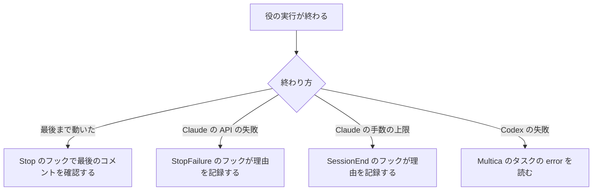

# 役の実行の上限と止まった理由の記録

無人の役の実行が、上限なしに続いたり、理由を残さずに終わったりしないようにする。手数の上限、止まった理由の記録、ログインの期限の見張りを足す。

この文書は、原本を変える人に向けて、決めたことと理由と実機の結果を書く。使う人への手順は `manual.md` に書く。

## 目的と範囲

Multica の役の実行には、時間の上限がない。使用上限や認証の失敗で終わった理由は、Multica のタスクの自由な文にしか残らない。ログインが切れると、その系統の役はすべて失敗し、人は失敗の通知で初めて気づく。

ここでは、セットアップの流し直しで次の 3 つを入れる。再試行と時間切れは、既定で上限があることを確認し、値を書かない。

| 入れるもの | 置き場 | 効く範囲 |
| --- | --- | --- |
| 手数の上限（`CLAUDE_CODE_MAX_TURNS`） | Claude のモデルの役の custom_env | 流し直したプロジェクトの役だけ |
| 止まった理由を記録する 2 つのフック | 共有の `settings.json` のキットの項目 | 同じホストのすべてのプロジェクトの Claude の役 |
| ログインの行 | 使用上限の見張り（`squad-usage-check`） | 流し直したプロジェクトの見張り |

役の実行の終わり方ごとに、理由が残る場所は次のとおりになる。Codex には失敗を受けるフックがないので、Multica のタスクの記録を読む。

## 再試行と時間切れと出力の長さ

棚卸しで挙げた値は、どれも既定で上限があったので書かない。値を書くと、Claude Code と Codex の既定の見直しを受けなくなるためである。

| 項目 | 既定（このホストで確認） | 扱い |
| --- | --- | --- |
| `CLAUDE_CODE_MAX_RETRIES` | 10 回。15 回で頭打ちになる | 書かない |
| `API_TIMEOUT_MS` | 600000（10 分） | 書かない |
| `BASH_DEFAULT_TIMEOUT_MS`・`BASH_MAX_TIMEOUT_MS` | 2 分と 10 分 | 書かない |
| `BASH_MAX_OUTPUT_LENGTH` | 文脈に入る量には効かず、読み返す範囲だけを決める | 書かない |
| 設定の `bashOutputMaxChars` | 30000 字。4000 から 128000 の間に収める | 書かない |
| Codex の再試行と流れの時間切れ | ChatGPT のログインでは上書きを受け付けない。既定で 5 回つなぎ直す | 書けない |
| Codex の `tool_output_token_limit`・`background_terminal_max_timeout` | 上書きを受け付ける。時間の既定は 300000 | 書かない |

`BASH_MAX_OUTPUT_LENGTH` は、棚卸しでは出力の長さの上限としていた。今のバージョンでは、文脈に入る長さを決めるのは設定の `bashOutputMaxChars` である。

## 手数の上限

Claude のモデルの役の custom_env に `CLAUDE_CODE_MAX_TURNS` を付け、1 回の実行のターンの数に上限を置く。既定には上限がなく、抜けられない繰り返しが使用上限まで続くためである。

| 役 | 値 | 理由 |
| --- | --- | --- |
| 使用上限の見張り・CI の見張り・Dependabot のマージ | 300 | 決まった手順だけを動かす。観測した最大の 3 倍ほどにする |
| ほかの Claude のモデルの役 | 2500 | 長い実行を切らない。観測した最大の 2 倍ほどにする |

値は、このホストの Multica の記録にある、役ごとの道具の呼び出しの数から決めた（[要確認の項目](#要確認の項目)）。1 ターンで道具を並べて呼べるので、ターンの数は道具の呼び出しの数を超えない見込みである。

今の `CLAUDE_CONFIG_DIR` などと同じく、Claude のモデルの役にだけ付け、流し直しで付け外しする。付け外しする変数の一覧にも足し、ランタイムを替えると外れるようにする。

### 上限に達したとき

上限に達した実行は、`error_max_turns` の結果と終了コード 1 で終わる。Stop のフックは届かないので、最後のコメントの確認は流れない。

最後のコメントがないまま、実行は失敗で終わる。Multica は失敗の通知を受信箱に送る見込みで、流し直しのあとに人が確かめる（[テストと実機の確認](#テストと実機の確認)）。理由は、次の節の記録に `max_turns` で残る。

## 止まった理由の記録

Claude の役の実行が API の失敗か手数の上限で終わったとき、理由を 1 行の JSON で状態の置き場に残す。Multica の記録は自由な文で、理由の種類で探せないためである。

| 終わり方 | 届くフック | 記録する理由 |
| --- | --- | --- |
| 使用上限・認証・過負荷などの API の失敗 | StopFailure | 入力の `error` の値 |
| 手数の上限 | SessionEnd だけ | `max_turns` |
| 最後まで動いた | Stop | 記録しない |
| Codex の失敗 | なし | 記録しない。Multica のタスクの error を読む |

2 つのフックは、今の PreToolUse と Stop と同じく、共有の `settings.json` にキットの項目として書く。スクリプトはガードの置き場に写す。`MULTICA_TASK_ID` がない実行では、何もせずに終わる。

### 記録の形

記録は、状態の置き場の `run-stops/<年>-<月>.jsonl` に 1 行ずつ足す。状態の置き場は、Stop のガードと同じく `SQUAD_KIT_STATE_DIR`、なければガードの置き場の `state/` である。

| 欄 | 値 |
| --- | --- |
| `time` | 記録した時刻（UTC） |
| `task` | `MULTICA_TASK_ID` |
| `agent` | `MULTICA_AGENT_ID`。ないときは空 |
| `session` | 入力の `session_id` |
| `reason` | 下の表の値 |
| `source` | `claude` |

`reason` は、StopFailure の `error` の 13 の値と `max_turns` のどれかにする。知らない値は `unknown` にする。13 の値は次のとおりである。

| 種類 | 値 |
| --- | --- |
| 認証とアカウント | `authentication_failed`・`oauth_org_not_allowed`・`account_on_hold`・`verification_required`・`cloud_credential_error` |
| 使用上限と課金 | `rate_limit`・`billing_error` |
| サービスの状態 | `overloaded`・`server_error` |
| 依頼の誤り | `invalid_request`・`model_not_found`・`max_output_tokens` |
| そのほか | `unknown` |

入力の `last_assistant_message` は、モデルの出力で、作業先の内容を含みうるので書かない。置き場は権限 700、ファイルは 600 にし、1 行を 1 回の書き込みで足す。

書けないときは、何も出さずに 0 で終わる。StopFailure では、フックの出力と終了コードは実行の結果に効かなかった。記録の失敗で、実行の終わり方を変えないためである。

### SessionEnd での手数の上限の見分け

SessionEnd の入力には、終わった理由の区別がない。上限で終わった実行の記録には、型が `max_turns_reached` の添付の行が残るので、これを読む。

1. 入力の `hook_event_name` が `SessionEnd` かを見る
2. `transcript_path` の実体が、`CLAUDE_CONFIG_DIR` の `projects` の下にあり、名前が `<session_id>.jsonl` の通常のファイルかを見る
3. ファイルの末尾の 64 KiB の中に、添付の型が `max_turns_reached` の行があれば記録する

どれかが合わなければ、記録せずに 0 で終わる。最後まで動いた実行でも SessionEnd は届くので、読むのは末尾だけにする。

### 記録の読み方

記録は、人が `manual.md` の手順で `jq` を使って読む。使用上限の見張りは読まない。実行の失敗は、Multica が通知を送るためである。

Codex の役の理由は、Multica のタスクの記録の error の文を読む。`multica agent tasks <役の ID> --output json` の `error` の欄に出る。

## ログインの見張り

使用上限の見張りに、Claude Code のログインの期限と、Codex のログインの状態の行を足す。切れる前に、見張りのタスクで担当者に知らせる。

| ツール | 読むもの | ok | warn | error |
| --- | --- | --- | --- | --- |
| Claude Code | `claude auth status --json` の `loggedIn` と `loginExpiresAt` | 期限まで 10 日より長いか、期限がない | 期限まで 10 日以内 | 終了コードが 0 でない、ログインしていない、期限を過ぎた |
| Codex | `codex login status` の終了コード | 0 | なし | 0 でない |

期限の 10 日前は、`USAGE_LOGIN_WARN_DAYS` で変えられるようにする。Claude Code は期限の 3 日前から再ログインを促す。その前に、週に 1 回だけ見る人も間に合うよう、7 日を足した。

### 行とタスク

ログインの行のキーは `login:claude` と `login:codex` にする。`claude:` で始まるキーと分けるのは、表示から消えた枠を戻す処理に入れないためである。

| 状態 | 作るタスクの題 | 本文の始めの文 |
| --- | --- | --- |
| warn | `[ログイン] Claude Code のログインの期限` | 期限が近い。期限の前に、`manual.md` の手順でログインし直す |
| error | `[ログイン] Claude Code のログイン` または `[ログイン] Codex のログイン` | ログインしていない。このツールの役はすべて失敗する |

ok に戻ったら、「ログインし直された」とコメントして done にする。状態の変化とタスクの扱いは、使用上限の行と同じ `apply` を使い、文だけをキーで切り替える。

ログインが error のツールは、使用率を読まない。同じ原因で、使用量を取れないタスクが重ねてできないためである。そのツールの使用上限の行は、前回の状態のまま残す。

### 写さないもの

`claude auth status --json` の出力は、メールアドレスと組織を含む。`loggedIn`・`authMethod`・`loginExpiresAt` の 3 つの欄だけを読み、出力をタスクにも状態のファイルにも写さない。

タスクの本文には、期限の日付と残りの日数、終了コードだけを書く。`codex login status` の出力も写さない。

## 使用率の読み方

Claude は今の `/usage` の表示を読むまま、Codex は今の構造化した値のままにする。Claude の構造化した値は、モデルを呼ぶ実行でしか出ないためである。

Claude の `rate_limit_event` は、5 時間と週の使用率とリセットの時刻を持つ。見張りが毎回これを取ると、見張りが使用量を使う。Codex は、app-server の `account/rateLimits/read` で、すでに構造化した値を読んでいる。

## 実機で確認した結果

棚卸しで順 3 とした項目と、Codex の項目を、このホストで確認した。バージョンは Claude Code 2.1.322、codex-cli 0.172.0、multica 0.7.0 である。

Claude Code は、共有の設定ディレクトリを変えずに、別の設定の置き場と `--settings` で確認した。認証の失敗は、無効な API キーで起こした。

### 要確認の項目

4 つの要確認のうち 1 つを入れ、3 つを外した。

| 項目 | 実機で確認したこと | 扱い |
| --- | --- | --- |
| `CLAUDE_CODE_RETRY_WATCHDOG` | 429 と 529 で再試行を続け、使用上限のリセットまで待った。待つ長さの既定に上限はない | 外した。Multica に時間の上限がなく、黙って止まり続ける |
| `rate_limit_event` | モデルを呼ぶ実行でだけ出た。`/usage` では出ず、実行の記録にも残らない | 外した。見張りが使用量を使う |
| `--fallback-model` | 過負荷と使えないときだけ切り替わり、毎ターン元のモデルを試す | 外した。役のモデルが黙って替わり、過負荷は既定の再試行で受ける |
| `CLAUDE_CODE_MAX_TURNS` の役ごとの値 | 1 で `error_max_turns` と終了コード 1 になった。Stop と StopFailure は届かず、SessionEnd だけが届いた | 入れた。値は下の観測から決めた |

役ごとの道具の呼び出しの数は、このホストの Multica の記録にある Claude の役の実行で、次のとおりだった。Dependabot のマージは、記録がなかった。

| 役 | 中央値 | 95 パーセンタイル | 最大 |
| --- | --- | --- | --- |
| 設計 | 3 | 46 | 1235 |
| リーダー | 5 | 61 | 250 |
| コードのレビュー | 7 | 45 | 132 |
| 性能のレビュー | 5 | 16 | 137 |
| セキュリティのレビュー | 6 | 53 | 89 |
| 使用上限の見張り | 5 | 40 | 89 |
| CI の見張り | 7 | 22 | 64 |
| QA | 4 | 56 | 72 |
| UX のレビュー | 7 | 28 | 76 |
| Claude の実装 | 2 | 10 | 70 |
| 最上位の役 | 4 | 9 | 69 |
| Claude の修正 | 3 | 9 | 55 |
| 要件 | 5 | 18 | 37 |

### 要確認でない項目

ほかの項目も、実機で確認した。外したものはない。

| 項目 | 実機で確認したこと | 扱い |
| --- | --- | --- |
| StopFailure のフック | 無効な API キーで `authentication_failed` が届いた。出力と終了コード 2 は無視され、実行は終了コード 1 で終わった | 入れた |
| 再試行と時間切れの 4 つの変数 | 既定の値は[再試行と時間切れと出力の長さ](#再試行と時間切れと出力の長さ)のとおり | 書かない |
| `claude auth status` の期限 | `--json` に `loginExpiresAt` があった。ログインしていない置き場では、終了コード 1 と `loggedIn: false` だった | 入れた |
| `codex login status` | ログインした置き場で 0、空の置き場で 1 だった | 入れた |

### Codex の項目

Codex に同じものがある項目は、このホストの Codex で確認した。手数の上限と失敗のフックは、Codex にはなかった。

| 項目 | 実機で確認したこと | 扱い |
| --- | --- | --- |
| 再試行の上書き | 組み込みの `openai` の provider は、`request_max_retries` の上書きを受け付けない | 入れない。既定で 5 回つなぎ直す |
| `tool_output_token_limit` | `-c` で受け付けた | 書かない |
| `background_terminal_max_timeout` | 既定は 300000 だった | 書かない |
| 手数の上限 | 当たる設定のキーがない | 入れない |
| 失敗のフック | フックの種類に、失敗を受けるものがない。認証の失敗の `turn.failed` では、Stop も届かなかった | 入れない。Multica のタスクの error を読む |
| ログインの期限 | app-server の `account/read` と `getAuthStatus` に、期限の欄がない | 状態だけを見る |
| `codex login status` の確かさ | 無効な API キーでも 0 だった | 入れた。資格の有効さは見ない |
| 使用率 | app-server から構造化した値を読めた | 変えない |
| Multica の記録の error | Codex の役の失敗は、起動の時間切れなどだった。使用上限と認証の失敗はなかった | 文の形は未確認のまま残す |

## 入力と信頼の表

この変更は、認証の状態と、役の実行の記録を読む。読む入力ごとに、信頼する条件を次のとおりにする。

| 入力（誰が書いた何か） | 読むところ | 信頼する条件 | 合わないとき |
| --- | --- | --- | --- |
| StopFailure の入力の `error`（Claude Code が書く） | 理由の記録 | `hook_event_name` が `StopFailure` で、知っている値 | 知らない値は `unknown` にする |
| StopFailure の入力の `last_assistant_message`（モデルの出力で、作業先の内容に動かされうる） | 読まない | なし | 記録に写さない |
| SessionEnd の入力の `transcript_path`（Claude Code が書く。指す先は役とその子プロセスも書ける） | 手数の上限の見分け | 実体が設定ディレクトリの `projects` の下で、名前が `<session_id>.jsonl` の通常のファイル | 読まずに 0 で終わり、記録しない |
| 実行の記録の末尾の行（Claude Code・役・その子プロセスが書ける） | 手数の上限の見分け | 添付の型が `max_turns_reached` の行 | 記録しない |
| `MULTICA_TASK_ID`・`MULTICA_AGENT_ID`（デーモンが渡す。役の子プロセスも変えられる） | 記録の欄 | あれば写す | `MULTICA_TASK_ID` がなければ何もしない |
| `claude auth status --json` の出力（Claude Code が書く。メールアドレスと組織を含む） | ログインの見張り | 終了コード 0 で、3 つの欄を JSON として読める | error の行にする。出力は写さない |
| `codex login status` の終了コード（Codex が返す） | ログインの見張り | 0 | error の行にする。出力は写さない |
| 止まった理由の記録のファイル（フック・役・その子プロセスが書ける） | 人が手がかりとして読む | なし | 自動の判断には使わない |

記録のファイルと実行の記録は、同じ OS の利用者のプロセスが書ける。偽の行で記録の理由が違っても、記録は人が読む手がかりで、役の判断にもガードにも使わない。この境界は[残る危うさ](#残る危うさ)に書く。

## 文書と指示の変更

この文書のほかに、次のファイルを変える。役の指示と共通スキルは変えない。

| ファイル | 変えること |
| --- | --- |
| `common/guard/stop-failure` | 新しく置く。StopFailure の入力から理由を記録する |
| `common/guard/session-end` | 新しく置く。手数の上限で終わった実行を記録する |
| `lib/host.sh` | 合わせるフックに StopFailure と SessionEnd を足し、2 つのスクリプトをガードの置き場に写す |
| `lib/project.sh` | Claude のモデルの役の custom_env に、役ごとの手数の上限を足す。付け外しする変数の一覧にも足す |
| `common/monitor/squad-usage-check` | ログインの行を足し、ログインが error のツールは使用率を読まない |
| `manual.md` | 「ホストとエージェント用のログイン」と「止まったときに見ること」に、ログインのタスクの直し方と記録の読み方を書く |
| `CHANGELOG.md` | 先頭の `## 次のバージョン` の節に、流し直しで変わることを書く |
| `tests/` | [テストと実機の確認](#テストと実機の確認)のとおりに足す |
| `MANIFEST` | `bash scripts/manifest.sh` で作り直す |
| `docs/agent-guards.md` | 「書くキー」の表に、2 つのフックの行を足した。この文書と同じコミットで足した |
| `docs/README.md` | 索引の「エージェントが動く環境」の表に、この文書の行を足した。この文書と同じコミットで足した |

## 互換性と影響を受ける利用者

フックは、流し直したホストのすべてのプロジェクトの Claude の役に効く。手数の上限と見張りの変更は、流し直したプロジェクトにだけ効く。

- 手数の上限に達した Claude の役の実行は、最後のコメントなしに失敗で終わる
- 状態の置き場に、止まった理由の記録のファイルが増える
- 見張りのタスクに、`[ログイン]` で始まるものが増える
- ログインが切れたツールについて、使用量を取れないタスクができなくなる

custom_env と設定は、役の次の実行から効く。デーモンを起動し直す必要はない。

### 新しく止まる場合

今は続く役の実行が、手数の上限で止まる場合がある。流し直しが新しく止まる場合はない。

| 止まる場合 | 止まる所 | 直し方 |
| --- | --- | --- |
| 1 回の実行のターンの数が上限を超える | Claude の役の実行 | 記録の理由を見て、タスクを分けるか `multica issue rerun` で再実行する。続けて達するなら、その役の値を上げる |

### 古いキットとの混在

同じホストに、バージョンの違うキットで流し直すプロジェクトがあると、次のとおりになる。

| もの | 古いキットで流し直したとき |
| --- | --- |
| `settings.json` の 2 つのフック | 古いキットは知らないフックの種類を合わせないので残る |
| ガードの置き場の 2 つのスクリプト | 古いキットは消さないので残り、フックは動き続ける |
| custom_env の手数の上限 | 古いキットは知らない値を消さないので残る |
| 見張りのスクリプト | ログインの行がなくなる。状態のファイルの `login:` の行と開いたタスクは残る |

同じホストのプロジェクトは、同じバージョンのキットにそろえることを `manual.md` に書く。

### 戻し方

戻すときは、古いキットで流し直したあと、残るものを手で消す。動いているタスクがないときに行う。

1. エージェント用の設定ディレクトリの `settings.json` から、StopFailure と SessionEnd のキットの項目を消す
2. Claude のモデルの役ごとに、`multica agent env get` で今の custom_env を読み、`CLAUDE_CODE_MAX_TURNS` を消したファイルを `multica agent env set --custom-env-file` で書く
3. ガードの置き場の `stop-failure` と `session-end` を消す
4. 開いている `[ログイン]` のタスクを、手で done にする

記録のファイルは、消してもよい。役の判断にも見張りにも使っていない。

## テストと実機の確認

スクリプトと設定を合わせる処理、環境変数、見張りの行は自動テストで確認する。実際に効くかは、流し直しのあとに人が実機で確認する。

| テスト | 確認すること |
| --- | --- |
| 足す `tests/run-stops-test.sh` | StopFailure の入力の 13 の値と知らない値で、記録の行の欄と `reason` が表のとおりで、`last_assistant_message` を含まないこと |
| 足す `tests/run-stops-test.sh` | `MULTICA_TASK_ID` がない、置き場に書けない、入力が壊れているときは、記録せずに 0 で終わること |
| 足す `tests/run-stops-test.sh` | SessionEnd で、末尾に上限の添付がある記録だけを `max_turns` で記録すること。置き場の外・名前の違い・シンボリックリンクの記録は読まないこと |
| `tests/host-test.sh` | 2 つのフックが書かれ、人のフックが残り、2 つのスクリプトがガードの置き場に写ること |
| `tests/project-create-test.sh`・`tests/project-runtimes-test.sh` | Claude のモデルの役にだけ役ごとの手数の上限が付き、ランタイムを替えると外れること |
| `tests/squad-usage-check-test.sh` | ログインの行が、期限と終了コードから表の状態になり、変化でタスクを作り・コメントし・done にすること |
| `tests/squad-usage-check-test.sh` | ログインが error のツールで使用率を読まず、使用上限の行を前回のまま残すこと |
| `tests/squad-usage-check-test.sh` | タスクの本文と状態のファイルに、ログインの出力のメールアドレスと組織が入らないこと |

テストの `claude auth status --json` の出力は、読む 3 つの欄だけを持つ見本にする。実機の出力は、メールアドレスを含むので採取しない。

実機では、認証済みのデーモンで、同じプロジェクトのセットアップを流し直してから次を確認する。2 から 4 は試しのプロジェクトで行い、終わったら custom_env を戻す。

1. 共有の `settings.json` に 2 つのフックがあり、Claude のモデルの役の custom_env に手数の上限がある
2. 試しの Claude の役の custom_env に無効な `ANTHROPIC_API_KEY` を足して動かすと、記録に `authentication_failed` の行が出る
3. 試しの Claude の役の手数の上限を 1 にして動かすと、Multica で失敗になり、記録に `max_turns` の行が出る
4. 同じ役で再開の実行をしても、ターンを数え直す
5. 見張りの実行のあと、状態のファイルにログインの行がある。`USAGE_LOGIN_WARN_DAYS` を期限までの日数より大きくすると、`[ログイン]` のタスクができる

マージの前に人が 1 から 5 を確認し、結果を PR に書く。

## 残る危うさ

次の 5 つは、この設計では防がない。人間の承認で、受け入れるかを判断してもらう。

| 危うさ | 範囲 | 防がない理由と、今の守り |
| --- | --- | --- |
| Codex の役の止まった理由が、キットの記録に残らない | Codex の役 | 失敗のフックがなく、Stop も届かない。Multica のタスクの error を読むが、使用上限と認証の文の形は未確認である |
| 見張り自身が、切れたログインのツールで動くと知らせられない | 見張りのモデルの系統のログイン | 見張りの実行が失敗し、Multica が通知を送る。期限の 10 日前の warn で、切れる前に気づける |
| `codex login status` は、資格の有効さを見ない | Codex のログイン | 無効になった資格は、使用量を取れないタスクで気づく見込みである |
| 手数の上限で終わった実行は、最後のコメントの確認を通らない | Claude の役 | Claude Code が Stop を送らない。Multica の失敗の通知と、記録の `max_turns` で気づく |
| 記録のファイルと実行の記録は、役とその子プロセスも書ける | 同じホストの記録 | 書き手を分けられない。記録は人が読む手がかりで、判断には使わない |

## 決まっていないこと

なし

## 検討した案

上限は既定にないものだけを足し、理由はフックで状態の置き場に残す。ログインは、今の使用上限の見張りに行を足して見る。

| 案 | 選ばなかった理由 |
| --- | --- |
| 役の実行に時間の上限を置く | Multica の実行の設定で、キットが持つ設定の外にある。手数の上限で代える |
| 再試行と時間切れの値を書く | 既定に上限がある。値を書くと、既定の見直しを受けない |
| `CLAUDE_CODE_RETRY_WATCHDOG` を入れる | 使用上限のリセットまで黙って待ち続け、Multica の時間の上限もない |
| `--fallback-model` を入れる | 役のモデルが黙って替わる。過負荷は既定の再試行で受ける |
| `rate_limit_event` で使用率を読む | モデルを呼ぶ実行でしか出ず、見張りが使用量を使う |
| すべての役に同じ手数の上限を置く | 見張りの繰り返しに気づくのが遅れるか、作業の役の長い実行を切る |
| 止まった理由を見張りがタスクにする | Multica が失敗の通知をすでに送り、知らせが重なる |
| 止まった理由をフックからタスクのコメントに書く | 失敗のたびに外への書き込みが増え、Multica の通知と重なる |
| Codex の失敗を Stop のフックで記録する | 認証の失敗では Stop が届かなかった |
| Codex のログインの期限も見る | 期限を返す口がない |
| ログインの warn を期限の 3 日前にする | Claude Code の促しと同じ時機で、週に 1 回見る人が間に合わない |
