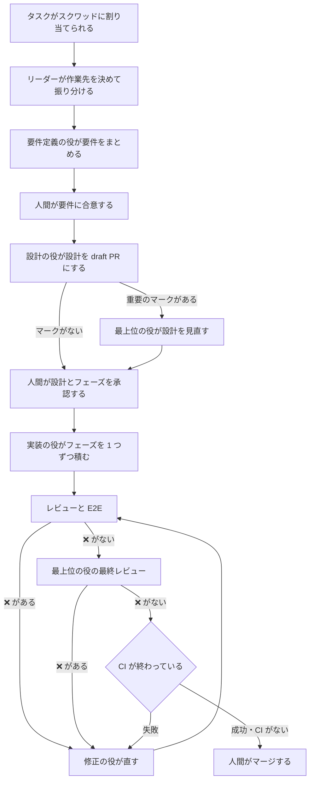

# タスクが進む流れの図と、設計の文書の索引

この文書は、原本を変える人に向けて、`manual.md` に足すタスクが進む流れの章と、設計の文書の索引を保つ検査を決める。流れの正本は `common/squad.md` と共通スキル squad-handoff で、manual の章はその要約である。

## 目的と範囲

目的は 2 つある。1 つ目は、導入する人が、タスクがどの役を通り、どこで人間を待つかを 1 か所で読めるようにすることである。今は、流れが役の指示とリーダーの参照に分かれ、manual には役ごとの説明しかない。

2 つ目は、原本を変える人が、設計の文書を目的から探せるようにすることである。`docs/` には 32 本の文書があり、ファイルの名前だけでは中身が分からない。

この文書で決めるのは、次の 3 つである。

1. manual の章の置き場所と全文。[manual の章](#manual-の章)に書く
2. 索引の置き場所と形。[索引](#索引)に書く
3. 索引に載っていない文書を見つける検査。[索引の検査](#索引の検査)に書く

次は、この文書の範囲の外である。

- 役の指示、共通スキル、プロジェクトのひな形、エージェントとオートパイロットの登録の変更
- 設計の文書を HTML のサイトにすること
- モデルを 3 層に分けない理由。[リーダーの指示の設計の検討した案](leader-principles.md#検討した案)に書く

## manual の章

`manual.md` に `## タスクが進む流れ` の章を足す。置き場所は「導入後に自動で行うことと、起票するタスク」の次で、「最上位の役の最終レビューと重要のマーク」の前である。導入を終えた人が次に流れを読み、そのあとで最上位の役の細部を読む順になるためである。

目次には、5 番目に次の項目を足し、今の 5〜9 番を 6〜10 番に送る。

```markdown
5. [タスクが進む流れ](#タスクが進む流れ): 導入したスクワッドで、タスクがどの役を順に通り、どこで人間を待つかを読む
```

### 章の全文

章は、図・流れの箇条書き・人間を待つところ・流れの外で動くものの順に書く。図は 13 の箱で、`STYLE.md` の目安の 12 を 1 つ超える。人間を待つ 3 か所と、❌ で修正へ戻る 3 本の線を 1 枚に収めるため、分けずに置く。

````markdown
## タスクが進む流れ

次の図は、全部の役を入れた構成で、タスクが割り当てられてから人間のマージまでの流れを示す。どの役がどの順で動き、どこで人間を待つかを読む。外した役の箱は飛ばして読み、要件や設計を人間が用意する構成は[最上位の役の最終レビューと重要のマーク](#最上位の役の最終レビューと重要のマーク)で読む。



図の流れは、次のとおりである。

1. 役は結果を返し、次の役への依頼は、リーダーか見張りのスクリプトが書く。図の矢印は、この受け渡しを省いて描いている
2. リーダーは、最初に振り分ける前に、タスクの作業先のリポジトリを決める。依頼のたびに使用率を読み、回す系統を選ぶ
3. 要件定義の役が要件をまとめ、人間と合意する
4. 設計の役は、設計と実装のフェーズを draft PR にして、人間の承認を受ける。重要のマークのあるタスクでは、人間の承認の前に、最上位の役が設計を見直す
5. 実装の役は、承認されたフェーズを 1 つずつ積む。全部のフェーズが積まれてから、レビューへ回る
6. レビューは、コードレビューが先で、E2E・UX・セキュリティ・パフォーマンスは、変更に合う観点だけを並行で頼む。重要のマークがあれば、すべての観点を頼む
7. ❌ の指摘、main とのコンフリクト、CI の失敗は、修正の役が直す。直したあとは、もう一度レビューを受ける
8. すべてのタスクで、人間のマージの前に、最上位の役が最終レビューを行う。CI の見張りがある構成では、チェックのある PR の CI が成功するまで、マージの依頼を待つ
9. マージは人間が行う

### 人間を待つところ

図の 3 か所（要件の合意、設計の承認、マージ）のほかに、次のときも人間を待つ。待つあいだ、リーダーはほかの役を呼ばない。

- 使用枠の残る系統に回せず、再開の時刻まで待つと、待ち始めから通算 24 時間を超えるとき
- 最上位の役の使用枠が、使うランタイムのすべてで上限の近くのとき
- プロジェクトが人間との合意を必要とする、外部インターフェースの変更があるとき
- 要件や設計だけでは、方針を決められないとき
- 修正の依頼が続き、続けてよいかを人間に確認する回になったとき
- 同じ誤りの差し戻しが 2 回続いたとき。最上位の役がある構成では、その役の診断のあとも続いたとき
- 同じ部品への ❌ の指摘が 3 回目になったとき。最上位の役がある構成では、その役の診断のあとの 4 回目

### 流れの外で動くもの

次のものは、タスクの流れの外で動く。外した役や置かなかった見張りの行は、飛ばして読む。

| 動くもの | すること | 動くとき |
| --- | --- | --- |
| ガード | 許可していないリポジトリへの `gh` の書き込みと `git push` を止める | エージェントの実行のたび |
| PR の CI の見張り | CI の結果を知らせる | リーダーが PR ごとに置く |
| 使用上限の見張り | AI の使用上限を見張る | 定期のオートパイロット |
| Dependabot の PR の週次の確認 | Dependabot の更新を週次で扱う | 週 1 回のオートパイロット |
| 週 1 回の依存ライブラリの脆弱性チェック | 依存ライブラリの既知の脆弱性を調べる | 週 1 回のオートパイロット |
````

### 章の中身の出どころ

章の中身は、次の正本から写す。章に新しい決まりは足さない。正本が変わったときは、この章も直す。

| 章の中身 | 正本 |
| --- | --- |
| 図と流れの箇条書き | `common/squad.md` の「流れ」、manual の「最上位の役の最終レビューと重要のマーク」 |
| 人間を待つところ | `common/squad.md` の「人間を待つところ」、squad-handoff の `references/leader-dispatch.md` と `references/leader-flow.md` |
| 流れの外で動くもの | manual の「導入後に自動で行うことと、起票するタスク」と、オートパイロットの節 |

使用枠の待ちは、`common/squad.md` の「使用枠の残る系統に回せないとき」と、`references/leader-dispatch.md` の通算 24 時間の決まりを合わせた文にする。前者だけでは、待てば済む場合も人間を呼ぶと読めるためである。

流れの外で動くものの表には、時刻を書かない。時刻の正本はオートパイロットの登録で、写すと登録を変えたときにずれるためである。

## 索引

設計の文書の索引を `docs/README.md` に置く。GitHub で `docs/` を開くと、この文書が一覧の下に表示されるためである。

索引は、設計の並びを当てはめない、設計でない文書である。冒頭に、主に読む人と、索引に 1 行を足す決まりを書く。そのあとに、変えるものごとに 7 つの節を置く。

| 節 | 載せる文書 |
| --- | --- |
| 役の指示と、タスクが進む流れ | 役の指示と、役から役へ仕事が渡る流れの設計 |
| 導入・更新と公開 | セットアップ、入口のスクリプト、公開のコマンド、端末の画面の設計 |
| エージェントが動く環境 | エージェントのシェル、デーモン、VM の設計 |
| 文書と言葉 | 文書の書き方、用語、AI が読む指示の読み直しの設計 |
| テスト | 原本のテストの設計 |
| 安全 | リポジトリの守りと、依存の監査 |
| 数える | スクワッドの作業の指標と時間の測り方 |

各節は、案内の 1 文と、2 列の表にする。列は「文書」と「書いてあること」で、文書の列は H1 をリンクの文字にする。主に読む人は列にせず、冒頭と節の案内の文に書く。読む人がほぼ同じで、列にすると同じ値が並ぶためである。

1 本の文書は、1 つの節にだけ載せる。2 つの節に当たる文書は、その文書を変えるときに主に触れるものごとの節に置く。

## 索引の検査

`scripts/check-links.py` に、索引の検査を足す。リンクの検査と同じく CI の `tests/links-test.sh` で流れるので、新しい検査の入口を足さずに済む。

引数のないときは、リンクの検査のあとに、`docs/` の直下のすべての `*.md`（`README.md` を除く）が、`docs/README.md` の表に載っているかを調べる。文書の一覧は、Git の追跡ではなくファイルから読む。まだ追跡していない新しい文書も、手元の検査で見つけるためである。

| 調べるもの | 決まり |
| --- | --- |
| 表の行 | 行の頭の空白を除いて `\|` で始まる行 |
| 載っている文書 | 表の行の 1 列目のセルが、インラインリンク `[文字](先)` の 1 つだけであるもの。先は索引のディレクトリから解き、アンカーを除いて比べる |
| 載っていないと数える書き方 | 参照の形のリンク、表の外のリンク、2 列目より後のリンク、1 列目でリンクのほかに文字があるもの |
| 載せる文書 | `docs/` の直下の `*.md` から `README.md` を除いたもの。下のディレクトリは見ない |

数えるのは、[索引](#索引)で決めた形だけにする。索引の文書の列は、H1 をリンクの文字にしたリンク 1 つと決まっている。ほかの書き方まで読み分けると、Markdown の文法を検査の中で真似ることになり、漏れの直しが続くためである。

索引の検査は、リンクの検査が調べるリンクを変えない。リンクの検査が除くのは、フェンスで囲んだコード、コードの span、HTML のコメントの中だけのままにする。

載っていない文書は、1 本を 1 行にして標準エラーに出す。`docs/README.md` がないときも、同じ形で 1 行を出す。どちらも終了コード 1 で止まる。

```text
docs/README.md: 索引: default-branch.md が載っていない
docs/README.md: 索引: ファイルがない
```

標準出力には、リンクの検査の集計の行のあとに、索引の集計の行を出す。

```text
検査: 設計の文書 32 本、索引にない文書 0 本
```

`--index <ファイル>` を渡すと、そのファイルを索引として、同じディレクトリの直下の `*.md` だけを調べる。リンクの検査は流さない。テストが一時のディレクトリで検査を確認するためである。

ないファイルを `--index` に渡すと、引数の誤りとして終了コード 2 で止まる。ファイルだけを渡すときは、今と同じくリンクの検査だけを流す。

## テスト

`tests/links-test.sh` に、索引の検査の確認を足す。一時のディレクトリに索引と文書を置き、`--index` で検査する。リポジトリの索引は、今ある引数なしの検査で確認する。

| 確認すること | 失敗したときに直すこと |
| --- | --- |
| リポジトリの `docs/` のすべての文書が、`docs/README.md` に載っている | 索引に、足した文書の行を足す |
| 索引にない文書があると、`索引: <名前> が載っていない` を出して落ちる | 検査が文書の一覧を読む処理を直す |
| アンカー付きのリンクで載せた文書も、載っていると数える | リンクの先からアンカーを除く処理を直す |
| 参照の形、表の外、2 列目にだけ書いた文書は、載っていないと数える | 表の行の 1 列目のセルだけを読む処理を直す |
| 索引のファイルがないと、終了コード 2 で止まる | 引数の確認を直す |
| `-` とタブで始めた項目に続く、字下げの段落の切れたリンクを、リンクの検査が見つける | リンクの検査の除き方を、[索引の検査](#索引の検査)の決まりに戻す |

## 変更の一覧

変えるファイルは、次のとおりである。役の指示、共通スキル、ひな形、登録のファイルは変えない。

| ファイル | 変えること |
| --- | --- |
| `docs/README.md` | 新しく置く。この文書と同じコミットで置いた |
| `docs/flow-and-index.md` | この文書。新しく置く |
| `docs/leader-principles.md` | 「モデルと思考の深さ」に advisor の案を並べる 1 文を、「検討した案」に advisor を既定にしない理由の 1 項目を足す。この文書と同じコミットで足した |
| `docs/doc-style.md` | 「リンクの検査」に、索引の検査を足す。この文書と同じコミットで足した |
| `manual.md` | 目次の項目と、[章の全文](#章の全文)の章を足す |
| `scripts/check-links.py` | [索引の検査](#索引の検査)と、`--index` とファイルを同時に渡すと終了コード 2 で止まる扱いを足し、先頭の説明を合わせて直す。リンクの先を解く処理は `resolve()` に切り出して索引の検査と共有し、リンクの検査が調べるリンクと除き方は変えない |
| `tests/links-test.sh` | [テスト](#テスト)の確認と、`tests/links-index-table.tsv` の行ごとの確認を足す |
| `tests/links-index-table.tsv` | 索引の掲載判定の期待を持つ表を新しく置く。行は[索引の検査](#索引の検査)の表の決まりごとに置き、[残る危うさ](#残る危うさ)の書き方は置かない |
| `STYLE.md` | 「リンク」の表に、設計の文書を索引に載せる決まりの行を足す。CI の列は「リンクの検査」にする |
| `MANIFEST` | `bash scripts/manifest.sh` で作り直す |

## 互換性と影響を受ける利用者

導入済みのプロジェクトの動作は変わらない。変わるのは、原本の文書と、原本のリンクの検査に足す索引の検査だけである。リンクの検査が調べるリンクは変えない。セットアップが配置・登録するもの、役の指示、共通スキルは変えない。

影響を受けるのは、原本を変える人である。設計の文書を `docs/` に足す PR は、索引にも 1 行を足さないと、リンクの検査が落ちる。この PR と同時に開いている PR が設計の文書を足すときは、あとからマージする PR が索引に行を足す。

manual を読む導入する人には、流れの章が増える。手順は変わらない。

## 残る危うさ

次の 4 つは、この設計で残る。どれも、レビューか正本の変更のときに直す。

1 つ目は、manual の章と正本のずれである。章は正本の要約なので、役の指示や待つところを変えた PR が章を直さないと、ずれる。[章の中身の出どころ](#章の中身の出どころ)を、正本を変える PR のレビューで見る。

2 つ目は、索引の「書いてあること」の文が、文書の中身とずれることである。検査は載っているかだけを見て、文の中身は見ない。文書の目的を変えた PR のレビューで見る。

3 つ目は、`docs/` の下のディレクトリにある文書である。検査は直下だけを見るので、ディレクトリを作って文書を置くと、索引にないまま通る。ディレクトリを作るときに、検査の範囲を見直す。

4 つ目は、索引の検査が見分けない書き方である。検査は表の行の 1 列目だけを読み、コードや HTML のコメントの中か、セルの中の `\|` かを見分けない。索引は決まった形の表だけで書くので、ほかの書き方は索引を変える PR のレビューで見る。この書き方で検査が誤って数えることは、検査の不具合として扱わない。

## 検討した案

章の置き場所、索引の形、検査の置き場所について、次の案を選ばなかった。

| 案 | 選ばなかった理由 |
| --- | --- |
| 流れの図を manual の冒頭に置く | 導入の手順の前に、導入したあとの話が来る。導入する人が最初に読むのは手順である |
| 流れの図を、待つところごとの 2 枚に分ける | 修正へ戻る線が 2 枚にまたがり、どこから戻るかが読みにくい。箱を 1 つ減らすより、1 枚で読める方を選んだ |
| 流れの外で動くものの表に、時刻の列を置く | 時刻の正本はオートパイロットの登録である。写すと、登録を変えたときにずれる |
| 索引の表に「主に読む人」の列を置く | ほとんどの行が「原本を変える人」になり、同じ値が並ぶ。違う文書だけ、説明の文に書く |
| 索引を `README.md` の入口の文書に置く | 入口の文書は、導入する人が最初に読む。設計の文書の一覧は、原本を変える人が読む |
| 索引をスクリプトで作る | 文書の題だけでは、何が書いてあるかが分からない。「書いてあること」の文は人が書く |
| 索引の検査を、別のスクリプトとテストにする | リンクの先の解き方を二重に持つことになる。リンクの検査と同じ解き方を使う |
| 索引のリンクを、Markdown の文法に沿ってすべて読み分ける | 索引の形は表の 1 列目に決まっている。文法を真似ると漏れの直しが続き、共有するリンクの検査の除き方まで変わる |
| 文書の一覧を Git の追跡から読む | まだ追跡していない新しい文書を、手元の検査で見つけられない |
