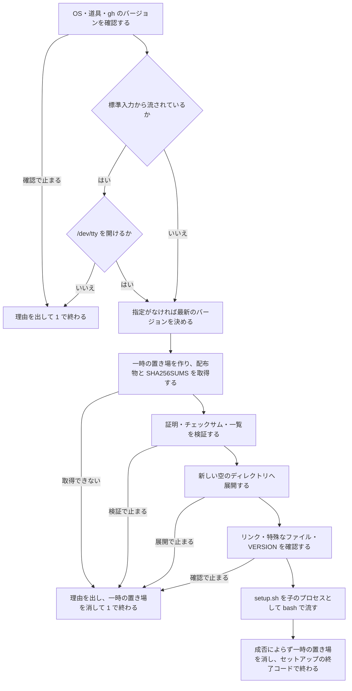

# clone せずに導入・更新する

原本を clone せずに、Release の配布物を検証してから展開し、セットアップを流す。この文書は、原本を変える人に向けて、その設計と理由を書く。

README に載せる 1 行のコマンドが、最新の Release の入口のスクリプトを `curl` で取って `bash` に流す。入口が使うバージョンを決め、配布物を検証して展開する。その原本の `setup.sh` を流す。

設計の対象は、配布物の形と検証の方法、入口のスクリプトと更新の知らせである。Release に配布物を載せる流れは `docs/release.md` に書く。使う人への手順は `README.md` と `manual.md` に書く。

## 目的と範囲

clone は導入後の動作に要らず、セットアップを流す置き場でしかない。そこで、Release に置いた配布物を取ってきて流す形にする。

配布物は、GitHub の証明（artifact attestation）とチェックサムの両方を検証してから展開・実行する。証明は、決まった発行のワークフローで作られたことを示す。

次は対象にしない。

- npm と Homebrew での配布。前提の道具が増えたり、新しいリポジトリが要ったりするため
- 持ち主の鍵による署名。鍵の運用が増え、発行のワークフローに限った検証ができないため
- clone で入れた人への切り替えの案内と、clone から流す方法の停止。`setup.sh` の clone のときの動き（[原本を取る](../manual.md#原本を取る)の、最新のタグの取り出し）は、この文書の取り方とは別に動く
- ZIP で導入済みの人の入れ直しの扱い。入れ直しの手順の中の「原本を取る」だけが、この文書の取り方を使う
- 新しいバージョンをタスクで知らせること
- 取得元の乗っ取りを完全に防ぐこと。配布方法では防げないので、[防げることと残るリスク](#防げることと残るリスク)に書く
- 1 行のコマンドで、入口のスクリプト自身を流す前に検証すること。入口まで検証したい人は、[手動の手順](#手動の手順)を使う

## 配布物

バージョンごとに、Release に次の 4 つを置く。どれも `docs/release.md` の発行のワークフローが作り、証明を付ける。

| ファイル | 中身 |
| --- | --- |
| `multica-squad-kit-<バージョン>.tar.gz` | タグの中身を `git archive` で固めたもの。中は `multica-squad-kit-<バージョン>/` の 1 つのディレクトリの下に、通常のファイルとディレクトリだけを置く |
| `install.sh` | 入口のスクリプト。原本のリポジトリのルートの `install.sh` と、タグの時点で同じ中身 |
| `SHA256SUMS` | 上の 2 つの SHA-256。`shasum -a 256` の出力と同じ形 |
| `multica-squad-kit-<バージョン>.sigstore.json` | 上の 3 つに付けた証明の束（Sigstore の bundle）。GitHub に問い合わせずに検証したい人と、記録のために置く |

配布物は tar.gz にする。`tar` と `gzip` は macOS と Ubuntu の標準に入っており、`manual.md` の道具の一覧を増やさずに済むため。ZIP の `unzip` は一覧にあるが、中のリンクを一覧で見分けにくい。

`<バージョン>` は `vX.Y.Z` の形で、タグと同じ。配布物の名前にバージョンを入れるのは、別のバージョンの配布物を取り違えても、照合で止まるようにするため。

## 検証の方法

証明は、`gh attestation verify` で、次の条件をすべて付けて検証する。どれかを欠くと、別のリポジトリ、別のワークフロー、別のタグで作られたものを通してしまうため。

| 指定 | 値 | 防ぐもの |
| --- | --- | --- |
| `--repo` | `drecom/multica-squad-kit` | ほかのリポジトリで付けた証明 |
| `--signer-workflow` | `drecom/multica-squad-kit/.github/workflows/release-assets.yml` | 同じリポジトリの別のワークフローで付けた証明 |
| `--source-ref` | `refs/tags/<バージョン>` | 別のブランチやタグから作ったもの |
| `--deny-self-hosted-runners` | （値なし） | GitHub の用意した環境の外で作ったもの |

リポジトリの名前は、大文字と小文字を GitHub の表記（`drecom`）のままにする。照合する値を毎回同じにするため。

チェックサムは、`SHA256SUMS` の証明を検証したあとで、その中の行と照合する。証明とチェックサムの両方を検証するのは、2 つが別の道の検証だからである。証明は誰が作ったかを、チェックサムは取ってきたものが壊れていないかを、別の道で検証する。

### 必要な `gh` のバージョン

`gh` は **2.102.0 以上**を求める。2.101.0 までの `gh attestation verify` では、決まった発行のワークフローを検証しきれない。

GitHub が公開した [GHSA-wjmr-j3rp-mh2g](https://github.com/cli/cli/security/advisories/GHSA-wjmr-j3rp-mh2g) と [GHSA-4mq3-hpgx-9cx8](https://github.com/cli/cli/security/advisories/GHSA-4mq3-hpgx-9cx8) による欠陥は、次の 2 つである。

- `--signer-workflow` を、証明の識別の先頭だけで比べていた。同じリポジトリの、名前の先頭が同じ別のワークフローで付けた証明が通る
- `--source-ref` を、大文字と小文字を区別せずに比べていた。名前が大文字と小文字だけ違うブランチで作ったものが通る

バージョンは `gh --version` の 1 行目の `gh version X.Y.Z` から読み、数として比べる。読めないときも、古いときと同じに扱う。

Ubuntu 24.04 の標準の apt の `gh` は 2.45.0 で、`gh attestation` を持たない。Ubuntu では、GitHub の公式の apt のリポジトリ（`cli.github.com/packages`）から入れる。

`gh` のログインは、セットアップの前提（`gh auth login`）として求める。`gh release download` と `gh attestation verify` が GitHub の API を使うため。

## 1 行のコマンド

README には、多くの OSS と同じ形の、次の 1 行を載せる。貼る側では何も検証せず、取ってきた入口をそのまま流す。バージョンの決定と、配布物の検証は、すべて入口が行う。

```bash
curl -fsSL https://github.com/drecom/multica-squad-kit/releases/latest/download/install.sh | bash
```

- 取得元は、最新の Release の `install.sh` の配布物にする。`main` のブランチのファイルにしないのは、公開の前の変更を流さず、不変の Release で守られた物だけを流すため（[防げることと残るリスク](#防げることと残るリスク)）
- 入口への引数は、`bash -s --` のあとに渡す。特定のバージョンは `| bash -s -- v1.0.0`、拡張は `| bash -s -- --extension <拡張のディレクトリ>` のように書く
- `curl` の `-f` で、HTTP の誤りのときに何も流さない。途中で切れたときに一部だけを流さない手当ては、入口の側で行う（[標準入力から流すとき](#標準入力から流すとき)）

コマンドは、macOS の既定の zsh と、Linux の bash のどちらに貼っても同じに動く。パイプの先は、どちらでも `bash` が読むため。`curl` は、macOS と Ubuntu の標準に入っている。

## 入口のスクリプト

原本のリポジトリのルートに `install.sh` を置く。1 ファイルで動き、原本のほかのファイルを読まない。単独で取ってきて流すため。

```bash
bash install.sh [<バージョン>] [--extension <拡張のディレクトリ>]
bash install.sh --verify <バージョン> <置き場>
bash install.sh --check-listing <バージョン> <配布物>
bash install.sh --help
```

`<バージョン>` は `vX.Y.Z` の形に限る。省いたときは、`gh release view` で最新の Release のタグを 1 回だけ読み、使うバージョンとして出す。決めたバージョンを取得から照合まで全部で使い、途中で読み直さない。取り直しで別のバージョンが混ざらないようにするためである。

`--extension` は、そのまま展開した原本の `setup.sh` へ渡す。ほかの `setup.sh` の引数は受けない。`--no-checkout` は、展開した原本に `.git` がなく、意味を持たないためである。

`--verify` は、置き場にすでにある配布物を検証するだけで、展開も実行もしない。`docs/release.md` の発行の流れで、公開の前に検証するために使う。

`--check-listing` は、渡した配布物（tar.gz）に[展開の前の検証](#展開の前の検証)だけを流す。証明とチェックサムは検証せず、展開も実行もしない。

`scripts/build-assets.sh` が、作った配布物を使う人と同じ処理で検証するために使う（`docs/release.md` の[配布物を作る](release.md#配布物を作る)）。`<バージョン>` は、一覧の名前の頭に求める `multica-squad-kit-<バージョン>/` を決める。

`--check-listing` は、`tar` だけを使う。OS、`gh`、`shasum` と、`gh` のバージョンを確認しない。証明のない配布物を、PR の CI と、`gh` のない手元でも検証するためである。通ったときは、証明とチェックサムを検証していないことを添えて、通ったことを出す。

Bash 3.2 で動く書き方にする。エラーは `エラー:` のマークで標準エラー出力に出す。`lib/ui.sh` を読めないので、同じマークと色を中に持つ。

終わり方は次のとおり。

| 終わり方 | 終了コード |
| --- | --- |
| セットアップが終わった | セットアップの終了コード |
| `--verify` か `--check-listing` で検証が通った | 0 |
| 検証、取得、展開のどれかで止まった | 1 |
| 引数の誤り | 2 |

### 流れ

検証をすべて終えてから展開し、展開したものを検証してからセットアップを流す。止まるときは、理由を出して 1 で終わり、作った一時の置き場を消す。

入口の確認から検証・実行・後片付けまでの分かれ道を、次の図に示す。



1. OS が macOS か Linux であることと、`gh`・`tar`・`shasum` があることを確認する
2. `gh` のバージョンを確認する（[必要な `gh` のバージョン](#必要な-gh-のバージョン)）。古いか読めないときは、必要なバージョンを出して、何も取らずに止まる
3. 標準入力から流されているときは、`/dev/tty` を開けるかを確認する（[標準入力から流すとき](#標準入力から流すとき)）
4. バージョンの指定がなければ、最新を読んで決め、使うバージョンを出す
5. `mktemp -d` で一時の置き場を作る
6. `gh release download <バージョン>` で、配布物と `SHA256SUMS` を、置き場の下の新しいディレクトリへ取ってくる。取れないときは、`gh` の出した理由と、`gh auth status` の確認を出して止まる
7. `SHA256SUMS` の証明を検証する
8. `SHA256SUMS` の中の配布物の行を 1 行だけ取り出し、配布物と照合する。行がない、2 行以上ある、違うときは止まる
9. 配布物の証明を検証する
10. 配布物の中の一覧を検証する（[展開の前の検証](#展開の前の検証)）
11. 置き場の下に新しい空のディレクトリを作り、そこへ展開する
12. 展開したものにリンクや特殊なファイルがないことを確認し、`multica-squad-kit-<バージョン>/VERSION` を `<バージョン>` と照合する
13. 展開した原本の `setup.sh` を、子のプロセスとして `bash` で流す。標準入力から流されているときは、セットアップの標準入力を `/dev/tty` にする
14. セットアップが終わったら、成否によらず一時の置き場を消し、セットアップの終了コードで終わる

一時の置き場は、`trap` で、途中で止まったときと割り込まれたときも消す。導入したものは原本の外（`~/.multica-agent` など）に写されるので、原本を消しても動く。途中で止まったセットアップの再実行は、手元の原本ではなく、Multica の今の状態を読んで済んだものを使う。

配布物の照合と証明の検証は、取ってきたファイルに対してだけ行う。照合したファイルを、検証したあとに取り直したり、名前を変えて写したりしない。検証したものと、展開するものを同じにするため。

### 標準入力から流すとき

1 行のコマンドでは、`bash` が入口を標準入力から読む。そのため、次の 3 つを入口の書き方で手当てする。

1. 途中で切れた入口を流さないため、処理をすべて関数に入れ、最後の呼び出しだけで流し始める
2. 入口の残りを子のプロセスに読ませないため、取得と検証のコマンドの標準入力は `/dev/null` にする
3. セットアップの質問に端末から答えられるよう、セットアップの標準入力を `/dev/tty` にする。標準入力がパイプであるため

最後の呼び出しは `main "$@"` を波括弧で囲み、閉じ括弧まで届かなければ構文が成立しない形にする。行の途中で切れても、引数のない `main` が流れず、何も流れない。`main` を呼ぶ時点で、`bash` は入口を読み終えている。

標準入力から流されているかは、関数の外の最初で、`BASH_SOURCE[0]` が空かどうかで見分ける。ファイルとして流すと、ここにパスが入る。関数の中では、標準入力から読んだときも `bash` が入るので、見分けに使わない。

`/dev/tty` を開けないとき（端末のない CI など）は、取得の前に止まる。入口をファイルに取ってから `bash install.sh` で流すことを出す。ファイルとして流したときは、標準入力を今のまま渡す。

セットアップが呼ぶ子のプロセスも、この `/dev/tty` を標準入力として受け継ぐ。macOS では、標準入力が `/dev/tty` のとき Claude の CLI が落ちる。そこで、ホストの準備のログインの確認では、`claude auth status` の標準入力を `/dev/null` にして呼ぶ。

この確認の出力は、標準出力も標準エラーも画面に出さず、一部も転載しない。メールアドレスや組織の名前などのアカウント情報が入り、標準エラーには認証の値が出るおそれもあるためである。ログインしていないときは、案内の固定の文で止まる。確認そのものに失敗したときは、出力の代わりに、数値と固定の文だけの診断を出す。

### 展開の前の検証

配布物の一覧を、展開の前に `tar -tzf` と `tar -tvzf` で読み、次のどれかに当たれば止まる。展開先の外へファイルを書かせないため。

| 拒むもの | 見分け方 |
| --- | --- |
| 絶対パス | 名前が `/` で始まる |
| 上へ出るパス | 名前を `/` で分けた中に `..` がある |
| 別の置き場の下のもの | 名前が `multica-squad-kit-<バージョン>/` で始まらない |
| リンクと特殊なファイル | `tar -tvzf` の各行の先頭の 1 文字が、`-`（ファイル）と `d`（ディレクトリ）のどちらでもない。シンボリックリンクの `l` とハードリンクの `h` を含む |
| 読み違えのおそれがある名前 | 名前に制御文字かバックスラッシュがある |
| 印字できる ASCII でない名前 | `LC_ALL=C` で、名前に `[:print:]` でない文字がある。ASCII 以外のバイトを含む |

印字できる ASCII でない名前は、`LC_ALL=C` の一覧では、GNU tar も macOS の bsdtar（3.5.3 で確認した）も `\ooo` の 8 進の形で出す。そのため、今の tar では先にバックスラッシュとして拒まれる。`[:print:]` の見分けは、tar の実装やバージョンがバイトのまま出したときにも、同じ範囲で拒むための備えである。原本の名前の決まり（`docs/release.md` の[名前の決まり](release.md#名前の決まり)）と、この検証が通す名前の範囲は同じにする。

2 つの一覧の行の数が違うときも止まる。名前に改行などがあって、行の対応がずれているおそれがあるため。一覧は `LC_ALL=C` で読み、GNU tar と macOS の bsdtar の両方で同じ見分け方が使えるものだけを使う。

展開は `tar -xzf <配布物> -C <空のディレクトリ>` で行い、GNU tar だけの指定は使わない。展開のあとの検証（流れの 12）は、一覧の検証をすり抜けたものがあっても、流す前に止めるためのもの。

## 手動の手順

README に、配布物の取得から実行までを 1 つずつ流す手順を載せる。1 行のコマンドを流す前に中身を見たい人と、入口のスクリプトを使いたくない人のためである。

1. 使うバージョンと一時の置き場を決める（`V=` と `D=$(mktemp -d)`）
2. 配布物と `SHA256SUMS` を `gh release download` で取ってくる
3. `SHA256SUMS` と配布物の証明を、[検証の方法](#検証の方法)の 4 つの指定で検証する
4. `SHA256SUMS` の配布物の行で、配布物を照合する
5. `tar -tvzf` で一覧を出し、`multica-squad-kit-<バージョン>/` の下のファイルとディレクトリだけであることを目で確認する
6. 新しい空のディレクトリを作って展開する
7. 展開した `setup.sh` と、気になるファイルを読む
8. 読んだのと同じ置き場の `setup.sh` を `bash` で流す

この手順は、入口のスクリプトを使わず、入口と同じ検証を人が 1 つずつ行うものにする。どの手順も、前の手順で取ってきたファイルをそのまま使い、取り直さない。そのため、閲覧したファイルと流すファイルが同じになる。

`gh` のバージョンは、手順の前に `gh --version` で確認することを書く。

## 更新の知らせ

セットアップは、流し始めに最新のバージョンを読み、導入済みのバージョンより新しければ、そのことを出す。インストーラーは展開した原本のセットアップを流すので、知らせはセットアップが 1 回だけ出す。インストーラーで別に読むと、同じ知らせが 2 回出るため。

### 導入済みのバージョンの記録

セットアップが最後まで終わったら、流した原本の `VERSION` を `~/.multica-agent/template/version` に書く。ホストに 1 つだけ置く。関所と見張りはホストで共有し、最後に流したバージョンで入れ替わるため。途中で止まったときは書かない。

記録がないとき（初めての導入と、バージョンを記録する前に導入したとき）は、今流している原本の `VERSION` を導入済みのバージョンとみなす。

### 知らせの出し方

新しいバージョンの確認は `lib/version.sh` にあり、`setup.sh` が道具とログインの確認のあと、質問の前に呼ぶ。`gh` のログインを確認したあとなら、`gh api` を使えるため。

| 最新のバージョンを読んだ結果 | 出すこと |
| --- | --- |
| 導入済みのバージョンより新しく、今流しているバージョンと同じ | マークを付けずに標準出力へ、導入済みのバージョンと、この実行で最新のバージョンに更新すること |
| 導入済みのバージョンより新しく、今流しているバージョンより新しい | `ui_warning` で、新しいバージョンがあることと、README の更新の手順 |
| 導入済みのバージョンと同じか古い | 何も出さない |
| 読めない（ネットワーク、認証、形の誤り） | `ui_warning` で、最新のバージョンを確認できなかったことと、導入は続けること |

最新のバージョンは `gh api repos/drecom/multica-squad-kit/releases/latest --jq .tag_name` で読む。値が `vX.Y.Z` の形でなければ、読めないときと同じに扱う。バージョンは `X`・`Y`・`Z` を数として順に比べる。

知らせのあとも、セットアップは止めずに続ける。clone から流したときも、最新のタグを取り出して流し直したあとのセットアップで、同じ表のとおりに出す。clone のときの動きは、この文書の取り方とは別に動く。

GitHub の Watch で Release の通知を受ける案内は、README に載る。

## テストと CI

テストは `tests/` に置き、CI の `scripts` のジョブの両 OS で流す。本物の GitHub には触れず、`gh` は `PATH` の先頭に置いたスタブにする。

| テスト | 検証すること |
| --- | --- |
| `tests/install-test.sh` | 入口の引数と、取得から後片付けまでの処理 |
| `tests/install-command-test.sh` | README のコマンドと手動の手順、標準入力からの実行 |
| `tests/setup-version-test.sh` | [知らせの出し方](#知らせの出し方)の表の 4 つの場合と、記録がないとき。最後まで終わったときだけ記録を書くこと |

`tests/install-test.sh` では、次を確認する。

- 正しい配布物で、展開した `setup.sh` が渡した引数で流れ、一時の置き場が消える
- バージョンを省いたときに最新を 1 回だけ読み、そのバージョンで取る
- 配布物を 1 バイト書き換えたとき、展開も実行もせずに 1 で終わる
- `SHA256SUMS` の行がないか 2 行あるときと、証明の検証が失敗するときも、展開も実行もせずに 1 で終わる
- 絶対パス、`..`、別の置き場の下のものを含む配布物を、展開の前に拒む。展開先の外にファイルができない
- シンボリックリンクかハードリンクを含む配布物も、展開の前に拒む。展開先の外にファイルができない
- `gh` が 2.101.0 と読めないバージョンのとき、何も取らずに必要なバージョンを出して止まる
- `VERSION` が違うとき
- `--verify` が展開も実行もしない
- `--check-listing` が、正しい配布物で 0 で終わり、上の拒む配布物と名前に漢字のある配布物を 1 で拒む
- 漢字の配布物は、tar の出方で理由の文が変わるので、1 で終わることだけを見る
- 一覧にバイトのままの漢字を返す `tar` のスタブで、印字できる ASCII でない名前として拒み、その理由を出す
- `--check-listing` が `gh` と `shasum` のない `PATH` でも流れ、`gh` を呼ばない
- 引数の誤り

`tests/install-command-test.sh` は、`README.md` から 1 行のコマンドと手動の手順を取り出し、bash と zsh で流す。1 行のコマンドでは、`curl` のスタブが原本の `install.sh` を返し、擬似端末の中で流す。

- 最新のバージョンを出して、セットアップが端末から答えを読める
- `bash -s --` で渡したバージョンと拡張が届く
- 最後の呼び出しが欠けた入口と、その途中で切れた入口を流すと、何も取らずに止まる
- 端末がないときに、取得の前に止まる
- 手動の手順で、取り直しが起きず、1 行のコマンドと同じ `setup.sh` が同じ引数で流れる

テストの道具は、次のとおりにする。

- スタブの `gh` は、受けた引数を記録する。`attestation verify` は、ケースごとに決めた SHA-256 のファイルだけを通し、受けた引数を 4 つの指定と照合する
- 拒む配布物は、`python3` の `tarfile` で作る。`tar` は、作るときに絶対パスや `..` を書き換えることがあるため
- zsh がない手元では、zsh のケースを飛ばしたことを出して通す。CI では両 OS に zsh がある
- 擬似端末は、`tests/stdin-tty-run.py` で `python3` の `pty` から用意する。画面を読まないので、[端末に依るテスト](terminal-tests.md)の補助は使わない

`scripts/check.sh` は、ルートの `install.sh` の `bash -n` も流す。

## 防げることと残るリスク

公開したあとの配布物と入口の差し替えは、GitHub の側の 2 つの設定で防ぐ。不変の Release と、`v*` のタグの ruleset である（`docs/release.md` の[リポジトリの設定](release.md#リポジトリの設定)）。

公開した Release の配布物は、持ち主もトークンを盗んだ人も、追加・差し替え・削除ができない。タグの付け替えと削除もできない。拒むのは GitHub 自身で、入口の検証には頼らない。

入口の検証が防ぐのは、Release の外で作った配布物を紛れ込ませることと、取得の途中の書き換えや壊れである。別のリポジトリやワークフローで作ったものも通さない。展開の前の検証で、展開先の外へ書かせることも防ぐ。

次の弱点は残る。`README.md` に、残るリスクとして書く。

- 1 行のコマンドは、入口の `install.sh` 自身を検証せずに流す。信頼するのは、HTTPS と GitHub の Release までになる
- 入口まで検証したい人は、[手動の手順](#手動の手順)を使う
- 公開や管理の権限を取られたときは防げない。新しいバージョンを公開されると、最新を読む 1 行のコマンドはそれを流す
- 発行のワークフローを書き換えられたときも同じである。証明は決まったワークフローで作ったことを示すだけである
- 不変の Release を有効にする前に公開したバージョンと、公開の前の下書きは守れない。設定は、入口を載せた最初のバージョンを出す前に行う
- 公開の前に中身を読み落とすこと。手動の手順で中身を読めるが、読む人の判断に任せる
- セットアップは、流した人の普段の権限で動くこと。エージェントは、ホームの SSH の鍵や普段の `gh` の認証を読める

鍵を分けたい人には、VM の手順（`manual.md` の「閉じ込めて動かす」）を案内する。

## 検討した案

入口で検証を行い、Release の配布物を取って流す案を選んだ。選ばなかった案と理由は、次のとおりである。

| 案 | 選ばなかった理由 |
| --- | --- |
| 貼る側のコマンドで、入口の証明を検証してから流す | 見慣れない長いコマンドになる。守れるのは公開後の差し替えまでで、不変の Release が止める |
| 入口が自分自身の証明を検証する | 差し替えた入口は、その検証を省ける |
| Homebrew の tap で配る | tap のリポジトリと、バージョンごとの formula の更新が増える。WSL の中にも Homebrew を入れることになる |
| 1 行のコマンドにバージョンを書き、バージョンごとに README を書き換える | バージョンを出すたびに README の変更が要る。バージョンの固定は、入口が最新を 1 回だけ読むことで足りる |
| 1 行のコマンドで、配布物まで検証して展開する | 1 行に収まらない。展開の前の検証を、テストできるスクリプトに置けない |
| 入口にバージョンを書き込んで配る（ワークフローが書き換える） | 配布物の `install.sh` がタグの中身と変わり、照らし合わせられない。バージョンはコマンドで渡し、展開した `VERSION` と照合すれば足りる |
| 証明を `--repo` と `--signer-repo` だけで検証する | 同じリポジトリの別のワークフローや、別のブランチで作ったものが通る |
| 入口の取得元を `main` のブランチのファイルにする | 公開の前の変更を流してしまう。不変の Release の守りも効かない |
| `gh` のバージョンを、`gh attestation` があるかで確認する | 2.101.0 までの欠陥のあるバージョンを通す。必要なバージョンを出すと決めている |
| GitHub の不変の Release の証明（`gh release verify`）だけで検証する | Release に載っていることは示すが、どのワークフローで作ったかは示さない |
| 配布物を ZIP にする | 中のリンクを一覧で見分けにくい。`tar` は標準に入っているので、道具は増えない |
| 一時の置き場を `~/.multica-agent` の下に置き、次の更新で使い回す | 新しい空のディレクトリに展開する決まりに反する。前のバージョンのファイルが混ざるおそれがある |
| 導入済みのバージョンを、プロジェクトごとの答えのファイルに書く | 知らせを出す時点では、どのプロジェクトを流すかがまだ決まっていない。関所と見張りはホストで共有する |
| インストーラーとセットアップの両方で、最新のバージョンを読む | 同じ知らせが 2 回出る。インストーラーは必ずセットアップを流す |

入口と配布物は同じ Release にあるので、貼る側で入口を検証しても、守れるのは公開後の差し替えである。公開の権限を取られたときは、この形でも防げない。
