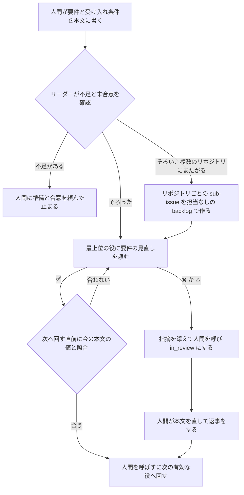

# 要件を最上位のモデルで決める

要件を決める役を、Claude なら Fable 5.2、Codex なら Astra の思考の深さ high で動かす。質問は 1 回のコメントにまとめ、「推奨で」を合意として扱う。役を置かない構成では、最上位の役が人間の用意した要件を見直してから次の役へ回す。

この文書は、原本を変える人に向けて、要件を決める役のモデルと指示、役を置かない構成の要件の見直しの決まりを書く。

## 目的と範囲

要件は手戻りの起点になる工程なので、最上位のモデルで決める。質問を 1 回にまとめ、人間を待つ回数と、要件を決める役の実行の回数を減らす。

次は対象にしない。

- ほかの役のモデル
- 使用率が上限に近いときに系統を移すか待つ決まり。`squad-usage-wait pick` に任せる
- バージョンを上げること。VERSION と MANIFEST は、バージョンを上げる PR で扱う
- 要件を決める役専用の評価の場面
- 要件を決める役を外せないようにすること
- 使用率に応じてモデルを下げること

## 役のモデルと思考の深さ

要件を決める役の front matter を、ランタイムのマークで分ける。モデルはマークを外したあとに読むので、FORMAT の決まりのまま、どの構成でも次のとおりになる。

| 使うランタイム | モデル | 思考の深さ |
| --- | --- | --- |
| 両方 | `claude-fable-5-2`（Fable 5.2） | high |
| Claude Code だけ | `claude-fable-5-2`（Fable 5.2） | high |
| Codex だけ | `gpt-6-astra`（Astra） | high |

`common/agents/planner.md` の front matter は、次の形である。

```text
<!-- IF runtime-claude -->
model: claude-fable-5-2
<!-- ELSE -->
model: gpt-6-astra
<!-- ENDIF -->
thinking_level: high
```

FORMAT には「Claude のモデルの役は、runtime-claude がなければ Codex の実装と同じモデルにする」とある。これは、ランタイムのマークを外したあとに `claude-` のモデルが残るときの決まりである。

Codex だけの構成ではランタイムのマークで Astra が残るので、この決まりは働かず、Codex の実装のモデル（Sol）に移らない。最上位の役と同じく、ない方のモデルへ移さない形になる。FORMAT の文は、この役のための例外を持たない。

## 要件を決める役の指示

質問は 1 つずつ聞かず、仮定と質問を 1 回のコメントにまとめる。人間は、推す答えのままでよければ「推奨で」と返すだけで済む。

`common/agents/planner.md` の「人間に確認するとき」は、聞き方を次の 4 項目で決める。

1. 置いた仮定と質問を 1 回のコメントにまとめる。質問ごとに、選択肢と、それぞれの良い点・悪い点、推す答えを添える
2. 「推奨で」の返事は、すべての仮定と推す答えへの合意とみなす。違う点だけを答えた返事は、残りの仮定と推す答えへの合意とみなす
3. 合意できたら本文に書き、人間に確認し直さずにリーダーへ返す
4. 質問の往復は 2 回までを目安にする。3 回目が要るときは、決めることを 1 つに絞り、絞った理由を添える

「結果の出し方」の「合意できたら、本文に書き」の文にも、「人間に確認し直さずに」がある。

## 役を置かない構成の要件の見直し

要件を決める役を外した構成では、リーダーが、人間の用意した要件を次の役へ回す前に、最上位の役に見直しを頼む。ラベル `重要` の有無によらず頼む。最上位の役がないときは見直しを頼まず、次の有効な役へ回す。リーダーは要件を見直す役を代行しないためである。

見直しの頼み方と最上位の役の選び方は、[principal-review.md の設計の見直し](principal-review.md#設計の見直し)と同じにする。最上位の役は、`leader-principal.md` の「pick の結果」のとおり、系統を渡さない `squad-usage-wait pick <タスク> principal` で選ぶ。終了 3 なら依頼を書かずに待ち、起こしで起きたら同じ `pick` から頼み直す。

人間が要件と受け入れ条件を本文に書く。リーダーは不足と未合意を確認し、不足があれば人間に準備と合意を頼んで止まる。

要件を決める役を外した構成で、要件の見直しから次の役へ回す流れを示す。



### 頼むとき

見直しは、1 タスクにつき 1 回だけ頼む。例外は、見直した本文と今の本文が合わないときの頼み直しだけである。人間が指摘を受けて直した要件は、もう一度見直さずに次の役へ回す。

| 場面 | リーダーがすること |
| --- | --- |
| 要件がそろい、見直しの依頼がまだない | 最上位の役を選び、今の本文の値で要件の見直しを頼む |
| 今の本文と同じ値の依頼があり、返事を待っている | 頼み直さず、返事を待つ |
| 見直しの結果が ✅ | 次へ回す直前に照合し、合えば人間を呼ばずに次の有効な役（設計の役、なければ実装の役）へ回す |
| ✅ の結果が照合で合わない | 今の本文の値で、新しい回として頼み直す |
| 見直しの結果が ❌ か ⚠️ | 指摘を添えて人間を呼び、`in_review` にする |
| 人間が直して返事をした | 照合も頼み直しもせず、次の有効な役へ回す |
| 複数のリポジトリにまたがる | 親に `repository` を置かず、人間を呼ばない。sub-issue を作ってから親で見直しを頼む（詳細は表の下と[複数のリポジトリにまたがる親](#複数のリポジトリにまたがる親)） |
| 最上位の役が見直さずに返した | ❌ と同じく、見直さなかった理由を添えて人間を呼び、`in_review` にする。照合も頼み直しもしない（[見直さずに返すとき](#見直さずに返すとき)） |

複数のリポジトリにまたがるときは、リポジトリごとの sub-issue を担当なしの `backlog` で作る。見直しは親のタスクで頼み、sub-issue では頼まない。

ラベル `重要` のあるタスクでは、重要のマークの判断を先に行う。要件の見直しと、そのあとの設計の見直しは別に頼み、片方の結果でもう片方を飛ばさない。

### 依頼と返事の行

依頼の行は他の種類と同じ形で、種類に `要件の見直し` を持つ。要件の見直しには PR もコミットもないので、確認する対象をタスクの本文の sha256 で表す。squad-handoff の「レビューと E2E の返事を返す」の、コミットの代わりに名前と識別値で合わせる決まりに当たる。

```text
見直しの種類: 要件の見直し
返事を待つ役: <最上位の役の名前>
確認するコミット: タスクの本文 <sha256>
```

sha256 は、`multica issue get <タスク> --output json | jq -j .description | shasum -a 256` の先頭の値にする。リーダーは、頼む直前に今の本文からこの値を出す。最上位の役は、自分が読んだ本文を見直し、同じ方法で出した値を `確認したコミット: タスクの本文 <sha256>` で返す。行の名前は、`squad-review-wait` が読む名前である。

### 本文の照合と頼み直し

本文は保存せず、見直した本文が次へ渡す本文と同じかを値で照合する。最上位の役は前の本文を取得できないので、合わないときは今の本文で新しい回を頼む。

リーダーは ✅ を受けて次の役へ回す直前に、今の本文の値を出し直す。結果の値、依頼の値、今の値の 3 つが同じときだけ次へ回す。依頼のあとや見直しの途中で本文が変わると、どれかが違う。違えば古い ✅ を使わず、次へ回さない。

合わないときは、`leader-review-wait.md` の「確認したコミットの照合」と同じく、新しい回で頼み直す。今の値で `squad-review-wait watch` を流し、依頼のコメントを出し直す。この頼み直しは「1 回だけ」の数に入れない。照合で 2 回続けて合わなければ、3 回目は頼まず、依頼した値と返った値を添えて人間を呼ぶ。

「依頼がすでにある」は、今の本文と同じ値の依頼があることを指す。値の違う依頼は、本文が変わる前の回なので、頼み直さない理由にしない。

❌ か ⚠️ が返ったあとは、照合の対象から外れる。人間が指摘を読んで本文を直すので、値が変わるのは当然だからである。人間が返事をしたら、値を照合せず、見直しも頼まずに次の役へ回す。

見直さずに返した ❌ の `確認したコミット: なし` も、❌ なので照合しない。`leader-review-wait.md` の「確認したコミットの照合」は、`なし` の役を新しい回で頼み直すと決めている。要件の見直しの回ではこの決まりを使わず、人間を呼ぶ。値の誤りは本文や metadata の直しを要し、同じ依頼を頼み直しても直らないためである。

返事の待ち方は、`squad-review-wait watch`、`report`、`proceed` の手順に従う。結果を置く PR がないので、最上位の役は結果を `squad-review-wait report` でタスクに返す。

`report` のあとの `squad-review-next decide` は、要件の見直しの回で次の依頼を書かず、リーダーを起こす。回の種類を読む `round_kind` は種類 `要件の見直し` を持ち、`decide` は `次の依頼を決められません: 要件の見直しの回はリーダーが扱う` で終了 3 にする。種類を `要件の見直し` と読むのは、種類が分からない回として止まると、理由の行で要件の見直しと読み分けられないためである。PR の確認より前に止まるので、PR がなくても PR の見張りを呼ばない。

### 最上位の役の見るもの

最上位の役のひな形（`claude-principal.md` と `codex-principal.md`）の「担当すること・しないこと」は、3 種類に加えて 4 つ目として `要件の見直し` を持つ。この文は `<!-- IF planner --><!-- ELSE -->…<!-- ENDIF -->` の ELSE 側に置き、要件を決める役がある構成には出さない。

| 見るもの | 主な観点 |
| --- | --- |
| タスクの本文の背景・要件・やらないこと・受け入れ条件と、タスクのコメント | 受け入れ条件で確認できるか、抜けた場合や矛盾、リポジトリ間の I/F の合意、作業先の `AGENTS.md` の方針との食い違い |
| 複数のリポジトリにまたがる親では、sub-issue の一覧と、それぞれの `repository` と本文 | 分け方と作業先が、親の要件とプロジェクトの説明の各リポジトリの役割に合うか、I/F が親に残っているか |

本文が当たるリポジトリのうち sub-issue のないものがあれば、必須の指摘にする。

PR がないので、ELSE 側には次の 3 つがある。結果のマークと指摘の書き方は他の種類と同じにし、`設計` と `コード` の種類は添えない。

1. 作業先は、下の表のとおり、本文がプロジェクトの説明のいくつのリポジトリの役割に当たるかで決める。決まったリポジトリをすべて checkout し、それぞれの `AGENTS.md` を読む
   - 決められないときは[見直さずに返すとき](#見直さずに返すとき)のとおりに返す
2. 結果は PR に書かず、`squad-review-wait report` でタスクにだけ返す。`確認したコミット: タスクの本文 <sha256>`、結果のマークの行、`設計への指摘: なし` の順にする
3. 冒頭の「最終レビューは…すべてのタスクで行います。」の文のあとに、要件の見直しは重要のマークによらず行うことが書いてある

| 本文の当たり方 | タスクの形 | 作業先の決め方 |
| --- | --- | --- |
| 2 つ以上のリポジトリの役割に当たる | 複数のリポジトリにまたがる親 | sub-issue を必須にし、なければ見直さずに返す。作業先の照合は表の下のとおりにする |
| 1 つのリポジトリの役割だけに当たる。一覧が 1 つだけ | 単一のリポジトリのタスク | タスクの metadata の `repository` を一覧と照合する。sub-issue があっても、作業先の決め方には使わない |

複数のリポジトリにまたがる親では、`multica issue children <タスク>` ですべての sub-issue を読む。その metadata の `repository` を、プロジェクトのリポジトリの一覧と照合する。親自身の `repository` は、値があっても読まない。

当たり方は、リーダーが `leader-flow.md` の「作業先を決める」で使うのと同じ基準で決める。本文とプロジェクトの説明の各リポジトリの役割から決める点も同じである。役割が未記入などで当てはめられないときは単一のリポジトリのタスクとして扱う。その場合は、作業先が本文から決まらないことを要件の指摘に書く。

sub-issue の有無だけでは決めない。複数にまたがる本文で sub-issue がなく、親に一覧にある値が残っていると、その 1 つだけを見て見直しが進んでしまう。単一のリポジトリのタスクに sub-issue があるだけで親の値を無視すると、単一のリポジトリのタスクの作業先を、タスクの値と一覧の照合で決める決まりと食い違う。最上位の役とリーダーの判断が食い違ったときは、見直さずに返す場合のどれかに当たるので、人間が読んで直せる。

`設計への指摘:` の行は、行の順を他の種類の結果とそろえるために置く。設計はまだないので常に `なし` とし、リーダーは結果のマークで扱いを決める。

### 複数のリポジトリにまたがる親

要件を決める役がなく最上位の役がある構成では、リーダーは、要件の見直しを頼む前にリポジトリごとの sub-issue を作る。最上位の役が、分け方と、すべての作業先の `AGENTS.md` を見て要件を見直せるようにするためである。

リーダーは、`leader-flow.md` の「作業先を決める」で要望が 2 つ以上のリポジトリの役割に当たっても、それを理由に人間を呼んで止まらない。親には `repository` を置かない。分け方は、本文とプロジェクトの説明の各リポジトリの役割から決める。どのリポジトリに分けるかを決められないとき（どの役割にも当たらない部分がある、役割が未記入など）は、人間を呼んで止まる。

| 順 | リーダーがすること |
| --- | --- |
| 1 | リポジトリごとの sub-issue を、最初のステージも含めて担当なしの `backlog` で作る。本文には、親の要件のうちそのリポジトリの分を書き、リポジトリ間の I/F は親に残す |
| 2 | 各 sub-issue の metadata の `repository` に `OWNER/REPO` を書き、先に入れるリポジトリから順に `--stage` を付ける |
| 3 | 親のタスクで、今の本文の値で要件の見直しを頼む。依頼と返事の行は、単一のリポジトリのタスクと同じにする |
| 4 | 結果を受けるまで、sub-issue の担当と状態を変えない |
| 5 | ✅ で本文の値が合えば、人間を呼ばずに、最初のステージの sub-issue にスクワッドの担当と状態を付けて回す。各 sub-issue は、設計からの流れを通す |
| 6 | ❌ か ⚠️ なら、指摘を添えて人間を呼び、親を `in_review` にする。分け方を直すときは、人間が本文とあわせて sub-issue も直す |

最初のステージも担当なしの `backlog` で作るのは、squad-handoff の「新しいタスクを作るとき」の例外である。通常は最初のステージに担当を付けて作るが、ここでは見直しの前に sub-issue の設計が始まらないようにする。

sub-issue では要件の見直しを頼まない。親で見直した要件の分なので、同じ要件をリポジトリの数だけ見直さずに済む。人間の返事を受けて sub-issue を回すときは、通常の振り分けのとおり、各 sub-issue の `repository` が一覧にあるかを確認する。

### 見直さずに返すとき

最上位の役は、作業先を決められないときは見直さず、`squad-review-wait report` で ❌ として返す。通常の引き継ぎのコメントやメンションでは返さない。返事を待つ見張りとリーダーの手順が、ほかの結果と同じ道で受け取れるようにするためである。

| 場合 | `確認したコミット:` の行に添える理由 |
| --- | --- |
| 複数のリポジトリにまたがる親に sub-issue がない | `複数のリポジトリにまたがるが sub-issue がない` |
| sub-issue の `repository` がないか、一覧にない | `sub-issue の repository がないか一覧にない: <sub-issue の識別子>` |
| checkout できない | `checkout できない: <OWNER/REPO>` |
| 単一のリポジトリのタスクの `repository` がないか、一覧にない | `タスクの repository がないか一覧にない: <値、なければ なし>` |

4 つの場合は、要件の 4 つの場合と 1 つずつ対応する。どちらのタスクの形かは、[最上位の役の見るもの](#最上位の役の見るもの)の表で先に決める。

結果は次の 3 行の順にする。理由は `確認したコミット:` の行に括弧で添える。`squad-review-next` の結果の読み方（`parse_result`）は、決まった行を除いた最初の行をマークの行として読む。要件の見直しの回では `decide` がそこまで読まないが、理由を別の行にすると、ほかの結果と同じ形で読めなくなるためである。

```text
確認したコミット: なし（<見直さなかった理由>）
❌ <自分のエージェントの名前>: 要件を見直していない
設計への指摘: なし
```

`decide` は、`見直しの種類: 要件の見直し` の回を、結果のコミットと PR を読む前に `要件の見直しの回はリーダーが扱う` で止める。`確認したコミット: なし` でも同じ道を通るので、この回のために分けたスクリプトも行の形もない。

リーダーは、この ❌ をほかの ❌ と同じく扱い、理由を添えて人間を呼び、`in_review` にする。見直していない ❌ と指摘のある ❌ は読み分けない。人間は理由の文で読み分けられる。

## リーダーの指示の大きさ

リーダーの指示は、展開した大きさを上限の 12,288 バイトに収める。上限は `tests/agent-templates-test.sh` が測る、全分岐のうち長い方を足した大きさである。

展開した大きさは 11,161 バイトで、上限までの余裕は 1,127 バイトである（`tests/leader-eval/values.json` の値で展開した、このテストの出力）。指示に文を足すときは、ほかを縮めて余裕の中に収める。

原則 5 は、聞き方を決める唯一の原則で、評価の場面 3-1・3-2・6-2 の採点の拠りどころである。指示の原則 5 は「推す案と理由を添える」を持ち、冒頭には重なる語句を置かない。原則 4 と原則 7 は短い文である。原則 7 は手当ての内訳を書かず、内訳は `leader-flow.md` の「同じ誤りや差し戻しが続くとき」にある。

| 箇所 | 指示の文 | 省いた語句が読める場所 |
| --- | --- | --- |
| 冒頭の 2 文目 | 「人間には判断だけを頼む。」 | 原則 5 の「推す案と理由を添える」 |
| 原則 4 | ログだけでも手を打ってほしい意図と読む | `docs/leader-principles.md` の原則 4。指示には意図を読むことが残る |
| 原則 5 | 「原則と手順で決まることは進める。1 行目に起きたことと次の一手を書く。人間に聞くのは 1 つに絞り、推す案と理由を添える」 | なし。1 行目は「結論」でなく「起きたこと」と書く |
| 原則 7 | 手当ての内訳を書かず、「指示の実物は勝手に変えない」で終える | `leader-flow.md` の「同じ誤りや差し戻しが続くとき」 |
| 要件を決める役の ELSE | 合意済みの要件・受け入れ条件は、最上位の役があれば見直してもらってから、次の有効な役へ直接回す | なし。言い換えで縮めてある |

`docs/leader-principles.md` は、「役の目的」に「根拠と推す案を添えて」を書かない。「判断の優先の原則」の後ろには、指示の文を上限に収めるために縮めた、と書いてある。縮めた内容の置き場所は、この表が節の名前で示す。

## 互換性と影響を受ける利用者

要件を決める役の設定と見直しの決まりは、役のひな形とリーダーの指示にあるので、導入済みのプロジェクトはセットアップを流し直すと反映される。エージェントとオートパイロットの数、回答ファイル、`excluded_roles` は変わらず、回答ファイルの移し替えは要らない。

影響を受けるのは、原本を導入・更新する人と、導入したプロジェクトの担当である。

- 要件を決める役のモデルは Fable 5.2 か Astra、思考の深さは high である。登録済みのエージェントは、流し直しでこの設定に更新される
- 要件を決める役の質問は 1 回にまとまり、「推奨で」で合意になる
- 要件を決める役を外した構成では、リーダーが、人間の用意した要件を次の役へ回す前に、最上位の役に見直しを頼む。見直しはタスクごとに 1 回で、指摘がなければ人間を呼ばずに進む
- 最上位のモデルの利用枠を使うので、更新の前に利用枠を確認する必要がある

流し直す前から動いているタスクは、流し直したあとの指示で続きを進める。役を外した構成で、すでに設計か実装へ回ったタスクは、次の役へ回す前の時点を過ぎているので、要件の見直しを頼まない。

## テスト

役のモデルと指示の文は自動テストで確認し、リーダーの振る舞いはリーダーの評価の場面で確認する。

### 自動テスト

次のテストで確認する。どれも `tests/run.sh` と CI で流れる。

| テスト | 確認すること |
| --- | --- |
| `tests/agent-templates-test.sh` | Claude だけで `claude-fable-5-2` と high、Codex だけで `gpt-6-astra` と high、両方で `claude-fable-5-2` と high になる。展開した planner に「推奨で」と往復の目安があり、「質問は 1 つずつ」がない |
| `tests/agent-templates-test.sh` | 役を外した構成で、リーダーの指示に要件の見直しがあり、最上位の役の指示に `要件の見直し` がある。役を置く構成のリーダーは要件を決める役へ回し、最上位の役の指示に `要件の見直し` が出ない |
| `tests/agent-templates-test.sh` | 全構成のリーダーの原則に「推す案と理由を添える」がある。要件を決める役と最上位の役をどちらも外した構成で、スクワッドの説明に要件の見直しの行が出ない |
| `tests/project-runtimes-test.sh` | 片方だけのランタイムで登録する planner のモデル |
| `tests/setup-runtimes-test-lib.sh` | 期待するモデルの表で、planner は Fable 5.2／Astra で、medium の組に入らない |
| `tests/squad-review-next-decide-route-test.sh` | `見直しの種類: 要件の見直し` と `確認するコミット: タスクの本文 <sha256>` の回で、`要件の見直しの回はリーダーが扱う` で止まり、PR の見張りを呼ばない |
| `tests/leader-eval-test.sh` | 型 `新` の場面の ID と型を受け付け、場面の一覧にその場面がある。`cli.json` の `planner` が真偽値でなければ止まる |

### リーダーの評価の場面

役を外した構成を評価で流せるよう、場面の `cli.json` に `"planner": false` を置ける。`run.sh` は、`"ci_monitor": false` の場面で CI の見張り役を外した指示を場面ごとに描き、`"planner": false` の場面で要件を決める役を外した指示を描く。

- `run.sh` は、`ci_monitor` か `planner` が `false` の場面で、場面ごとの指示を描く。`planner` が `false` なら、有効な役から `planner` を外す
  - `ci_monitor` と `planner` は、どちらも真偽値かを確認する
- `leader_eval.py` の `run_one` は、どちらかが `false` の場面で、場面ごとの指示を読む

この場面は、過去の出来事ではなく手順を確認するので、型 1〜6 にも「保」にも当たらない。型を `新`、ID を `add-<番号>` にし、`tests/leader-eval-test.sh` が ID と型を検査する。今のリーダーはこの手順を持たないので、`新` の場面では今のリーダーが落ちてよく、新しいリーダーが 3 回とも基準を満たせば合格とする。

| ID | 外す役 | 入力の要点 | 合格の基準の要点 |
| --- | --- | --- | --- |
| `add-1` | planner | 人間が要件と受け入れ条件を本文に書き、設計を頼む | 最上位の役に `見直しの種類: 要件の見直し` で頼み、`squad-review-wait watch` と `返事を待つ役:` の行を置く。設計の役へまだ回さない |
| `add-2` | planner | 要件の見直しが ✅ で返り、本文は依頼のときと同じ | 人間を呼ばずに設計の役へ回し、見直しを頼み直さない |
| `add-3` | planner | 要件の見直しが ⚠️ で返った | 指摘を添えて人間を呼び、`in_review` にする |
| `add-4` | なし | 新しい要望を受け付けた | 要件を決める役へ頼み、最上位の役に要件の見直しを頼まない |
| `add-5` | planner | 要件の見直しが ✅ で返ったが、見直しの途中で人間が本文を直した | 設計の役へ回さず、今の本文の値で `squad-review-wait watch` を流し、新しい回として頼み直す |

### 確認するテスト

複数のリポジトリにまたがる親の要件の見直しは、自動テストで指示の文と `decide` の道を確認し、リーダーの評価の場面で振る舞いを確認する。どれも `tests/run.sh` で流れ、評価の場面はマージの前に流す。

| テスト | 確認すること |
| --- | --- |
| `tests/agent-templates-test.sh` | 最上位の役の作業先と、見直さずに返す文を構成ごとに確認する（詳細は表の下） |
| `tests/agent-templates-test.sh` | リーダーの手順と指示、squad-handoff の例外を確認する（詳細は表の下） |
| `tests/squad-review-next-decide-route-test.sh` | 要件の見直しの回で、見直さずに返った ❌ を扱う道を確認する（詳細は表の下） |
| `tests/leader-eval-test.sh` | `cli.json` の `repositories` と、`add-6`、`add-7`、`add-8` の場面を確認する（詳細は表の下） |

表のテストで確認する文と振る舞いを、次に書く。

- `tests/agent-templates-test.sh` では、要件を決める役がない構成（`no-planner` と `no-planning`）の最上位の役を確認する
  - `multica issue children`、本文の当たり方で作業先を決めること、親自身の `repository` を読まないことの文がある
  - 4 つの場合の理由と、`確認したコミット: なし（` がある
  - 境界の 2 つとして、複数にまたがる本文で sub-issue がなければ親の値があっても返す文がある。単一のリポジトリのタスクでは sub-issue があってもタスクの値を使う文もある
  - 役がある構成には、これらの文はどれも出ない
- 同じテストでは、リーダーの手順と指示、squad-handoff の例外も確認する
  - `leader-flow.md` と `leader-principal.md` に、担当なしの `backlog` で作ってから見直しを頼む語句がある。結果まで sub-issue の担当と状態を変えないことと、見直さずに返った ❌ を頼み直さないことの語句もある
  - `sub-issue では見直さない` の語句がある
  - 全構成のリーダーの指示に `振り分け前に作業先を決め` があり、`振り分け前に metadata` がない
  - squad-handoff の作業先の節に、止まらず分割へ進む例外がある
- `tests/squad-review-next-decide-route-test.sh` では、要件の見直しの回で、✅ と ⚠️ の繰り返しに加えて 1 件を確認する
  - `確認したコミット: なし（…）` と ❌ の結果を `report` したとき、`要件の見直しの回はリーダーが扱う` でリーダーに返す。何も書かず、PR の見張りを呼ばない
- `tests/leader-eval-test.sh` では、リポジトリの値と場面を確認する
  - `cli.json` の `repositories` が `OWNER/REPO` の文字列の配列でなければ止まる
  - `repositories` のある場面は場面ごとの指示を描き、「このプロジェクトの値」の一覧がその値になる
  - `add-6`、`add-7`、`add-8` が場面の一覧にある

評価の場面は、リポジトリを 2 つにするため、`cli.json` に `repositories` の鍵を置ける。値は `OWNER/REPO` の配列で、省略時は `values.json` の値を使う。`run.sh` と `leader_eval.py` の `run_one` は、`ci_monitor` か `planner` が `false` の場面と同じく、この鍵のある場面で場面ごとの指示を描いて読む。

場面ごとの指示は、`values.json` の `repositories` を場面の値に差し替えて描く。各値を `` ` `` で囲み、`、` でつないだものにする。各リポジトリの役割は、場面の入力にプロジェクトの説明として書く。

| ID | 外す役 | 入力の要点 | 合格の基準の要点 |
| --- | --- | --- | --- |
| `add-6` | planner | リポジトリが `example/shop` と `example/admin` の 2 つで、人間が両方にまたがる要件と受け入れ条件を本文に書いた。sub-issue はまだない | 親で見直しを頼む前に sub-issue を作る（詳細は表の下） |
| `add-7` | planner | 複数のリポジトリにまたがる親の要件の見直しが、`確認したコミット: なし（checkout できない: example/admin）` と ❌ で返った | 見直さなかった理由を添えて人間を呼ぶ（詳細は表の下） |
| `add-8` | planner | リポジトリが `example/shop` と `example/admin` の 2 つで、人間が `example/shop` の役割だけに当たる要件を本文に書いた | 単一のリポジトリのタスクとして見直しを頼む（詳細は表の下） |

表の場面ごとの記録と採点の基準は、次のとおりである。

- `add-6`
  - [記録] リポジトリごとの sub-issue を `backlog` で担当なしに作り、それぞれに `repository` と stage を書く。親に `repository` を書かない
  - [記録] そのあと親で `見直しの種類: 要件の見直し` で頼み、`squad-review-wait watch` を流す。人間を呼ばず、`in_review` にしない
  - [採点] 本文の要件をリポジトリの役割で分け、I/F を親に残している
- `add-7`
  - [記録] 理由を添えて人間を呼び、`in_review` にする。`squad-review-wait watch` を流さず、頼み直さない
  - [記録] sub-issue の担当と状態を変えない
- `add-8`
  - [記録] 親に `repository` として `example/shop` を書き、sub-issue を作らずに `見直しの種類: 要件の見直し` で頼む。人間を呼ばない
  - [採点] 2 つのリポジトリがあっても、単一のリポジトリのタスクとして扱っている

最上位の役の振る舞いを確認する評価の場面はないので、最上位の役の境界の 2 つは、展開した指示の文を `tests/agent-templates-test.sh` で確認する。リーダー側の境界は `add-8` で確認する。

## 残る危うさ

「推奨で」を合意とすると、人間が推す答えを読まずに返すことがある。要件の本文は、設計と最上位の役の見直しで読まれるので、そこで気づける。

要件の見直しの対象を本文の sha256 で表すので、改行や空白だけの直しでも値が変わる。そのときは新しい回の頼み直しになり、最上位の役の実行が 1 回余分にかかる。次へ回す直前に照合するので、古い ✅ で進むことはない。

複数のリポジトリにまたがる親では、本文の値が親の本文だけを表す。見直しの途中で人間が sub-issue の本文や `repository` だけを直しても、照合では気づけない。見直しの前にリーダーが作った sub-issue を、結果まで変えないことで狭める。人間が直す場合は、直したあとに返事をする流れで扱う。

見直さずに返った ❌ で人間が値を直して返事をすると、見直しを頼まずに次へ回る。要件はまだ見直されていない。人間がもう一度の見直しを返事で頼めば、リーダーは人間の依頼として頼む。見直していない ❌ は読み分けない決まりなので、この扱いは理由の文を読んだ人間に任せる。

リーダーの指示は上限までの余裕が限られる。指示へ文を足す変更は、縮める箇所を先に決めてから足す必要がある。

## 検討した案

役の構成・見直しの対象と頼み直し・指示の文・複数のリポジトリの扱いについて、次の案を選ばなかった。

- 要件を決める役を外せない形にする案は選ばない。要件で合意したとおり、外した構成は人間の要件を最上位の役が見直すことで足りるため
- 人間が直した要件をもう一度見直す案は選ばない。見直しが続くと枠を使い続け、人間が指摘を読んで直せば足りるため
  - 設計の見直しと同じ扱いにする
- 要件の見直しをラベル `重要` のタスクだけにする案は選ばない。役を外した構成では、要件の工程を最上位のモデルが通る経路がほかにないため
- 見直した本文の写しをタスクに保存し、その写しを見直しの対象にする案は選ばない。成果物が 1 つ増え、写しと今の本文の食い違いを別に照合する必要があるため
  - 本文が変われば、今の本文を見直し直せば足りる
- 見直しの対象をタスクの `updated_at` で表す案は選ばない。コメントやラベルの変更でも値が変わり、本文が同じでも頼み直しになるため
- 原則 5 の「推す案と理由を添える」を削り、冒頭に任せる案は選ばない。冒頭は目的の文で、原則の順位の中に入らず、評価の場面の採点も原則 5 の文を見るため
- 原則 7 の手当ての内訳を戻す案は選ばない。上限を超え、内訳は `leader-flow.md` に残るため
- Codex だけの構成で FORMAT の決まりのとおり Sol に移す案は選ばない。要件を最上位のモデルで決める目的に合わないため
- 複数のリポジトリにまたがる親で、親の metadata に作業先を並べる案は選ばない。`repository` は 1 つの `OWNER/REPO` を表す決まりで、ほかの役と見張りの読み方を変える必要があるため
  - 作業先は sub-issue の metadata で表す
- 最上位の役が sub-issue の有無だけでタスクの形を決める案は選ばない。sub-issue のない複数の親を親の値 1 つで見直してしまい、sub-issue のある単一のリポジトリのタスクを、タスクの値で扱う動作とも食い違うため
- 見直してから sub-issue に分ける順にする案は選ばない。最上位の役が分け方と各作業先の `AGENTS.md` を見られず、親に作業先がないので見直さずに返るため
- 見直さずに返すとき、通常の引き継ぎのコメントで返す案は選ばない。返事の待ちの見張りが結果を受け取れず、リーダーが ❌ と同じ道で扱えないため
- 見直していない ❌ を、新しいマークや行で読み分ける案は選ばない。スクリプトと行の形を変える必要があり、理由の文で人間が読み分けられ、場面もまれなため
- 値を直せるときに、リーダーが人間を呼ばずに直して頼み直す案は選ばない。リーダーの手順と行の形が増え、作業先の決め直しは人間の判断に当たるため
