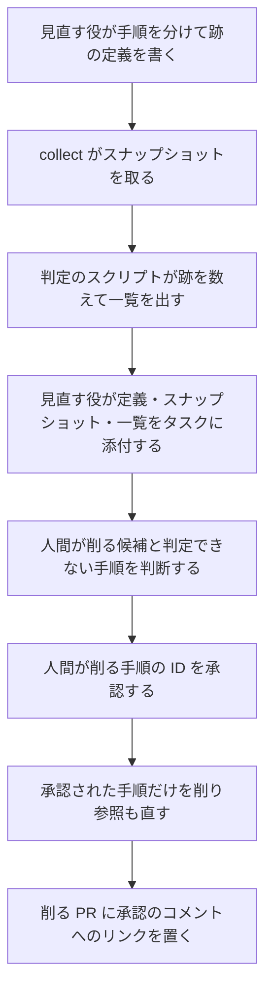

# 手順を足す条件と、効いていない手順の見直し

この文書は、原本を変える人に向けて、役の指示やスキルに手順を足すときに書くことを決める。最近の 20 件の記録で一度も働かなかった手順を、人間の承認を得て削る見直しも決める。

足す条件と見直しの手順の正本は `CONTRIBUTING.md` に置く。この文書には、その形を選んだ理由と、判定の作り方、互換性を置く。

## 目的と範囲

目的は、スクワッドの手順が増え続けて実行が重くなるのを止めることである。スクワッド自身の手順を直すタスクが多いのに、足す条件も削る決まりもないと、手順は増える一方になる。足す側には根拠と跡を求め、削る側は記録から同じ結果が出る判定で候補を出す。

当てる範囲は、導入先でエージェントが読む原本の手順で、次のファイルである。

| まとまり | ファイル |
| --- | --- |
| 役のひな形 | `common/agents/*.md`（`FORMAT` を除く） |
| 共通スキルとリーダーの手順の参照ファイル | `common/skills/squad-handoff/` の下の `*.md` |
| スクワッドとオートパイロットの指示 | `common/squad.md`、`common/autopilots.md` |

このリポジトリの `AGENTS.md`・作業別のルール・`CONTRIBUTING.md` は範囲に入れない。導入先が記入するひな形（`skeleton/`）、設計の文書（`docs/`）、スクリプトとテストも範囲に入れない。範囲外は記録で効いたかを判定しにくく、手順の増加の中心でもないため、範囲から外す。

## 手順を足す条件

範囲のファイルに手順を足す変更は、その設計に次の 2 つを書く。設計がない変更では、PR の本文に書く。

1. 防ぐ失敗は、どのタスクで何が起きたかを言葉で書く。タスクの識別子の置き場所は[タスクの識別子の置き場所](#タスクの識別子の置き場所)に従う
2. 働いた跡。手順が働いたときに、コメント・状態の変化・実行の記録のどれに何が残るかを、[跡の形](#跡の形)のどれかで書く

合意された要件で新しい機能を入れるための手順は、その要件を合意したタスクを根拠として示せば、1 の失敗の記録に代えられる。新しい機能の手順は、まだ失敗の記録がなく、失敗の記録を求めると入れられなくなるためである。2 の跡は、この場合も書く。跡のない手順は、次の見直しで判定できないものになり、人間に判断の手間を回すためである。

「手順を足す」は、役に何かをさせる・確認させる・止まらせる文を新しく入れることである。既存の手順の言い換え、誤りの修正、削除、参照先の変更は当たらない。既存の手順に条件や分岐を足して、役がすることが増える変更は当たる。

### タスクの識別子の置き場所

防ぐ失敗のタスクの識別子は、公開のリポジトリに書かず、設計の承認を頼むタスクのコメントに書く。PR の本文で示すときは、その PR を紐付けたタスクのコメントに書く。設計と PR の本文には、失敗を言葉で書き、「失敗の記録はタスクのコメントにある」と示す。

タスクの識別子や進行の記録を Multica 側に置き、PR の本文と原本へ持ち出さない決まりに合わせるためである。これは、`squad-handoff` の PR の本文の決まりである。

## 足す条件の確認

足す条件の記載がない変更は、このリポジトリのスクワッドの code-reviewer が、PR のレビューで見つける。範囲のファイルの差分は実装の PR で必ず code-reviewer のレビューを通り、code-reviewer はすでに `AGENTS.md` と `.agents/rules/` をレビューの観点として読むためである。

方法は次のとおりである。

1. このリポジトリだけの作業別のルール `.agents/rules/procedures.md` を使う。`paths` は[目的と範囲](#目的と範囲)の範囲のファイルで、内容は、`CONTRIBUTING.md` の足す条件へのリンクと、レビューで確認することである
2. `AGENTS.md` の作業別のルールの表に、範囲のファイルの手順を変える行があり、このルールを指す
3. code-reviewer は、範囲のファイルの差分に[手順を足す](#手順を足す条件)ものがあるとき、2 つ（または要件の根拠と跡）の記載を確認する。同じ PR の設計の差分、PR に示された設計、PR の本文のどれかを見る
   - 記載がないときは、ルールを示して必須の指摘にする
4. 設計の役と実装の役も同じルールを読むので、設計のフェーズで 2 つを書く。code-reviewer の確認が、その書き漏れを止める

人間が直接作る PR は、code-reviewer を通らないことがある。そのため、PR テンプレートの確認の項目で、範囲のファイルに手順を足したときに 2 つを書いたかを確認する。配布するひな形（`common/agents/code-reviewer.md`）には、この確認を入れない。足す条件は原本を変える人の決まりで、導入先のプロジェクトには当てないためである。

## 見直しの手順

見直しは、手順の一覧と跡を決め、記録のスナップショットを読む。判定の一覧を人間に示し、承認されたものだけを削る。判定は、同じ入力から同じ一覧が出るスクリプトで行う。

見直す役から集計、人間の承認、手順の削除へ渡す流れを示す。



1. 範囲のファイルの手順を、[手順の単位](#手順の単位)に分けて跡の定義に書く。手順ごとに、跡か、守る手順の分類か、跡を決められないことを書く
2. 跡の定義を渡して、[`metrics.py collect`](metrics.md#記録を読む) でプロジェクトのスナップショットを取る
3. 判定のスクリプトで、作られた時刻が新しい順の 20 件について跡を数え、判定の一覧を出す
4. 跡の定義・スナップショット・判定の一覧を見直しのタスクに添付し、人間に削る候補と判定できない手順の判断を頼む
5. 人間が承認した手順だけを削り、その手順を参照する箇所（他の役の指示・スキル・テスト・文書）も直す。削る PR に承認のコメントへのリンクを置く

添付するものは、[metrics.md の置き場所と公開の範囲](metrics.md#置き場所と公開の範囲)と同じく、手元の `tmp/` に置いてコミットしない。エージェントの名前は、同じ節の手順で別名へ置き換えてから添付する。

### 手順の単位

手順の単位は、範囲のファイルの最も小さい見出しの節とする。1 つの節に別々に働く手順が並ぶときは、節の中の段落か箇条書きの項目の先頭の文を目印にして分けてよい。見出しの少ないファイル（リーダーのひな形など）で、節ごと削るか残すかの粗い判断にしないためである。

判定のスクリプトは、跡の定義が見直しの元にしたコミットの範囲のファイルのすべての見出しを覆うことを確認し、覆わない見出しがあれば止まる。目印の文は、その節の中にちょうど 1 回現れることを確認する。説明や定義だけで役に何もさせない節は、「手順でない」と書いて一覧に分けて示す。

### 跡の形

跡は、スナップショットの記録だけで数えられる次の 3 つの形のどれかにする。

| 形 | 数えるもの | 例 |
| --- | --- | --- |
| コメント | 本文が正規表現に合うコメント。書き手の種類で絞れる | 引き継ぎの定型の行、止まった理由の決まった文 |
| 状態の変化 | 変化の前と後の状態が合う変化 | `blocked` への変化 |
| 実行 | 役と状態が合う実行。役は [metrics.md の数える](metrics.md#数える)と同じ名前の規則で分ける | 修正の役の実行 |

スナップショットはコメントの本文を残さないので、コメントの跡は `collect` で数える。`collect` に跡の定義を渡すと、コメントごとに合った跡の ID の一覧だけを `trace_matches` として残し、本文は残さない。スナップショットには使った跡の定義の SHA-256 を残し、判定のスクリプトは、渡された跡の定義の SHA-256 が違えば止まる。

`collect --traces <ファイル>` は、`schema_version: 1` と `procedures` の配列を持つ JSON を読む。配列の各項目の `id` が跡の ID で、重複しない空でない文字列にする。

`trace` が `kind: "comment"` のオブジェクトなら、`pattern` の正規表現で本文を検索する。`author_type` があれば、書き手の種類も一致するコメントだけに ID を残す。1 件で何度一致しても同じ ID は 1 回だけとし、ID の順に並べる。一致しないコメントの `trace_matches` は空の配列にする。

`trace` が `null`、または `kind` が `transition`・`run` の項目は、コメントの照合から外す。定義そのものや本文・一致した文字列はスナップショットへ写さない。入力した定義のバイト列の SHA-256 を `trace_definitions_sha256` に残す。合成した入力の見本は `tests/fixtures/metrics/traces.json` にある。

### 判定

判定は、スナップショットの `collected_at` の時点のタスクのうち、作られた時刻が新しい順（同じ時刻は ID の順）の 20 件について、手順ごとに跡に合う記録の数を数えて決める。数える記録は、その 20 件のタスクのコメント・状態の変化・実行である。

| 判定 | 条件 |
| --- | --- |
| 効いた | 跡が 1 回以上 |
| 削る候補 | 跡が 0 回で、守る手順ではない |
| 守る手順で残す | 秘密・書き込み先の制限・ガード・取り消せない操作のどれかを守る手順。跡の回数によらない |
| 判定できない | 跡を決められない手順 |
| 手順でない | 説明や定義だけの節 |

守る手順の分類は、跡の定義を書く人が手順ごとに書き、一覧の列に出す。人間は一覧でその分類を確認できる。守る手順は、跡が 0 回でも削る候補にしない。働く機会がまれでも、外したときの損が大きいためである。

削る候補・判定できない・守る手順の行には、足された理由をたどる材料として、目印の文を最初に足したコミットと、その件名を添える。スクリプトが、見直しの元にしたコミットで `git log -S -m` を読んで出す。`-m` により、マージの衝突の解消で初めて入った行は、そのマージのコミットが返る。件名にマージした PR の番号があれば、そこから設計とタスクをたどれる。

一覧は、手順の ID の順に並べ、手順ごとに次の項目を示す。同じスナップショット、跡の定義、元のコミットから流すと、1 バイトも違わない一覧が出る。

- ファイル
- 節
- 目印
- 跡
- 20 件での回数
- 判定
- 守る手順の分類
- 足したコミット

### 集計と一覧の入力

集計と判定の一覧は、次のコマンドで作る。集計には保存したスナップショットと跡の定義を使い、見出し・目印と履歴は見直し元の Git のコミットから読む。Multica の記録は読み直さない。

```bash
python3 scripts/metrics.py traces tmp/metrics/snapshot.json \
  --traces tmp/metrics/procedures.json --project-key example --member-key anonymous \
  --revision <見直し元のコミット> \
  --output tmp/metrics/traces
```

跡の定義の各項目には、`id` と `trace` に加え、次の 3 つを空でない文字列で書く。

- `file`（ファイル）
- `section`（節）
- `marker`（目印）

守る手順には `protection` を付け、分類を次の値で表す。説明だけの節は、`not_procedure: true` と `trace: null` にする。

| 分類 | 値 |
| --- | --- |
| 秘密 | `secrets` |
| 書き込み先の制限 | `write_scope` |
| ガード | `gate` |
| 取り消せない操作 | `irreversible` |

状態の変化の跡は `kind: "transition"` と `from_status`・`to_status`、実行の跡は `kind: "run"` と `role`・`status` で照合する。実行の `role` は `--project-key` と `--member-key` から役の名前を読む規則に従い、一致しない名前は「その他」として指定できる。コメントは本文を再照合せず、保存済みの `trace_matches` を数える。

出力は `traces.json` と `traces.md` で、入力のハッシュと使った値、選んだタスク、手順の ID の順の一覧を残す。跡を決められない行の回数は JSON では `null`、Markdown では「未確認」とし、0 回と区別する。合成した入力は `tests/fixtures/metrics/trace-procedures.json` と `trace-snapshot.json` にある。

`--revision` は見直し元のコミットとして必須で、解決した完全な SHA を出力の入力欄に残す。原本の Git リポジトリは現在の場所を使い、別の場所は `--repository <ディレクトリ>` で指定できる。見出しと目印はそのコミットの内容から読み、作業ツリーや後のコミットは使わない。

検査は、範囲のファイルのすべての見出しに、跡の定義があることを確認する。親の見出しや説明だけの節も、子の定義とは別に覆う。コードブロック内の見出しと先頭の YAML のメタデータは数えず、`#` の見出しと下線型の見出しを読む。

同じ名前の節があるときは、`section` に「親 / 子」のように見出しの階層を書く。節が一意に決まらないとき、目印がその節の本文（子の節を含む）にちょうど 1 回現れないとき、覆わない見出しがあるときは出力を更新せずに止まる。

削る候補・守る手順・判定できない行の `introduced_commit` に、目印を最初に足したコミットの `sha` と `subject` を残す。Markdown の「足したコミット」の列にも出す。ほかの判定の行は JSON では `null`、Markdown では「—」にする。

履歴は指定したコミットから `git log -S -m` で読み、浅い履歴や読み取れない履歴では止まる。マージの衝突の解消で初めて入った行は、`-m` でそのマージのコミットが返る。テストは一時領域に作った合成のリポジトリを使い、公開の履歴やサーバーには依存しない。

### 判定のスクリプトの置き場所

判定は、`scripts/metrics.py` の `traces` の手順で行う。`collect` と同じスナップショットを読み、`count` と同じ決定的な書き方で出すためである。跡の定義を読むのも `collect` と `traces` の 2 つで、置き場所をそろえる。

跡の定義は、見直しのたびに書く JSON で、見直しのタスクに添付し、コミットしない。テストでは、合成した跡の定義とスナップショットを `tests/fixtures/metrics/` に置く。

### 人間の承認と削除

判定の一覧を添付したコメントで、人間に削る候補のうち削るものを判断してもらう。判定できない手順を残すか削るかも頼む。人間が承認した手順だけを削る。

承認の形は、手順の ID を並べた返事とし、削る PR の本文にそのコメントへのリンクを置く。

削る PR では、削った手順を参照する箇所を残さない。ほかの役の指示とスキル、テスト、文書の参照を `git grep` で探して直し、関連テストと markdownlint を通す。

### 2 回目以降の見直し

見直しは、人間が必要と判断したときに見直しのタスクを起票し、上の手順で行う。「最近の 20 件」は、見直しを始める時点のプロジェクトのタスクのうち、作られた時刻が新しい順の 20 件とする。見直しを自動で起票するオートパイロットや見張りは置かない。起票を忘れて困った記録が出たら、そのときに足す条件に従って足す。

## 互換性と影響を受ける利用者

足す条件と判定のスクリプトは、導入済みのプロジェクトの動作を変えない。変わるのは、このリポジトリだけの指示と、開発用のスクリプト・テスト・文書で、セットアップが配置・登録するものに触れないためである。`scripts/metrics.py` は配布物に入るが、セットアップは読まず、導入先にも配置しない。

見直しで手順を削ると、セットアップを流し直したときに、導入先の役の指示（エージェントの指示）と、共通スキル `squad-handoff` の内容が変わる。削った手順は、流し直しのあとの実行から行われなくなる。導入先が[拡張](../EXTENSIONS.md)で末尾に足した指示は変わらない。

セットアップを流し直しても、エージェント・オートパイロット・スクワッドの登録の数と名前、オートパイロットのスケジュールは変わらない。オートパイロットの指示（`common/autopilots.md`）の手順を削ったときは、登録は同じで、指示の文だけが変わる。回答ファイルの形も変わらないので、移し替えは要らない。見直しを自動で起票するオートパイロットや見張りは置かない。

影響を受けるのは、原本を変える人（足す条件に従う）と、導入したプロジェクトの担当（流し直しで指示が短くなる）である。削った手順に頼って[拡張](../EXTENSIONS.md)を書いていたプロジェクトは、流し直しのあとに拡張を見直す。

## テスト

テストは、合成した見本だけで流し、外部の CLI とサーバーには触れない。

| 確認すること | 見本の作り方 |
| --- | --- |
| `collect` が、跡に合ったコメントの ID の一覧だけを残し、本文を残さない | 跡に合うコメントと合わないコメントを返す CLI のスタブ |
| 跡の定義の SHA-256 が違うと `traces` が止まる | 別の定義で取ったスナップショット |
| 新しい順の 20 件だけを数え、21 件目の記録は数えない | 21 件のタスクと、同じ時刻の 2 件 |
| 3 つの跡の形をそれぞれ数える | コメント・状態の変化・実行の跡 |
| 守る手順は 0 回でも削る候補にならない | 跡が 0 回の守る手順 |
| 跡のない手順は判定できない、説明だけの節は手順でないに分かれる | 跡のない手順と手順でない節 |
| 覆わない見出しや、2 回現れる目印で止まる | 見出しが欠けた定義と、目印が重なる見本の原本 |
| 足したコミットを添える | 見本のリポジトリで目印を足したコミット |
| 同じ入力から 2 回流した一覧が 1 バイトも違わない | 上の見本で 2 回流し、`cmp` で比べる |

範囲のファイルの `paths` が、`.agents/rules/procedures.md` と `CONTRIBUTING.md` の範囲の記述と食い違わないことは、レビューで確認する。

## 検討した案

足す条件を確認する役、判定の記録の残し方、手順の単位について、次の案を選ばなかった。

### 足す条件の確認をする役

足す条件は、このリポジトリの code-reviewer が確認する。配布するひな形・CI・最上位の役で確認する案は選ばなかった。

| 案 | 選ばなかった理由 |
| --- | --- |
| 配布する code-reviewer のひな形に確認を足す | 足す条件は原本を変える人の決まりで、導入先のプロジェクトに当てると、導入先の役の指示が増えて、手順が増え続ける問題を悪くする |
| CI の静的な検査で、範囲のファイルの差分に設計の記載があるかを見る | 「手順を足す」かどうかは文の意味で決まり、言い換えや修正と機械では分けられない。誤検知で止めるか、見逃すかのどちらかになる |
| 最上位の役の最終確認で見る | 最上位の役の最終確認は `重要` のタスクだけで、範囲のファイルを変えるすべての PR を通らない。最上位の役の使用を増やすことにもなる |

### 判定の記録

コメントの跡は、スナップショットを取るときに数える。本文を残す案、コメントを読み直す案、人が数える案は選ばなかった。

| 案 | 選ばなかった理由 |
| --- | --- |
| スナップショットにコメントの本文を残し、判定で正規表現を当てる | 本文を添付に広げない [metrics.md の決まり](metrics.md#記録を読む)に反する |
| 判定のときに CLI でコメントを読み直す | 読み直した時点で記録が変わると、同じスナップショットから同じ一覧が出なくなる |
| 判定を人が記録を読んで数える | 何度判定しても同じ候補が出る性質を満たせない |

### 手順の単位の大きさ

手順の単位は、最も小さい見出しの節とし、必要なときは目印の文で分ける。ファイル全体やすべての文を単位にする案は選ばなかった。

| 案 | 選ばなかった理由 |
| --- | --- |
| ファイルを単位にする | ファイルごと削るか残すかになり、効いていない一部を見つけられない |
| すべての文を単位にする | 1 回の見直しで定義する跡が数千になり、人間が一覧を判断できない |
