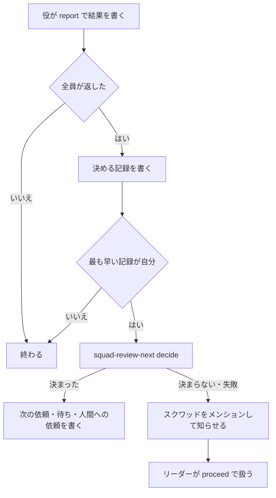
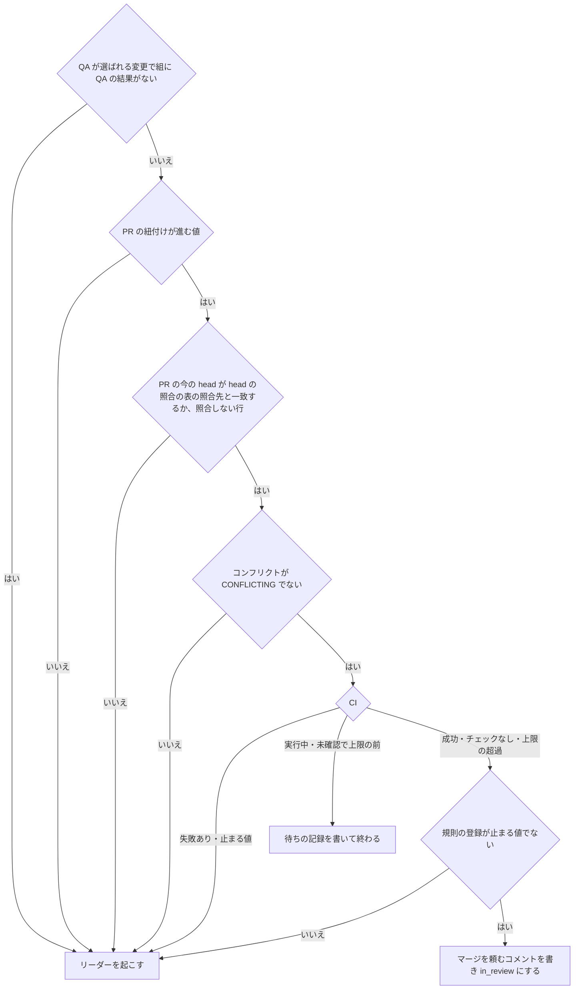
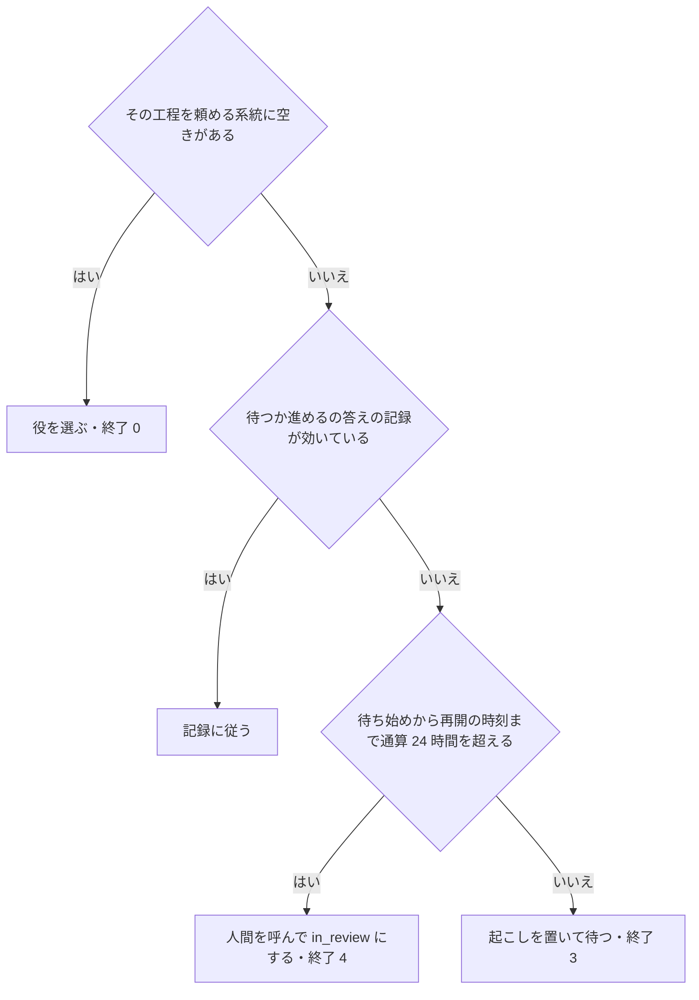

# 返事がそろったあとの次の依頼と、使用率が上限に近いときの待ち方

レビューと E2E の返事がそろったら、最後に返した役の `report` が、リーダーの手順と同じ決まりで次の依頼を決めて書く。決まりで決まらないときだけ、スクワッドのメンションでリーダーを起こす。

あわせて、頼むレビューの観点を、変えたファイルの場所と観点の対応からスクリプトが決める。使用率が上限に近いときは、工程を飛ばさず、空いている系統へ回すか、空きが戻る時刻まで待つ。

返事を待つ回と `proceed` の仕組みは、リーダーの指示 `leader-review-wait.md` と `squad-review-wait` のコメントにあり、この文書はその上に成り立つ。

PR の紐付けと紐付いていない PR の扱いは、リーダーの指示 `leader-pr-checks.md` の「PR の紐付けの確認」にある。短い道を除くすべてのタスクの最終レビューとマージの前の CI の待ちは [principal-review.md](principal-review.md) にある。この文書の仕組みはそれらの決まりを呼び、決まりそのものはそれらの文書が持つ。

## 目的と範囲

返事がそろったあとの、修正・最終レビュー・マージのどれを頼むかの判断は、決まりで決まるので、リーダーの実行を使わずに通す。頼む観点の選び方と、使用率が上限に近いときの止まり方も、実行ごとに揺れない決まりである。

対象は次の 3 つである。

1. 返事がそろったあとの次の依頼を、スクリプトが決めて書く
2. 重要のマーク `重要` のないタスクで頼むレビューの観点を、ファイルの場所と観点の対応から決める
3. 要件・設計・最終確認・実装・修正の工程で、使用率が上限に近いときに系統を移すか待つ

次は対象にしない。

- PR の紐付けの判定、紐付いていない PR の見張り、CI の待ちの決まり。`decide` は `squad-pr-watch` の各サブコマンドを呼び、出力の行の扱いもリーダーの手順に合わせる
- 役のモデルの決め方
- 同じ失敗の立て直しの工程そのもの。[使用率の待ち](#使用率の待ち)は、その工程にもそのまま使える形である
- 返事がそろったあと以外の受け渡し。判断の要る場面なので、リーダーが起きる
- 最上位の役の設計の見直しと、設計と PR の見直しの回の返事。設計の承認や止めた振り分けの再開を含むので、[回の種類](#回の種類)のとおりリーダーが扱う
- 使用率の閾値。`squad-dispatch-pick` と `squad-usage-read` の 80% である

## 全体の流れ

返事がそろったあとは、最後に返した役の実行が、次の依頼を決める記録を書き、最も早い記録の実行だけが決める。決まれば次の依頼を書いて終わり、決まらなければリーダーを起こす。



この仕組みのスクリプトは 2 つである。

| スクリプト | 使う人 | 役目 |
| --- | --- | --- |
| `squad-review-next` | `report`、リーダー | `request` でレビューの依頼を書き、`decide` で返事のあとの次の依頼を決めて書く |
| `squad-usage-wait` | `squad-review-next`、リーダー | 工程ごとに、回す系統を選ぶか、待つ時刻を決めて起こしを置く |

## 決める実行と一度だけ書く仕組み

次の依頼を決めるのは、`report` を流した役の実行のうち、決める記録を最も早く書いた実行だけにする。リーダーを起こさずに動ける実行は、返事を書いた役の実行しかないためである。

### report の流れ

`report` は、役の結果を投稿するとき、本文に `返事の回: <回のコメントの ID>` の行を足す。役はこの行を自分で書かない。[返事の組](#返事の組)で、回と役に紐付く結果を、ほかのコメントと読み分けるためである。

結果を書いたあと全員が返したと読めたら、`返事がそろいました` の知らせの代わりに、決める記録 `返事の待ち: 次の依頼を決めます` を `/note` で書く。読み直しで最も早い記録が自分のものなら、`squad-review-next decide <タスク> <回のコメント>` を流す。最も早さの決め方は、`squad-review-wait proceed` と同じく、時刻と ID の順にする。

`decide` が決まらない（終了 3）か失敗した（終了 1）ときは、`返事がそろいました` の知らせを書いて、スクワッドのリーダーを起こす。知らせの 1 行目はこの文のままにし、2 行目に `次の依頼を決められません: <理由>` を置く。失敗のときの理由は、標準エラーの要約にする。`report` が途中で止まって知らせも書けなかったときは、下の status の判定で拾う。

`report` のコマンドの時間切れの案内は 600 秒である。`decide` は使用率の読み取り（最大 90 秒）、PR の紐付けと CI の読み取り、コンフリクトの状態の確認（最大 120 秒）を流すためである。

### 制御記録の読み方

`前の回:` などの行は、本文にあるだけでは制御記録と読まない。役の結果や人間のコメントは、依頼を引用したり、同じ形の行を持ち込んだりできるためである。[一度だけ書く](#一度だけ書く)、[status と proceed の判定](#status-と-proceed-の判定)、`ci-wait` の依頼済みの確認（[CI の待ちの規則で起きたとき](#ci-の待ちの規則で起きたとき)）は、この節の条件がすべてそろうコメントだけを制御記録とする。

判定は `squad-cli-lib` に 1 つだけ置き、`squad-review-next`、`squad-review-wait`、`squad-pr-watch` で同じものを使う。スクワッドを決める処理を `squad-cli-lib` に置いたのと同じ理由で、3 つのスクリプトの判定が食い違わないようにするためである。判定には、タスクのコメントの一覧と、リーダーの ID を渡す。

リーダーの ID は、`squad-review-next` と `squad-review-wait` では[スクワッドとリーダーの決め方](#スクワッドとリーダーの決め方)で決め、`ci-wait` では引数の `<リーダーの ID>` を使う。判定は名簿を読まないので、名簿の読み取りは起きない。`analyze` の出力は、リーダーの `手戻りの見直し:` の行があるかも返す（[decide-record-read.md の記録の読み方](decide-record-read.md#記録の読み方)）。

| 条件 | 制御記録とするとき |
| --- | --- |
| 行の置き方 | コメントが[読める本文](#読める本文)で、種類を示す行と `前の回:` の行が、どちらも囲みの外の「ほかの行」（行頭が空白でも記号でもない行）である。囲みの中の行は読まない |
| 結果でない | `返事の回:` の行がない。役の結果は `report` がこの行を足すので、結果に含まれる行を制御記録と読まない |
| 作者 | 作者の種類がエージェントで、指す回の決める実行の役か、リーダーである。メンバーと、そのほかのエージェントのコメントは読まない |
| 時刻 | 指す回のコメントより後に書かれている。作者が決める実行の役なら、その役の決める記録より後でもある |
| 指す回 | `前の回:` の ID が、同じタスクの[認める回](#認める回)で、回の種類がレビューと E2E の回か最終レビューの回である |
| 種類 | 下の表の種類のどれかで、種類を示す行と `前の回:` の行が同じコメントにある |

行は、[読める本文](#読める本文)の前処理のあとに読む。`前の回:` の行は、`前の回: <ID>` のとおりに完全に一致するものだけを読む。

回の決める実行の役は、その回の決める記録（`返事の待ち: 次の依頼を決めます`）のうち、時刻と ID の順で最も早いものを書いた役とする。決める記録は、回の `返事を待つ役:` にある役のエージェントが、回より後に、上の行の置き方と結果でない条件を満たして書いたものだけを数える。`decide` を流すのは、この役の実行か、[CI の待ちの規則で起きたとき](#ci-の待ちの規則で起きたとき)のリーダーだけなので、制御記録の作者もこの 2 つに限る。

| 種類 | 種類を示す行 | 一度だけ書くで書き済みと数える | status と proceed で次へ回し済みと数える |
| --- | --- | --- | --- |
| 頼み直し | `コミットが合わず頼み直す役:` | 数える | 数える |
| 修正の依頼 | `修正の依頼:` | 数える | 数える |
| 最終レビューの依頼 | `見直しの種類: 最終レビュー` | 数える | 数える |
| マージの依頼 | `マージの依頼:` | 数える | 数える |
| 24 時間を超えた人間の呼び出し | `使用率の待ち:` で始まり、`24 時間を超える` を含む | 数える | 数える |
| 使用率の待ち | 上に当たらない `使用率の待ち:` | 数えない | 数える |
| CI の待ちの記録 | `マージの前の CI の待ち:` | 数えない | 数える |

どの種類にも当たらないコメントは、`前の回:` の行があっても制御記録としない。`前の回:` の行だけを引用したコメントや、種類を示す行のないコメントで、書き済みや次へ回し済みにならないようにするためである。

#### 読める本文

制御記録を読む部品は、コメントの本文を信頼できない入力として扱う。この設計が読む書き方は、この節の表の範囲に限り、Markdown のブロックの構造（入れ物の入れ子）は読まない。範囲の外の書き方を含む候補は、読めないとして許可の側に倒さず、どの判定でも次へ進めない。範囲を絞れば、囲みの内と外の読み方が CommonMark 0.31.2 と同じになるためである。

本文は、次の順に処理する。順を入れ替えると、囲みの中の `/note` や単独の CR で、囲みの内と外が入れ替わる。

| 順 | 処理 | CommonMark の節 |
| --- | --- | --- |
| 1 | CR と LF の組と、残った単独の CR を、どちらも LF に直してから、LF で行に分ける | 2.1（行の終わりは LF、CR、CR と LF の組） |
| 2 | タブを除く制御文字（U+0000〜U+001F、U+007F〜U+009F）が 1 つでもあれば、読めないとする | 2.3。U+0000 を置き換える決まりと食い違わないよう、拒む |
| 3 | 1 行目だけ、`/note` そのものなら行を除き、`/note` と空白 1 つで始まれば、その 6 文字を除く。2 行目より後の `/note` は、ほかの文字と同じに扱う | なし（Multica の書き方） |
| 4 | 各行の行末の空白とタブを落とす | 4.5（終わりの行の後ろの空白）、4.8（段落の行末） |
| 5 | 上の行から順に、囲みの外か中かを決めながら、下の 2 つの表で行を分ける | 4.5 |

3 で 1 行目に残った文字は、ほかの行と同じに下の表で分ける。ただし、`/note` と空白の後ろが囲みの記号（`` ` `` か `~` を 3 つ以上）で始まる 1 行目は、読めないとする。Multica が `/note` を除いて表示するかで、囲みの始まりかどうかが変わるためである。

囲みの外の行は、次の表で分ける。上から順に当てはめ、最初に当たった行の扱いにする。例の `␣` は空白、`⇥` はタブ、`R` は回のコメントの ID である。

| 行（囲みの外） | 例 | CommonMark の節 | 扱い |
| --- | --- | --- | --- |
| 空行 | （空） | 4.9 | 読める |
| 行頭が空白の文字（`str.isspace()` が真になる文字。空白・タブ・U+00A0・U+3000 など）か、Unicode の書式文字（Cf。U+200B・U+FEFF など） | `␣前の回: R`、`⇥- a` | 2.2、4.4、4.5、5.2 | 読めない。字下げは、項目の続き、字下げのコード、字下げした囲みの開始のどれにもなる |
| 列 0 で `` ` `` か `~` を 3 つ以上続け、下の囲みの開始に当たる | ```` ``` ````、```` ```text ````、`~~~` | 4.5 | 囲みの開始。次の行から囲みの中 |
| 列 0 で `` ` `` か `~` を 3 つ以上続け、囲みの開始に当たらない | ```` ```a`b ```` | 4.5 | 読めない |
| `>` で始まる | `> 前の回: R` | 5.1 | 読めない。次の行が引用の怠惰な続きになるかを読まないため |
| `<` で始まる | `<!--`・`<div>`・`<script>`・`<?x`・`<!DOCTYPE`・`<![CDATA[`・`<https://example.com>` | 4.6、6.5、6.6 | 読めない。HTML のブロックは、中の囲みの記号を囲みにしない |
| 項目の記号（`-`・`*`・`+` か、1〜9 桁の数字に `.` か `)`）で、後ろが行末 | `-`、`1.` | 5.2 | 読めない。次の行が項目の中身になる |
| 項目の記号と空白かタブに続く中身が、空白・`>`・`<`・囲みの記号・項目の記号で始まる | ```` - ``` ````・`1) > a`・`- - a`・`* * *` | 5.2、5.3、4.1 | 読めない。項目の中に、引用・HTML・囲み・入れ子の項目ができる |
| 項目の記号と空白かタブに、上に当たらない中身が続く | `- code-reviewer: ✅`、`1) 理由` | 5.2 | 読める。入れ子のない項目は、囲みの内と外を変えず、置き方は満たさない |
| ほかの行 | `前の回: R`、`# 見出し`、`---`、`\| 表 \|` | 4.1〜4.3、4.8、4.10 | 読める。置き方を満たす行 |

囲みの中の行は、終了の行を除き、すべて中身とし、上の表で分けない。囲みの開始と終了は、次の表のとおり CommonMark の 4.5 に合わせる。

| 行 | 字下げ | 記号 | 記号の後ろ |
| --- | --- | --- | --- |
| 開始（囲みの外の行） | 列 0。字下げ 1〜3 の開始は、上の表で読めない | `` ` `` か `~` を 3 つ以上続ける | バッククォートの囲みは、バッククォートを含まない。`~` の囲みは問わない |
| 終了（囲みの中の行） | 0〜3 列。タブは次の 4 の倍数の列まで進める（2.2） | 開始と同じ文字で、開始の長さ以上 | 空白とタブだけ |

閉じないまま本文が終わったら、読めないとする。CommonMark では末尾まで囲みの中だが、書きかけや途中で切れた本文と見分けられないので、許可の側に倒さない。

範囲の中の本文では、囲みの外に入れ物（引用・項目の中のブロック・HTML のブロック・字下げのコード）が開かない。入れ子のない項目に続く列 0 の行は、段落の怠惰な続きになりうる。しかし囲みの開始は段落に割り込むので、怠惰な続きにならない（4.5、5.2）。

このため、範囲の中では囲みの内と外が CommonMark と同じになる。行の置き方は行の単位で決め、段落の続きかは問わない。

#### 候補と読めないときの扱い

読めるかを問うのは、判定に関わる候補だけにする。関係のない古いコメントで、後の回がずっと進めなくなることを防ぐためである。候補は、作者の種類がエージェントで、`返事の回:` の文字列を含まず、前処理の 1 のあとの本文が下の表の文字列をどこかに含むコメントとする。メンバーのコメントと役の結果は、制御記録にも回にもならないので、候補にしない。

| 判定 | 候補が含む文字列 |
| --- | --- |
| 最新の回（`status`、`proceed`、`report`） | `返事を待つ役:`。認める回のうち最新のものより後のコメントに限る |
| `decide` が `前の回:` でたどる回 | `返事を待つ役:`。たどる途中のコメントに限る |
| 制御記録（一度だけ書く、次へ回し済み、CI の待ちの記録の重複） | `前の回: <判定する回の ID>` |
| 決める記録と `proceed` の記録 | `返事の待ち: 次の依頼を決めます` か `返事の待ち: この回を次へ回します`。判定する回より後のコメントに限る |
| 同じコミットの最終レビューの回 | `見直しの種類: 最終レビュー` |
| `ci-wait` の依頼済み | `マージの依頼: <head>` |

候補が読めないとき、どのスクリプトも何も書かずに止まる。理由は `制御記録を読めない（<コメントの ID>: <読めない理由>）` の形にする。読めない理由は、次のどれかである。

- 制御文字
- `/note` の後ろの囲みの記号
- 行頭の空白
- 囲みにならない囲みの記号
- 引用
- HTML
- 項目の中身
- 閉じない囲み

止まり方は、スクリプトごとに次の表のとおりである。

| スクリプト | 読めない候補があるとき |
| --- | --- |
| `decide` | 何も書かず、`次の依頼を決められません: 制御記録を読めない（…）` で終了 3 にする。リーダーは、決まらない知らせの「上のどれでもない」の行のとおりに扱い、決められなければ人間を呼ぶ |
| `report` | 結果を書いたあと、決める記録を書かず、`decide` も流さない。決まらない知らせに同じ理由の `次の依頼を決められません:` の行を置いて、リーダーを起こす |
| `status` | 何も書かず、理由を標準エラーに出して終了 1 にする。リーダーは手順のとおり、スクリプトの失敗として人間へ返す |
| `proceed` | 記録を書かず、`status` と同じに終了 1 にする |
| `ci-wait` | 依頼済みと読まず、マージの依頼も書かない。待ちの規則と metadata を残したまま、`status` と同じに終了 1 にする |

`decide` は、書く前に、書く本文を同じ部品で読む。読めないときと、種類を示す行と `前の回:` の行が置き方を満たさないときは、何も書かずに `次の依頼を決められません: 書く本文を読めない（<読めない理由>）` で終了 3 にする。マージを頼むコメントは、PR を作った役の `紐付けの失敗:` の段落をそのまま写すので、写した行で範囲を外れることがあるためである。`report` の決める記録、`proceed` の記録、`watch` と `request` が書くコメントは、決まった行だけなので範囲に収まる。

#### 認める回

制御記録が指す回と、`status` と `proceed` が読む最新の回は、次の 2 つがそろう回のコメントだけにする。返事を待つ役の行を持つコメントを、作者を問わず回と読むと、結果に引用された依頼が最新の回になるためである。

1. `返事を待つ役:` の行が上の行の置き方を満たし、エージェントのメンションを 1 つ以上持つ。`返事の回:` の行がない
2. 作者が、次のどちらかである
   - リーダー。リーダーが書いた回は、回の種類を問わず回として読む
   - `前の回:` の指す回の決める実行の役。頼み直しか最終レビューの依頼の制御記録であり、指す回も認める回である

2 でたどるのは同じタスクのコメントだけで、[スクワッドとリーダーの決め方](#スクワッドとリーダーの決め方)と同じく 10 回までにする。

認める回が 1 つもないときの `status` と `proceed` は、今の回がないときと同じに動く。`decide` は、渡された回が認める回でなければ、何も書かずに `次の依頼を決められません: 回を認められない（<当たらなかった条件>）` で終了 3 にする。最終レビューの回は、これに加えて[最終レビューの回と結果を認める条件](#最終レビューの回と結果を認める条件)を `decide` が確認する。最新の回の候補や、たどる途中のコメントが読めないときは、古い回に戻らず、[候補と読めないときの扱い](#候補と読めないときの扱い)のとおりに止まる。

### 一度だけ書く

`decide` が書くコメントには、すべて `前の回: <回のコメントの ID>` の行を置く。`decide` は書く前に、この回を指す[制御記録](#制御記録の読み方)のうち、書き済みと数える種類のものを探す。あれば `次の依頼: 書き済み` を出して何も書かない。

同じ返事の組から 2 回流しても、書くのは 1 回だけで、中身は最初のものになる。この回を指す候補が[読めない](#読める本文)ときは、書き済みとも未済とも決めず、何も書かずに終了 3 にする。

`前の回:` の行があっても、制御記録の条件に当たらないコメントは書き済みと数えない。役の結果や人間のコメントにある引用で、次の依頼が書かれないまま止まることを防ぐためである。数えなかったコメントは、`decide` の出力に残さず、そのまま次の依頼を決める。

決める記録が複数の実行で書かれても、`decide` を流すのは最も早い記録の実行だけである。記録の読み直しと制御記録の確認の二重で、同じ回の依頼が 2 つ書かれることを防ぐ。

### status と proceed の判定

`squad-review-wait status` と `proceed` は、決める記録と[制御記録](#制御記録の読み方)を読む。最新の回は、[認める回](#認める回)のうち最も新しいものにする。`status` の判定は、全員が返していて回の記録がまだないときに `proceed` へ進み、次を加えて決める。

| 回の状態 | status の判定 |
| --- | --- |
| この回を指す制御記録がある | 次へ回し済みなので何もしない |
| 決める記録があり、この回を指す制御記録がなく、記録から 15 分未満 | 待つ（`返事の待ち: スクリプトが次の依頼を決めている`） |
| 決める記録があり、この回を指す制御記録がなく、記録から 15 分以上 | `proceed` へ進む |

`proceed` も、この回を指す制御記録があるときだけ `返事の待ち: 回ごと済み` を返す。この回を指す候補か、最新の回の候補が[読めない](#読める本文)ときは、`status` も `proceed` も済みとも未済とも決めず、何も書かずに終了 1 にする。`前の回:` の行があっても制御記録の条件に当たらないコメントは、`status` でも `proceed` でも数えない。引用で済み扱いになると、返事の待ちの見張りが回の止まりを拾えなくなるためである。

決める記録と `proceed` の記録（`返事の待ち: この回を次へ回します`）も、制御記録と同じ行の置き方と結果でない条件を満たすものだけを数える。決める記録は、さらに[制御記録の読み方](#制御記録の読み方)のとおり、回の返事を待つ役が書いたものだけにする。`proceed` の記録の作者は、実行の種類を問わない。

15 分は、`decide` の最長の時間（6 分ほど）より十分に長くした。決める実行が止まっても、待つ上限の見張りか人間の返事で起きたリーダーが拾う。

`proceed` の記録（`返事の待ち: この回を次へ回します`）は、決める記録と別のマークにする。`proceed` は決める記録を自分の記録と数えない。決まらない知らせで起きたリーダーが、`proceed` で次へ進めるようにするためである。

### スクワッドとリーダーの決め方

`decide` が書いた回の作者は、リーダーではなく返事を書いた役になる。そこで、回の作者をリーダーとするスクワッドがないときは、回の `前の回:` をたどり、リーダーが書いた回のスクワッドを使う。`squad-review-wait` の決め方（回の作者をリーダーとするスクワッドを選ぶ）は、リーダーが書いた回ではそのまま使う。

たどるのは同じタスクのコメントだけで、10 回までにする。それでも決まらなければ、投稿の前に失敗する。

たどった先のリーダーが書いた回でスクワッドを決めたあと、途中の回が[認める回](#認める回)かを、そのスクワッドのリーダーで確認する。途中に認めない回があれば、`decide` は何も書かずに `次の依頼を決められません: 回を認められない（<当たらなかった条件>）` で終了 3 にする。スクワッドを決める前は作者の役を読めないので、先にリーダーの回まで行き、そこから認め直す。

決めたスクワッドの `leader_id` を、起こしの宛先に使う。`decide` は役の実行で動くので、宛先を省くか `MULTICA_AGENT_ID` から読む規則は、返事を書いた役を起こしてしまう。そこで、`decide` が置く規則と見張りには、すべてこの ID を渡す。

| 規則・見張り | 渡し方 |
| --- | --- |
| 返事の待ちの見張り（`squad-review-wait watch`） | `--agent-id` に渡す |
| 使用率の待ちの起こし（`squad-usage-wait`） | `--agent-id` に渡す |
| コンフリクトの規則（`squad-pr-watch conflicts`） | `--leader <ID>` に渡す。省くと、`--agent-id` を省いて呼び出した実行を起こす |
| 紐付いていない PR の見張り（`squad-pr-watch unlinked`） | `--leader <ID>` に渡す。省くと `MULTICA_AGENT_ID` をリーダーとして読む |
| CI の待ちの規則（`squad-pr-watch ci-wait`）と、その場の CI の確認（`ci-now`） | 引数の `<リーダーの ID>` に渡す |

`--leader` を渡さないときは、上の表の「省くと」のとおりに動く。見張り役を渡す `unlinked` は、見張り役を起こし、`--leader` は `unlinked-check` に渡すリーダーの ID だけを決める。

## 次の依頼の決め方

`decide` は、まず[回の種類](#回の種類)を読み、自分で決める回だけを先へ進める。そのうえで回の返事の組を読み、上から順に当てはめて最初に当たった行で決める。決まりは、リーダーの手順をそのまま写したものである。手順は、次のファイルにある。

- [leader-review-reply.md](../common/skills/squad-handoff/references/leader-review-reply.md)
- [leader-review-request.md](../common/skills/squad-handoff/references/leader-review-request.md)
- [leader-review-stuck.md](../common/skills/squad-handoff/references/leader-review-stuck.md)
- [leader-principal.md](../common/skills/squad-handoff/references/leader-principal.md)
- [leader-pr-ci.md](../common/skills/squad-handoff/references/leader-pr-ci.md)
- [leader-pr-merge.md](../common/skills/squad-handoff/references/leader-pr-merge.md)

| 順 | 条件 | 次の依頼 |
| --- | --- | --- |
| 0 | 回の種類が、`decide` で決める回でない。または[認める回](#認める回)でない | リーダーを起こす |
| 1 | 組に[検証が未実行の結果](#検証が未実行の結果)がある。または返事の結果が読めない | リーダーを起こす |
| 2 | PR の紐付けの判定が、進む値でない（[返事がそろったときの PR の確認](#返事がそろったときの-pr-の確認)） | リーダーを起こす |
| 3 | 保留した CI の失敗がある（`squad-pr-watch ci-held`）、または取得に失敗した | リーダーを起こす |
| 4 | 紐付いていない PR のその場の確認で、止まる値が出た | リーダーを起こす |
| 5 | `確認したコミット:` が合わない役がいて、その役が前の回でも合わなかった | リーダーを起こす |
| 6 | `確認したコミット:` が合わない役がいる | 合わない役だけを、同じコミットの新しい回で頼み直す |
| 7 | `設計への指摘: あり` の結果がある。または短い道の記録があり、重要のラベルがある | リーダーを起こす |
| 8 | ❌ の結果がある | [修正の依頼](#修正の依頼)へ |
| 9 | 短い道でなく、同じコミットの済んだ最終レビューがない | [最終レビューの依頼](#最終レビューの依頼)へ |
| 10 | 上のどれにも当たらない | [マージの依頼](#マージの依頼)へ |

2〜4 は PR をその場で読む確認で、5〜10 は返事の組だけで決まる。`decide` は 5〜10 の行き先を先に組から決め、その行き先を使って 2〜4 を流す。2〜4 で止まる値が出たら、行き先の依頼を書かずにリーダーを起こす。

9 は、短い道のタスクと、最上位の役がない構成では当たらない（[最終レビューの依頼](#最終レビューの依頼)）。短い道かは、`analyze` の欄 `short_path` と、その場で読む重要のラベルで決める（[usage-reduction.md の最終レビューを飛ばす条件](usage-reduction.md#最終レビューを飛ばす条件)）。

同じ返事の組からは、いつも同じ行き先になる。使用率と PR の状態はその場で読む。そのため、決めた依頼に添える `振り分け:`・コンフリクト・CI の行は、読んだ時点の値になる。

### 返事がそろったときの PR の確認

リーダーの手順は、返事がそろったときに PR の紐付けを確認する（[PR の紐付けの確認](../common/skills/squad-handoff/references/leader-pr-link.md#pr-の紐付けの確認)）。紐付いていなければ、その場で CI とコンフリクトを読む（[紐付いていない PR のその場の確認](../common/skills/squad-handoff/references/leader-pr-ci.md#紐付いていない-pr-のその場の確認)）。

`decide` も同じ区切りで同じ確認を流し、表の 2〜4 とする。止まる値は、どれも人間を呼ばずにリーダーを起こす。人間を呼ぶか、修正へ回すかは、リーダーが手順で決める。

表の 2 は、`squad-pr-watch link-check <タスク> [<きっかけのコメント>]` の `紐付け:` の行で次のように分ける。

| 判定 | `decide` の動き |
| --- | --- |
| 紐付いている | 進む。以降の確認は紐付いているものとして流し、マージの依頼でも `unlinked` を登録しない |
| 紐付いていない | 進む。表の 4 のその場の確認を流し、マージの依頼では `unlinked` を登録する |
| 紐付いていない。行の末尾に `連携: なし` が付く | 「紐付いていない」と同じに進む。違いは、`decide` が連携なしの印も持ち、マージの依頼と使用率の待ちのコメントの行を出し分けることと、`unlinked` の登録に失敗したら止まること |
| 食い違い、作業先と違う、不正な `pr_url`、`pr_url` なし | 止まる。何も書かず、`次の依頼を決められません: <紐付け: の行>` で終了 3 |
| 未確認 | 同じ実行で 1 回だけ流し直す。まだ未確認なら止まり、`次の依頼を決められません: <紐付け: の行>` で終了 3 |

`連携: なし` は、[連携なしのリポジトリの扱い](pr-link-no-integration.md#リーダーの手順と-decide)で決めた行の末尾である。`decide` は、末尾の `連携: なし` を読み、紐付いていない（`LINKED=false`）に加えて連携なしの印を持つ。紐付いていないときの確認と登録は変えない。

`link-check` は、PR を作った役の `squad-pr-link` が失敗した PR を、「紐付いていない」と判定する前に、間隔を空けて紐付け直す。`decide` は `<回のコメント>` を `link-check` のきっかけに渡し、試み直しの記録はその返信になる。`decide` の流れは変えない。

`link-check` が使い方の誤り（終了コード 2）か見つからない（127）とき、行が出ないときも未確認とする。2 か 127 で止まるときは、理由に「ホストのスクリプトが古い」ことを足す。リーダーは、知らせの理由の `紐付け:` の行を、`link-check` を流し直して手順で扱う。止まる値の扱いを `decide` に写さないのは、どれも人間を呼ぶか役に補ってもらう判断で、状態の変更が増えるためである。

表の 3 は、CI の見張り役があるか、紐付いていないときに `squad-pr-watch ci-held <タスク> <回のコメントの ID>` を流す。出たチェック名か取得の失敗で止まる。ただし行き先がマージで、次のどちらかに当たるときは流さない。マージの依頼の `ci-wait` が CI を読むためで、リーダーの手順の「CI」の例外と同じである。

1. CI を待っているタスク。metadata に `ci_wait_head` がある
2. 見張り役がある構成の、最終レビューの回

表の 4 は、紐付いていないときだけ流す。順と読み方はリーダーの手順と同じである。

1. CI の見張り役があれば、`squad-pr-watch ci <タスク> <見張り役の ID> <回のコメントの ID>` を流す
2. `squad-pr-watch ci-now <タスク> <leader_id> <回のコメントの ID> [<見張り役の ID>]` を流す。ただし行き先がマージで見張り役があるときは流さず、マージの依頼の `ci-wait` で読む
3. `squad-pr-watch conflicts-check <タスク>` を流す

止まる値と進む値は、次のとおりである。

- 止まる値: `ci-now` の `失敗あり` で保留でない行・`紐付け:` で始まる行・0 以外の終了・`コンフリクト: CONFLICTING`
- 進む値: 保留の行・知らせ済みの行・失敗なし・チェックなし・マージ済みか閉じている・`MERGEABLE` と未確認のコンフリクト

止まったときの理由は、止まった行をそのまま `次の依頼を決められません:` に写す。

行き先がマージのとき、[マージの依頼](#マージの依頼)はここで読んだ `ci-now` とコンフリクトの行を使い、同じ区切りで流し直さない。リーダーの手順の、マージへ回す前の `conflicts-check` がその場の確認の 3 を兼ねる決まりと同じである。

### 回の種類

`decide` が決めるのは、マージの前のレビューと E2E の回と、最終レビューの回だけである。最上位の役の設計の見直しと、設計と PR の見直しの回は、✅ でも決めずにリーダーを起こす。どちらも、リーダーへ返す回だからである。

回には、設計の承認・止めた振り分けの再開・コードの指摘をフェーズの依頼へ添えることが含まれる。決まりは、principal-review.md の[設計の見直し](principal-review.md#設計の見直し)と[設計の承認より後に重要のマークが付いたとき](principal-review.md#設計の承認より後に重要のマークが付いたとき)のとおりである。

要件の見直しは、リーダーが最上位の役へ頼む回である。要件を決める役を置かない構成で、人間の用意した要件を次の役へ回す前に頼む（[planner-requirements.md](planner-requirements.md#役を置かない構成の要件の見直し)）。PR がなく、確認する対象は `確認するコミット: タスクの本文 <sha256>` の行で表す。結果を受けて次の役へ回すかはリーダーが決めるので、`decide` は次の依頼を書かず、PR の確認より前に止まる。

回の種類は、回のコメントの行で読む。

| 回のコメントの行 | 回の種類 | `decide` の動き |
| --- | --- | --- |
| `観点:` か `コミットが合わず頼み直す役:` があり、`見直しの種類:` がない | レビューと E2E の回 | 次の依頼を決める |
| `見直しの種類: 最終レビュー` | 最終レビューの回 | 次の依頼を決める |
| `見直しの種類: 設計の見直し` か `見直しの種類: 設計と PR の見直し` | 設計の見直しの回 | `次の依頼を決められません: 設計の見直しの回はリーダーが扱う` で終了 3 |
| `見直しの種類: 診断` | 診断の回 | `次の依頼を決められません: 診断の回はリーダーが扱う` で終了 3 |
| `見直しの種類: 要件の見直し` | 要件の見直しの回 | `次の依頼を決められません: 要件の見直しの回はリーダーが扱う` で終了 3 |
| 上のどれにも当たらない | 分からない | `次の依頼を決められません: 回の種類が分からない` で終了 3 |

リーダーを起こした回では、`report` が知らせを書き、リーダーは [leader-principal.md](../common/skills/squad-handoff/references/leader-principal.md) の手順で扱う。`request` を使わずにリーダーが書いた回は `観点:` の行がないので、分からない回としてリーダーが扱う。

### 返事の組

返事の組は、回で待った役ごとに、その役が回より後に書いた結果のうち最新のものである。結果は、`返事の回:` の行がその回のコメントの ID と同じコメントとする。決める記録・`proceed` の記録・使用率の待ち・知らせ・次の依頼には、`返事の回:` の行を置かない。そのため、役の実行が結果のあとに書いても組に入らない。

組に入った結果が[結果が読めるとき](#結果が読めるとき)に当たらなければ、その回は返事の結果が読めないとする。同じ役の前の結果が読めても、それに戻らない。役が結果を書き直したなら、最新のものが役の今の結論だからである。待った役に `返事の回:` の行のある結果がないときも、読めないとする。

頼み直しの回では、`前の回:` をたどって、合っていた役の結果も組に入れる。合っていた役の結果は、その役を頼んだ前の回の ID の `返事の回:` で選ぶ。頼み直しの回の前の回で合っていた役の結果を、残すためである。

最終レビューの回は、その前の回（4 役と E2E の回）の組に、最上位の役の結果を足したものを組にする。最上位の役の結果は、最終レビューの回の ID の `返事の回:` で選ぶ。最終レビューの依頼にも `前の回:` を置くので、同じようにたどれる。回と結果は、[最終レビューの回と結果を認める条件](#最終レビューの回と結果を認める条件)を満たすものだけを使う。

### 結果が読めるとき

結果は、次の 4 つがそろうときだけ読めるとする。どれかが欠けたら、返事の結果が読めないとしてリーダーを起こす。

1. `返事の回:` の行が、組を選んだ回の ID である
2. `確認したコミット:` の行がある
3. 先頭の行が、squad-handoff の「PR にレビューやテストの結果を書く」の `<マーク> <名前>: <結論>` の形で、結果のマークが ❌・⚠️・✅ のどれかである。`/note`・`返事の回:`・`確認したコミット:`・`設計への指摘:` の行は、先頭の行を探すときに飛ばす
4. `設計への指摘: <あり | なし>` の行がある

3 の結果のマークの行と 4 の `設計への指摘:` の行は、結果に書く行である。書く指示を置く先は、squad-handoff の「レビューと E2E の返事を返す」・レビューと E2E の役のひな形・最上位の役のひな形である。結果に書く行にするのは、次の理由による。結果のマークの行を PR のコメントにだけ求める指示では、タスクに返す要約が「引き継ぐとき」の文章の結論から始まり、指示どおりの結果がすべて読めなくなる。

`あり` は、指摘が設計そのものに関わり、コードの修正では解決しないときに書く。最上位の役の `設計` の種類の指摘も `あり` にする。決まった行がないと、設計への指摘をリーダーが本文から読み分けることになり、実行ごとに揺れるためである。

### 検証が未実行の結果

検証スキルが未記入で検証を飛ばした結果は、結果のマークと `設計への指摘:` の行によらず、リーダーを起こす。修正、最終レビュー、マージの依頼は書かない。⚠️ のままマージの依頼へ、❌ のまま修正の依頼へ進むと、検証していない変更が先へ進むためである。リーダーは、記入のタスクを確認してから頼み直すか、人間を呼ぶ。

役は、squad-handoff の「未記入の報告を返す」のとおり、結果に次の 1 行をそのまま書く。

```text
未実行: 検証スキルが未記入
```

この行は、`設計への指摘:` の行のすぐ次に置く。`確認したコミット:`・結果のマークの行・`設計への指摘:` の行は、「レビューと E2E の返事を返す」と役のひな形のとおりに書く。この 3 行の順は、役のひな形の順と同じである。

結果のマークは ✅ にしない。未記入や未実行は成功にしないためである。足りない欄・確認した内容・記入のタスク・次の手は、この行のあとの本文に書く。

`decide` は、組の結果ごとに、この行を探す。探すのは、`返事の回:` で結果を選んだあとで、[結果が読めるとき](#結果が読めるとき)の前である。`/note` を除き、行末の空白を除いた行が `未実行: 検証スキルが未記入` と一致すれば、未実行の結果とする。置き場所は問わない。

この行があれば、`確認したコミット:`・結果のマーク・`設計への指摘:` の行は読まず、欠けていても未実行の結果とする。違う値の `未実行:` の行（ガード・道具がない・CI に任せたなど）は当たらず、ほかの行と同じに読む。

表の 1 の中では、次の順で決める。

1. 組を作れない誤りは、先に止まる。回を認められない、`前の回:` の行が読めない、たどりきれない、前の回を読めないときである
2. 組の結果を、`前の回:` でたどって入れた役の分まで、すべて見る。未実行の結果が 1 つでもあれば、ほかに読めない結果があっても、未実行の理由で止まる
3. 未実行の結果がなく、結果がない役か読めない結果があれば、組の順で最初のものの理由で止まる

読めない結果より未実行を先にするのは、未実行のときにリーダーがすることが、記入のタスクの確認と決まっているからである。読めない結果は、リーダーが本文を読んで扱う。両方あるときに未実行を知らせれば、頼み直しのときに読めない役も一緒に頼める。

止まるときは、表の 1 のほかの理由と同じに、PR の確認（表の 2〜4）を流さず何も書かない。知らせの 2 行目は次の形にする。

```text
次の依頼を決められません: 検証スキルが未記入で未実行（<役>、<役>）
```

`<役>` は名簿のキー（`code-reviewer`、`qa` など）で、組の順に、未実行のすべての役を `、` で区切って並べる。名簿にない役は、ほかの理由と同じにエージェントの ID を書く。リーダーは、この理由で [leader-review-stuck.md](../common/skills/squad-handoff/references/leader-review-stuck.md) の表から、squad-handoff の「リーダーが報告を受けたとき」の手順へ進む。

最上位の役の結果も、同じ行で未実行と読む。結果を使うところごとに、次のとおり扱う。

| 使うところ | 未実行の結果の扱い |
| --- | --- |
| 最終レビューの回で `decide` を流したとき | 最上位の役の結果も組に入るので、上のとおり表の 1 で止まる |
| 表の 9 で、同じコミットの最終レビューを探すとき | 済んでいないとし、`同じコミットの最終レビューが済んでいない: 検証スキルが未記入で未実行（<役>）` で止まる。行のほかは、ほかの済んでいない理由と同じに扱う |
| マージの依頼の確認の 2 の照合と、見る範囲の前の結果 | 使わない。読める行がそろっていても、読めない結果と同じにするので、見る範囲は `PR の差分全体` になる |
| 修正の依頼の 3 の最上位の役の結果 | 結果があるかだけを見る。見直しの回の返事は、[回の種類](#回の種類)のとおりリーダーが扱うためである |

### コミットの照合

照合の決まりは、[確認したコミットの照合](../common/skills/squad-handoff/references/leader-review-request.md#確認したコミットの照合)のとおりにする。7 文字以上の 16 進で、依頼の `確認するコミット:` の先頭と一致すればよい。行がない・`なし`・合わない役を、合わない役とする。

頼み直しの回は、[レビューの依頼を書く](#レビューの依頼を書く)と同じ形で書き、`観点:` の行の代わりに `コミットが合わず頼み直す役: <名前>` を置く。名前はメンションのリンクにしない。前の回の依頼に `列挙を頼む部品:` の行があれば、同じ順で写す。前の回でも `コミットが合わず頼み直す役:` に名前があった役が、また合わなければ、3 回目は頼まずにリーダーを起こす。

ZIP が成果物の回は、照合の値が名前と sha256 になる。分岐を増やさないため、`確認するコミット:` の行がない回は、スクリプトで決めずにリーダーを起こす。

### 修正の依頼

❌ の結果があるときは、次の順に確認してから修正の役へ頼む。止まるときは、どれもリーダーを起こし、リーダーが手順で扱う。`decide` が自動で書く修正の依頼は、タスクで最初の 1 回だけである。2 回目からはリーダーを起こし、依頼を書かない。

| 順 | 条件 | 次の依頼 |
| --- | --- | --- |
| 1 | `修正の依頼:` の行の数に 1 を足すと 4 になる | リーダーを起こす（手戻りの見直しか続行の確認） |
| 2 | タスクに `設計の変更: 実装を始めたあと` の行があり、重要のマークがなく、リーダーの `手戻りの見直し:` の行もない | リーダーを起こす（手戻りの見直しの判断） |
| 3 | 重要のマークがあり、最上位の役の結果がタスクにない | リーダーを起こす（設計と PR の見直し） |
| 4 | タスクに `修正の依頼:` の行が 1 つ以上ある | リーダーを起こす（2 回目からの修正の依頼） |
| 5 | 上のどれにも当たらない | 修正の役を選んで頼む |

4 の理由の行は `修正の依頼が 2 回目から（同じ誤りと同じ部品はリーダーが判断する）` である。`修正の依頼:` の行は、コンフリクトや CI の失敗の依頼でも数える。そのため、コンフリクトを解消したあとの最初の ❌ も、リーダーが扱う。

1〜3 を先に見るので、行が 3 つのときは 1 の理由で止まる。1 と 2 の理由の行は、表の「次の依頼」の括弧の中の判断を示す形で `decide` が書く。

3 の最上位の役の結果は、`見直しの種類:` の行がある回の ID を `返事の回:` に持つ、最上位の役のコメントで探す。作者と回は、[最終レビューの回と結果を認める条件](#最終レビューの回と結果を認める条件)の表のとおりに限る。設計の見直しも同じ PR への結果なので、それがあれば当たらない。

`見直しの種類: 診断` の回の結果は数えない。診断は失敗の原因だけを見て、設計と PR の見直しの代わりにならないためである。

当たったときに起きたリーダーは、修正の依頼を止めて、設計と PR の見直しを頼む。その回の返事は、[回の種類](#回の種類)のとおりリーダーが扱う。

修正の役は、`squad-usage-wait pick <タスク> fix` で選ぶ。使用率で待つときは、[使用率の待ち](#使用率の待ち)の行を書いて終わる。選べたら、次の行を持つ依頼を書く。

```text
<修正の役のメンションのリンク> PR の ❌ の指摘を直してください。
前の回: <回のコメントの ID>
修正の依頼: <N> 回目
振り分け: <squad-usage-wait が出した行>
直す指摘: <❌ を返した役の名前>（結果は、この回の返事のコメントと PR のコメントにある）
対象の PR: <PR の URL>
```

直したあとの依頼の流れは、次のとおりである。修正の役がスクワッドへ返し、リーダーが必要な観点のレビューを `request` で頼み直す。

### 最終レビューの依頼

❌ のない組で、同じコミットの済んだ最終レビューがなければ、重要のマークによらず最上位の役に最終レビューを頼む。principal-review.md の[最終レビュー](principal-review.md#最終レビュー)のとおり、短い道のタスクを除くすべてのタスクで行うためである。最上位の役が名簿にない構成と、短い道のタスクだけ、飛ばしてマージの依頼へ進む。

短い道とするのは、`analyze` の `short_path` が `true` で、重要のラベルがないときである。ラベルがあるときは、ここへ来る前に表の 7 で止まる。

`short_path` の欄がないか読めないとき、またはラベルを読めないときは、`decide` は失敗で終わる。最終レビューを飛ばす側に誤らないためである。決まりは [usage-reduction.md の最終レビューを飛ばす条件](usage-reduction.md#最終レビューを飛ばす条件)にある。

同じコミットの最終レビューは、`見直しの種類: 最終レビュー` の回のうち、`確認するコミット:` が組のコミットと同じもので探す。済んだとするのは、[最終レビューの回と結果を認める条件](#最終レビューの回と結果を認める条件)を満たす回と、その回の最上位の役の結果がそろうときだけである。

最上位の役は、次の順で選ぶ。

1. principal-review.md の[実装した系統の決め方](principal-review.md#実装した系統の決め方)で系統を決める。実装と修正の役のエージェントの ID と設計の役のモデルは[名簿](#名簿の読み方)から、実行は `issue-runs` で読む
2. `squad-usage-wait pick <タスク> principal [<系統>]` を流す
   - 系統を決められたときだけ渡す。`squad-usage-wait` はそのまま `squad-dispatch-pick principal <系統>` へ渡す
   - 決められないときは引数なしで、空いている方を選ぶ

選べたら、`squad-review-wait watch` を流してから、次の行を持つ依頼を書く。

- `見直しの種類: 最終レビュー`
- `確認するコミット:`
- `見る範囲:`
- `返事を待つ役:`
- `振り分け:`
- `前の回:`

`見る範囲:` は、principal-review.md の[見る範囲](principal-review.md#見る範囲)のとおりに決める。次の順で当てはめる。

1. 前の最終レビューの結果がなければ、`PR の差分全体` にする
2. 結果があれば、その `確認したコミット:` が組のコミットの祖先かを `gh-compare` で読み、祖先なら `<前の SHA>..<組のコミット>` にする
3. 結果に `確認したコミット:` がないか読めないとき、祖先でないとき、比較を読めないときは、`PR の差分全体` にする

範囲を狭める側に誤らないためである。

### 最終レビューの回と結果を認める条件

最終レビューの回と結果は、作者と回の連鎖がそろうときだけ認める。最上位の役以外が書いた回と結果で、最上位の役の返事がないままマージの依頼へ進むことを防ぐためである。

最終レビューの回は、次のすべてを満たすときだけ認める。

1. `見直しの種類: 最終レビュー` の行が、[制御記録の読み方](#制御記録の読み方)の行の置き方を満たし、`返事の回:` の行がない
2. 作者が、リーダーか、`前の回:` が指す回の決める実行の役である。決める実行の役が書いた回は、指す回より後で、その役の決める記録より後に書かれている
3. `前の回:` の行があり、指す回が同じタスクの[認める回](#認める回)のうち、レビューと E2E の回である。リーダーが書いた回も、`前の回:` がなければ組をたどれないので認めない
4. `返事を待つ役:` の行のメンションがちょうど 1 つで、その ID が名簿の `claude-principal` か `codex-principal` の役のエージェントである。名簿はアーカイブ済みのエージェントとスクワッドのキーに合わないエージェントを入れないので、名簿にあることを有効とする
5. `確認するコミット:` の行が、指す回の `確認するコミット:` と同じである

最終レビューの結果は、作者が回の `返事を待つ役:` の最上位の役で、`返事の回:` がその回の ID のコメントだけにする。同じ `返事の回:` を持つほかの作者のコメントは、組に入れず、済みにも数えない。結果が[結果が読めるとき](#結果が読めるとき)に当たることは、ほかの役と同じに求める。

条件に当たらないときは、`decide` は次の依頼を決めずに、`次の依頼を決められません: 最終レビューを認められない（<当たらなかった条件>）` で終了 3 にする。どこで当たらなかったかによらず、扱いはリーダーへ戻す。

| 使うところ | 認める回と結果の使い方 | 認めないものがあるとき |
| --- | --- | --- |
| 最終レビューの回で `decide` を流したとき | その回が認める回で、最上位の役の結果があるときだけ組を作る | 終了 3 |
| 表の 9 で、同じコミットの最終レビューを探すとき | 認める回と、その回の最上位の役の結果がそろうときだけ、最終レビューが済んだとする | 同じ `確認するコミット:` で、エージェントが書いた最終レビューの回の候補が認める条件に当たらなければ、終了 3 |
| マージの依頼の確認の 2 の照合と、見る範囲の前の結果 | 認める回の最上位の役の結果の `確認したコミット:` だけを使う | 終了 3 |
| 修正の依頼の 3 の最上位の役の結果 | 作者が名簿の最上位の役で、`返事の回:` が認める回のうち `見直しの種類:` の行がある回のものだけを数える | 数えない。結果がタスクにないとして扱う |

最終レビューの回の候補は、`見直しの種類: 最終レビュー` の行を行の置き方のとおりに持ち、`返事の回:` の行がない、エージェントのコメントとする。メンバーのコメントと、結果に引用された行は候補にしない。`見直しの種類: 最終レビュー` を含むエージェントのコメントが[読めない](#読める本文)ときも、認める条件に当たらない候補と同じに終了 3 にする。候補が認める条件に当たらないときに済みとも未済とも決めないのは、別の最終レビューを重ねて頼むか、マージへ進むかを、作者の確認を含めてリーダーが決めるためである。

### マージの依頼

❌ がなく、最終レビューが要らないか済んでいれば、人間のマージへ回す前の確認を、[マージの前の確認](../common/skills/squad-handoff/references/leader-pr-merge.md#マージの前の確認)の順に流す。止まる値が出たら、マージの依頼を書かずにリーダーを起こす。CI の待ちだけは、リーダーを起こさずに待ちの記録を書いて終わる。

QA の役があり、[観点の選び方](#観点の選び方)で QA が選ばれる変更なのに、組に QA の結果がないときは、下の確認を流さずにリーダーを起こす。画面に触れる変更を、E2E なしで人間へ回さないためである。

| 順 | 確認 | 進む値 | 止まってリーダーを起こす値 |
| --- | --- | --- | --- |
| 1 | PR の紐付け。表の 2 の `link-check` の結果を使う | 紐付いている、紐付いていない | 表の 2 で止まっている |
| 2 | PR の今の head を、[head の照合の表](usage-reduction.md#head-の照合の表)の照合先と照合する。最上位の役の有無によらず流し、head は 1 の行の `pr:` の正規形の PR で読む | 一致する。表で照合しない行 | 一致しない、照合先を読めない。リーダーが表の「一致しない」の列に従う |
| 3 | `squad-pr-watch conflicts-check <タスク>`。紐付いていないときは表の 4 の行を使う | `MERGEABLE`、未確認 | `CONFLICTING` |
| 4 | CI。下の [マージの前の CI](#マージの前の-ci) | 成功、チェックなし、上限の超過 | 失敗あり、`ci-now` の止まる値、0 以外の終了 |
| 5 | 規則の登録。下の [マージ待ちの規則の登録](#マージ待ちの規則の登録) | 登録できた。`unlinked` が 0 以外で終わった | `conflicts` が 0 以外で終わった。`unlinked` が `紐付け:` の行を出した |

確認がすべて通ったら、[マージを頼むコメント](#マージを頼むコメント)を書き、タスクを `in_review` にする。

確認の分かれ道ごとの行き先は、次の図のとおりである。



#### マージの前の CI

CI の見張り役があれば、紐付けの有無によらず、`squad-pr-watch ci <タスク> <見張り役の ID> <回のコメントの ID>` に続けて `squad-pr-watch ci-wait <タスク> <leader_id> <回のコメントの ID> [<起きた規則>]` を流す。`ci-now` は流さない。`<起きた規則>` は、`decide` が [CI の待ちの規則で起きたとき](#ci-の待ちの規則で起きたとき) に受けた規則の ID で、受けていなければ渡さない。

`ci-wait` の行で、次のように分ける。

| 行 | `decide` の動き |
| --- | --- |
| 成功、チェックなし | 進む。行をマージを頼むコメントに添える |
| 実行中・未確認で、待つ上限の 2 時間を超えた | 進む。行を添え、「通った」とは書かない |
| 実行中、未確認 | マージを頼まず、人間も呼ばない。[CI の待ちの記録](#ci-の待ちの記録)を書き、状態を変えずに終了 0 |
| 失敗あり | 止まり、`次の依頼を決められません: <CI の行>` で終了 3 にする。リーダーが CI の失敗の決まりで修正へ回す |
| PR がマージ済みか閉じている、タスクが終わっている、マージを依頼済み、終わった規則で起きた | 何も書かず、`次の依頼: 書かない（<CI の行>）` を出して終了 0 |
| 終了コード 1 | `decide` の失敗として終了 1 |

見張り役がないときは、紐付いていなければ表の 4 の `ci-now` の行を使い、紐付いていれば CI を読まない。チェックなしは待たない。

#### CI の待ちの記録

CI の待ちのときは、`前の回:` の行と、`ci-wait` の行をそのまま写した `マージの前の CI の待ち: <CI の行>` の行だけのコメントを書く。メンションはしない。待ちの規則が CI の終わりか 30 分後にリーダーを起こすので、誰かを呼ぶ必要がないためである。

待ちの記録は、同じ回と同じ head で 1 回だけ書く。同じ回を指す CI の待ちの記録の[制御記録](#制御記録の読み方)に、同じ head の `マージの前の CI の待ち:` の行があれば、書かずに終了 0 にする。待ちは上限までに 4 回ほど起きるので、起きるたびに同じ記録が並ばないようにするためである。

このコメントは、[一度だけ書く](#一度だけ書く)の確認で書き済みの依頼と数えない。使用率の待ちの行と同じ扱いで、規則で起きたあとに流し直した `decide` がマージの依頼を書けるようにするためである。`status` は、このコメントを[制御記録](#制御記録の読み方)として読み、次へ回し済みとする。待ちの規則が残っているので、返事の待ちの見張りでリーダーを起こす必要はない。

#### マージ待ちの規則の登録

CI まで通ったときだけ、規則を登録する。CI を待つ間は登録しない。`unlinked-check` はタスクが `in_review` のときだけ働き、待つ間は `in_progress` のままだからである。

1. `squad-pr-watch conflicts <タスク> --leader <leader_id>` で、コンフリクトの規則を入れ直す。出力は規則の登録の結果なので、コメントに写さない
2. 紐付いていないときだけ、続けて `squad-pr-watch unlinked <タスク> <回のコメントの ID> [<見張り役の ID>] --leader <leader_id>` を流す。紐付いているときは流さない

`unlinked` は、`<回のコメントの ID>` のコメントが回として認められるかと、その `対象の PR:` が metadata の `pr_url` と同じかを照合してから登録する。違えば規則を作らず、`紐付け: 食い違い pr: <pr_url> 回の PR: <回の PR>` を出して 0 で終わる。

`unlinked` の出力は、次のように扱う。

| 出力 | `decide` の動き |
| --- | --- |
| `{id}` と `見張り: 1 時間おき、<期限> まで` の行 | 進む。`見張り:` の行を、マージを頼むコメントにそのまま写す |
| `紐付け:` で始まる行 | 止まり、`次の依頼を決められません: <紐付け: の行>` で終了 3 にする。マージは頼まない |
| 0 以外の終了（連携なしでない） | 進む。見張りなしでマージを頼み、登録できなかったことと、ホストでセットアップを流し直してほしいことを書く |
| 0 以外の終了（連携なし） | 止まる。何も書かず、`次の依頼を決められません: 連携なしの PR の見張りを登録できない（squad-pr-watch unlinked が 0 以外で終わった）` で終了 3 |

連携なしの PR は、見張りがマージのあとに `done` にする。見張りがないと誰も `done` にしないので、見張りなしでマージを頼まない。

リーダーは、マージを頼まず、ホストでセットアップを流し直すことを人間に頼む。この依頼にも、紐付けと `done` を頼む行は入れない。人間の返事で再開したら `decide` を流し直す。

#### マージを頼むコメント

呼ぶ人間をメンションし、次の行を順に置く。行の形と添える文は、リーダーの手順の [人間を呼ぶコメントに添える行](../common/skills/squad-handoff/references/leader-pr-merge.md#人間を呼ぶコメントに添える行)と同じである。

1. マージを頼む 1 行
2. `マージの依頼: <head の完全な SHA>`。head は、マージの依頼の確認の 2 で照合した PR の今の head にする
3. `前の回: <回のコメントの ID>`
4. 短い道のタスクだけ、`最終レビューなし（短い道）`。`道:` で始めない（[usage-reduction.md の道の記録と表示の行](usage-reduction.md#道の記録と表示の行)）
5. コンフリクトの行と CI の行。`squad-pr-watch` の出力をそのまま写す
6. `読む深さ: <深さ>（<理由>）`
7. `マージの前に人間がすること: <PR の本文の注意>`
8. `直さずに残した指摘: <N> 件`。1 件以上なら、指摘ごとの行を続ける
9. `前からある不具合: <N> 件`。1 件以上なら、役ごとの内訳を括弧で添える
10. 各役の結論の 1 行
11. 紐付いていないときだけ、次の行を続ける

6〜9 の行の形と決め方は、[マージの依頼に読む深さと残した指摘を足し、前からある不具合を分けて数える](merge-request-reading.md#マージを頼むコメントの行)にある。

紐付いていないときに続ける行は、次のとおりである。連携なしのときは、次の 2 つに替える。

- 「連携なしのリポジトリなので、マージのあとは見張りがマージを確認し、タスクを `done` にする。PR: `<正規形>`」。`<正規形>` は `link-check` の行の `pr:` の値を写す
- `unlinked` の `見張り:` の行

連携なしでは、`紐付けの失敗:` の段落、連携の案内、紐付けと `done` を頼む行は置かない。役の `連携なし:` の段落も写さない。

連携なしでないときは、次のとおりである。

- 「紐付いていないので、マージのあとにタスクを `done` にしてほしい（または先に紐付けてほしい）。PR: `<正規形>`」。`<正規形>` は `link-check` の行の `pr:` の値を写し、metadata の `pr_url` を読み直さない
- `unlinked` の `見張り:` の行。登録できなかったときは、その旨とセットアップの流し直しの依頼
- PR を作った役の引き継ぎにある `紐付けの失敗:` の段落を、空行の前までそのまま。段落がなければ置かない
- その段落に連携の案内があれば、ワークスペースの設定のコードの画面で、作業先のリポジトリが GitHub 連携につながっていることの確認の依頼

`紐付けの失敗:` の段落は、タスクのコメントのうち、PR を作った役が書いたもので探す。PR を作った役は、`pr_url` の PR と同じ URL を持つ、最も早い役のコメントの作者とする。見つからなければ置かない。紐付けの依頼だけのために人間を呼ぶことはしない。

呼ぶ人間は、スクワッドの `creator_id` で読み、名前を `multica workspace member list` から引く。squad-handoff の「呼ぶ人間」と同じ決め方である。

#### CI の待ちの規則で起きたとき

`decide` は、3 つ目の引数に起きた規則の ID を受けられる（`squad-review-next decide <タスク> <回のコメント> [<起きた規則>]`）。CI の待ちの規則はリーダーを起こすので、規則で起きたあとの流し直しはリーダーが行う。

リーダーは、CI の待ちの規則で起きたとき、タスクの最新の `マージの前の CI の待ち:` のコメントに `前の回:` の行があれば、`squad-review-next decide <タスク> <その前の回> <起きた規則の ID>` を流す。`decide` は返事の組から行き先を決め直し、表の 2〜4 とマージの依頼の確認を 1 から流す。待つ間に head が変わっていれば、マージの依頼の確認の 2 の照合で止まり、リーダーが [head の照合の表](usage-reduction.md#head-の照合の表)の「一致しない」の列に従う。`前の回:` の行がなければ、リーダーが待ちを始めたので、リーダーの手順を 1 から流す。

`ci-wait` は、同じ head の `マージの依頼:` の行を、次の 2 つのコメントから探す。`decide` が書くマージの依頼の作者は返事を書いた役なので、リーダーのコメントだけでは足りないためである。どちらにも当たらないコメントは、`マージの依頼: <head>` の行があっても依頼済みと読まない。

| 対象 | 依頼済みと読むとき |
| --- | --- |
| リーダーのコメント | 作者が引数のリーダーで、`マージの依頼: <head>` の行が[制御記録の読み方](#制御記録の読み方)の行の置き方を満たし、`返事の回:` の行がない。リーダーの手順で書いた依頼は `前の回:` を持たないので、`前の回:` は求めない |
| `decide` が書いたコメント | 種類がマージの依頼の[制御記録](#制御記録の読み方)で、`マージの依頼: <head>` の行の head が一致する。作者は指す回の決める実行の役かリーダーで、指す回は同じタスクの[認める回](#認める回)である |

`ci-wait` は、引数のリーダーの ID を判定に渡す。指す回は引数の回に限らない。同じ head のマージの依頼が前の回から書かれていれば、依頼済みとする。

`マージの依頼: <head>` を含むエージェントのコメントが[読めない](#読める本文)ときは、依頼済みと読まず、待ちの規則と metadata を残して終了 1 にする。リーダーは手順のとおり、人間へ返す。

#### 待ちを離れるとき

CI を待っているタスク（metadata に `ci_wait_head` がある）で、`decide` は、次のどれかを書く前に `squad-pr-watch ci-wait-clear <タスク>` を流す。

- 頼み直しの依頼
- 修正の依頼
- 最終レビューの依頼
- 24 時間を超えた人間の呼び出し

この流しは、principal-review.md の[リーダーの手順](principal-review.md#リーダーの手順)の、待ちを離れるときの決まりと同じで、待ちを離れたあとに規則を残さないためである。`ci-wait-clear` が 0 以外で終わったら、依頼を書かずに `decide` の失敗として終了 1 にする。

リーダーを起こすときは `ci-wait-clear` を流さない。起きたリーダーが、手順で待ちを離れるかを決めるためである。

### 状態の変更

`decide` がタスクの状態を変えるのは、マージを頼むときと、使用率の待ちが 24 時間を超えて人間を呼ぶときの 2 つだけで、どちらも `in_review` にする。リーダーを起こすときは状態を変えず、リーダーが手順で決める。

CI の待ちの記録を書くときも、状態を変えない。タスクは `in_progress` のままで、principal-review.md の[リーダーの手順](principal-review.md#リーダーの手順)の、CI を待つ間の状態と同じである。

## 名簿の読み方

`decide` と `request` は、スクワッドの役とそのエージェントの ID を、スクワッドのメンバーとエージェントの名前から読む。リーダーの指示の「このスクワッドの役」は、返事を書いた役の実行からは読めないためである。

エージェントの名前は、セットアップが `<プロジェクトのキー>-<役>-<メンバーのキー>` に揃えている（`lib/project.sh`）。キーには `-` が入らないので、名前の先頭と末尾の区切りを外したものを役とする。スクワッドの名前のキーと合わないエージェントと、アーカイブ済みのエージェントは名簿に入れない。

読み取りは、`squad-cli-lib` の欄の約束に入れ、実物の見本で必須・条件付き・省略可能を決める。入れるのは次のとおりである。

| 約束 | 入れるもの | 使うところ |
| --- | --- | --- |
| `squad-member-list` | `multica squad member list` のメンバーの種類と ID | 名簿 |
| `agent-get` | `model` の欄 | 要件・設計の役の系統 |
| `squad-list` | `creator_id` の欄 | 呼ぶ人間 |
| `gh-pr-files` | `filename` と `previous_filename` の欄 | 変えたファイル |
| `gh-file` | base のブランチのファイルの内容の読み取り | プロジェクトの対応 |
| `gh-compare` | GitHub の 2 つのコミットの比較の `status`。`ahead` か `identical` なら、前のコミットを祖先とする | 最終レビューの見る範囲 |
| `issue-runs` | `agent_id` と `status` の欄を使う | 実装した系統 |

## レビューの依頼を書く

リーダーはレビューと E2E を頼むとき、依頼のコメントを自分で書かず、`squad-review-next request <タスク> <きっかけのコメント> <確認するコミット>` を流す。観点を選び、`squad-review-wait watch` を流してから、依頼のコメントを書く。

依頼のコメントは、`確認するコミット:` と `返事を待つ役:` の行に、選んだ観点と理由の 1 行を加えたものにする。

```text
確認するコミット: <完全な SHA>
返事を待つ役: <選んだ役のメンションのリンク>
観点: <役の名前>、<役の名前>（<理由>）
対象の PR: <PR の URL>
列挙を頼む部品: <部品の名前>
```

`列挙を頼む部品:` の行は、種類単位で頼んだ修正の再確認にだけ置く。`request` が最新の修正の依頼の `頼む範囲:` の行から書き、リーダーは渡さない。置く条件と失敗する場合は、`review-rework.md` の[列挙を頼む部品の行を書く](review-rework.md#列挙を頼む部品の行を書く)に従う。

`観点:` の理由は、次のどれかにする。ファイルのパスは書かない。タスクのコメントのパスは Multica の WAF に拒まれることがあるためである。

| 場合 | 理由の書き方 |
| --- | --- |
| 重要のマークがある | `重要のマーク「重要」があるため、有効な観点をすべて頼む` |
| 対応に当たらないファイルがある | `対応に当たらないファイルが N 件あるため、有効な観点をすべて頼む` |
| 対応を読めない | `対応を読めないため、有効な観点をすべて頼む: <短い理由>` |
| 対応で決まった | `変えたファイル N 件が対応に当たった（プロジェクト M 件・既定 K 件）` |

コマンドが失敗したときは、依頼を書かずに標準エラーの要約を出す。リーダーは手順で、出力を添えて人間へ返す。

## 観点の選び方

重要のマークのあるタスクでは、有効な観点をすべて頼む。重要のマークのないタスクでは、PR で変えたファイルを、ファイルの場所と観点の対応に当てて選ぶ。

有効な観点は、名簿にあるレビューと E2E の役である。役は `code-reviewer`・`ux-reviewer`・`security-reviewer`・`performance-reviewer`・`qa` である。

### 対応の書き方

対応は、1 行に 1 つ、`<場所の型> <役>[,<役>...]` で書く。`#` から行末はコメントで、空行は飛ばす。

場所の型は、リポジトリの根からのパスに当てる。`*` は `/` をまたがない任意の文字列、`**` は `/` をまたぐ任意の文字列、`?` は `/` 以外の 1 文字に当たる。末尾が `/` の型は、そのディレクトリの中のすべてに当たる。`/` を含まない型は、どの深さのファイル名にも当たる。

形の誤り（列が足りない、知らない役の名前、型の文字が不正）が 1 行でもあれば、対応を読めないとする。一部の行だけで選ぶと、意図しない観点の抜けが起きるためである。

### 上書きと追加

プロジェクトの対応は、作業先のリポジトリの `.agents/review-paths` に置く。読むのは PR の base のブランチの内容にする。PR の中で対応を書き換えて、その PR のレビューを減らせないようにするためである。

ファイルごとに、プロジェクトの対応に当たる行があれば、その行の役だけを使う（上書き）。当たらなければ、原本の既定の対応に当たる行の役を使う。プロジェクトの対応で既定にない場所を足せば、そのファイルも対応に当たるようになる（追加）。同じ側の複数の行に当たれば、その役をすべて使う。

`.agents/review-paths` が base にないときは、既定だけで選ぶ。ないことは誤りではない。読み取りが 404 以外で失敗したときは、対応を読めないとする。

### 原本の既定の対応

既定の対応は、`squad-review-next` の中に持つ。原本の更新で既定を直せば、セットアップの流し直しで導入先にも届く。

| 場所 | 観点 |
| --- | --- |
| 文書（`*.md`、`docs/`） | `code-reviewer` |
| 画面（`*.tsx`・`*.jsx`・`*.vue`・`*.svelte`・`*.css`・`*.scss`・`*.html`） | `code-reviewer`、`ux-reviewer`、`qa` |
| 認証と権限（`**/auth/**`、`**/*auth*`、`**/*permission*`） | `code-reviewer`、`security-reviewer` |
| 配布と依存（`.github/workflows/`・`Dockerfile`・`package.json`・ロックファイル・`go.mod`・`Gemfile`・`requirements*.txt`・`pyproject.toml`・`Cargo.toml`） | `code-reviewer`、`security-reviewer` |
| データベース（`**/migrations/**`、`*.sql`） | `code-reviewer`、`performance-reviewer`、`security-reviewer` |
| テスト（`**/test/**`・`**/tests/**`・`*_test.*`・`*.test.*`・`*.spec.*`） | `code-reviewer` |
| ソース（`*.sh`・`*.py`・`*.go`・`*.rb`・`*.js`・`*.ts`・`*.rs`・`*.java`・`*.kt`・`*.swift`・`*.php`・`*.c`・`*.cc`・`*.cpp`・`*.h`） | `code-reviewer` |

表の括弧の中は、実装では 1 型 1 行で持つ。表にない場所のファイルは、どの対応にも当たらない。

### 選んだ観点を決める

選んだ観点は、変えたファイルごとの役を合わせ、有効な観点と重なるものにする。次のどれかなら、有効な観点をすべて頼む。

1. 対応のどれにも当たらないファイルが 1 つでもある
2. 対応を読めない
3. 変えたファイルの一覧を読めない、または一覧が GitHub の上限で切れている
4. 選んだ観点と有効な観点の重なりが空になる

変えたファイルは `gh-pr-files` で読む。名前を変えたファイルは、前の名前と新しい名前の両方を当てる。消したファイルも当てる。

## 使用率の待ち

使用率が上限に近くても、モデルを下げたり、工程を飛ばしたりしない。系統を移せる工程は空いている系統の役へ回し、移せない工程は空きが戻る時刻まで待つ。この決まりは `squad-usage-wait` に置き、リーダーと `decide` が同じものを使う。

上限に近いかの判定は、`squad-dispatch-pick` と同じにする。Claude は週か 5 時間の使用率が 80% 以上、Codex は週の使用率が 80% 以上か利用不可のとき、その系統を上限に近いとする。

待つかどうかの分かれ道ごとの行き先は、次の図のとおりである。



### 工程ごとの動き

`squad-usage-wait pick <タスク> <工程> [小さい|大きい]` の工程は、`planner`・`designer`・`implement`・`fix`・`principal` のどれかにする。両系統の構成かは、名簿にその工程の Claude と Codex の役が両方あるかで決める。

| 工程 | 両系統の構成 | 片系統の構成 |
| --- | --- | --- |
| `implement`、`fix`、`principal` | `squad-dispatch-pick` で空いている系統の役へ回す。両方が上限に近いときだけ待つ | その系統が上限に近ければ待つ |
| `planner`、`designer` | 該当しない。役は 1 体で、系統を移せない | 役のモデルの系統が上限に近ければ待つ |

`planner` と `designer` の系統は、名簿にあるその役の `model` から決める。`claude-` で始まれば Claude、それ以外は Codex とする。

使用率を読めないときは、両系統の構成では `squad-dispatch-pick` の代わりの決まりで選ぶ。片系統の構成ではその系統に固定し、選んだことと理由を `振り分け:` の行に書く。読めないことを理由に待たない。

### 再開の時刻

待つときの再開の時刻は、上限に近い枠のリセット時刻にする。複数の枠が上限に近ければ、遅い方のリセット時刻にする。両方の系統が上限に近ければ、系統ごとの再開の時刻のうち早い方にする。

Codex が利用不可で、週の使用率が 80% 未満のときは、リセット時刻を読めない。このときは、60 分後と週のリセット時刻の早い方にする。起きたときに読み直すので、早めに起きても待ち直すだけで済む。

### 待つときに残すもの

待つときは、`squad-usage-wait` が起こしを置き、呼んだ側がタスクのコメントに次の行を残す。行はスクリプトが出し、呼んだ側はそのまま写す。人間は呼ばない。

```text
使用率の待ち: <工程> を <再開の時刻（RFC3339）> まで待つ。待ち始め: <最初に待ち始めた時刻（RFC3339）>。<上限に近い枠と使用率>
```

起こしは、`multica issue wakeup create <タスク> --kind at --at <再開の時刻> --agent-id <リーダーの ID>` で置く。指示は `使用率の待ちの起こしで起きました。` で始め、工程と、`decide` から呼んだときは回のコメントの ID を書く。

同じ工程・同じ回の起こしがすでにあれば、置き直さずにそれを使い、起こしを 1 件に保つ。役を出すときと人間を呼ぶときは、その起こしを消す。使う起こしと消す起こしの決め方は、[usage-answer.md の起こしを 1 件に保つ](usage-answer.md#起こしを-1-件に保つ)にある。

### 起きたとき

起こしで起きたリーダーは、止めた工程をもう一度頼む。工程の依頼の前に `squad-usage-wait pick` を流すので、空きが戻っていればモデルを下げずにその工程から続き、まだ上限に近ければもう一度待つ。`decide` から待った回は、`squad-review-next decide <タスク> <回のコメント>` を流し直す。

`decide` の一度だけの確認は、使用率の待ちの行だけを持つコメントを、書き済みの依頼と数えない。待ちのあとに流し直した `decide` が、次の依頼を書けるようにするためである。

### 24 時間を超えるとき

最初に待ち始めた時刻から再開の時刻までが 24 時間を超えるときだけ、待たずに人間を呼ぶ。`squad-usage-wait` は起こしを置かず、`使用率の待ち: <工程> は <再開の時刻> まで待つと通算 24 時間を超える。待ち始め: <最初に待ち始めた時刻>。<上限に近い枠と使用率>` を出して終了 4 で終わる。呼んだ側は、「待つ」「進める」「利用枠を足した」の 3 つの答えを示して人間を呼び、行をそのコメントに写して、タスクを `in_review` にする。

`decide` が人間を呼んだ回は、人間が答えたあとも、同じ回の `decide` を流し直さない。人間を呼ぶコメントを書き済みの依頼と数えるので、流し直しても何も書かれないためである。続きは、リーダーが止めた工程の `pick` から頼む（[decide が人間を呼んだ回](usage-answer.md#decide-が人間を呼んだ回)）。

人間を呼ぶ行とコメントの形、答えの記録、答えが効いているあいだの判定は、[usage-answer.md](usage-answer.md) にある。「待つ」か「進める」の答えの記録が効いているあいだは、24 時間の判定をせず、記録に従う。

`decide` がこの呼び出しを書くときは、表の 2 で紐付いていなければ、リーダーの手順の[人間を呼ぶコメントに添える行](../common/skills/squad-handoff/references/leader-pr-merge.md#人間を呼ぶコメントに添える行)のうち、マージの依頼でないときの行を添える。紐付けの依頼の 1 行、`紐付けの失敗:` の段落、連携の確認の依頼で、置き方は[マージを頼むコメント](#マージを頼むコメント)と同じである。人間を呼ぶ機会に、紐付けの依頼もまとめて届けるためである。

連携なしのときは、どれも添えない。連携なしの PR は、紐付けの依頼も `done` の依頼も要らないためである。

最初に待ち始めた時刻は、同じ工程の `使用率の待ち:` の行が続くあいだ引き継ぐ。続きを切って次の待ちから数え直すのは、次の 3 つのどれかに当たるときだけである。

1. 工程の再開。その工程の `振り分け:` の行のあるコメントがあり、工程を頼めたので待ちが終わっている
2. 古い形の延長の行。その工程の 24 時間を超えたコメントより後に、リーダーが書いた `使用率の待ちの延長: <工程>。決めた人: <名前>` の行がある
3. 人間の答えの期限。スクワッドの使う答えの記録の期限が過ぎていて、期限より前の待つ行と人間を呼ぶ行は引き継がない（[期限のあとの数え直し](usage-answer.md#期限のあとの数え直し)）

ほかのコメントでは続きを切らない。人間の質問や、ほかの工程の待ち、ほかの役の結果が間にあっても、最初に待ち始めた時刻を引き継ぐ。「進捗は？」のような質問で数え直すと、人間が決めないまま 24 時間を超えて待ち続けるためである。

延長の行は古い形で、リーダーはもう書かない。人間の答えは、`squad-usage-wait answer` が記録に残す（[答えの記録](usage-answer.md#答えの記録)）。流し直しの前の延長の行が残るタスクでは、その工程の 24 時間を超えたコメントより後でリーダーが書いた行だけを数える。

### 終了コード

| 終了コード | 意味 | 呼んだ側がすること |
| --- | --- | --- |
| 0 | 役を選んだ。`役:` と `振り分け:` の行を出す | その役へ、`振り分け:` の行を添えて頼む |
| 3 | 待つ。起こしを置き、`使用率の待ち:` の行を出す | 行をコメントに残して終わる |
| 4 | 待つと通算 24 時間を超える。`使用率の待ち:` の行を出す | 行を写し、3 つの答えを示して人間を呼び、`in_review` にする |
| 1 | 使い方や読み取りの誤り | 標準エラーの要約を添えて人間へ返す |

使用率の読み取りは 90 秒で打ち切るので、コマンドの時間切れは 120 秒以上にする。

人間の答えを記録する `squad-usage-wait answer` の終了コードは、[answer の I/F](usage-answer.md#answer-の-if) にある。

## 読む行と書く側の指示

スクリプトが本文から読む行は、どれも書く側の指示（スキル・ひな形・リーダーの手順）に形と置き場所を書く。読む決まりだけがあり書く指示がない行は、指示どおりに書いた本文がすべて読めず、毎回リーダーに戻るためである。行の形と読み方の正本は、この文書の各節と[読める本文](#読める本文)である。

| 行の形 | 読むスクリプト | 書く人 | 書く側の指示 |
| --- | --- | --- | --- |
| 結果の `確認したコミット: <SHA>` | `decide` | レビューと E2E の役、最上位の役 | squad-handoff の「レビューと E2E の返事を返す」 |
| 結果のマークの行 `<マーク> <名前>: <結論>` | `decide` | レビューと E2E の役、最上位の役 | squad-handoff の「レビューと E2E の返事を返す」と、レビューと E2E の役・最上位の役の 7 つのひな形 |
| 結果の `設計への指摘: <あり \| なし>` | `decide` | レビューと E2E の役、最上位の役 | squad-handoff の「レビューと E2E の返事を返す」 |
| 結果の `未実行: 検証スキルが未記入` | `decide` | レビューと E2E の役、最上位の役 | squad-handoff の「未記入の報告を返す」 |
| 結果の `返事の回:` | `report`・`status`・`proceed`・`decide` | `report` | スクリプトが書く。役が書かないことは squad-handoff の「レビューと E2E の返事を返す」 |
| 回の `返事を待つ役:`・`確認するコミット:`・`観点:` | `report`・`status`・`proceed`・`decide` | `request` を流すリーダー、`decide` | `leader-review-wait.md`。依頼は `request` で書く |
| 頼み直しの回の `コミットが合わず頼み直す役:` | `decide` | `decide` | スクリプトが書く |
| 最終レビューの回の `見直しの種類: 最終レビュー`・`見る範囲:`・`振り分け:`・`前の回:` | `decide`・`ci-wait` | `decide`、手で頼むリーダー | `leader-principal.md` の「最上位の役を呼ぶところ」「見る範囲」「pick の結果」。手で頼むときの `前の回:` と読める本文の形も、この 3 つの節に書く |
| 設計の見直しの回の `見直しの種類:` | `decide` | リーダー | `leader-principal.md` の「最上位の役を呼ぶところ」 |
| 要件の見直しの回の `見直しの種類: 要件の見直し` | `decide` | リーダー | `leader-principal.md` の「最上位の役を呼ぶところ」に書く |
| `修正の依頼: <N> 回目` | `decide`・`request` | `decide`、リーダー | `leader-principal.md` の「修正の依頼の数え方」 |
| 修正の依頼の `頼む範囲: 種類単位（<部品の名前>）` | `request` | リーダー | `leader-flow.md` の「同じ誤りや差し戻しが続くとき」 |
| 回の `列挙を頼む部品:` | `decide` の頼み直し | `request`、`decide` | スクリプトが書く。読む役の決まりはレビューの 4 役のひな形 |
| `設計の変更: 実装を始めたあと` | `decide` | リーダー | `leader-principal.md` の「修正の依頼の数え方」 |
| `重要のマーク:` | `decide` | リーダー | `leader-principal.md` の「重要のマークの記録」 |
| PR を紐付けられなかったことの行 | `decide` | PR を作った役 | squad-handoff の「PR を作る・実装を積む」 |
| `マージの依頼: <SHA>` | `decide`・`ci-wait` | `decide`、手で頼むリーダー | `leader-pr-checks.md` の「マージの前の確認」。読める本文の形も同じ節 |
| `マージの前の CI の待ち:` と `前の回:` | `decide`・`ci-wait` | `decide` | スクリプトが書く。起きたリーダーの読み方は `leader-pr-checks.md` |
| `使用率の待ち:` と、`振り分け:` の行の末尾の工程 | `squad-usage-wait`・`decide` | `pick` の出力を写す `decide` とリーダー | `leader-dispatch.md` の「役の選び方」、`leader-flow.md`、`leader-principal.md` の「pick の結果」 |
| `使用率の答え:` の記録 | `squad-usage-wait` | `squad-usage-wait answer` | スクリプトが書く。流す手順は `leader-dispatch.md` の「使用率の待ちで人間が答えたとき」 |
| `使用率の答えの取り消し:` の行 | `squad-usage-wait` | `squad-usage-wait answer` | スクリプトが書く。読む条件は [usage-answer.md の「記録と読む条件」](usage-answer.md#記録と読む条件) |
| 古い形の `使用率の待ちの延長: <工程>。決めた人: <名前>` | `squad-usage-wait` | 流し直しの前のリーダー | なし。リーダーは書かず、残っている行の読み方だけを残す |
| `返事の待ち:` の記録（決める記録、`proceed` の記録） | `status`・`proceed`・`decide` | `report`・`decide`・`proceed` | スクリプトが書く |
| `.agents/review-paths` の対応 | `request` | プロジェクトの担当 | [対応の書き方](#対応の書き方)と、プロジェクトのひな形の見本 |

スクリプトの標準出力の行（`紐付け:`・`コンフリクト:`・`CI <SHA>:`・`役:`・`見張り:` など）は、スクリプトが書きスクリプトが読むので、表に入れない。エージェントが写す行は、写す指示の場所を表に書いた。

## プロジェクトのひな形

`skeleton/` に、コメントだけの `.agents/review-paths` がある。書き方と、上書き・追加の決まりが、コメントで書いてある。コメントだけのファイルは、対応の行がないので既定だけで選ぶ。

`skeleton/README.md` の置き場所の表に、`.agents/review-paths` の行がある。置き場所は作業先のリポジトリの根からの `.agents/review-paths` で、用途はレビューの観点の対応の上書きと追加である。

このリポジトリ自身の対応と、行を選んだ理由は、[このリポジトリのレビューの観点の対応](own-review-paths.md)にある。

## 互換性と影響を受ける利用者

影響を受けるのは、導入したプロジェクトの担当と、原本を導入・更新する人である。セットアップを流し直すと、リーダーの指示・squad-handoff・役のひな形・見張りのスクリプトが入れ替わる。エージェントとオートパイロットの登録は変わらない。

流し直したあとの動作は次の 8 つである。

1. 返事がそろったあと、決まりで決まるときはリーダーが起きない。次の依頼は、返事を書いた役の名前で書かれる
2. 重要のマークのないタスクで頼む観点が、変えたファイルで決まる。対応を置かなければ原本の既定で決まり、文書だけの変更では `code-reviewer` だけになる
3. 使用率が上限に近いとき、人間を呼ぶ代わりに、再開の時刻のコメントを残して待つ。人間が呼ばれるのは、通算 24 時間を超えるときだけになる
4. レビューと E2E の結果に、先頭の結果のマークの行と `設計への指摘:` と `返事の回:` の行が要る。行がない結果は読めないとして、リーダーが扱う
5. マージの前の確認も、決まりで決まるときは `decide` が流し、CI を待つときは待ちの記録を書いて規則で起き、紐付いていない PR では見張りを登録して `見張り:` の行を写す。止まる値が出たときだけリーダーが起きる
6. `前の回:` やマージの依頼の行は、作者・時刻・種類・指す回がそろうときだけ記録と読む
   - 最終レビューは、名簿の最上位の役を待つ回にその役が返したときだけ済みになる
   - リーダーが `前の回:` を持たずに書いた最終レビューの回は、`decide` が決めずにリーダーへ戻す
7. `前の回:`・`返事を待つ役:`・マージの依頼などの行を持つエージェントのコメントに、字下げ・引用・HTML・入れ子の項目・閉じない囲みがあると、次の動作になる
   - スクリプトは次へ進めず、リーダーを経て人間に戻す
   - 引用の `>` の行も、読めないとして止まる
   - リーダーが手で書くマージの依頼と回は、[読める本文](#読める本文)の形で書く
8. 検証スキルが未記入で検証を飛ばした結果は、結果のマークによらずリーダーに戻る
   - ⚠️ でも ❌ でも、マージの依頼や修正の依頼へは進まない
   - 役のひな形と、エージェントとオートパイロットの登録は変わらない

流し直しの途中に返事を待つ回があると、古い `report` が書いた結果には `設計への指摘:` と `返事の回:` の行がない。前のリーダーが書いた回には `観点:` の行もない。その回は 4 のとおりリーダーが扱うので、流れは止まらない。流し直しは、動いているタスクがないときにする。

回答ファイルの項目は流し直しの前後で同じなので、移し替えは要らない。`.agents/review-paths` は任意で、置かなくても動く。

## テスト

スクリプトの決まりは、`tests/multica-fixture.py` の偽の CLI と、`tests/cli-fixture-lib.py` の見本で確認する。リーダーの手順は、`tests/leader-eval` の場面で確認する。

| テスト | 確認すること |
| --- | --- |
| `squad-review-next` の `decide` | [次の依頼の決め方](#次の依頼の決め方)の表の各行と、修正の依頼の各行。修正の依頼は、`修正の依頼:` の行がないときだけ書くこと |
| `squad-review-next` の `decide` | 行が 1 つ以上あれば `修正の依頼が 2 回目から` の理由で終了 3 になり、依頼を書かないこと。行が 3 つのときは 4 回目の前の理由で止まること |
| `squad-review-next` の `decide` | 重要のマークがあり行が 6 つのとき、同じ部品の 2 回目と 3 回目、同じ誤りの 2 回目に当たる入力でも書かないこと。同じ組で 2 回流して 1 回だけ書くこと |
| `squad-review-next` の `decide` | `前の回:` のたどり方。[回の種類](#回の種類)の各行で、設計の見直しと設計と PR の見直しの回は、✅・コードの指摘・設計への指摘のどれでも書かずに終了 3 になること |
| `squad-review-next` の `decide` | 要件の見直しの回は、`確認するコミット: タスクの本文 <sha256>` の行でも、PR の見張りを呼ばずに終了 3 になること。結果のあとに同じ役の決める記録や知らせがあっても、`返事の回:` の結果を組に選ぶこと |
| `squad-review-next` の `decide` | 最新の結果が読めなければ、前の読める結果に戻らず読めないとすること。結果の見本は、ひな形の指示どおりの順（`確認したコミット:`・結果のマークの行・`設計への指摘:`）で書き、読めること |
| `squad-review-next` の `decide` | 文章の結論やメンションが先頭にある結果は読めないとすること |
| `decide` の未実行の結果 | `未実行: 検証スキルが未記入` の行に、⚠️ の結果・❌ の結果・結果のマークの行がない結果の 3 つで、リーダーを起こし、修正・最終レビュー・マージの依頼を書かないこと |
| `decide` の未実行の結果 | 知らせの理由が `検証スキルが未記入で未実行（<役>）` で、未実行の役のキーをすべて組の順に並べること。`前の回:` でたどった役の未実行の結果でも止まること |
| `decide` の未実行の結果 | 読めない結果と未実行の結果が組にあると、未実行の理由で止まること。違う値の `未実行:` の行、字下げや引用の中の行は当たらず、ほかの行と同じに読むこと |
| `decide` の未実行の結果 | 最上位の役の結果が未実行なら、同じコミットの最終レビューを済んでいないとし、見る範囲の前の結果に使わないこと。結果の見本のテストが通ること |
| `decide` の PR の確認 | `link-check` の判定ごとに、紐付いている・紐付いていないで進み、食い違い・作業先と違う・不正な `pr_url`・`pr_url` なしで書かずに終了 3 になること。未確認で 1 回だけ流し直すこと、終了 2 と 127 で理由に古いスクリプトを足すこと |
| `decide` の PR の確認 | 紐付いていないときのその場の確認で、止まる値と進む値を分けること。`ci-held` を飛ばす 2 つの場合 |
| `decide` のマージの依頼 | 紐付いていないときに `unlinked` を `--leader` 付きで登録し、`見張り:` の行と添える行を写すこと。`unlinked` が `紐付け:` を出したら止まり、0 以外で終わったら見張りなしで頼むこと |
| `decide` のマージの依頼 | 紐付いているときは `unlinked` を流さないこと。すべてのタスクの head の照合 |
| `decide` のマージの依頼 | `連携: なし` のときに、添える 1 行と見張りの行だけを置き、紐付けと `done` の依頼・`紐付けの失敗:` の写し・連携の案内を置かないこと |
| `decide` のマージの依頼 | `連携: なし` で `unlinked` が 0 以外で終わったら、何も書かずに終了 3 になること。使用率の待ちのコメントに、紐付けの行を添えないこと |
| `decide` の CI の待ち | CI が実行中か未確認のときマージを頼まず、待ちの記録を 1 回だけ書いて規則が残ること。規則で起きて成功したら、マージの依頼が 1 回だけ書かれ、規則が消えること |
| `decide` の CI の待ち | 終わった規則の ID と依頼済みの head では何も書かないこと。修正と最終レビューへ進むときに規則が消えること |
| `decide` の CI の待ち | 紐付いていないときも同じに動くこと |
| `decide` の最終レビュー | 重要のマークのないタスクでも最終レビューを頼むこと。最上位の役がない構成では飛ばすこと |
| `decide` の最終レビュー | 系統を決めて `pick` に渡すこと。見る範囲が初回、祖先、祖先でない、読めないで分かれること |
| `decide` の制御記録 | この回を指す次のコメントがあっても書き済みとせず、次の依頼を 1 回だけ書くこと。次のものも同じにすること |
| `decide` の制御記録 | 役の結果（`返事の回:` あり）の中の `前の回:`・逆引用符と `~~~` の囲みの中の `前の回:` と種類の行 |
| `decide` の制御記録 | `前の回:` だけで種類の行のないエージェントのコメント・人間のコメント |
| `decide` の制御記録 | 決める実行の役でもリーダーでもないエージェントのコメント・回より前か決める記録より前の時刻のコメント |
| `decide` の制御記録 | 存在しない回か認めない回を指すコメント |
| `decide` の制御記録 | 決める実行の役とリーダーが書いた各種類の記録では書き済みとし、使用率の待ちと CI の待ちの記録だけは書き済みとしないこと |
| `decide` の認める回 | リーダーが書いた回、決める実行の役が書いた頼み直しと最終レビューの回を認めること |
| `decide` の認める回 | リーダーでも決める実行の役でもない作者の回・返事を待つ役の行が囲みの中にある回で、何も書かずに理由つきで終了 3 になること |
| `decide` の認める回 | `返事の回:` のある回・たどった途中に認めない回がある回で、何も書かずに理由つきで終了 3 になること |
| `decide` の最終レビューの認め方 | 最上位の役でない役を待つ最終レビューの回で、マージを頼まず `in_review` にもせず、理由つきで終了 3 になること |
| `decide` の最終レビューの認め方 | リーダーでも決める実行の役でもない作者の最終レビューの回で、マージを頼まず `in_review` にもせず、理由つきで終了 3 になること |
| `decide` の最終レビューの認め方 | `前の回:` がないかレビューと E2E の回を指さない回・待つ役が 2 つ以上の回で、マージを頼まず `in_review` にもせず、理由つきで終了 3 になること |
| `decide` の最終レビューの認め方 | `確認するコミット:` が指す回と違う回で、マージを頼まず `in_review` にもせず、理由つきで終了 3 になること |
| `decide` の最終レビューの認め方 | 最上位の役でない作者の `返事の回:` の結果を組と済みに数えないこと。元の回で `decide` を流したとき、同じコミットの認めない候補があれば終了 3 になり、認める回に最上位の役の結果がなければ済みとしないこと |
| `decide` の最終レビューの認め方 | 修正の依頼の 3 で、認めない回への最上位の役の結果を数えないこと |
| `squad-pr-watch` | `conflicts` と `unlinked` の `--leader` で宛先が変わり、省くと宛先が変わらないこと。`ci-wait` が、リーダーのコメントと、マージの依頼の制御記録の `マージの依頼:` を依頼済みと読むこと |
| `squad-pr-watch` | `前の回:` があっても、役の結果・囲みの中の行・決める実行の役でもリーダーでもない作者・認めない回を指すコメントの `マージの依頼:` は依頼済みと読まないこと。リーダーの書いた `前の回:` のない依頼は依頼済みと読むこと |
| `squad-review-next` の `request` | 重要のマークのあるとき、既定だけ、プロジェクトの上書き・追加 |
| `squad-review-next` の `request` | 当たらないファイル、読めない対応、base にない対応、名前を変えたファイル |
| `squad-usage-wait` | 両系統・片系統・設計の役の各組み合わせ、`principal` の系統の引数を `squad-dispatch-pick` へ渡すこと |
| `squad-usage-wait` | 再開の時刻の選び方、起こしを 1 件に保つこと、24 時間の数え方 |
| `squad-usage-wait` | 人間の質問だけでは待ち始めを引き継ぐこと、工程の再開と 24 時間を超えたあとの延長の行で数え直すこと、24 時間を超える前の延長の行は数えないこと |
| `squad-usage-wait` | 人間の答えの記録のケースは、[usage-answer.md のテスト](usage-answer.md#テスト)にある |
| `squad-review-wait` | 結果に `返事の回:` の行を足すこと、決める記録の早さの決め方、決まらない知らせ |
| `squad-review-wait` | `status` の 15 分の判定、`proceed` が決める記録を数えないこと、作者がリーダーでない回のスクワッド |
| `squad-review-wait` | 囲みの中の `前の回:`・役の結果の `前の回:`・人間のコメントの `前の回:` だけがあるとき、`status` が次へ回し済みとせず、`proceed` が `回ごと済み` を返さないこと |
| `squad-review-wait` | 返事を待つ役の行を引用した結果や、作者がリーダーでも決める実行の役でもない回の形のコメントを、最新の回として読まないこと。返事を待つ役でない役の決める記録を、15 分の判定に使わないこと |
| `squad-review-wait` | 結果、同じ役の決める記録、`decide` の順に流し、決める記録でなく結果で次の依頼が決まること。設計の見直しと設計と PR の見直しの回で、✅ でもコードの指摘でも、次の依頼を書かずに理由つきの知らせを書くこと |
| `squad-cli-lib` の約束 | 名簿と変えたファイルの読み取りの欄を、実物の見本で照合すること。制御記録の判定が、3 つのスクリプトから同じ入力で同じ結果を返すこと |
| `tests/agent-templates-test.sh` | 役のひな形とリーダーの手順にある時間切れと行の名前。[読む行と書く側の指示](#読む行と書く側の指示)の表の、指示の場所にある行の名前 |
| `tests/agent-templates-test.sh` | squad-handoff の「レビューと E2E の返事を返す」と 7 つのひな形に結果のマークの行の指示があること、`leader-principal.md` に手で頼む最終レビューの `前の回:` の指示があること |
| `tests/agent-templates-test.sh` | squad-handoff の「未記入の報告を返す」に `未実行: 検証スキルが未記入` の行の指示があり、`leader-review-wait.md` の理由の表に `検証スキルが未記入で未実行` の行があること。役のひな形が 12288 バイト以内であること |
| `tests/leader-eval` | 決まらない知らせで起きたとき（理由が `紐付け:`・CI・コンフリクトの行のときを含む）のリーダーの動き |
| `tests/leader-eval` | CI の待ちの規則で起きて `decide` を流すときと、使用率の待ちの起こしで起きたときの、リーダーの動き |
| `tests/leader-eval` | 24 時間を超えて人間を呼んだあと、人間が待つか進めると答えたときだけ答えを記録し、質問には記録しないこと（[usage-answer.md のテスト](usage-answer.md#テスト)） |

次の依頼の決め方・観点の選び方・使用率の待ちの各決まりは、それぞれ少なくとも 1 つのケースで確認する。

### 本文の読み方のテスト

[読める本文](#読める本文)の決まりは、次の 2 つの表の行をそれぞれケースにして確認する。入力は、決める実行の役が回 `R` のあとに書いたエージェントのコメントで、`R` は認める回とする。`⏎` は LF、`␍` は単独の CR、`␣` は空白、`⇥` はタブである。`B` は `修正の依頼: 1 回目⏎前の回: R` の 2 行を表す。

| 入力 | 期待（`squad-cli-lib` の読み方） |
| --- | --- |
| `B` | 読める。制御記録 |
| `/note⏎B`、`/note 修正の依頼: 1 回目⏎前の回: R` | 読める。制御記録 |
| `修正の依頼: 1 回目␍⏎前の回: R`、`修正の依頼: 1 回目␍前の回: R`、`/note␍⏎修正の依頼: 1 回目␍前の回: R⏎` | 読める。行を 2 つに分け、制御記録 |
| `# 見出し⏎---⏎\| a \|⏎- code-reviewer: ✅⏎1) 理由⏎B` | 読める。制御記録 |
| ```` ```⏎B⏎``` ````、`~~~⏎B⏎~~~` | 読める。囲みの中なので、制御記録でない |
| ```` ```⏎/note ```⏎B⏎``` ````、`~~~⏎/note ~~~⏎B⏎~~~` | 読める。2 行目の `/note` を除かずに中身とし、`B` は囲みの中なので、制御記録でない |
| ```` ```␍example⏎B⏎``` ```` | 読める。単独の CR で行を分けるので、1 行目が囲みの開始で `example` は中身になり、制御記録でない |
| ````` ````⏎```⏎B⏎```` ````` | 読める。短い記号の行では閉じないので、制御記録でない |
| ```` ```⏎␣␣␣```⏎B ```` | 読める。字下げ 3 の行で閉じるので、制御記録 |
| ```` ```⏎␣␣␣␣```⏎B⏎``` ````、```` ```⏎⇥```⏎B⏎``` ````、```` ```⏎``` x⏎B⏎``` ```` | 読める。字下げ 4、タブ、後ろに文字のある行では閉じないので、制御記録でない |
| ```` ```⏎B ```` | 読めない（閉じない囲み） |
| ```` ```a`b⏎B ```` | 読めない（囲みにならない囲みの記号） |
| ```` /note ```⏎B ```` | 読めない（`/note` の後ろの囲みの記号） |
| ```` ␣```⏎x⏎␣```⏎B ```` | 読めない（行頭の空白） |
| `B` の 1 行目か 2 行目の行頭に、空白を置いたもの | 読めない（行頭の空白） |
| `B` の 1 行目か 2 行目の行頭に、タブを置いたもの | 読めない（行頭の空白） |
| `B` の 1 行目か 2 行目の行頭に、U+00A0 を置いたもの | 読めない（行頭の空白） |
| `B` の 1 行目か 2 行目の行頭に、U+3000 を置いたもの | 読めない（行頭の空白） |
| `B` の 1 行目か 2 行目の行頭に、U+FEFF を置いたもの | 読めない（行頭の空白） |
| `B` の 1 行目か 2 行目の行頭に、U+200B を置いたもの | 読めない（行頭の空白） |
| `> x⏎B`、`> 前の回: R⏎修正の依頼: 1 回目` | 読めない（引用） |
| ```` - ```⏎␣␣```⏎```⏎B⏎``` ```` | 読めない（項目の中身） |
| 上の入力の `-` を `*` に替えたもの | 読めない（項目の中身） |
| 上の入力の `-` を `+` に替えたもの | 読めない（項目の中身） |
| 上の入力の `-` を `1.` に替えたもの | 読めない（項目の中身） |
| 上の入力の `-` を `1)` に替えたもの | 読めない（項目の中身） |
| `-⏎B` | 読めない（項目の中身） |
| `1) > a⏎B` | 読めない（項目の中身） |
| `- <b>⏎B` | 読めない（項目の中身） |
| `- - a⏎B` | 読めない（項目の中身） |
| `* * *⏎B` | 読めない（項目の中身） |
| `- a⏎␣␣- b⏎B` | 読めない（行頭の空白） |
| ```` <!--⏎```⏎-->⏎B⏎``` ```` | 読めない（HTML） |
| 上の入力の 1 行目を `<div>` に替えたもの | 読めない（HTML） |
| 上の入力の 1 行目を `<script>` に替えたもの | 読めない（HTML） |
| 上の入力の 1 行目を `<pre>` に替えたもの | 読めない（HTML） |
| 上の入力の 1 行目を `<style>` に替えたもの | 読めない（HTML） |
| 上の入力の 1 行目を `<textarea>` に替えたもの | 読めない（HTML） |
| 上の入力の 1 行目を `<?x` に替えたもの | 読めない（HTML） |
| 上の入力の 1 行目を `<!DOCTYPE html>` に替えたもの | 読めない（HTML） |
| 上の入力の 1 行目を `<![CDATA[` に替えたもの | 読めない（HTML） |
| 上の入力の 1 行目を `<x-tag>` に替えたもの | 読めない（HTML） |
| 上の入力の 1 行目を `<https://example.com>` に替えたもの | 読めない（HTML） |
| `B` に U+0000、U+001B、U+007F、U+0085 のどれかを含めたもの | 読めない（制御文字） |

| 場面 | 期待 |
| --- | --- |
| `decide`。この回を指す読めない候補がある | 何も書かず、`次の依頼を決められません: 制御記録を読めない（<コメントの ID>: <読めない理由>）` で終了 3 |
| `decide`。別の回を指す読めない候補だけがある | 候補にせず、次の依頼を 1 回だけ書く |
| `decide`。メンバーのコメントか役の結果（`返事の回:` あり）に、読めない書き方の `前の回: R` がある | 候補にせず、次の依頼を 1 回だけ書く |
| `decide`。`前の回:` でたどる途中の回のコメントが読めない | 何も書かず、理由つきで終了 3 |
| `decide`。同じコミットで `見直しの種類: 最終レビュー` を含む読めない候補がある | マージを頼まず、理由つきで終了 3 |
| `decide`。写す `紐付けの失敗:` の段落に、字下げの行か `<` で始まる行がある | 何も書かず、`次の依頼を決められません: 書く本文を読めない（<読めない理由>）` で終了 3 |
| `decide` が書く各種類のコメント（頼み直し・修正・最終レビュー・マージ・使用率の待ち・CI の待ちの記録） | 同じ部品で読めて、制御記録になる |
| `report`。最新の回の候補が読めない | 結果は書き、決める記録を書かず `decide` も流さず、理由つきの決まらない知らせでリーダーを起こす |
| `status`。この回を指す読めない候補か、認める最新の回より後に読めない回の候補がある | 何も書かず、理由を標準エラーに出して終了 1。次へ回し済みとも `proceed` へ進むとも返さない |
| `proceed`。`status` と同じ候補がある | 記録を書かず終了 1。`回ごと済み` も `次に進む` も返さない |
| `ci-wait`。`マージの依頼: <head>` を含む読めないリーダーのコメントがある | 依頼済みとせず、マージの依頼も書かず、待ちの規則と metadata を残して終了 1 |
| `squad-cli-lib` の `analyze`、`state`、`merge_requested` | 上の表の全入力で、同じ部品が表の期待と同じ結果を返す |
| `squad-review-next`、`squad-review-wait`、`squad-pr-watch` | 上の表から選んだ代表の行で、上の場面の期待どおりに動く。代表の選び方は [代表の行](test-trim.md#代表の行) を参照する |

## 残る危うさ

決める記録を最も早く書いた実行が、`decide` の途中で止まると、15 分のあいだ誰も進めない。待つ上限の見張り（60 分）か人間の返事で起きたリーダーが拾うので、止まったままにはならないが、遅れは出る。

返事を書いた役の実行は、リーダーより短い時間切れで動いていることがある。`decide` が時間切れで止まると、上の場合と同じになる。案内の時間切れを 600 秒にして避けるが、役の実行の設定によっては足りない。

`proceed` で最も早く記録した実行が、そのあと次の工程の依頼を書く前に止まると、その回は誰も進めない。2 つ目以降の実行は `回ごと済み` で止まり、`status` も記録があるので待たない。止まった実行は Multica の失敗として残るので、人間が気づいて再開する。別の実行が代わりに進むには、記録の実行が終わったかを実行の一覧で調べる必要があり、二重に進めない決まりと両立しないので、扱わない。

既定の対応は、拡張子と場所の型で観点を決めるので、画面の変更が `.ts` だけで書かれたリポジトリでは `ux-reviewer` と `qa` が選ばれない。プロジェクトの対応で足してもらう。`skeleton/` のコメントに、この例が書いてある。

`decide` は、マージの依頼のときに紐付け・CI・コンフリクトを読み、規則を登録するので、役の実行に時間がかかる。読み取りはそれぞれ時間切れがあり、案内の 600 秒に収まる見込みだが、GitHub の応答が遅いと 15 分の判定まで遅れることがある。

Codex の利用不可のリセット時刻は読めないので、60 分ごとに起きて読み直す。起きるたびにリーダーの実行が 1 回かかる。

[制御記録の読み方](#制御記録の読み方)は、回の決める実行の役とリーダーが書いたコメントを信じる。この 2 つが、種類を示す行と `前の回:` の行を持つコメントを自分で書けば、制御記録として読む。どちらも `decide` を流す実行そのものなので、判定では見分けない。ほかの役、メンバー、囲みの中の行からは書き済みにも済みにもできない。

[読める本文](#読める本文)は、読めない候補で止まるので、この 2 つが字下げや引用などを使って制御の行を書くと、次へ進まず人間に戻る。止まるのは、許可に倒さないための使えなさの代わりである。`decide` が書く本文は書く前に確認し、リーダーの手順にも読める形で書くことを書くので、起きるのは手で書いた行が形を外れたときに限る。

結果の本文が、行頭から `未実行: 検証スキルが未記入` だけの行を引用すると、検証した結果でも未実行と読む。この行を変える PR のレビューで起きやすい。リーダーに戻るだけで先へは進まないので、読み分けずに安全側に倒す。逆引用符で囲んだ言及や、文の途中の言及は当たらない。

## 検討した案

比べた案を、決めたことごとの小節に並べる。採った案は表では（採用）を付け、文章では採ったと書く。

### 決める実行の案

| 案 | 良い点 | 悪い点 |
| --- | --- | --- |
| 最後に返した役の `report` が決める（採用） | リーダーの実行を使わない。返事を書いた直後に決まる | 役の実行の時間が延びる。決める記録の仕組みが要る |
| リーダーを起こし、リーダーがスクリプトを流して決める | リーダーの手順がそのまま使える | リーダーの実行が毎回要り、返事がそろうたびに起きる |
| オートパイロットの定期の見張りが決める | 役の実行の時間が延びない | 決まるまで定期の間隔だけ遅れる。見張りの登録が要り、導入先の登録が変わる |

### 設計の見直しの回の案

設計の見直しと設計と PR の見直しの回も `decide` で決める案は採らなかった。✅ のあとは設計の承認を人間に頼むか、止めた振り分けを再開する。コードの指摘はフェーズの依頼へ添えることもある。どれもマージの前の回の表とは違う判断で、表に含めると分岐が増えるので、リーダーに任せる。

### 返事の組の選び方の案

回より後に役が書いた最新のコメントを結果とする案は採らなかった。役の実行は結果のあとに決める記録を書くので、最新のコメントが記録になり、そろうたびに読めないとしてリーダーが起きる。記録などの制御用のコメントをマークで除く案も、マークが増えるたびに除き忘れが起きる。結果の側に回の ID を置けば、足すコメントの種類によらず読み分けられる。

### 24 時間の数え直しの案

人間のコメントがあれば数え直す案は採らなかった。質問だけで待ち始めが新しくなり、人間が決めないまま 24 時間を超えて待つことがある。数え直しは、上限で人間を呼んだあとの答えの記録だけで決める。記録を行に残せば、スクリプトは人間の文の意味を読まずに数え直せる。

待ち始めを数え直すだけでは、リセットが 24 時間より先のあいだ、次の `pick` でまた人間を呼ぶ。そのため、答えは期限つきの記録にして、期限まで効かせる（[usage-answer.md](usage-answer.md)）。

### 設計への指摘の読み分けの案

結果の本文から「設計」の語で読み分ける案は、指摘の文脈で揺れるので採らなかった。決まった行を置く案は、役のひな形と squad-handoff に書く指示が要るが、読めないときは安全側でリーダーを起こせるので採った。

### 対応の置き場所の案

対応を、リーダーの指示や回答ファイルに置く案は、変えるたびにセットアップの流し直しが要るので採らなかった。作業先のリポジトリに置けば、PR で変えられ、リポジトリごとに違う構成に合わせられる。PR の base から読むので、その PR で自分のレビューを減らすこともできない。

### コンフリクトの扱いの案

マージの前に `CONFLICTING` のとき、`decide` が修正の役へ解消を頼む案は採らなかった。解消を頼む条件（[起きたときの確認](../common/skills/squad-handoff/references/leader-pr-ci.md#起きたときの確認)）は、動いている実行の有無を読む判断を含むためである。頻度が低いので、リーダーに任せる。

### 止まる値の扱いの案

紐付けの止まる値、CI の失敗、コンフリクトで、`decide` が人間を呼ぶか修正へ回す案は採らなかった。リーダーの手順では、どれも人間を呼ぶか役に補ってもらう判断で、修正の依頼の数え方や同じワークフローの失敗の決まりも絡む。`decide` は止まった行を理由に写してリーダーを起こし、扱いをリーダーの手順の 1 か所に保つ。

### 依頼済みの確認の作者の案

`ci-wait` の依頼済みの確認は、`decide` が書いたマージの依頼も読む必要がある。作者を名簿のどの役でもよいとする案と、`前の回:` の行を持つエージェントのコメントに広げる案を比べた。どちらも、役の結果や引用に同じ形の行があれば依頼済みと読み、マージの依頼を抜かす。

そこで、[制御記録の読み方](#制御記録の読み方)の条件を満たすマージの依頼だけを読む形にした。リーダーのコメントは、依頼が `前の回:` を持たないので、作者と行の置き方だけで読む。

### 制御記録の見分け方の案

制御記録を見分ける方法として、次の案を比べた。

| 案 | 良い点 | 悪い点 |
| --- | --- | --- |
| 作者、時刻、種類、指す回をそろえて読む（採用） | コメントの形をそのまま読める。役の結果は `返事の回:` で、囲みは行の置き方で外し、ほかの書き方は読めないとして拒める | 判定が長くなる。3 つのスクリプトで食い違わないよう、`squad-cli-lib` に 1 つにまとめる必要がある |
| 記録をタスクの metadata に置く | 引用や結果と混ざらない | 役の実行が metadata を書き合い、最も早いものを決める仕組みが別に要る。コメントの読み方と二重になる |
| 記録の作者をリーダーだけにする | 判定が短い | `decide` は返事を書いた役の実行で動くので、リーダーを起こさずに決める流れが成り立たない |
| 秘密のマークを行に足す | 作者を問わずに見分けられる | マークを役の実行に渡す置き場がなく、コメントを読めるエージェントにはマークも見える |

### 本文の読み方の案

制御の行が囲みや引用の中にあるかを読む方法として、次の案を比べた。

| 案 | 良い点 | 悪い点 |
| --- | --- | --- |
| CommonMark のブロックの構造をすべて読む | どの書き方のコメントも制御記録として読める | 入れ物・HTML・字下げ・行の終わりの組み合わせに限りがなく、見直しのたびに読み漏れが見つかった。読み漏れは許可に倒れる |
| 制御の行を、決まったマークの行で挟んだ塊にだけ書く | 塊の中だけ読めばよい | 役のひな形、リーダーの手順、`decide` が書くすべての本文の形を、塊に合わせる必要がある。塊の外の引用と区別する決まりが別に要る |
| 読み漏れを残る危うさとして残す | 実装が要らない | 役の結果や引用から書き済みや済みにでき、次の依頼が抜ける |
| 読める書き方を限り、外れた候補は読めないとして拒む（採用） | 読む範囲が表で閉じ、範囲の外は許可に倒れない。依頼の形をそのまま読める | 範囲の外の書き方の候補で流れが止まり、人間に戻る |

入れ子のない項目を読める範囲に入れるのは、`decide` が書くマージの依頼と修正の依頼が、役ごとの結論を項目で書くためである。項目の中身の先頭を限れば、項目の中に入れ物は開かない。

### 最終レビューの作者の案

最終レビューの回と結果を、`見直しの種類: 最終レビュー` の行と `返事の回:` だけで読む案は採らなかった。タスクにコメントできる役が、自分を待つ回と自分の ✅ を書けば、最上位の役の返事がないままマージの依頼へ進むためである。待つ役と結果の作者を名簿の最上位の役に限り、回を決める実行の役かリーダーが書いたものに限れば、最上位の役が返したときだけ済みになる。条件に当たらないときに `decide` が書き直さずリーダーへ戻すのは、重ねて頼むか、作者を確認してマージへ進むかを、リーダーの手順で決めるためである。

### 未実行の結果の行き先の案

検証スキルが未記入で検証を飛ばした結果の扱いは、次の 3 つを比べ、A を採った。

| 案 | 良い点 | 悪い点 |
| --- | --- | --- |
| A: 決まった行を置き、`decide` がリーダーを起こす（採用） | 結果のマークによらず止まる。理由で、リーダーが記入のタスクの確認へ進める | 行を読む決まりと、書く指示が 1 つずつ要る |
| B: 未実行の役が ❌ と `設計への指摘: あり` を書く | `decide` に専用の読み方が要らない | 指摘でないものを指摘として書く。知らせの理由から未記入だと分からない |
| C: 未実行の役が結果のマークの行を書かない | `decide` に専用の読み方が要らない。読めない結果として戻る | ひな形と「レビューと E2E の返事を返す」の、結果のマークの行を書く指示と食い違う。理由から未記入だと分からない |

行の置き場所を `設計への指摘:` の行のすぐ次に限って読む案は採らなかった。置き場所を外れた未実行の結果がマージへ進むためで、引用で戻る誤りの方が軽い。

### スクワッドの決め方の案

タスクの担当のスクワッドを使う案は、オートパイロットが作るタスクで担当がスクワッドとは限らないので採らなかった。`前の回:` をたどれば、リーダーが書いた回の決め方をそのまま使える。
