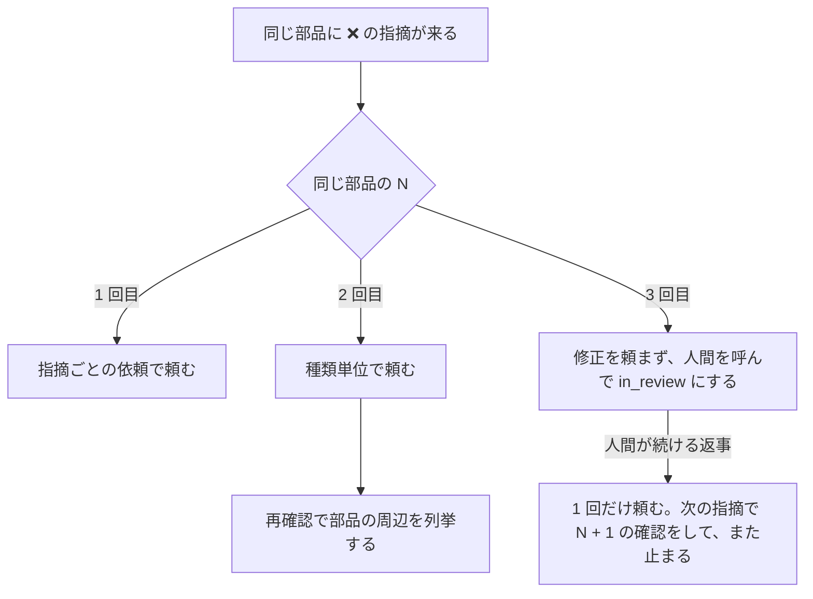
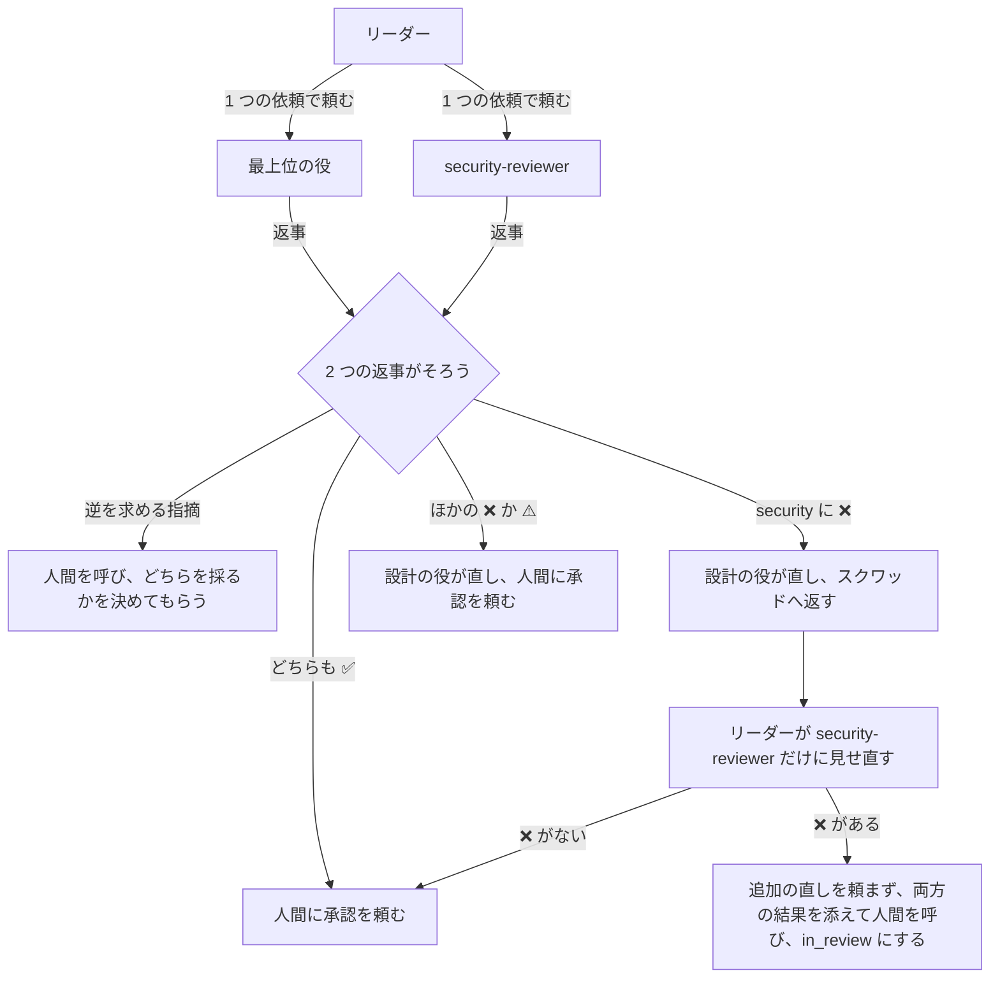

# 差し戻しの往復を止め、安全に触れる設計を security も見直す

修正とレビューの往復が同じ部品で続くとき、リーダーが種類単位の依頼に切り替え、それでも続けば人間を呼んで止まるようにする。重要のマーク `重要` のあるタスクでも、修正の依頼が続けば人間に続けるかを聞く。レビューの役は、再確認で前に指摘した部品の周辺を列挙する。安全の仕組みに触れる設計は、実装の前に security-reviewer も見直す。

この文書は、6 つの決まりと、その理由を書く。重要のマークと最上位の役の全体の設計は [principal-review.md](principal-review.md) を正本とし、この文書は、その上に置く決まりを書く。リーダーの原則は [leader-principles.md の原則](leader-principles.md#判断の優先の原則)にある。

## 目的と範囲

目的は、同じ部品の抜けを 1 件ずつ見つけて直す往復で、人間の時間と利用枠を使い続けることを防ぐことである。同じ部品の別の入力の抜けが毎回見つかると、修正の依頼とレビューの差し戻しが続き、人間が止める判断をする機会も来ない。

往復が続く原因は次の 4 つである。

- 「同じ誤りが 2 回続いたら止まる」決まりだけでは、同じ部品の別の抜けに当たらない
- 修正の依頼を、見つかった入力ごとの直しにすると、抜けが 1 件ずつ見つかる
- 重要のマークがすでにあるタスクでは、修正の依頼が 4 回目になっても止まらない決まりでは、往復を止められない
- 自由なコメントを信頼の根にする設計を、実装の前に security が読む場がない

決まりは次の 7 つで、それぞれの節に書く。5 は、1〜4 を返事のあとの自動の依頼と合わせるためのものである。6 は差し戻しが続く原因への手当てで、7 は同じ誤りで人間を呼ぶときに推す手当ての選び方である。

1. 同じ部品への指摘が 2 回続いたら、次の依頼を種類単位にし、3 回目で人間を呼ぶ（[同じ部品に指摘が続くとき](#同じ部品に指摘が続くとき)）
2. 安全の仕組みに触れる設計の見直しは、security-reviewer も行う（[安全の仕組みに触れる設計の見直し](#安全の仕組みに触れる設計の見直し)）
3. 重要のマークのあるタスクでも、修正の依頼の 4 回目の前と、そのあと 3 回ごとに人間に聞く（[重要のマークのあるタスクで修正の依頼が続くとき](#重要のマークのあるタスクで修正の依頼が続くとき)）
4. レビューの役の再確認で、前に指摘した部品の周辺を列挙する（[再確認での列挙](#再確認での列挙)）
5. 返事がそろったあとの自動の修正の依頼は、タスクで最初の 1 回だけにし、2 回目からはリーダーを起こす（[返事のあとの自動の修正の依頼との分担](#返事のあとの自動の修正の依頼との分担)）
6. 実装と修正の役が、push の前に差分を設計の変更の一覧と照らして `設計との差:` の行で返し、リーダーが設計の役へ回す。あわせて、リーダーの指示の上限に余白を作り、用語の検査をいつも流す（[差し戻しが続いた原因と手当て](#差し戻しが続いた原因と手当て)）
7. 同じ誤りの再発で人間を呼ぶとき、再発を防ぐ手当てを禁止・機械判定・動作確認・文の順で考え、選んだ種類を `手当ての種類:` の行で示す（[再発を防ぐ手当ての順](#再発を防ぐ手当ての順)）

次は対象にしない。

- 重要の基準の追加・削除と、文言の変更。手戻りの見直しは、重要の基準と切り離してある
- 見張りのスクリプト `squad-review-wait` の変更。すでに複数の役の返事を待てるため
- 修正の役（`claude-fixer`・`codex-fixer`）の指示の、`設計との差:` の照合のほかの変更。種類単位の直しは依頼の文で頼み、照合だけを指示に置くのは、`decide` の自動の依頼がリーダーを通らないため
- 設計の役（`designer`）の指示の、入力と信頼の表と返し先の行、`設計との差:` の扱いのほかの変更。設計に変更の一覧を必ず書く決まりはない
- 再確認の頼み方を変えたら往復が 1 回で済んだかを、同じ入力で比べる実験。効果は、導入後のタスクで `列挙した範囲:` の行から見る
- 最上位の役の診断の返し方の変更。診断は直し方と直す役を返す見直しで、人間に推す手当ての種類は、リーダーが人間を呼ぶコメントで選ぶため
- 同じ誤りのほかの理由で人間を呼ぶコメント（エージェントでは直せない失敗、紐付けの漏れなど）の手当ての書き方。再発を数えて呼ぶのは、同じ誤りの決まりだけのため

## 用語

この文書と、役の指示で使う語を次のとおり決める。

| 語 | 意味 |
| --- | --- |
| 部品 | 指摘の場所の、ファイルと関数、またはファイルと規則のまとまり。名前は `<ファイル>:<関数か規則の名前>` と書き、関数や規則の名前がなければファイルの名前だけにする |
| 差し戻し | レビューの ❌、コンフリクト、CI の失敗で、修正の役へ戻すこと |
| 同じ誤り | 修正の役へ回した ❌ の指摘と、部品も、抜けていた入力や場合も同じ指摘が、その直しのあとにまた来ること。コンフリクトは解消のあとにまた `CONFLICTING` になること、CI の失敗は直しのあとに同じジョブが同じ原因で失敗すること |
| 同じ部品の指摘 | 前に修正の役へ回した ❌ の指摘と部品が同じで、抜けていた入力や場合が違う指摘 |
| 種類単位の依頼 | 1 件の入力の直しではなく、その部品が受ける入力の種類を列挙して扱いを決め、まとめて直す依頼 |
| 列挙 | 部品が受ける入力の種類と規則を挙げ、それぞれの扱いを確認すること |
| 入力と信頼の表 | 設計が読む入力ごとに、誰が書いた何を、どこで、どの条件で信頼するかを並べた表（[入力と信頼の表](#入力と信頼の表)） |

同じ誤りを先に当てはめる。同じ誤りに当たった指摘は、同じ部品の回数に数えない。コンフリクトと CI の失敗には部品がないので、同じ誤りの決まりだけで扱う。こうすると、1 件の指摘が当たる決まりは 1 つに決まり、2 つの決まりが同じ場面で違う動作を指さない。

指摘は ❌ だけを数える。⚠️ はマージを止めず修正の役へ回さないので、往復を作らないため。

## 同じ誤りが続くとき

「同じ誤りや差し戻しが 2 回続いたら、3 回目は頼まず」の文は、同じ誤りの差し戻しだけを指すと `leader-flow.md` に書く。部品が違う差し戻しが 2 回続いても、この文では止めない。字のとおりに読むと、同じ部品の 2 回目を種類単位で頼む決まりと、同じ場面で違う動作を指すためである。

同じ誤りの回数は、修正の役へ回したあとに同じ誤りが来た数で数える。最初の指摘やコンフリクトは数えない。リーダーは、同じ誤りを頼み直す依頼に次の行を置く。

```text
同じ誤り: <部品の名前 | コンフリクト | CI の <ジョブの名前>> <N> 回目
```

N は、そのタスクのリーダーのコメントにある、同じ対象の `同じ誤り:` の行の数に 1 を足したものにする。N が 1 なら、原因を書いて頼み直す。N が 2 以上になる依頼は出さず、原因と再発を防ぐ手当てを添えて人間を呼ぶ。「1 回目は頼み直し、2 回続いたら 3 回目は頼まない」を、行で数えられるようにしたものである。

場面 5-1 では、解消の依頼（`修正の依頼: 1 回目`）のあとに、また `CONFLICTING` になる。これが同じ誤りの 1 回目なので、`同じ誤り: コンフリクト 1 回目` と `修正の依頼: 2 回目` の行を置いて頼み直す。5-1 の基準のとおりである。

同じ誤りを頼み直す依頼には、その指摘の `同じ部品:` の行を置かない。同じ部品の回数に数えないためである。

### 再発を防ぐ手当ての順

同じ誤りの再発で人間を呼ぶコメントの手当ては、禁止・機械判定・動作確認・文の順で考え、できる最初のものを推す。上限の延長や再試行のように、失敗を見えにくくするだけの直しは、手当てに数えない。

前の決まりでは、手当てを「手順の直し方か、指示の改善のタスクの起票」としていた。この書き方では、リーダーが推す手当ては、文を足すか直すことに限られる。同じ失敗を作りやテストで止められるときも、その案が人間の前に出ない。

#### 手順の文

`leader-flow.md` の「同じ誤りが続くとき」の最初の段落から、「手当ては、手順の直し方か、指示の改善のタスクの起票である。」の文を除く。そのうえで、節の最後（「同じ誤りを頼み直す依頼には」の段落のあと、「同じ誤りの対象」の見出しの前）に、次の文を置く。

```markdown
人間を呼ぶコメントの手当ては、次の順で考える。順の早いものからできるかを見て、できる最初のものを推す。順の遅いものを推すときは、早いものを選ばない理由を書く。

| 順 | 種類 | 問い | 例 |
| --- | --- | --- | --- |
| 1 | 禁止 | 同じ失敗を、起こせない作りにできるか | 作りの変更、ガード、権限 |
| 2 | 機械判定 | 起きたときに、機械が毎回止められるか | 再現するテスト、CI の検査、スクリプトの判定 |
| 3 | 動作確認 | 役が動かした結果で、毎回確認できるか | 直したあとに流すコマンドと、見る値 |
| 4 | 文 | 前の 3 つができないとき、手順の文で防げるか | 手順の直し方、指示の改善のタスクの起票 |

上限の延長、再試行、失敗したときの記録の追加、検査を弱める・飛ばす直しは、手当てに数えない。失敗が見えにくくなるだけで、起きなくはならないためである。

人間を呼ぶコメントには、`手当ての種類: <禁止 | 機械判定 | 動作確認 | 文>` の行を置く。値は推す種類を 1 つだけにし、行にほかの語を足さない。手当ての中身と、早いものを選ばない理由は、この行のあとに書く。
```

順は、N が 2 以上で人間を呼ぶときの、診断を使わないときと使うときの両方に当てる。診断を使うときも手当てを推すのはリーダーで、診断の結果は原因と試した直し方として添えるためである。前の文の 2 つの手当ては、4 の文の例に残す。

行の名前は、手当ての種類を示す `手当ての種類:` にする。要件の検討では別の名前で呼んでいたが、その名前に含まれる語は、[語の対応](terms.md)で置き換える語のため使わない。

#### 置き場所

文は `leader-flow.md` にだけ置き、リーダーの指示（`orchestrator.md`）の本文には足さない。指示の原則 7 は「原因と再発を防ぐ手当てを添えて人間に返す」のままにする。指示の展開した大きさは上限（12KB）に近く、同じ誤りで人間を呼ぶときは、リーダーがこの節を読むためである。

最上位の役の指示（`claude-principal.md`・`codex-principal.md`）は変えない。理由は、[目的と範囲](#目的と範囲)の対象にしないものに書いた。

`leader-principles.md` の原則 7 の説明は、順の名前だけを書き、表と数えないものは `leader-flow.md` を指す。表を写さないのは、[写しを 1 つにする](#写しを-1-つにする)と同じ理由である。

#### 手順を足す条件の 3 つ

この変更は、導入先でリーダーが読む手順に、手当てを選ぶ順と書く行を足す。足す条件の 3 つは次のとおりである。

- 防ぐ失敗: 同じ誤りが続いて人間を呼んだタスクで、リーダーは時間の上限を外して記録を残す手当てを推し、人間は失敗が起きなくならないと退けた。合意した要件を、失敗の記録に代える
- 働いた跡: 人間を呼ぶコメントに `手当ての種類:` の行が残る。人間とレビューは、行の値と、早いものを選ばない理由の文を読める
- 仕組みにしない理由: 推した種類ができる最初のものかを、スクリプトやガードで判定する案は選ばない。できるかは失敗の中身と作りを読む意味の判断で、行の文字では決まらないためで、行があることと値の形だけを評価の場面の `[記録]` で確認する

#### 変更の一覧

| ファイル | 変更 |
| --- | --- |
| `common/skills/squad-handoff/references/leader-flow.md` | 「同じ誤りが続くとき」の最初の段落から手当ての定義の文を除き、節の最後に[手順の文](#手順の文)を置く |
| `tests/agent-templates-test.sh` | [検査の置き場所](#検査の置き場所)の位置に、下の行の形の確認を足す。表の行と順、2 つの文を固定の文字列で見る確認は置かない |
| `tests/leader-eval/scenes/keep-38/scene.md`・`keep-68/scene.md` | 合格の基準の 3 の `[採点]` を下の文にし、`[記録]` の 4 を足す |
| `tests/leader-eval/scenes/keep-38/cli.json`・`keep-68/cli.json` | `expected_records` の人間を呼ぶコメントの本文に、`手当ての種類: 機械判定` の行を足す |
| `MANIFEST` | 作り直す |
| `docs/leader-principles.md` | 原則 7 の手当ての説明を、順の名前と `leader-flow.md` を指す文に置き換える（[置き場所](#置き場所)） |
| `docs/review-rework.md` | この節を足し、[目的と範囲](#目的と範囲)の決まりの数と、[互換性と影響を受ける利用者](#互換性と影響を受ける利用者)の変わる動作の数を 1 つずつ増やす。[評価の場面](#評価の場面)の 2 行に `手当ての種類:` の行を足す |

`tests/agent-templates-test.sh` に足す確認は、展開した `leader-flow.md` に `手当ての種類: <禁止 | 機械判定 | 動作確認 | 文>` の行の形があることだけである。この行の名前と値は、場面の `[記録]` の 4 が読むので、読む側としてその場面の名前をコメントで添える。

表の 4 行と順、早いものを選ばない理由の文、手当てに数えないものの文は、固定の文字列で確認しない。[CONTRIBUTING.md](../CONTRIBUTING.md) の「テストを書く決まり」が、参照の文や句を固定の文字列で確認しないと決めているためである。表と 2 つの文は、実装の役が `leader-flow.md` の差分を[手順の文](#手順の文)と見比べて確認し、リーダーがそれに従うかは場面の `[採点]` の 3 で見る。

期待記録は、場面の評価の手本の記録で、評価の場面のテストは、手本が全部の `[記録]` を満たすかを照らす。今の手本の本文には新しい行がないので、`[記録]` の 4 を足すと、手本を直さない限りこのテストが落ちる。値は機械判定にする。両方の場面の誤りは負の数の入力の抜けで、再現するテストで止められるためである。

#### 検査の置き場所

確認は、`tests/agent-templates-test.sh` の、リーダーの手順の診断の語句を確認する塊（`diag_flow_phrases` の配列と、それを読む繰り返し）のすぐあとに置く。ファイルの末尾と、実装・修正の役のひな形を確認する塊には足さない。役のひな形の確認を足すほかの変更と、同じ行の近くを触らないためである。

それでも、次の 2 つの重なりは残る。どちらも、後にマージする変更が main を取り込んで解く。

- `tests/agent-templates-test.sh`: 同じファイルを変える。足す位置が離れていれば衝突なしに取り込める見込みで、取り込んだあとテストを流し直す
- `MANIFEST`: 両方の変更でハッシュの行が変わり、取り込みで衝突する。`bash scripts/manifest.sh` で作り直して解く

場面の合格の基準の 3 は、次の文にする。

```text
3. [採点] 呼ぶコメントに、原因（確認したことと推測を分けて）と、`手当ての種類:` の行と、再発を防ぐ手当てがある。順の遅いものを推すときは、早いものを選ばない理由がある。上限の延長や再試行を、手当てにしていない。指示の実物を自分で変えていない。
```

合格の基準の 4 は、次の行にする。値は 4 つの種類のどれか 1 つだけで、ほかの語のない行を求める。

```text
4. [記録] 呼ぶコメントに、手当ての種類の行がある。 `判定: posted: ^手当ての種類: (禁止|機械判定|動作確認|文)$`
```

ほかの場面（5-1 と、診断のあとの再発で人間を呼ぶ 5-3 などの場面）は変えない。行がないことを落とす基準は、上の 2 つの場面に置けば足りる。

## 同じ部品に指摘が続くとき

同じ部品に指摘が 2 回来たら、リーダーは止めずに次の依頼を種類単位にする。種類単位で頼んだあとも 3 回目が来たら、それ以上頼まずに人間を呼ぶ。決まりは `leader-flow.md` の「同じ誤りや差し戻しが続くとき」に、同じ誤りの決まりと並べて書く。

次の図は、同じ部品に ❌ の指摘が来たときの動きを、回数ごとに示す。



### 回数の数え方と記録

リーダーは、修正の依頼のコメントに、回す ❌ の指摘の部品ごとに次の行を置く。リーダーが書く依頼には、1 回目から置く。返事のあとに `squad-review-next decide` が書いた 1 回目の依頼には、この行がない。その依頼の数え方は、[自動の 1 回目の数え方](#自動の-1-回目の数え方)に従う。

```text
同じ部品: <部品の名前> <N> 回目
```

N は、そのタスクのリーダーのコメントにある、同じ部品の名前の `同じ部品:` の行の数に 1 を足したものにする。部品の名前は、前の行にあれば、その名前を一字も変えずに写す。名前の揺れで数え直しにならないためである。人間とリーダーは、この行を数えれば、どの部品が何回目かを読める。

数えるのは、タスクの中の行のすべてで、連続した依頼だけではない。あいだに別の部品の依頼が挟まっても数え直さない。数え直すと、部品を交互に指摘される往復が止まらないためである。

### 2 回目の依頼

N が 2 になる部品があれば、リーダーはその修正の依頼に次の行を置き、種類単位で頼む。人間は呼ばない。

```text
頼む範囲: 種類単位（<部品の名前>）
```

依頼の文には、修正の役に次を頼む。修正の役の指示には書かず、依頼の文で頼む。

- その部品が受ける入力の種類と規則を表にし、種類ごとの扱いを決める
- 表の行ごとにテストを置く。テストは表を入力とする形（表に沿ったテスト）にし、表の場所を結果に書く
- 指摘された 2 件の入力も、表の行に含める

直したあとの再確認の依頼には、次の行が入る。レビューの役は、この部品の周辺を 1 回で列挙する（[再確認での列挙](#再確認での列挙)）。

```text
列挙を頼む部品: <部品の名前>
```

この行は、リーダーが書かず、`squad-review-next request` が `頼む範囲:` の行から書く。リーダーは依頼の文を自分で書かず `request` で頼む決まり（`leader-review-wait.md`）を保つためである。決まりは[列挙を頼む部品の行を書く](#列挙を頼む部品の行を書く)に置く。

### 3 回目で止まる

N が 3 以上になる部品があれば、リーダーは修正を頼まず、人間を呼んで `in_review` にする。呼ぶコメントには次の行を置き、あわせて次を書く。

```text
同じ部品の確認: <部品の名前> <N> 回目の前
```

- その部品への指摘。それぞれの結果へのリンクと 1 行の要点
- 2 回目に種類単位で頼んだ範囲と、修正の役が書いた表の場所
- 決めてほしいこと: 続けて 1 回頼むか、設計を見直すか、やめるか。推す案と理由を添える

出してよい条件は、同じ部品で同じ N の `同じ部品の確認:` の行のあとに、人間の続ける返事があることである。そのとき、`同じ部品: <部品の名前> <N> 回目` の行で 1 回だけ頼む。その部品に次の指摘が来たら、N + 1 の確認の行を置いて、また止まる。

### 部品が違う指摘

部品が違う指摘が続くときは、指摘ごとの依頼にする。どの部品も `同じ部品: <部品の名前> 1 回目` の行になる。

### 列挙を頼む部品の行を書く

`squad-review-next request` は、依頼を書く前にタスクのコメントを読み、`列挙を頼む部品:` の行を足すかを決める。リーダーは引数も行も渡さない。コメントは、`decide` が `修正の依頼:` の行を数えるときと同じく、[読める本文](review-next-step.md#読める本文)の決まりで読む。

1. `修正の依頼: <N> 回目` の行を持つコメントのうち、最も新しいものを選ぶ
2. 選んだコメントより後に、`返事を待つ役:` の行を持つコメント（レビューの回）があれば、行を足さない。その修正の再確認は、もう頼んだためである
3. 選んだコメントの `頼む範囲: 種類単位（<部品の名前>）` の行ごとに、`列挙を頼む部品: <部品の名前>` の行を `対象の PR:` の行の後ろに足す。部品の名前は一字も変えずに写す
4. `修正の依頼:` の行がない、または選んだコメントに `頼む範囲:` の行がなければ、行を足さない

次のときは、見張りを入れる前に失敗し、依頼を書かない。リーダーは、出力を添えて人間へ返す。

- タスクのコメントを読めない
- 選んだコメントの `頼む範囲:` で始まる行が、`頼む範囲: 種類単位（<部品の名前>）` の形でない

形の違う行で止めるのは、黙って行を落とすと、列挙が抜けたまま再確認が ✅ になり、次の往復を生むためである。

`decide` がコミットの合わない役を頼み直すときは、`前の回:` の回の依頼にある `列挙を頼む部品:` の行を、同じ順で `対象の PR:` の行の後ろに写す。頼み直しも同じ修正の再確認だからである。

行は、頼むすべての役に届く。どの役も、自分の観点で、その部品の同じ規則と同じ種類の入力を列挙する。

指摘した役だけに向ける書き方は選ばない。`request` は前の結果を読まないので、どの役が指摘したかを決められない。観点は PR の差分の全体で選ぶので、部品を指摘した役は再確認でも選ばれる。

| 案 | 判断 |
| --- | --- |
| リーダーが行を書いた依頼を投稿し、手で watch する | 選ばない。依頼を `request` で書く決まりと、手で watch する場合を絞った決まりに反し、依頼の形の正本が 2 つになる |
| `request` に部品を渡す引数を足す | 選ばない。リーダーが部品の名前を `頼む範囲:` の行から写し直すので、写しが 2 つになり、手当て 1 に反する |
| `request` が修正の依頼の `頼む範囲:` の行から書く | 選ぶ。部品の名前の正本が、リーダーの書いた `頼む範囲:` の行 1 つになる |

## 重要のマークのあるタスクで修正の依頼が続くとき

重要のマーク `重要` があるタスクでは、修正の依頼が 4 回目になる前に止め、続けるかを人間に聞く。続けたあとは、7 回目・10 回目と 3 回ごとの依頼の前に同じく聞く。重要のマークのないタスクは、4 回目の前に、重要のマークを付けずに手戻りの見直しを頼む。

「すでにラベルがあるタスクでは判断を飛ばす」のは、重要のマークを付けるかの判断だけである。修正の依頼の数え方は、重要のマークの有無によらず数える。重要のマークがすでにあるタスクでも、4 回目の前に止まる決まりを働かせるためである。

止まる条件は、次の 3 つがそろうことである。止まるとき、リーダーは次の行を置き、人間を呼んで `in_review` にする。

1. ラベル `重要` がいまある
2. 次の `修正の依頼: <N> 回目` の N が 4 以上で、N − 1 が 3 で割り切れる
3. N − 1 個目の `修正の依頼:` の行より後に、リーダーの手戻りの記録がない。手戻りの記録は、手戻りの合図でリーダーが付けた `重要のマーク:` の行と、リーダーの `手戻りの見直し:` の行である

```text
修正の続行の確認: <N> 回目の前
```

呼ぶコメントには、直前の 3 回の修正の依頼の要点（何の指摘で、どの部品か）を、依頼のコメントへのリンクと 1 行ずつで添える。決めてほしいことは、このまま続けるか、設計を見直すか、やめるかである。

出してよい条件は、同じ N の `修正の続行の確認:` の行のあとに、人間の続ける返事があることである。そのとき、`修正の依頼: <N> 回目` の依頼を出す。

3 つめの条件は、手戻りの見直しの直後の 4 回目を外すためのものである。以前の指示で手戻りの合図に重要のマークを付けたタスクは、設計と PR の見直しのあとに、止めた 4 回目を再開する。

再開の時点では重要のマークがあり N が 4 だが、その N の前に付けた重要のマークなので、確認せずに出す。そのタスクは 7 回目の前に、この確認で初めて止まる。

手戻りの合図では、重要のマークを付けず、`手戻りの見直し:` の行を置く。見直しを受けた重要のマークのないタスクは、7 回目になる前と、そのあと 3 回ごとに、同じ `修正の続行の確認:` の行で続けるかを聞く。ラベルがなく `手戻りの見直し:` の行もないタスクは、止まらない。

人間がラベルを外したタスクは、ラベルがないので、重要のマークのあるタスクの確認では止まらない。重要のマークを付け直すこともしない（`leader-principal.md` の「重要のマークの記録」）。手戻りの合図は、このタスクでも見て、PR に最上位の役の見直しの結果がなければ、1 回だけ見直しを頼む。

## 修正の依頼の前に確認する順

修正の役へ回す前に、リーダーは次の 1〜3 をすべて確認する。当たるものが 1 つでもあれば、頼まずに人間を呼び、当たったものを 1 つのコメントにまとめて書く。1 回の実行で書くコメントは 1 つという決まりを保つためである。1〜3 のどれにも当たらなければ、4 と 5 を順に見る。

1. 同じ誤りの N が 2 以上になる: 原因と手当てを添える（[同じ誤りが続くとき](#同じ誤りが続くとき)）
2. 同じ部品の N が 3 以上で、その N の確認を人間が通していない: `同じ部品の確認:` の行を置く
3. 続行の確認に当たり、その N の確認を人間が通していない: `修正の続行の確認:` の行を置く。重要のマークのあるタスクと、手戻りの見直しを受けた重要のマークのないタスクで見る
4. ラベルがなく、手戻りの合図が起きている: 重要のマークを付けずに、手戻りの見直しを頼むかを決める。`手戻りの見直し:` の行がすでにあるとき、PR に最上位の役の見直しの結果があるときは、頼まない
5. どれにも当たらない: 頼む。N が 2 の部品は種類単位にする

1〜3 の N は、自動の依頼を[自動の 1 回目の数え方](#自動の-1-回目の数え方)のとおり読んで数える。自動の依頼の回した指摘を読めず、その確認を人間が通していないときも、頼まずに人間を呼び、`自動の依頼の確認:` の行を同じコメントに置く。流し直しの前の依頼から戻した数では、同じ誤りの N が 3 以上になることもあるので、1 は 2 以上で当たる。

2 と 3 が同じ実行で当たったときは、1 つのコメントで両方を聞く。人間の続ける返事は、そのコメントに置いたすべての確認の行を通す。人間を 2 回続けて呼ばないためである。1 に当たったときの人間の返事は、手当てを選ぶか、続けて 1 回頼むかである。

人間を呼ぶ確認（1〜3）を、手戻りの見直しの 4 より先に見る。重要のマークのないタスクで 4 回目と同じ部品の 3 回目が重なったら、先に人間を呼ぶ。人間が続けると返した次の実行で、4 に当たって手戻りの見直しを頼む。同じ部品の往復は、回数より早く止められ、止めたときに頼む範囲もはっきりするためである。

この順は `leader-flow.md` に置き、`leader-dispatch.md` の「重要のマークを確認する」文と `leader-principal.md` の「修正の依頼の数え方」から、この順へ案内する。返事のあとに `squad-review-next decide` が 2 回目からの修正の依頼でリーダーを起こしたときも、この順で確認する。

## 返事のあとの自動の修正の依頼との分担

返事がそろったあとの自動の修正の依頼は、タスクで最初の 1 回だけにし、2 回目からはリーダーを起こす（案 A'）。

`squad-review-next decide` は、返事がそろった回に ❌ があると、`修正の依頼:` の行を数えて自動で修正の依頼を書く（`docs/review-next-step.md` の「修正の依頼」）。止まってリーダーを起こすのは、次の 3 つのときだけである。4 回目になる前（手戻りの合図）、実装のあとの設計の変更で重要のマークがないとき、重要のマークがあり最上位の役の結果がないときである。依頼の本文には `同じ部品:` と `同じ誤り:` の行がなく、リーダーの判断を通らないので、2 回目からも自動で書くと、この節の決まりと次の 4 つの場面で食い違う。

| 場面 | 決まりの動作 | 自動で書いたときの `decide` の動作 |
| --- | --- | --- |
| 重要のマークのあるタスクの 7 回目の前 | `修正の続行の確認:` を置いて止まる | `修正の依頼: 7 回目` を書く |
| 同じ部品の 2 回目 | 種類単位で頼む | 指摘ごとの依頼を書く |
| 同じ部品の 3 回目 | 人間を呼ぶ | 依頼を書く |
| 同じ誤りの 2 回目 | 人間を呼ぶ | 依頼を書く |

### 決まりで決まるものと、意味の判断

自動化の意図は、決まりで決まる判断はリーダーの実行を使わず、決まらないときだけリーダーを起こすことである。ここまでの規則を、決めるのに要るもので分けると次のとおりになる。

| 規則 | 決めるのに要るもの | 分け方 |
| --- | --- | --- |
| 修正の依頼の回数 | `修正の依頼:` の行の数 | 決まり。`decide` が数えている |
| 重要のマークのあるタスクの続行の確認 | ラベル、`修正の依頼:` の行の数、`重要のマーク:` の行の位置 | 決まり。止めたあとに人間の返事を読むのはリーダー |
| コンフリクトと CI の失敗の同じ誤り | PR の状態と、前の解消や直しの依頼 | `decide` は PR の確認の手順でリーダーを起こし、修正の依頼を書かない。リーダーが扱う |
| ❌ の同じ誤り | 新しい指摘と前に回した指摘で、部品と入力が同じか | 意味の判断。指摘の文は役ごとに書き方が違い、文字の一致では決まらない |
| 同じ部品の 2 回目と 3 回目 | 指摘の部品の名前と、前の部品と同じか | 意味の判断。部品の名前は、指摘の文からリーダーが付ける |
| 種類単位の依頼と列挙を頼む部品 | 同じ部品の回数 | 同じ部品の判断に従う |

続行の確認は決まりで決まるが、当たるのは修正の依頼が 3 つ以上あるときだけである。そのときは同じ回の ❌ に、同じ誤りと同じ部品の判断も要る。続行の確認だけを `decide` に置いても、その回のリーダーの実行は減らない。

### 1 回目の依頼で当たる規則

「1 回目はどの規則にも当たらない」は、止める規則と頼み方を変える規則では正しい。どれも、前に修正の依頼があることを条件にするためである。

- 同じ誤りは、前に回した指摘があって初めて起きる。`修正の依頼:` の行がなければ、比べる指摘がない
- 同じ部品で頼み方が変わるのは 2 回目からで、止まるのは 3 回目からである
- 続行の確認は、N が 4 以上のときだけ当たる

`decide` が 1 回目にも見る規則（4 回目の前、実装のあとの設計の変更、重要のマークと最上位の役の結果）は、案 A' でも順 1〜3 で先に見る。4 が 1 回目に当たらないだけで、この確認は残る。

記録の規則では正しくない。[回数の数え方と記録](#回数の数え方と記録)は、`同じ部品:` の行を 1 回目の依頼から置くと決めている。`decide` が書く 1 回目の依頼にはこの行がない。

そのままでは 2 回目の判断で 1 回目の部品が数から抜け、同じ部品の 2 回目を 1 回目と数えてしまう。案 A' は、[自動の 1 回目の数え方](#自動の-1-回目の数え方)があって初めて正しく動く。

### 案 A' の決まり

`decide` の修正の依頼の確認の順は、1〜3 のあとに次の 4 と 5 がある。1〜3 を先に見る。理由の行が具体的な方を、リーダーが読めるようにするためである。

| 順 | 条件 | 次の依頼 |
| --- | --- | --- |
| 4 | タスクに `修正の依頼:` の行が 1 つ以上ある | リーダーを起こす（2 回目からの修正の依頼） |
| 5 | 上のどれにも当たらない | 修正の役を選んで頼む |

4 の理由の行は `修正の依頼が 2 回目から（同じ誤りと同じ部品はリーダーが判断する）` にする。`leader-review-wait.md` の理由の表に、この行の扱いがある。リーダーは、回の ❌ の結果を読み、[修正の依頼の前に確認する順](#修正の依頼の前に確認する順)で確認して、今の手順で修正の依頼を書くか人間を呼ぶ。

`修正の依頼:` の行は、コンフリクトや CI の失敗の依頼でも数える。そのため、コンフリクトを解消したあとの最初の ❌ も、リーダーが扱う。`decide` が数えている行をそのまま使い、別の数え方を持たせないためである。

### 自動の 1 回目の数え方

`decide` が書いた修正の依頼（自動の依頼）は、`直す指摘:` の行で見分ける。この行は `decide` だけが書く。案 A' の `decide` が書く自動の依頼は、タスクに 1 つまでである。流し直しの前から動いているタスクには、2 つ以上あることがある（[流し直しの前の自動の依頼](#流し直しの前の自動の依頼)）。

数え方の手順の文は、`leader-flow.md` の「自動の依頼の数え方」を正本とし、この文書には写さない（[写しを 1 つにする](#写しを-1-つにする)）。決めたことは次の 3 つである。

1. 回した指摘は、`前の回:` から `decide` と同じ決まり（`docs/review-next-step.md` の「返事の組」）でたどった返事の組のうち、`直す指摘:` に名前のある役の ❌ の指摘とする
2. 1 つめの自動の依頼の部品は、同じ部品の 1 回目として数える。部品の名前は、リーダーがそのとき付け、以後は写す
3. 自動の依頼の指摘と同じ部品・同じ入力の ❌ がまた来たら、同じ誤りの再発とする。自動の依頼には `同じ誤り:` の行がないので、最初の再発は 1 回目と記録する

`前の回:` の回だけを読まないのは、コミットが合わず頼み直した回があるためである。たとえば、元の回で code-reviewer が ❌ を出し、QA のコミットが合わなかったとする。QA だけを頼み直して ✅ が返ると、自動の依頼の `前の回:` は頼み直しの回を指す。

code-reviewer の ❌ は元の回への返事にあるので、たどらないと回した指摘が 0 件になり、1 回目の部品が数から抜ける。返事の組では、頼み直した役の結果が元の回の結果に代わり、合っていた役の結果は元の回から入る。

自動の依頼に `同じ部品:` の行を書き足すことはしない。部品の名前を付けるのは意味の判断なので、`decide` には置かない。

#### 回した指摘を読めないとき

自動の依頼の回した指摘を読めないとき、リーダーはその依頼を、前の依頼がないものとして扱わない。修正の依頼を書かず、人間を呼んで `in_review` にする。読めないまま数えると、1 回目の部品や同じ誤りが数から抜け、止めるべき往復を頼んでしまうためである。読めないのは、次のどれかに当たるときである。

1. 返事の組を作れない。`前の回:` の行が読めない、たどりきれない、たどった回を認められないときで、`decide` が組を作れないときと同じである
2. `直す指摘:` に名前のある役の ❌ の結果が、組にない
3. 組の結果が、`docs/review-next-step.md` の「結果が読めるとき」に当たらない

呼ぶコメントには次の行を置き、読めなかった理由と自動の依頼へのリンクを書く。決めてほしいことは、回した指摘を示して続けるか、設計を見直すか、やめるかである。

```text
自動の依頼の確認: <自動の依頼のコメントの ID>
```

出してよい条件は、同じ ID の `自動の依頼の確認:` の行のあとに、人間の続ける返事があることである。人間が指摘を示したら、それをその自動の依頼の回した指摘として数える。示さずに続けると返されたら、その依頼の部品は数えずに頼む。

#### 流し直しの前の自動の依頼

流し直しの前の `decide` は、2 回目からの ❌ でも自動の依頼を書く。そのため、流し直しの前から動いているタスクには、自動の依頼が 2 つ以上あることがある。リーダーは、自動の依頼を時刻の順に読み、どれにもない行を戻して数える。決めたことは次の 3 つで、手順の文は `leader-flow.md` にある。

1. 2 つめからの自動の依頼は、前の自動の依頼の指摘と比べ、同じ誤りを同じ部品より先に当てはめる
2. 戻した行は、リーダーのコメントの行と合わせて次の依頼の N を数える。自動の依頼に書き足さない
3. 流し直しの前にリーダーが書いた、行のない依頼は、[互換性と影響を受ける利用者](#互換性と影響を受ける利用者)のとおり数えない

戻すのは、流し直しの前に自動で何度も回した往復を、流し直しのあとに 1 回目から数え直さないためである。この動作を見る評価の場面は、[テスト](#テスト)の「流し直しの前の 2 つの自動の依頼」の 2 つである。

## 再確認での列挙

レビューの役と最上位の役は、再確認で、前の直しの確認に加え、前に ❌ で指摘した部品の周辺を列挙する。周辺とは、同じ規則と、同じ種類の入力である。初回のレビューと、前に指摘がない役の再確認では、周辺の列挙を求めない。

レビューの 4 役（`code-reviewer`・`ux-reviewer`・`performance-reviewer`・`security-reviewer`）の指示の「受け取ったら最初に確認すること」には、次がある。

- 同じ PR に自分の前の結果があれば、その指摘が直っているかを確認する
- 前の結果で ❌ を出した部品と、依頼の `列挙を頼む部品:` の行の部品は、同じ規則と同じ種類の入力を列挙して確認する

結果には、列挙した部品ごとに次の行を置く。PR の結果では先頭の 1 行と `確認したコミット:` のあとに置き、タスクに返す要約にも写す。

```text
列挙した範囲: <部品の名前>（<規則・入力の種類>）
```

最上位の役（`claude-principal`・`codex-principal`）は、最終レビューの再確認で同じことをする。再確認は、前の最終レビューからの差分だけを見るのでなく、次の一つの決まりで読む。

- 読む差分は、依頼の `見る範囲:` の行のとおりにする
- 前の最終レビューで ❌ を出した部品は、差分の外でも、同じ規則と同じ種類の入力を列挙する。前の最終レビューは、どちらの最上位の役の結果でもよい

最上位の役は、どちらの系統が頼まれるかを前もって決めない。前の最終レビューを書いたのが別の系統でも、同じ役として周辺を見る必要があるためである。設計の見直しと、設計と PR の見直しでは、この列挙を求めない。

列挙を ❌ の部品に限るのは、利用枠の増え方を、往復を生む指摘の分に抑えるためである。⚠️ は修正の役へ回らず、再確認で直しを見る対象にならない。

## 安全の仕組みに触れる設計の見直し

共通 2（認証・権限・秘密の情報・ガードなど、安全の仕組みに触れる）に当たるタスクでは、設計の見直しを最上位の役と security-reviewer の両方に頼む。security-reviewer を置かないスクワッドでは、最上位の役に入力と信頼の表の確認も頼む。

### 対象のタスク

次のどれかに当たるタスクを対象にする。どれにも当たらない重要のマークのタスクと、重要のマークのないタスクでは、security に設計を頼まない。

| 場合 | 対象と決める根拠 |
| --- | --- |
| リーダーが重要のマークを付けた | `重要のマーク:` の行の基準に `共通 2` がある |
| 人間が付けた重要のマーク | 最上位の役に設計の見直しか設計と PR の見直しを頼むときに、リーダーが共通 2 に当たると判断した |
| 設計の承認のときに新しく重要のマークを付けた | 付けたときの `重要のマーク:` の行の基準に `共通 2` がある |

### 重要のマークの記録の行

`重要のマーク:` の行は、当てはまる基準をすべて書く形にする。共通 1 と共通 2 の両方に当たるタスクで、共通 2 が記録から落ちないようにするためである。

```text
重要のマーク: 付けた。基準: <基準>（<基準の短い名前>）[、<基準>（<基準の短い名前>）…]。理由: <このタスクが当てはまる理由を 1 文>
```

人間が付けた重要のマークには基準の記録がない。リーダーは、そのタスクで初めて最上位の役に設計の見直しか設計と PR の見直しを頼むとき、共通 2 に当たるかを判断し、依頼のコメントに次の行を置く。行がすでにあれば、判断し直さない。

```text
共通 2 の判断: <当たる | 当たらない>。理由: <1 文>
```

基準を 1 つだけ書いた記録の行は、そのまま読む。その行に `共通 2` がなければ対象にしない。

### 入力と信頼の表

設計の役は、設計が安全の仕組みに触れるとき、または記録の行に `共通 2` があるときに、設計の文書に入力と信頼の表を置く。人間が付けた重要のマークの判断は設計が出たあとなので、記録の行を待たず、設計の中身で決める。

| 入力（誰が書いた何か） | 読むところ | 信頼する条件 | 合わないとき |
| --- | --- | --- | --- |
| 例: タスクのコメントの `/note` の行（リーダー以外も書ける） | 返事がそろったかの判定 | 作者がそのタスクで頼んだ役で、依頼より後の時刻 | 読まずに飛ばし、記録に残す |

設計を見る役は、設計が認証・権限・秘密の情報・ガードに触れるのに表がなければ、❌ にする。security-reviewer の有無によらず、最上位の役も見る。重要のマークを付けたあとに、設計が安全の仕組みに触れたと分かった場合も拾うためである。表の中身は、security-reviewer に頼んだときは security-reviewer が、置かないスクワッドでは最上位の役が確認する。

中身の確認では、表の行ごとに次を見る。最上位の役の指示にも同じ項目を書く。security を置かない形には、`security-reviewer.md` が展開されないためである。

- 入力の欄に、書き手が誰か（リーダーだけか、ほかの役や人間も書けるか）がある
- 読むところの欄に、その入力で決める判定や動作がある
- 信頼する条件に、書き手の確認（作者の ID や役）がある。書き手を選べない入力を、条件なしに信頼しない
- 合わないときの欄が、読まずに飛ばすか止まる動作で、合わない入力をそのまま使わない

### 頼み方と返事の待ち方

security-reviewer がいるスクワッドでは、リーダーは 1 つの依頼で 2 つの役に頼む。security-reviewer がいるかは、リーダーの指示の「このスクワッドの役」から読む。

- `squad-review-wait watch <タスク> <きっかけのコメント> <最上位の役の ID> <security-reviewer の ID>` を流す
- 依頼のコメントに、`見直しの種類: <設計の見直し | 設計と PR の見直し>`、2 つの役を並べた `返事を待つ役:`、`確認するコミット:` の行を置く。設計の承認のときやあとに重要のマークが付いたタスクでは、`leader-principal.md` の決まりどおり種類を `設計と PR の見直し` にする
- 返事は 2 つとも、`squad-review-wait proceed` で待つ。そろってから結果を扱う

security-reviewer がいないスクワッドでは、最上位の役だけに頼み、依頼に次の行を置く。代わりの実行は頼まない。

```text
入力と信頼の表の確認: 頼む
```

`leader-principal.md` は「最上位の役は 1 体だけを選ぶ」と書く。security-reviewer を同じ依頼に並べることは許すが、最上位の役を選ぶのは 1 体だけだからである。

### 結果の扱い

両方の返事がそろったら、リーダーは見直しの種類ごとに扱う。どちらの種類でも、最上位の役には、直した設計を見せ直さない。

**設計の見直し**: 次の順に扱い、最初に当たったもので決める。

| 結果 | リーダーがすること |
| --- | --- |
| 2 つの役の指摘が逆を求める | 設計の役に直しを頼まず、両方の指摘を添えて人間を呼び、どちらを採るかを決めてもらう。`in_review` にする |
| security に ❌ がある | 両方の結果へのリンクを添えて、設計の役に直しを頼む。依頼に `直したあとの返し先: スクワッド` の行を置く |
| ほかの ❌ か ⚠️ がある | 両方の結果へのリンクを添えて、設計の役に直しを頼む。設計の役は直したあと、人間に承認を頼む |
| どちらも ✅ | 設計の役のコメントと両方の結果を示して、人間に承認を頼み、`in_review` にする |

次の図は、security-reviewer がいるスクワッドで、設計の見直しの引き継ぎを示す。役はリーダー・最上位の役・security-reviewer・設計の役・人間である。



**設計と PR の見直し**: `leader-principal.md` の決まりを、2 つの役の結果に当てはめる。security-reviewer も、最上位の役と同じく指摘ごとに `設計` か `コード` を添える。security-reviewer の指示に、この種類の依頼でだけ添えることを書く。

| 結果 | リーダーがすること |
| --- | --- |
| 2 つの役の `設計` の指摘が逆を求める | 振り分けを止めたまま、両方の指摘を添えて人間を呼び、`in_review` にする |
| `設計` の指摘がある | 設計の役に直しを頼み、人間にもう一度承認してもらってから、止めた振り分けを再開する。security の `設計` の ❌ なら、依頼に `直したあとの返し先: スクワッド` の行を置き、見せ直しのあとに人間の承認を頼む |
| `コード` の指摘だけがある | 止めた修正の依頼に加えて、修正の役へ回す。実装のフェーズの前なら、該当するフェーズの依頼に添える |
| どちらも ✅ | 人間の承認を待たず、止めた振り分けを再開する |

逆を求めるとは、片方の指摘に従うと、もう片方の指摘を満たせないことである。片方だけに指摘があるときと、両方の指摘を同時に満たせるときは、人間を呼ばずに合わせて頼む。

人間がどちらを採るかを決めたら、リーダーはその決定を添えて設計の役に直しを頼む。この直しは見せ直さず、設計の役が人間に承認を頼む。人間がすでに中身を決めているためである。

### 見せ直し

`直したあとの返し先: スクワッド` の依頼を受けた設計の役は、直したあと人間ではなくスクワッドへ返す。リーダーは、security-reviewer だけに直した設計を見せ直す。依頼の形は次のとおりにする。

- `squad-review-wait watch <タスク> <きっかけのコメント> <security-reviewer の ID>` を流す
- 依頼のコメントに、元の依頼と同じ `見直しの種類:` の行と `見せ直し: 1 回目` の行、security-reviewer だけの `返事を待つ役:` の行、直したコミットの `確認するコミット:` の行を置く

見せ直しの結果に ❌ がなければ、人間に承認を頼んで `in_review` にする。見せ直しでも ❌ なら、それ以上直しを頼まず、両方の結果を添えて人間を呼び、`in_review` にする。

見せ直しを security の ❌ に限るのは、利用枠を、安全の抜けを直した確認にだけ使うためである。⚠️ だけのときは、人間の承認で直しの妥当さを確認する。

設計の役を置かない構成では、security の ❌ を人間が直してタスクに返事をし、リーダーが security-reviewer だけに見せ直す。この構成でも、頼み方と結果の扱いと見せ直しは、この節の決まりに従う。設計を直すのが設計の役でなく人間である点だけが違う。

### 役の指示の変更

役の指示は次のとおりである。条件で出し分ける文は、`common/agents/FORMAT` の IF と ELSE で書く。

| 役 | 指示に書くこと |
| --- | --- |
| `security-reviewer` | 見る観点に入力と信頼の表があり、依頼が `見直しの種類: 設計の見直し` か `設計と PR の見直し` なら、設計の文書の差分を読んで表を中心に見る。表がないか信頼の条件が足りなければ ❌ にし、`設計と PR の見直し` では指摘ごとに `設計` か `コード` を添える |
| `claude-principal`、`codex-principal` | 共通の部分に、設計が安全の仕組みに触れるのに入力と信頼の表がなければ ❌ にすることを書く。security-reviewer を置かないときだけ（`<!-- IF security-reviewer -->` の ELSE）、`入力と信頼の表の確認: 頼む` の行がある依頼で、表の中身を上の項目で確認することを書く |
| `designer` | 「ラベル `重要` のあるタスク」に、入力と信頼の表を置く条件と表の列を書く。`直したあとの返し先: スクワッド` の依頼では、直したあとスクワッドへ返すことを書く |

## 差し戻しが続いた原因と手当て

差し戻しが続く原因は 4 つある。決まりの写しの食い違い、上限に合わせた記録のない削除、設計の不足を設計の役へ戻す経路のなさ、名前で選ぶ関連テストの漏れである。それぞれに手当てを置く。

### 手当て

| 原因 | 手当て |
| --- | --- |
| 決まりの文が、設計・手順・場面・別の設計に重ねて書かれ、直すたびに写しのどれかが残って食い違う | 数え方の手順の文の正本を `leader-flow.md` の「自動の依頼の数え方」に置き、この文書には決めたことと理由だけを書く（[自動の 1 回目の数え方](#自動の-1-回目の数え方)）。評価の場面は前の依頼の数え方を書かず `[記録]` の行で結果を示し、ほかの文書は数え方を写さず `leader-flow.md` を指す |
| 上限まで余白がなく、文を足すたびに別の文を削り、削除を設計の一覧と照らす場がない | `orchestrator.md` の「このプロジェクトの値」に、「このスクワッドの役」と重なる役のメンションのリンクの行を置かず、余白を保つ（[上限の余白](#上限の余白)）。ひな形の文を削る・縮めるときは、設計の変更の一覧に載せる |
| 実装の役が見つけた設計の不足が、設計の役へ戻らない | 実装と修正の役は、push の前に PR の差分を設計の変更の一覧と設計の決めたことに照らし、`設計との差:` の行で返す。リーダーは、差があればレビューを頼む前に設計の役へ回し、設計の役は差ごとに扱いを 1 つ決めて返す（[設計との差を返す](#設計との差を返す)） |
| 置き換える前の語は、どのファイルにも入り得るのに、検査を名前で選ぶと漏れる | `tests/terms-test.sh` を、関連テストとは別に、変更によらず手元で流す（[検査の選び方](#検査の選び方)） |

### 写しを 1 つにする

数え方の手順の文（自動の依頼の数え方と、流し直しの前の自動の依頼の戻し方）は、配る手順（`leader-flow.md`）を正本にする。リーダーが読むのは配った手順で、修正の役が直すのもその文だからである。設計の文書には、何を数えるかと、その理由だけを残す。行の形や条件のように設計と手順の両方に置く文は、`設計との差:` の照合で、設計の決めたことと合うかを push の前に確認する（[設計との差を返す](#設計との差を返す)）。

評価の場面は、元の出来事にその回の場面を、合格の基準にその回の結果を書く。前の依頼をどう数えたかは書かず、数えた結果として置く行と置かない行を `[記録]` の行で示す。元の出来事や `[採点]` で数え直さない。

`tests/leader-eval-test.sh` は、場面の `scene.md` のうち、`[記録]` の行のほかが「数え」を含まないことを確認する。前の依頼の数え直しを、場面の文に書かせないためである。`[記録]` の行を外すのは、出してはいけない行の説明に、この語が要るためである。

### 検査が保証する範囲

数え方について自動の検査が保証するのは、場面の文と場面の入力の 2 つだけにする。手順・設計・文書の数値や条件の意味が合うかは、自動では保証せず、`設計との差:` の照合とレビューで見る。

| 検査 | 保証すること | 置き場所 |
| --- | --- | --- |
| 語の検査 | 場面の `scene.md` で、`[記録]` の行のほかが「数え」を含まない。場面の文が前の依頼を数え直さない | `tests/leader-eval-test.sh` |
| 再発の検査 | 場面の `cli.json` のコメントの一覧で、❌ の指摘の行と一字も違わない行が前の ❌ にあるとき、次の `修正の依頼:` の行を持つコメントに、その部品の `同じ部品:` の行がない | `tests/leader-eval-test.sh` |
| 意味の照合 | 手順・設計・文書・場面の、数値や条件の意味が合う | 実装と修正の役の照合（[設計との差を返す](#設計との差を返す)の 2）とレビュー |

再発の検査の指摘の行は、`❌` を含むコメントの `-` と空白で始まる行で、部品はその行の最初のコロンと空白より前とする。行が一字も違わないことだけで同じ入力と見るので、文の違う再発は捕まえない。`同じ部品:` の行がない依頼（自動の依頼や流し直しの前の依頼）は、この検査を通る。同じ負の数の指摘の再発に `同じ部品: … 2 回目` を置いた場面は、この検査が落とす。

意味の食い違いまで自動で捕まえる案（例を構造化し、参照と一致を検査する案）は選ばない。同じ入力かはリーダーの読みで決まり、機械では文が同じかでしか決められない。捕まえるには、自動の 1 回目や流し直しの前の依頼を含む数え方を、テストの中にもう 1 つ書くことになる。それは写しを増やし、[手当て](#手当て)の写しを 1 つにする決まりに反する。

再発の検査は、同じ文の再発に `同じ部品:` の行を置かないことだけを見るので、数え方の写しにならない。

場面 keep-40 の `c-rev3` の指摘は、同じ部品の別の入力（100 以上を `99+` にしない）にする。`c-rev1` と同じ負の数の指摘では、同じ誤りを先に当てはめる決まり（[用語](#用語)）により `同じ部品: … 2 回目` にならず、場面の意図（同じ部品の 3 回目と 4 回目の前が重なる）が成り立たないためである。

### 上限の余白

`orchestrator.md` の「このプロジェクトの値」に、`planner`・`designer`・`claude-implementer`・`codex-implementer`・`claude-fixer`・`codex-fixer`・`claude-principal`・`codex-principal`・`code-reviewer`・`ux-reviewer`・`security-reviewer`・`performance-reviewer`・`qa` の 13 の役のメンションのリンクの行は、置かない。同じリンクが「このスクワッドの役」に 1 つずつあり、リーダーはそこから写す。名前と ID の行、スクワッドと呼ぶ人間のリンク、見張りの 3 役のリンクは置く。見張りの 3 役は「このスクワッドの役」にリンクがないためである。

「このプロジェクトの値」の先頭には「役のメンションのリンクは「このスクワッドの役」にある。」の 1 文を置く。`leader-review-wait.md` の QA の案内と同じ置き場所にそろえるためである。

全分岐の上限（12KB）には余白を保つ。原則 4 の「ログだけでも手を打ってほしい意図と読む」を含む文は、上限に収めるために削らない。`tests/agent-templates-test.sh` は、この語句と、13 行が置かれていないことと、12KB の確認をする。

13 行を置くと、全分岐の上限が 12KB を超え、`tests/agent-templates-test.sh` の 12KB の確認が落ちる。そのため置かない。

### 設計との差を返す

実装と修正の役は、push の前に PR の差分を設計と照らし、結果を `設計との差:` の行で返す。リーダーは、差があればレビューを頼む前に設計の役へ回し、設計の役が差ごとに扱いを決める。

照らす差分は、PR の base との 3 点の差にする。差分を取る前に base を取ってくる。

```bash
git fetch origin <base>
git diff origin/<base>...HEAD
```

3 点の差は base との分かれ目から数えるので、main を取り込んだあとも、main 側だけの変更は入らない。コンフリクトの解消で main 側の文を消したときは、この差に削除として出る。前のフェーズの変更も毎回照らすが、表に載せた差と戻した差は差でなくなるので、同じ差を 2 度返すことはない。

照らすのは次の 2 つである。照らす先は、PR の `docs/` の差分と PR の本文から読む。

1. 一覧にない変更: 設計の変更の一覧（設計の文書で、変えるファイルとそこで変えることを並べた表）にないファイルの変更と、一覧に書いていない既存の文の削除・言い換え。一覧が、評価の場面の表（[テスト](#テスト)）のように節に分かれる設計もある
2. 決めたことと違う文: 一覧にあるファイルの中で、変えた文が設計の該当する節の決めたことと合わないもの。たとえば、`leader-flow.md` の 1 行や場面の採点が、設計の数え方と違うものがこの型である

設計に変更の一覧がないときは、2 だけを照らす。設計がないとき（PR の `docs/` の差分にも本文にも設計がない、設計を経ないバグの修正など）は、照らさない。

実装の役は、「push の前の照合」の見直し役に、この差分と 1・2 の照らし方を加えて渡す。修正の役は、結果の出し方の前に、同じ照合を自分でする。修正の役の変更は小さく、見直し役を呼ぶほどでないためである。

結果は、引き継ぎに次の形で書く。差が複数あれば、1 件 1 行で並べる。行の頭をそろえ、リーダーが検索で読めるようにする。

```text
設計との差: なし
設計との差: <ファイル> <一覧にない変更か、決めたことと違う文の要約>
設計との差: 照らす設計なし
```

実装と修正の役は、設計の文書を直さない。設計の決めたことを変えないと作れないときは、止めて人間に確認する。決めたことは守れるが、一覧にないファイルや文を変える必要があったとき（上限に収める削除など）は、コミットして push し、この行で返す。

リーダーは、引き継ぎの行を次のように扱う。

| 引き継ぎ | リーダーの扱い |
| --- | --- |
| `設計との差: なし`、`設計との差: 照らす設計なし` | 次へ進む |
| `設計との差:` の行がない | `なし` と同じに扱い、設計の役へ回さず、行を返させる依頼もしない。流し直しの前に動き出した実行の引き継ぎには行がなく、挙げ漏れはレビューで見つかるため |
| 差を挙げた行がある | レビューも最終レビューも頼まずに、設計の役へ回し、依頼に差の行をそのまま写す。この依頼には `設計の変更:` の行を置かない |

設計の役は、差ごとに次の 3 つから 1 つを選び、`設計との差の扱い: <ファイル> <扱い>` の行で返す。

| 扱い | 設計の役がすること | そのあとのリーダー |
| --- | --- | --- |
| 表に載せる | 設計の変更の一覧の行だけを直して push する。決めたことの文は変えない | 設計の変更として扱わない。手戻りの見直しにも人間の承認にも回さず、止めていたレビューを頼む |
| 戻す | 戻す変更と、代わりにすることを返す。設計は変えない | 差を返した役へ戻すことを頼む。修正の役へは修正の依頼として回して `修正の依頼:` の行で数え、実装の役へは同じフェーズを頼み直す |
| 設計を変える | 変える決めたことと理由を返す。設計はまだ変えない | 決まり（[principal-review.md の実装を始めたあとの設計の変更](principal-review.md#実装を始めたあとの設計の変更)）のとおり、`設計の変更: 実装を始めたあと` の行を置いて設計の役に設計の変更を頼む。変えた設計の承認と手戻りの合図の扱いも、その決まりのとおりにする |

表に載せるを選べるのは、差が設計の決めたことを変えないときだけにする。既存の決まりを消す・弱める削除や言い換え（原則の文の削除など）は、戻すか設計を変える。表に載せる直しを人間の承認に回さないのは、決めたことが変わらず、人間はマージの前に設計の差分を読むためである。

扱いが混ざるときは、設計を変える差の設計の変更と承認を先に済ませ、次に戻す差を頼み、最後にレビューを頼む。

戻す差を修正の役へ回す依頼は、`修正の依頼:` の行で数えるので、[修正の依頼の前に確認する順](#修正の依頼の前に確認する順)の 3 と 4 に当てはめる。❌ の指摘ではないので、同じ誤りと同じ部品には数えず、`同じ部品:` と `同じ誤り:` の行を置かない。決まりは、リーダーの分を `leader-flow.md` と `leader-dispatch.md` に、修正の依頼の数え方を `leader-principal.md` に、設計の役の分を `designer.md` に置く。`decide` の自動の修正の依頼はリーダーを通らないので、照合は実装と修正の役の指示に置く。

### 検査の選び方

`tests/terms-test.sh` は、Git で管理するすべてのテキストのファイルを読む。名前で選ぶ関連テストでは、変えたファイルの名前を含まないので選ばれない。

`tests/terms-test.sh` は、関連テストに選ばれなくても、変更によらず手元で流す。決まりは [CONTRIBUTING.md](../CONTRIBUTING.md) にあり、`AGENTS.md` と検証スキルにそろえる。

### 照合する範囲

場面の入力のすべての項目を、リーダーの手順がその項目をどう読むかと照らす。決まりは[場面の置き場所と形](leader-principles.md#場面の置き場所と形)に置き、場面を足す・変える実装と修正の役と、場面を探す設計の役が使う。この範囲にしたのは、求めるコマンド・手で watch する場面・stub のタスクだけでは、PR の head とコメントのコミット、コメントの日時の順が漏れるためである。

| 項目 | 手順の読み方 | 合う形 |
| --- | --- | --- |
| コマンドの出力 | `called:` と `before:` が求めるコマンドを、リーダーの手順で呼び、出力を読んで次を決める | 求めるコマンドがリーダーの手順で呼ぶもので、出力が入力の文の状態と同じ |
| PR の head | `gh pr view` の `headRefOid`、`conflicts-check` の `head:`、`ci-check` の `CI <SHA>:` を、今の head として読む | どれも同じ SHA で、最後に push したと入力の文かコメントが書いたコミットと同じ |
| コメントのコミット | `確認したコミット:` を依頼の `確認するコミット:` と照らし、合わない返事を頼み直す | 合わないのは、場面がそのずれを入力にするときだけ |
| 題・branch・ファイル・本文 | タスクと PR の stub を、同じタスクの内容として読む | `scene.md` と `cli.json` のどの stub も同じタスクを表す |
| 件数 | `修正の依頼:`・`見せ直し:`・`同じ部品:` の行と ❌ の数を、コメントの一覧から数える | 入力の文が書く回数と、一覧の行の数が同じ |
| 日時 | コメントの一覧を `created_at` の順に読み、前の回と次の回を決める | 一覧の並び、`created_at`、入力の文の出来事の順が同じ |

場面がずれそのものを入力にするとき（古いコミットへの返事、確認したコミットの合わない QA など）は、そのずれを入力の文に書く。文に書いていないずれは、直す対象にする。

この照合は自動の検査に含めない。PR の head が古いレビューのコミットと違うのは、6-2 のように場面の意図であることが多い。意図かどうかは入力の文を読まないと決められない（[検査が保証する範囲](#検査が保証する範囲)）。

### 引数の大きさの上限

セットアップは、CLI から読んだ記録と本文を jq の引数で渡さず、標準入力で渡す。Linux では、プロセスに渡す引数 1 つの上限が 131,072 バイトで、超えると jq が起動せず、終了コード 126（`Argument list too long`）で終わるためである。macOS には引数 1 つの上限がないので、手元のテストだけでは気づけない。

テストの jq と偽の CLI は、Linux の上限を超える引数を拒み、macOS でも同じ失敗を起こす。見張りのスクリプト（`common/monitor/`）にも同じ決まりがあり、CLI と GitHub から読んだ一覧や記録・指示の本文・利用者の文書を、標準入力で渡す。

上限を受けるのは、プロセスを起こす引数と環境変数だけである。シェルの関数への引数と、`printf` などの組み込みは受けない。

値の大きさは、変数の名前でなく、値が何から作られるかで見る。`--arg` と `--argjson` に渡す `$変数` ごとに、代入をさかのぼり、CLI の応答・指示やスキルの本文・利用者の文書のどれを含むかを見る。次の 3 つの値は、大きさによらず jq の引数で渡さない。

1. CLI から読んだ一覧と記録。`{id,name}` などの小さな項目に絞る前のもの
2. 役とオートパイロットの指示、スキルの本文と補助ファイル
3. 利用者の文書。タスクの本文、拡張の `autopilots.md` など

標準入力で渡す箇所は次のとおりである。

| 場所 | 渡すもの |
| --- | --- |
| `lib/project.sh` | スキルの一覧と、役の指示を含む記録 |
| `lib/workspace.sh` | 共通スキルの補助ファイルの JSON |
| `lib/questions.sh` | `agent list` の全件（指示を含む）と、`workspace member list` の全件 |
| `lib/autopilots.sh` | オートパイロットの指示と、`autopilot_owned` が使う `managed`（役ごとの `agent list` の 1 件で、指示を含む） |
| `lib/squad.sh` | `agent list` の 1 件 |
| `lib/setup-issues.sh` | `issue list` の 1 ページ（タスクの本文を含む）と、タスクの記録 1 件 |
| `lib/installation.sh` | オートパイロットの定義 1 件（指示を含む） |
| `lib/extensions.sh` | 拡張の `autopilots.md` の全文 |
| `lib/project-changes.sh` | `workspace member list` の全件 |

次の箇所は、`mc` に指示と説明を渡す。`multica agent update` と `autopilot update` の `--help` に、ファイルから読む口がないためである。どれも上限よりずっと小さく、超えそうになれば下の偽の CLI の検査で止まる。

- `lib/project.sh` と `lib/squad.sh` の、役とスクワッドの指示
- `lib/autopilots.sh` の、オートパイロットの指示
- `lib/project.sh` の、プロジェクトの説明
- `lib/workspace.sh` の、ラベルの説明

そのほか、セットアップが作る小さな値と、CLI の応答を小さな項目に絞った値は、引数で渡す。前者は ID・名前・タイトル・設定・役の記録・保存した回答で、後者は `lib/installation.sh` の `{id,name}` とスクワッドの名簿、`lib/answers.sh` のリポジトリと持ち主、`lib/questions.sh` のリポジトリの URL と名前である。

絞った値は 1 件が小さく、上限を超えるには千件以上が要る。環境変数で大きな値を渡す箇所は、セットアップにもテストにもない。テストで `--argjson` を使う箇所は、どれも 1 KB 未満の値である。

標準入力で渡さないと、上限を超えたときに、失敗が静かに誤った結果になる。

- `lib/questions.sh` の `agent list` の全件が上限を超えると、jq が失敗し、確認の一覧が既存のオートパイロットを「今あるものを保持」と誤って出す
- `lib/autopilots.sh` の `managed` が、役が多くて上限を超えると、流し直しで既存のオートパイロットを直さず、「保持しました（別の担当またはプロジェクト）」と出す。外したリポジトリ・役・定義のオートパイロットも、一時停止せず「保持しました（別の担当）」と出す
- `lib/setup-issues.sh` の、重要のマークのないタスクを探す一覧は、プロジェクトの全タスクを 100 件ずつ本文ごと読む。タスクの多いプロジェクトでは 1 ページが上限を超え、セットアップのタスクを作るたびに「タスク一覧のページが重複しています。」で止まる

`managed` を ID と持ち主だけに絞る案もあるが、この節の決まりの例外が増えるので、ほかと同じ標準入力にする。

標準入力で渡す箇所は、値を標準入力で jq に渡す。2 つの値を比べる箇所は、`printf` で 2 つの JSON を続けて流し、`jq -s` で読む。`lib/extensions.sh` は、文書を `jq -Rs` で読み、文字列として保存する。

作業のファイルを作らずに済み、呼ぶ場所（ワークスペース・プロジェクト・拡張）によらず同じ形になる。共通スキルがどれだけ大きくなっても、照合は上限で止まらない。

テストの偽の CLI（`tests/setup-runtime-cli.py`）の `skill list` は、本物の `multica skill list` と同じ項目だけを返す。返すのは `config`・`created_at`・`created_by`・`description`・`id`・`labels`・`name`・`updated_at`・`workspace_id` で、本文は返さない。本文と補助ファイルは `skill get --with-content` で返す。偽の一覧が本物より大きいと、本物では起きない失敗をテストが起こすためである。

テストの検査は、Linux の上限を macOS でも働かせる。`tests/setup-runtimes-test-lib.sh` は、`tools/jq` を本物の jq への包みにする。

包みは、引数か環境変数の 1 つが 131,072 バイト以上なら、本物の jq を呼ばず `Argument list too long` を出して終了コード 126 で終わる。偽の CLI も、受け取った引数の 1 つが同じ上限以上なら失敗する。大きさは文字ではなくバイトで数える。

包みと偽の CLI は、拒んだ呼び出しを `$test_dir` の記録のファイルに 1 行ずつ足す。テストは、セットアップを流すたびに記録が空であることを確認する。

失敗を否定の結果として読む箇所（`if !`・`|| matched=no`・`2>/dev/null` など）では、終了コードで失敗が分からない。そのため、包みの 126 を「担当が違う」と読むことがある。記録を見れば、拒んだことが分かる。

`setup-runtimes-both-changes-test.sh` は、最初の流し直しの前に、偽の CLI の記録に次の 2 つを足す。セットアップを流す回数は増やさない。

1. 外したリポジトリ `example/removed` のリポジトリ単位のオートパイロット: 今のリポジトリの同じ定義と同じ担当で、状態を active にする。`managed` を使う `autopilot_owned` の判定を当て、流し直しのあとに paused になることを確認する
2. 重要のマークのない、`repository-change` の `example/removed` のタイトルのタスク: 本文は 140,000 バイトにする
   - 最初の流し直しで一覧の読み取りとタスクの記録の読み取りを、2 回目でもう 1 つの読み取りを当てる
   - 同じ ID のタスクに重要のマークが付き、2 回目でタスクの数が増えないことを確認する

`lib/extensions.sh` と、メンバーの一覧の箇所には、大きさのテストがない。前者は引数そのものがなく、拡張のテストには包みがない。後者は人数が数百人になって初めて起きる大きさの問題で、偽の CLI に大きな一覧を作る費用に見合わない。

Linux での確認は、CI の `scripts (ubuntu-24.04, 1/2)`・`2/2`・`checks-passed` を読む。手元の macOS では、包みを入れた状態で `setup-runtimes-both` の 3 本を流す。

包みを入れた状態で、セットアップと偽の一覧が上の決まりに従っていなければ 3 本が落ち、従っていれば通る。そのため、包みは Linux の失敗を再現していると分かる。Docker の `ubuntu:24.04` で流す方法もあるが、jq と Python の用意が要るので必須にしない。

## 互換性と影響を受ける利用者

この節の決まりは、役のひな形の内容と、手順書の動作に入っている。影響を受けるのは、導入したプロジェクトの担当と、原本を導入・更新する人である。

セットアップを流し直すと、リーダー・設計の役・実装と修正の役・レビューの 4 役・最上位の役の指示と squad-handoff が入れ替わる。置いていない役の指示は配られない。エージェントとオートパイロットの登録は変わらない。増える役も、回答ファイルの項目もないためである。

流し直したあとの動作は次の 11 項目である。

1. 同じ部品への指摘が 2 回続くと、種類単位の修正とテストの表を頼む。3 回目で人間が呼ばれる
2. 重要のマークのあるタスクで、修正の依頼の 4 回目の前と、そのあと 3 回ごとに、続けるかを聞かれる
3. レビューの役の再確認が、前に ❌ を出した部品の周辺まで読む。その回の実行は長くなる
4. 共通 2 の重要のマークのタスクで、設計の見直しに security-reviewer の実行が 1 回増える。security の ❌ を直したときは、もう 1 回増える
5. `重要のマーク:` の行に、基準が複数並ぶことがある
6. 返事がそろったあとの修正の依頼は、タスクで最初の 1 回だけ自動で書かれる。2 回目からはリーダーが書くので、その回ごとにリーダーの実行が 1 回増える
   - 自動の依頼の回した指摘を読めないときは、人間が呼ばれる
7. 実装と修正の役の引き継ぎに `設計との差:` の行がある。差があれば、レビューの前に設計の役の実行が 1 回増える
   - 設計の役が表に載せると返せば、人間は呼ばれず、マージの前に設計の差分で見る
   - 設計を変えると返せば、設計の変更として頼み、手戻りの合図の確認と人間の承認に回る
8. リーダーの指示の「このプロジェクトの値」には、「このスクワッドの役」と重なる役のメンションのリンクの行がない。拡張で足した指示がこの行を参照していれば、「このスクワッドの役」を読むように直す
9. Linux でエージェントの多いワークスペースでも、セットアップの確認の一覧が既存のオートパイロットを「今あるものを直す」と正しく出す。流し直しは既存のオートパイロットを直し、外したものを一時停止する
   - 共通スキルが大きくなっても、照合が引数の上限で止まらない
10. Linux でタスクの多いプロジェクトでも、セットアップのタスクの作成と採用が「タスク一覧のページが重複しています。」で止まらない
11. 同じ誤りの再発で人間を呼ぶコメントに、`手当ての種類:` の行が入る。推す手当てが文を足すことに限られず、上限の延長や再試行は推されない

流し直しの前から動いているタスクでは、`同じ部品:` と `同じ誤り:` の行がない修正の依頼がある。リーダーは、自分が書いた行のない依頼を数えず、次の依頼から数え始める。`直す指摘:` の行がある `decide` の依頼は、2 つ以上あっても、[流し直しの前の自動の依頼](#流し直しの前の自動の依頼)のとおり時刻の順に読んで行を戻す。

流し直しの前に自動で 2 回頼んだ同じ誤りは、流し直しのあとの最初の再発で止まる。修正の依頼の回数は `修正の依頼:` の行で数えるので、重要のマークのあるタスクは、流し直しの直後でも 4 回目の前の確認が働く。

### 変更の知らせ

この変更の知らせは、バージョンを上げる PR が、`CHANGELOG.md` に次の文で足す（[release.md の変更の知らせ](release.md#変更の知らせ)の決まり）。知らせに書くのは、上の 11 項目のうち 11 だけである。1〜10 は、前のバージョンまでに公開した。

登録が変わらないと書く文は、同じ節のほかの変更と食い違わないよう、「この変更では」とこの変更の範囲に限る。

```markdown
同じ誤りの再発で人間を呼ぶとき、リーダーが、再発を防ぐ手当てを禁止・機械判定・動作確認・文の順で考えるようにした。流し直しで、リーダーの手順が替わる。

替わったあとの人間を呼ぶコメントには、推す手当ての種類を示す `手当ての種類: <禁止 | 機械判定 | 動作確認 | 文>` の行が入る。上限の延長や再試行は、手当てとして推さない。この変更では、エージェントとオートパイロットの登録は変わらない。
```

## テスト

自動テストで、次を確認する。

- 展開したリーダーの手順に、差し戻し・同じ誤り・同じ部品の定義、確認する順、`同じ誤り:`・`同じ部品:`・`同じ部品の確認:`・`頼む範囲:`・`列挙を頼む部品:`・`修正の続行の確認:`・`自動の依頼の確認:`・`共通 2 の判断:`・`入力と信頼の表の確認:`・`設計との差:`・`設計との差の扱い:` の行の決まりがある。`修正の依頼: <N> 回目`、`同じ誤りや差し戻しが 2 回続いたら` などの語句もある
- 展開したリーダーの手順に、`手当ての種類: <禁止 | 機械判定 | 動作確認 | 文>` の行の形がある。手当ての順の表と、手当てに数えないものの文は、固定の文字列で確認しない
- 展開したレビューの 4 役と最上位の役の指示に、再確認の列挙と `列挙した範囲:` の行がある
- security-reviewer を置く形と置かない形で、最上位の役の指示を描く。どちらの形にも表がないときの ❌ の文がある
  - 置かない形にだけ `入力と信頼の表の確認:` の文と確認の項目があり、置く形にはない
- 設計の役の指示に、入力と信頼の表の列と、返し先の行の決まりがある。`設計との差の扱い:` の行と、表に載せる・戻す・設計を変えるの 3 つがある
- `request` は、最新の修正の依頼に `頼む範囲: 種類単位（<部品>）` の行があり、そのあとにレビューの回がなければ、依頼に `列挙を頼む部品: <部品>` の行を足す。`頼む範囲:` の行がないとき、修正の依頼がないとき、あとにレビューの回があるときは足さない
  - コメントを読めないときと、`頼む範囲:` の行の形が違うときは、見張りを入れずに失敗する
- `decide` の頼み直しは、前の回の依頼の `列挙を頼む部品:` の行を写す
- 評価の場面の一覧と数が、場面のディレクトリと合う。`security_reviewer` が真偽値でない `cli.json` を拒む
- `decide` は、`修正の依頼:` の行がないタスクの ❌ で修正の依頼を書く。行が 1 つ以上あれば、`修正の依頼が 2 回目から` の理由でリーダーを起こし、依頼を書かない
  - 行が 3 つのときは、4 回目の前の理由で止まる
- `decide` は、重要のマークがあり行が 6 つのタスク・同じ部品の 2 回目と 3 回目・同じ誤りの 2 回目に当たる入力で、修正の依頼を書かずにリーダーを起こす。修正の役が食い違いを再現した 4 つの場面である
- 展開したリーダーの指示に原則 4 の「ログだけでも手を打ってほしい意図と読む」があり、13 の役のメンションのリンクの行がない。全分岐の上限が 12KB 以内である
- 展開した実装と修正の役の指示に、`設計との差:` の行の 3 つの値と、`git diff origin/<base>...HEAD` を設計の変更の一覧と決めたことに照らす文がある
- 評価の場面の `scene.md` で、`[記録]` の行のほかが「数え」を含まない。数えた結果を入力の文に書く場面は落ちる
- 評価の場面の `cli.json` で、❌ の指摘の行と一字も違わない行が前の ❌ にあるとき、次の修正の依頼にその部品の `同じ部品:` の行がない。この形の場面は落ちる
- `setup-runtimes` のテストで、jq と偽の CLI が受け取る引数と環境変数は、どれも 131,072 バイト未満である。包みが上限ちょうどの引数で 126 を返し、1 バイト少ない引数を通す
  - 拒んだ呼び出しの記録は、セットアップを流すたびに空である
- `setup-runtimes` の変更のテストで、外したリポジトリのオートパイロットが一時停止され、本文の大きい重要のマークのないタスクが採用される。2 回目の流し直しでタスクの数が増えない
- 文書の用語と改行の検査が通る

自動テストは、場面の形と一覧だけを確認し、リーダーの動作は確認しない。動作を確認するのは評価の場面だが、実装の役は流さない（次の段落）。

評価は本物のモデルを呼び、使用上限を使い、全場面で数時間かかる。そのため、実装の役は評価を流さず、自動テストだけを流す。実装の役は、評価の場面を追加したときはそのことを報告し、評価の受け入れ条件を満たしたとは報告しない。

評価を流さないときは、評価の受け入れ条件は未実行のまま、自動テストとレビューの結果で人間が判断する。場面は、導入後の評価で使えるように置いておく。

### 評価の場面

リーダーの評価の場面（`tests/leader-eval/scenes/`）には、次の場面がある。ID は `add-` か `keep-` の連番である。既存の場面（5-1 と keep-16 を含む）も、あわせて通す。

| 場面 | 入力 | 合格の基準の要点 |
| --- | --- | --- |
| 同じ部品の 2 回目 | 同じ部品に別の入力の ❌ が 2 回目 | 依頼に `同じ部品: … 2 回目` と `頼む範囲: 種類単位` を置き、表とテストを頼む。人間を呼ばない |
| 種類単位の直しのあと | 2 回目の直しが返った | `squad-review-next request` で再確認を頼む。手で watch せず、`列挙を頼む部品:` の行を自分で書かない |
| 同じ部品の 3 回目 | 種類単位のあと、同じ部品に 3 回目の ❌ | 修正の役を呼ばず、`同じ部品の確認: … 3 回目の前` を置いて人間を呼び、`in_review` |
| 同じ部品で続けると返された | 上のあとに人間が続けると返した | `同じ部品: … 3 回目` で頼む。人間を呼ばない |
| 同じ部品と続行の確認が重なる | 重要のマークがあり、`修正の依頼:` の行が 3 つで、同じ部品の 3 回目 | 1 つのコメントに `同じ部品の確認:` と `修正の続行の確認:` の行を置き、人間を 1 回呼ぶ |
| 同じ誤りの 1 回目 | 同じ入力の ❌ が、1 回目の直しのあとにまた来た。`同じ誤り:` の行はない | 原因を書き、`同じ誤り: … 1 回目` で頼み直す。`同じ部品:` の行を置かず、人間を呼ばない |
| 同じ誤りの 2 回目 | 上の頼み直しのあとに、同じ入力の ❌ がまた来た。`同じ誤り:` の行が 1 つ | 種類単位の依頼をせず、原因と手当てと `手当ての種類:` の行を添えて人間を呼ぶ |
| 部品が違う指摘 | 違う部品の ❌ が 2 回続いた | 指摘ごとの依頼。`頼む範囲:` がない |
| 重要のマークのあるタスクの 4 回目の前 | 重要のマークがあり、`修正の依頼:` の行が 3 つ | `修正の続行の確認: 4 回目の前`、人間を呼ぶ、`in_review`、修正の役を呼ばない |
| 続けると返された | 上のあとに人間が続けると返した | `修正の依頼: 4 回目` で頼む |
| 重要のマークのあるタスクの 5 回目の前 | 重要のマークがあり、行が 4 つ | 止まらずに頼む |
| 重要のマークのあるタスクの 6 回目の前 | 重要のマークがあり、行が 5 つ。4 回目の前に続ける返事がある | 止まらずに 6 回目を頼む。人間への確認も `in_review` への変更もしない |
| 重要のマークのあるタスクの 7 回目の前 | 重要のマークがあり、行が 6 つ | 止まって人間を呼ぶ |
| 重要のマークのないタスクの 4 回目の前 | 重要のマークがなく、行が 3 つ | 重要のマークを付けず、`手戻りの見直し: 頼んだ` の行を置いて、設計と PR の見直しを頼む |
| 見直しのあとの再開 | 3 つ目の `修正の依頼:` の行のあとにリーダーの `手戻りの見直し: 頼んだ` の行があり、見直しが ✅ | 確認せずに `修正の依頼: 4 回目` で頼む。人間を呼ばない |
| ラベルを外されたタスク | `重要のマーク:` の行があり、ラベルがなく、行が 3 つ。PR に設計の見直しの結果がある | 重要のマークを付け直さず、確認もせずに頼む。`手戻りの見直し: 頼まない` の行を置く |
| 共通 1 と共通 2 の記録 | 記録の行に 2 つの基準があり、設計が出た | 2 つの役を watch し、1 つの依頼で頼む |
| 共通 1 だけの記録 | 記録の行が共通 1 だけで、設計が出た | security を頼まない |
| 重要のマークのないタスク | 重要のマークがなく、設計が承認された | security を頼まない |
| security を置かない | `security_reviewer` が false、共通 2 の記録 | 最上位の役だけに、`入力と信頼の表の確認: 頼む` を添えて頼む |
| 片方だけの指摘 | 最上位の役が ❌、security が ✅ | 両方の結果を添えて設計の役に頼む。人間を呼ばない |
| 逆を求める指摘 | 2 つの役の指摘が逆 | 設計の役を呼ばず、人間を呼び、`in_review` |
| security の ❌ | security が ❌ | 依頼に `直したあとの返し先: スクワッド` |
| security の ⚠️ だけ | security が ⚠️、最上位の役が ✅ | 返し先の行がない。見せ直さない |
| 直した設計が返った | security の ❌ を直して返った | security だけを watch し、`見せ直し: 1 回目` と元と同じ `見直しの種類:` で頼む |
| 設計と PR の見直しの `コード` の指摘 | 共通 2 の重要のマークで、security が `コード` の ❌、最上位の役が ✅ | 人間を呼ばず、止めた修正の依頼に加えて修正の役へ回す |
| 見せ直しでも ❌ | 見せ直しの結果が ❌ | 設計の役を呼ばず、人間を呼び、`in_review` |
| 人間の重要のマークで当たる | 人間が付けた重要のマーク、認証の設計が出た | `共通 2 の判断: 当たる` と 2 つの役への依頼 |
| 人間の重要のマークで当たらない | 人間が付けた重要のマーク、画面の文言の設計が出た | `共通 2 の判断: 当たらない` と最上位の役だけの依頼 |
| 2 つの基準で重要のマークを付ける | 認証のタスクを受け付けた | `重要のマーク:` の行に共通 1 と共通 2 の両方 |
| 自動の 1 回目のあとの同じ部品 | `decide` が書いた 1 回目の依頼（`同じ部品:` の行がない）のあと、同じ部品に別の入力の ❌ が来て、`decide` がリーダーを起こした | `同じ部品: … 2 回目` と `頼む範囲: 種類単位` で頼む |
| 自動の 1 回目のあとの違う部品 | 上と同じで、違う部品の ❌ が来た | 指摘ごとに `同じ部品: … 1 回目` で頼む。`頼む範囲:` がない |
| 自動の 1 回目のあとの同じ誤り | `decide` が書いた 1 回目の依頼のあと、同じ入力の ❌ がまた来て、`decide` がリーダーを起こした | 原因を書き、`同じ誤り: … 1 回目` で頼み直す。`同じ部品:` の行を置かず、人間を呼ばない |
| 頼み直しの回を指す自動の 1 回目 | 元の回で code-reviewer が ❌、QA のコミットが合わず、QA だけを頼み直して ✅。自動の依頼の `前の回:` は頼み直しの回で、そのあと同じ部品に別の入力の ❌ が来た | `同じ部品: … 2 回目` と `頼む範囲: 種類単位` で頼む |
| 自動の依頼の指摘を読めない | 自動の依頼の `前の回:` の回を認められず、返事の組を作れない。次の ❌ で `decide` がリーダーを起こした | 修正の役を呼ばず、`自動の依頼の確認:` を置いて人間を呼び、`in_review` |
| 流し直しの前の 2 つの自動の依頼と同じ誤り | 行のない自動の依頼が 2 つあり、どちらも同じ入力の ❌ を回した。流し直しのあとに同じ入力の ❌ がまた来た | 修正の役を呼ばず、原因と手当てと `手当ての種類:` の行を添えて人間を呼び、`in_review`。`同じ誤り:`・`同じ部品:`・`頼む範囲:` の行を置かない |
| 流し直しの前の 2 つの自動の依頼と同じ部品 | 行のない自動の依頼が 2 つあり、同じ部品の違う入力の ❌ を回した。流し直しのあとに同じ部品の別の入力の ❌ が来た | 修正の役を呼ばず、`同じ部品の確認: … 3 回目の前` を置いて人間を呼び、`in_review` |
| 設計との差がある | 実装の役が `設計との差: <ファイル> <要約>` の行で返した | レビューを頼まず、差の行を写して設計の役に頼む。`設計の変更:` の行を置かず、人間を呼ばない |
| 表に載せると返された | 上のあとに、設計の役が `設計との差の扱い: <ファイル> 表に載せる` で返した | 人間を呼ばず、`設計の変更:` の行を置かずに、レビューを頼む |
| 修正の回で戻すと返された | 修正の役の差を、設計の役が `設計との差の扱い: <ファイル> 戻す` で返した。`修正の依頼:` の行が 1 つ | 修正の役に `修正の依頼: 2 回目` で頼む。レビューを頼まず、人間を呼ばない |

keep-5（ログインの有効期限を延ばす設計の見直し）は、共通 2 に当たるので、security-reviewer も watch して頼むことが合格の基準である。

リーダーが部品を見分ける判断と、指摘が逆を求めるかの判断は、評価の場面の `[採点]` の基準で見る。`[採点]` は、その回の結果だけを書き、前の依頼の数え方を書き直さない（[写しを 1 つにする](#写しを-1-つにする)）。場面の表の合格の基準も、その回の結果と行だけを書く。

## 残る危うさ

部品の名前は、指摘の書き方によって揺れることがある。名前が揺れると、同じ部品が別の部品として数えられ、止まるのが遅れる。前の行の名前を写す決まりで揺れを減らし、関数の名前がない指摘はファイル単位で数えて、遅れより早めに止まる側に寄せる。

種類単位の依頼と列挙で、1 回の修正と再確認は長くなる。往復が 1 回で済むタスクでは、その分だけ利用枠が増える。

共通 2 の判断は、リーダーが付けた重要のマークでは、付けたときの記録で決まる。重要のマークを付けたあとに設計が安全の仕組みに触れたと分かっても、記録に共通 2 がなければ security は設計を見ない。この場合は、最上位の役が表のないことを ❌ にできるが、表の中身は見ない。実装のあとのレビューでは、security が見る。

security-reviewer を置かないスクワッドでは、最上位の役の表の指摘を直した設計を、見せ直す役がない。直しの妥当さは、人間の承認だけで確認する。

案 A' では、2 回目からの ❌ の回ごとにリーダーの実行が 1 回増える。往復が続くタスクほど増えるが、そのタスクこそ規則で止めたい往復である。

流し直しの前の自動の依頼から行を戻すとき、同じ誤りか同じ部品かは、リーダーの読みで決まる。読み違えると、止まるのが 1 回遅れるか早まる。流し直しの前にリーダーが書いた行のない依頼は数えないので、その分も遅れることがある。流し直しは動いているタスクがないときにすると知らせ、このずれが起きるタスクを減らす。

2 つの役の指摘が逆を求めるかは、リーダーの読みで決まる。読み違えて合わせて頼むと、設計の役が両立しない直しに迷い、人間に聞くことになる。その場合も、往復が 1 回増えるだけで止まる。

評価を流さないと、リーダーの判断（部品の見分けと確認する順と自動の依頼の数え方）は、本物のモデルで確認しないままマージされる。場面の形は自動テストで確認するが、リーダーが場面のとおりに動くかは、導入後のタスクで初めて分かる。

`設計との差:` の照合は、見直し役と修正の役の読みに頼る。表の書き方が粗いと、差を挙げすぎて設計の役の実行が増えるか、挙げ漏れる。決めたことと違う文は、一覧と照らすより読み違えやすい。

変更の一覧のない設計では、決めたことと違う文だけを照らすので、一覧にないファイルの変更は見つからない。挙げ漏れても、レビューで見つかる。

場面の入力の再発は、文が一字も違わないときだけ自動で捕まえる。文を変えた同じ入力の再発と、手順・設計・文書の数値や条件の意味の食い違いは、照合とレビューの読みに頼る。

`設計との差:` の行がない引き継ぎは `なし` と同じに扱うので、流し直しの前に動き出した実行では照合が働かない。この場合も、往復は照合のないときと同じで、レビューで見つかる。

表に載せる直しは、人間がマージの前に設計の差分を読むまで、人間の目に触れない。表に載せるのは決めたことを変えない差に限るが、その判断は設計の役の読みに頼る。

推した手当ての種類が、できる最初のものかは、リーダーの読みで決まる。順の早いものができるのに文を推すと、同じ失敗が文の読み落としでまた起きる。順の遅いものを推すときは早いものを選ばない理由を書かせ、人間がその理由を読んで手当てを選ぶ。

PR を長く開くと、main が同じ部品を変えることは防げない。コンフリクトは、修正の役が main を取り込んで解く。

## 検討した案

次の案は、いずれも目的を満たさないか、手間や写しを増やすため選ばない。理由は項目ごとに書く。

- 同じ部品の 2 回目で止めて人間を呼ぶ案は選ばない。種類単位で頼めば往復が止まる見込みが高く、人間を呼ぶのは種類単位でも続いたときで足りるため
- 連続した依頼だけを数える案は選ばない。別の部品が挟まると数え直しになり、交互の往復が止まらないため
- ⚠️ の部品も列挙する案は選ばない。修正の役へ回らない指摘で、再確認を長くするだけのため
- 修正の役の指示に種類単位の直し方を書く案は選ばない。種類単位にするのはリーダーが決める場面だけで、依頼の文で頼めば足りるため
- 重要のマークのあるタスクで、続けたあとも毎回聞く案は選ばない。人間が続けると決めたあとに毎回呼ぶと、判断の手間が増えるため
- security を置かないスクワッドで、別の役に security の代わりの実行をさせる案は選ばない。最上位の役が設計の見直しと同じ回で表を見れば、実行を増やさずに済むため
- 指摘が食い違えば必ず人間を呼ぶ案は選ばない。多くの食い違いは両方を満たせ、人間を呼ぶのは逆を求めるときで足りるため
- 直した設計を、最上位の役にも見せ直す案は選ばない。最上位の役の指摘の直しは人間の承認で確認する決まりのため
- 返事のあとの自動の修正の依頼は、すべて自動にする案と、すべてリーダーにする案を選ばず、最初の 1 回だけを自動にする案 A' にする。理由は[決まりで決まるものと、意味の判断](#決まりで決まるものと意味の判断)にある
- リーダーの指示の上限（12KB）を上げる案は選ばない。上限は、リーダーが毎回読む指示を短く保つために置き、余白は、重なった行を置かなければ保てるため
- 上限に収めるため原則の文や例を削る案は選ばない。原則は判断の根で、削ると最上位の役が必須で戻す
- 設計の不足を、リーダーへの依頼の文だけで返させる案は選ばない。`decide` の自動の修正の依頼はリーダーの文を通らず、修正の役に届かないため
- `設計との差:` の行がない引き継ぎに、行を返させる依頼をする案は選ばない。流し直しの前の実行が返すたびに往復が 1 回増え、挙げ漏れはレビューで見つかるため
- 表に載せる直しも、人間の承認と手戻りの見直しに回す案は選ばない。決めたことが変わらない直しで人間を呼ぶと、止まる回が増えるだけで、人間はマージの前に設計の差分を読むため
- 照らす差分を、その実行で変えたファイルに絞る案は選ばない。絞る基準の読み方が分かれ、扱いを決めた差は差でなくなるので、PR 全体を照らしても同じ差を 2 度返さないため
- 数え方の意味の食い違いを、場面の例を構造化して自動で検査する案は選ばない。数え方をテストの中にもう 1 つ書くことになり、写しが増えるため（[検査が保証する範囲](#検査が保証する範囲)）
- 数え方の文を設計の文書に置き、手順を設計へ案内させる案は選ばない。リーダーは設計の文書を読まないため
- 重要のマークの記録を基準 1 つのままにし、共通 2 だけを別の行にする案は選ばない。記録の行が 2 つに分かれ、人間とリーダーの読む場所が増えるため
- 手当ての順を、リーダーの指示の原則 7 に書く案は選ばない。指示の展開した大きさが上限に近く、順は同じ誤りで人間を呼ぶときにだけ要るため
- 手当ての順を、最上位の役の診断にも足す案は選ばない。診断は直し方と直す役を返す見直しで、人間に推す手当ては、人間を呼ぶリーダーが選べば足りるため
- 手当ての順を足さず、手当ての定義の文だけを直す案は選ばない。何を推すかの順がないと、作りやテストで止められるときも文を推すことが続くため
