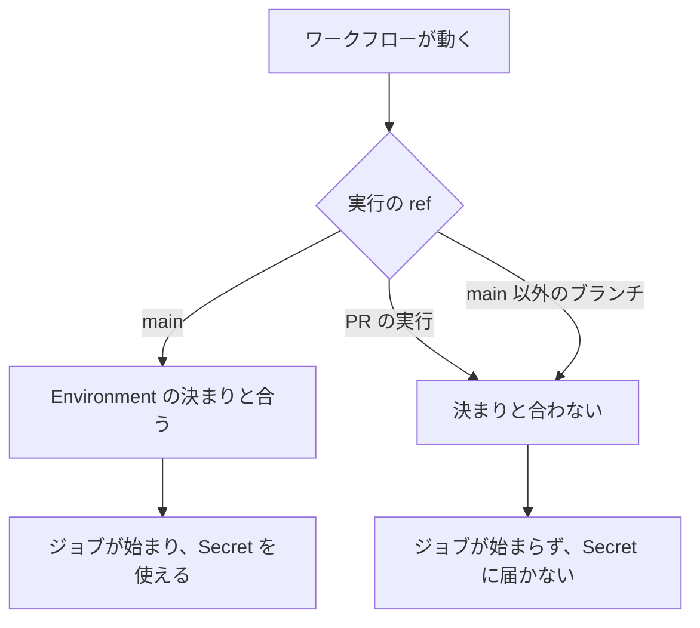

# GitHub Actions のサプライチェーン攻撃を防ぐ

原本のリポジトリの main と GitHub Actions を、乗っ取られたアクションや、外からの指示で動いたエージェントの変更から守る。この文書は、ワークフロー・検査のスクリプト・リポジトリの設定の仕組みと、その理由を書く。管理者が設定画面で行う手順は、[CONTRIBUTING.md の「リポジトリの設定」](../CONTRIBUTING.md#リポジトリの設定)にある。

## 目的と範囲

エージェントは人間の管理者の認証で動くので、外からの指示を受けたエージェントが、main を直接書き換えたり、一覧を持ち出したりできる。次の 6 つを目的にする。

1. main への直接の push を止め、Checks のすべてのジョブが通るまで PR をマージさせない
2. すべての `uses:` を 40 桁の SHA で固定し、タグや枝の参照を残さない
3. Dependabot が、アクションの更新の PR を定期的に出す
4. 秘密の語の一覧を、main にマージ済みの検査のコードにだけ渡す。公開の内容の検査は PR の CI で続ける
5. すべての checkout で認証情報を残さない
6. 依存の既知の脆弱性と、危ないワークフローの書き方を、PR と定期の両方で見つけ、GitHub の画面で見せる

次は対象にしない。

- エージェント専用のアカウント、承認の必須、GitHub App、環境ごとのトークンの分離
- CODEOWNERS、不変の Release、`v*` のタグの保護（タグと Release は [リポジトリの設定](../CONTRIBUTING.md#リポジトリの設定) で扱う）
- 侵害の痕跡の調査と、多要素認証

## 守るものと脅威

守るものは、main の中身、配布物、秘密の語の一覧の 3 つである。脅威ごとの守りと、その目的は次のとおり。

| 脅威 | 守り | 目的 |
| --- | --- | --- |
| エージェントが誤って、または外からの指示で main へ直接 push する | ruleset が PR を必須にし、削除と force push を止める | 1 |
| CI が落ちたままの変更をマージする | ruleset が、Checks のすべてのジョブをまとめたチェックを必須にする | 1 |
| 参照するアクションのタグが、乗っ取られて差し替えられる | すべての `uses:` を 40 桁の SHA で固定し、Dependabot が更新の PR を出す | 2・3・6 |
| 古いアクションの既知の脆弱性に気づかない | 固定したアクションの勧告を、PR と定期の検査で引き、画面で見せる | 3・6 |
| 同じリポジトリの PR が検査のスクリプトを書き換え、一覧を持ち出す | 一覧は Environment の Secret に置き、main にマージ済みの検査のコードにだけ渡す | 4 |
| 取り出したあとの手順が、残ったトークンを使う | すべての checkout で認証情報を残さない | 5 |
| ワークフローに、式の埋め込みや信頼できない checkout が入る | CodeQL の解析で見つけ、画面で見せる | 6 |

## main の保護

main の ruleset では、PR を必須にし、必須のチェックを課す。必須のチェックは、Checks のすべてのジョブの結果をまとめるジョブ `checks-passed` の 1 つだけにする。

### まとめのジョブ

`check.yml` の `checks-passed` は、ほかのすべてのジョブを `needs` に並べる。`if: always()` で、前のジョブが失敗・取り消し・飛ばしのときも動き、結果がすべて `success` のときだけ通る。

```yaml
  checks-passed:
    if: always()
    needs: [scripts, assets, content, terminal]
    runs-on: ubuntu-24.04
    timeout-minutes: 5
    steps:
      - name: Require every job to succeed
        env:
          RESULTS: ${{ join(needs.*.result, ' ') }}
        run: |
          for result in $RESULTS; do
            if [ "$result" != success ]; then
              echo "成功していないジョブがあります: $RESULTS" >&2
              exit 1
            fi
          done
```

`scripts` のジョブの名前は、OS とシャードの組で決まる。シャードの数を変えるたびに ruleset を直さずに済むよう、必須にするのはこのジョブだけにする。ワークフローの決まりのテストが、`needs` にほかのすべてのジョブがあることを確認する。ジョブを足して `needs` に入れ忘れると、テストが落ちる。

### ruleset の中身

branch ruleset `base-branch-rules` は、対象を既定のブランチ（`main`）にし、Enforcement status を Active にして、次の中身にする。

| ルール | 値 | 防ぐもの |
| --- | --- | --- |
| Restrict deletions | 有効 | main の削除 |
| Block force pushes | 有効 | 履歴の書き換え |
| Require a pull request before merging | 有効。Required approvals は 0 で、ほかの小項目はすべて無効 | PR を通らない直接の push |
| Require status checks to pass | 有効。`checks-passed` を、ソースを GitHub Actions（ID は `15368`）に限って必須にし、「up to date」を無効にする | CI が落ちた変更のマージ |
| Bypass list | 空 | 管理者を含む、決まりの迂回 |

チェックのソースを GitHub Actions に限るのは、同じ名前のコミットの状態を、ほかのトークンから書いて通すことを防ぐため。「up to date」を無効にするのは、マージのたびにほかの PR の取り込み直しを求めないため。マージのあとの main は、push の実行で確認する。

ソースは、画面の Add checks で選ぶか、API の `required_status_checks` に `integration_id` を書いて指定する。画面は、そのチェックの最近の実行から選ぶので、CI の実行履歴がない移行先の最初の設定では、GitHub Actions を選べない。そのため、最初の設定は、API で `integration_id` に `15368` を指定して作る。API は実行履歴を求めないので、最初から同じ保護になる。

手順と確認は、[CONTRIBUTING.md の「3. ruleset を足す」](../CONTRIBUTING.md#3-ruleset-を足す)にある。確認では、名前だけでなく、`integration_id` が GitHub Actions の `15368` であることまで照らす。名前だけが合って発行元が違うと、ほかのアプリが同じ名前の結果を書いて通せるため。

承認は必須にしない。人間が 1 人で運用し、承認の必須は対象の外であるため。

### 保護の限り

手順書には、次の 1 文がそのまま書いてある。

> この保護は、管理者の権限を持つエージェントなら ruleset ごと外せるので、誤った push と、外からの指示による直接の push を止めるだけである。

エージェントは人間の管理者の `gh` の認証で動くので、ruleset の変更の API も呼べる。外す操作を止めるには、エージェント専用の権限の低いアカウントが要るが、対象の外である。

## アクションの固定と更新

すべてのワークフローの `uses:` を、40 桁のコミットの SHA と、`# vX.Y.Z` の注記で書く。注記は、Dependabot が更新の PR でバージョンを読み、書き換えるのに使う。

```yaml
      - uses: actions/checkout@<40 桁の SHA> # vX.Y.Z
```

固定するバージョンは、固定した時点の最新のリリースにする。`actions/checkout` は、`release-assets.yml` と同じバージョンにそろえる。SHA は、タグが指すコミットを `gh api repos/<OWNER>/<REPO>/commits/<タグ> --jq .sha` で読む。

### Dependabot の更新

`.github/dependabot.yml` が、GitHub Actions の依存を毎週確認する。

```yaml
version: 2
updates:
  - package-ecosystem: github-actions
    directory: /
    schedule:
      interval: weekly
    cooldown:
      default-days: 7
    groups:
      actions:
        patterns: ['*']
```

`cooldown` で、出てから 7 日たったリリースだけを提案させる。乗っ取られたリリースは、多くが数日のうちに見つかって取り下げられるため。既知の脆弱性を直すセキュリティの更新は、この待ちを受けない。`groups` で、同じ週の更新を 1 つの PR にまとめ、マージの手間を減らす。

Dependabot の PR は、ほかの PR と同じく Checks を通してから人間がマージする。Dependabot の PR の CI には Secret が渡らないが、PR の CI は秘密の語の一覧を使わないので、通る（[秘密の語の検査](#秘密の語の検査)）。

### SHA の固定の強制

リポジトリの設定で、SHA で固定していないアクションを使うワークフローを、GitHub が失敗にする。固定していない参照を足した PR は、ワークフローが始まらずに失敗する。`checks-passed` が成功しないので、マージもできない。

この設定は、すべてのワークフローの固定が main に入ってから有効にする。先に有効にすると、main とすべての PR の Checks が始まらなくなる。再利用のワークフロー（`uses:` でワークフローを呼ぶもの）は、この設定の外でタグを使えるが、原本は使っていない。ワークフローの決まりのテストが、すべての `uses:` を手元でも確認する。

## 秘密の語の検査

検査は、PR で流す公開の検査と、main で流す秘密の語の検査に分かれる。一覧は、main だけが使える Environment の Secret に置き、PR とほかのブランチのワークフローからは読めない。

### 公開の検査

`tests/check-content.sh --public` は、一覧を読まず、UUID の混入とシンボリックリンクだけを数える。

```bash
bash tests/check-content.sh --public [検査する木]
```

結果は `PASS content: 公開の検査で混入 0 件（秘密の語は見ていない）` と出し、一覧を使ったときと読み分けられるようにする。`--public` を付けないときは一覧を必須にし、一覧がないまま通ることはない。`check.yml` の `content` のジョブは、Secret を参照せず、`--public` で流す。

### 秘密の語の検査のワークフロー

`.github/workflows/private-terms.yml` は、Environment `private-terms` の Secret を使う。動くのは、main への push、毎週の定期、手での実行である。

```yaml
name: Private terms
on:
  push:
    branches: [main]
  schedule:
    - cron: '17 3 * * 1'
  workflow_dispatch:
permissions:
  contents: read
jobs:
  private-terms:
    runs-on: ubuntu-24.04
    timeout-minutes: 10
    environment: private-terms
    steps:
      - uses: actions/checkout@<40 桁の SHA> # vX.Y.Z
        with:
          persist-credentials: false
      - name: Check private terms
        env:
          FORBIDDEN_TERMS: ${{ secrets.FORBIDDEN_TERMS }}
        run: |
          umask 077
          mkdir -p tmp
          printf '%s\n' "$FORBIDDEN_TERMS" > tmp/forbidden.txt
          SQUAD_KIT_FORBIDDEN_FILE="$PWD/tmp/forbidden.txt" bash tests/check-content.sh
```

Environment は、Deployment branches を `main` のブランチだけに限る。GitHub は、この決まりをワークフローの実行の ref と照らす。PR の実行の ref は `refs/pull/<番号>/merge`、ほかのブランチへの push や手での実行の ref はそのブランチなので、どれも Environment を使えず、ジョブが始まらない。PR やブランチでワークフローや検査のスクリプトを書き換えても、Secret に届くのは、レビューを経て main に入ったコードだけになる。

次の図は、実行の ref によって、ジョブが始まるかどうかが分かれるようすを示す。



一覧は Repository Secret に置かない。Repository Secret は、Environment を使わないジョブにも渡るため。定期の実行は、Secret の一覧に語を加えたとき、main の中身を確認し直すためのものである。加えた直後に確認したいときは、手で実行する。

ジョブが Environment を使うたびに、GitHub は配置（deployment）の記録を 1 件作り、リポジトリの画面に出る。検査の記録として害はないので、そのままにする。

### 検出の時点

秘密の語は、マージの直後に、main への push の実行で見つける。マージの前に見つけるには、PR の head の木を、Secret を使える実行で読むことになり、一覧を main のコードにだけ渡す分離を崩すため（[検出の時点の案](#検出の時点の案)）。

語が main に入ったら、`Private terms` の実行が失敗し、GitHub が失敗を知らせる。見つけた人は、語を除く PR を作ってマージする。main の履歴には語が残るが、push した時点で同じブランチは公開されているので、マージの前に見つけても公開は防げない。

配布物に語を入れないため、`CONTRIBUTING.md` の「タグと Release を出す」の手順は、発行の前に main の最後の `Private terms` の実行が成功していることの確認を含む。

## 認証情報を残さない

すべての `actions/checkout` に `persist-credentials: false` を付ける。取り出したあとの手順は、どれも Git の認証を使わないため。

例外を作るときは、`persist-credentials: true` の行のすぐ上に、`# 認証情報を残す理由:` で始まるコメントで理由を書く。ワークフローの決まりのテストは、この形の例外だけを通す。今は例外はない。

## 脆弱性と危ないワークフローの検出

`.github/workflows/scan.yml` は、CodeQL の解析と、固定したアクションの既知の脆弱性の検査を流す。どちらも PR・main への push・毎週の 3 つで動く。結果は、リポジトリの Security の画面の Code scanning と、PR のチェックと注記に出る。

| 検出するもの | 道具 | 動くとき | 結果を見る場所 |
| --- | --- | --- | --- |
| 危ないワークフローの書き方（式の埋め込み、信頼できない checkout、強すぎる権限など） | CodeQL の `actions` | PR、main への push、毎週 | Security → Code scanning、PR の注記 |
| Python の検査とスクリプトの危ない書き方 | CodeQL の `python` | 同上 | 同上 |
| SHA で固定したアクションの既知の脆弱性と、注記のバージョンと SHA の食い違い | `tests/check-action-advisories.py` | 同上 | 同上（ツールの名前 `action-advisories`）、`Scan` の失敗 |

```yaml
name: Scan
on:
  pull_request:
  push:
    branches: [main]
  schedule:
    - cron: '23 4 * * 1'
permissions:
  contents: read
jobs:
  codeql:
    runs-on: ubuntu-24.04
    timeout-minutes: 15
    permissions:
      contents: read
      security-events: write
    strategy:
      fail-fast: false
      matrix:
        language: [actions, python]
    steps:
      - uses: actions/checkout@<40 桁の SHA> # vX.Y.Z
        with:
          persist-credentials: false
      - uses: github/codeql-action/init@<40 桁の SHA> # vX.Y.Z
        with:
          languages: ${{ matrix.language }}
          build-mode: none
      - uses: github/codeql-action/analyze@<40 桁の SHA> # vX.Y.Z
        with:
          category: /language:${{ matrix.language }}
  action-advisories:
    runs-on: ubuntu-24.04
    timeout-minutes: 5
    permissions:
      contents: read
      security-events: write
    steps:
      - uses: actions/checkout@<40 桁の SHA> # vX.Y.Z
        with:
          persist-credentials: false
      - name: Look up advisories for pinned actions
        env:
          GH_TOKEN: ${{ github.token }}
        run: python3 -I tests/check-action-advisories.py --sarif action-advisories.sarif .github/workflows
      - if: always()
        uses: github/codeql-action/upload-sarif@<40 桁の SHA> # vX.Y.Z
        with:
          sarif_file: action-advisories.sarif
          category: action-advisories
```

CodeQL は、GitHub の既定の設定（default setup）ではなく、リポジトリのワークフローで流す。理由は、既定の設定が SHA の固定の強制のもとで動くかが、文書に書かれていないことである。固定したワークフローなら確実に動き、決まりのテストでも確認できる（[検出の道具の案](#検出の道具の案)）。シェルのスクリプトは CodeQL が対象にしないので、`scripts/check.sh` の構文の検査とレビューで見る。

`Scan` は Checks に入れず、必須のチェックにしない。必須にするのは Checks のジョブと決めているため。検出は PR の画面に出るので、レビューとマージの判断で見る。

### 固定したアクションの既知の脆弱性

SHA で固定したアクションは、Dependabot の警告の対象にならない。GitHub の文書によると、警告を作るのはセマンティック バージョニングで参照するアクションだけである。SHA で固定したものには作らない（[Monitoring the actions in your workflows](https://docs.github.com/en/actions/reference/security/secure-use#monitoring-the-actions-in-your-workflows)）。そこで、`# vX.Y.Z` の注記をバージョンとして使い、GitHub Advisory Database を `action-advisories` のジョブで引く。

`tests/check-action-advisories.py` は、標準ライブラリだけで書き、GitHub の API は `gh api` で呼ぶ。渡したディレクトリのワークフローを読み、次の順に確認する。

1. すべての `uses:` を `OWNER/REPO[/PATH]@<40 桁の SHA> # vX.Y.Z` として読む。`./` で始まる手元のアクションは飛ばし、形の合わないものは検出にする
2. `gh api repos/OWNER/REPO/commits/vX.Y.Z --jq .sha` で、注記のタグが指すコミットを読む。固定した SHA と違えば「注記のバージョンと SHA の食い違い」として検出にする
3. `gh api -X GET /advisories -f ecosystem=actions -f affects=OWNER/REPO@X.Y.Z` で、そのバージョンに効く審査済みの勧告を引く。`affects` は `,` でつないで 1 回にまとめる
4. 検出を SARIF に書く。場所はワークフローのファイルと `uses:` の行、規則の ID は勧告の GHSA の ID か `version-mismatch` にする

2 は、注記が偽りだと、バージョンで引いた結果を信じられないために置く。固定のあとでタグが付け替えられたときも、ここで見つかる。3 の `PATH` のあるアクション（`github/codeql-action/init` など）は、`OWNER/REPO` の名前で引く。4 の検出は、ジョブの要約にも同じ表で書く。

終了コードは、検出なしが 0、検出ありが 1、API を読めなかったなど検査できなかったときが 2 にする。読めなかった結果を検出なしとして通さないため。検出ありでも SARIF を登録できるよう、登録の手順は `if: always()` で流す。

結果は、3 つの場所で見る。

| 動くとき | 見る場所 |
| --- | --- |
| PR | PR のチェック `Scan / action-advisories` の失敗と、変えた `uses:` の行の Code scanning の注記 |
| main への push と毎週 | Security → Code scanning の一覧で、ツールを `action-advisories` に絞る。毎週の実行の失敗は、Actions → Scan に出る |
| 直したあと | 次の実行で、同じ警告が Code scanning で Fixed になる |

毎週の実行が、固定したあとに公表された脆弱性を見つける。PR は、持ち込んだバージョンと、そのときの勧告を確認する。直し方は、直ったバージョンの SHA と注記に書き換える PR で、Dependabot の更新の PR がそれを出すことも多い。

## 設定の手順

管理者が行う操作と確認の方法は、[CONTRIBUTING.md の「リポジトリの設定」](../CONTRIBUTING.md#リポジトリの設定)にある。

設定の順序は次のとおり。

- 最初のマージの前に、Environment（手順 1）と ruleset（手順 3）を作る
- 最初のマージのあと、最初の公開の前に、SHA の固定の強制・Dependabot・コードの解析（手順 4〜6）を設定する

Environment は、使うワークフローがマージされる前に作る。ない名前の Environment を参照すると、GitHub が保護のない Environment を作り、Repository Secret を使ってしまうため。

ruleset は、空の最初のコミットを push したあと、最初のマージの前に作る。SHA の固定の強制は、固定が main に入ってからにする。

## 検出が動くことの確認

`tests/workflow-rules-test.sh` は、`.github/workflows/` のすべてのファイルと `.github/dependabot.yml` を、`release-workflow-test.sh` と同じく行で読む。確認する決まりは次のとおり。壊した写しを拒むことも、同じテストで確認する。

- すべての `uses:` が `@<40 桁の SHA> # vX.Y.Z` の形である
- `actions/checkout` の数と `persist-credentials: false` の数が合う。例外は、理由のコメントのすぐ下の `persist-credentials: true` だけを通す
- `checks-passed` が `if: always()` を持ち、`needs` が `check.yml` のほかのすべてのジョブと一致する
- `secrets.` を参照するのは `private-terms.yml` だけで、そのジョブは `environment: private-terms` を持つ
- `private-terms.yml` のきっかけが、main への push、`schedule`、`workflow_dispatch` だけである
- どのワークフローも `pull_request_target` と `workflow_run` を使わない
- `check.yml` の `content` が `--public` で流す
- `dependabot.yml` が `github-actions` を対象にする
- `scan.yml` の `codeql` と `action-advisories` が、PR・main への push・`schedule` で動き、`action-advisories` の SARIF を `if: always()` で登録する

発行のワークフローの決まりは、`release-workflow-test.sh` が確認する。

このテストのほかに、守りごとの確認の方法は次のとおり。設定のあとの確認は、[設定の手順](#設定の手順)の確認の方法で人間が行う。

| 確認すること | 確認の方法 | 時点 |
| --- | --- | --- |
| 直接の push が拒まれ、Checks が通るまでマージできず、承認なしでマージできる | 手順 3 の動作の確認 | 手順 3 のあと |
| 必須チェック `checks-passed` の発行元が GitHub Actions（`integration_id` が `15368`）になっている | 手順 3 の確認の方法の `required_status_checks` の出力 | 手順 3 のあと |
| 保護の限りの 1 文が手順書にある | `CONTRIBUTING.md` の「リポジトリの設定」を読む | 手順書を変えたとき |
| タグの参照が残らず、強制のあとはタグの参照を足した PR が落ちる | `workflow-rules-test.sh`、手順 4 の確認用の PR | CI と手順 4 のあと |
| Dependabot が `github-actions` を対象にし、警告の API が一覧を返す | `workflow-rules-test.sh`、手順 5 の確認の方法 | CI と手順 5 のあと |
| 検査のスクリプトを書き換えた同じリポジトリの PR に一覧が渡らない | 下の一覧が渡らないことの確認用の PR | 手順 1 のあと |
| 秘密の語をマージの直後に見つける | [検出の時点](#検出の時点)、`workflow-rules-test.sh` のきっかけの確認、main の `Private terms` の実行 | CI と、最初のマージのあと |
| 認証を残す checkout がなく、例外に理由がある | `workflow-rules-test.sh` | CI |
| 検出が PR と定期の両方で動き、画面で見える | `action-advisories-test.sh`、下の検出の確認用の PR、手順 6 の確認の方法 | CI、手順 6 のあと |

一覧が渡らないことの確認用の PR は、同じリポジトリのブランチで、次の 2 つの変更を入れて作る。どちらも値ではなく長さだけを出し、マージせずに閉じ、ブランチを消す。

1. `check.yml` の `content` に、`env: FORBIDDEN_TERMS: ${{ secrets.FORBIDDEN_TERMS }}` と、その長さを出す手順を足す。出る長さが 0 になる
2. `private-terms.yml` のきっかけに `pull_request` を足す。`private-terms` のジョブが、Environment の決まりで始まらない

検出の確認用の PR は、PR の head から、同じリポジトリのブランチで作る。例には、勧告 [GHSA-cxww-7g56-2vh6](https://github.com/advisories/GHSA-cxww-7g56-2vh6) の `actions/download-artifact` を使う。効くのは 4.0.0 以上 4.1.3 未満で、4.1.3 で直っている。

| バージョン | SHA | 期待する結果 |
| --- | --- | --- |
| v4.1.2（脆弱） | `eaceaf801fd36c7dee90939fad912460b18a1ffe` | 検出する |
| v4.1.3（直ったもの） | `87c55149d96e628cc2ef7e6fc2aab372015aec85` | 検出しない |

1. `.github/workflows/advisory-probe.yml` を足す。きっかけは `workflow_dispatch` だけにし、手順に `actions/download-artifact@eaceaf801fd36c7dee90939fad912460b18a1ffe # v4.1.2` を 1 つ置く
2. PR を draft で作る。`Scan / action-advisories` が失敗し、要約に `GHSA-cxww-7g56-2vh6` が出る
3. PR の Files changed を開く。その `uses:` の行に Code scanning の注記が出る
4. 同じ行を `@87c55149d96e628cc2ef7e6fc2aab372015aec85 # v4.1.3` に書き換えて push する。`Scan / action-advisories` が成功し、注記が消える
5. 注記を `# v4.1.3` のまま、SHA を v4.1.2 のものに戻して push する。`version-mismatch` で失敗する
6. PR をマージせずに閉じ、ブランチを消す

`.github/workflows/advisory-probe.yml` は手で流さないので、アクションは動かない。

SHA は、手順の前に `gh api repos/actions/download-artifact/commits/v4.1.2 --jq .sha` と `v4.1.3` で読み直し、表と合うことを見る。勧告は `gh api -X GET /advisories -f ecosystem=actions -f affects=actions/download-artifact@4.1.2 --jq '.[].ghsa_id'` が `GHSA-cxww-7g56-2vh6` を返し、`@4.1.3` が空を返すことで見る。`action-advisories-test.sh` は、この 2 つの応答の写しで、同じ検出と非検出を CI で確認する。

## 残る危うさ

この仕組みで防げないことと、その扱いを挙げる。

- 管理者の権限を持つエージェントは、ruleset・Environment・Actions の設定を外せる。[保護の限り](#保護の限り)のとおり、止めるのは誤りと外からの指示による直接の操作だけである
- 秘密の語は、main の履歴に入ってから見つかる。見つけるまでに `release.sh` で発行すると、配布物に入る
- 同じリポジトリの PR のワークフローは、`permissions:` で書き込みの権限を求められる。main は ruleset で守られるが、ほかのブランチや Security の警告は書き換えられる
- SHA の固定の強制が、Dependabot の更新の実行に効くかは、GitHub の文書に書かれていない。手順 5 で Dependabot の最後の確認にエラーがないことを見る
- `Scan` は必須でないので、検出があってもマージはできる。検出の多さを見てから、必須にするかを決める
- `action-advisories` は、GitHub Advisory Database の審査済みの勧告だけを見る。公表から審査までの間と、勧告のない乗っ取りは見つけない

項目ごとの補足は次のとおり。発行の前の確認は手順書に頼り、`release.sh` は `Private terms` の結果を確認しない。同じリポジトリの PR への権限の分離は、対象の外である。

Dependabot の確認がエラーなら、強制を無効にせず、Dependabot の画面のエラーを人間が確認する。勧告のない乗っ取りは、SHA の固定と Dependabot の `cooldown` で防ぐ。

## 検討した案

比べた案を、決めた場所ごとに並べる。

### 検出の時点の案

マージの前と後のどこで秘密の語を見つけるかを比べた。

| 案 | 良い点 | 悪い点 |
| --- | --- | --- |
| マージの直後に、main の push の実行で見つける（選んだ案） | Secret を使う実行は、main のコードだけを読む。特権のきっかけがいらない | 語は main の履歴に入る。語を除く PR が要る |
| マージの前に、`pull_request_target` で main の検査を PR の head の木にかける | 語が main に入らない | 信頼できない木を、Secret のある実行で取り出す。CodeQL の信頼できない checkout の警告になる |
| マージの前に、管理者が手元で一覧を使って流す | Secret を CI に置かない | 人の手順に頼り、忘れると見つからない。エージェントの PR は手元で流せない |

`pull_request_target` は、ワークフローの定義を base から読むので、検査のコードは main のものになる。それでも、Secret のある実行に PR の head の木を取り出す点は変わらない。検査が中身を読むだけでも、PR が足したファイルの名前やリンクが、検査のスクリプトの動きを変える余地が残る。マージの前に見つけても、push したブランチはすでに公開されているので、公開を防ぐ効果は小さい。

fork の PR は承認なしで流れ、通るか落ちるかで語を当てる試しに使える。

### 一覧の置き場所の案

秘密の語の一覧を、どこに置くかを比べた。

| 案 | 採らない理由 |
| --- | --- |
| Repository Secret のまま、Checks の `content` を main の push だけで流す | 同じリポジトリのブランチに、push で動くワークフローを足せば、Repository Secret を読める |
| Repository Secret のまま、`if:` で PR では渡さない | `if:` は PR が書き換えるワークフローの中にあり、外せる |
| Environment に置き、Required reviewers で人の承認を挟む | main の push のたびに承認が要る。ブランチの限定だけで、PR とブランチからは読めなくなる |

### 必須のチェックの案

ruleset で必須にするチェックの選び方を比べた。

| 案 | 採らない理由 |
| --- | --- |
| Checks のすべてのジョブの名前を ruleset に並べる | シャードの数を変えるたびに ruleset を直す。直し忘れると、なくなった名前を待ってマージできなくなるか、足したシャードが必須から漏れる |
| ワークフローの名前 `Checks` を必須にする | ruleset が必須にできるのはジョブのチェックの名前で、ワークフローの名前ではない |

### 検出の道具の案

固定したアクションの脆弱性を見つける道具を比べた。

| 案 | 採らない理由 |
| --- | --- |
| CodeQL の既定の設定（default setup） | 設定画面だけで済むが、SHA の固定の強制のもとで動くかが文書にない。設定がリポジトリになく、テストで確認できない |
| dependency-review-action を PR で流す | PR でしか動かず、固定のあとに公表された脆弱性を毎週は見ない。SHA で固定したアクションを見るかは文書に書かれておらず、Dependabot の警告は SHA の固定を対象にしない |
| Dependabot の警告に任せる | SHA で固定したアクションには警告を作らないと、GitHub の文書にある |
| タグの参照に戻し、Dependabot の警告を使う | SHA の固定と両立しない |
| zizmor などの外の検査の道具を足す | zizmor にも固定したアクションの勧告を引く検査があるが、足した道具そのものが新しい依存になる。勧告は `gh api` と標準ライブラリの短いスクリプトで引ける |

zizmor を足さなくても、式の埋め込みと信頼できない checkout は、CodeQL の `actions` が見る。
