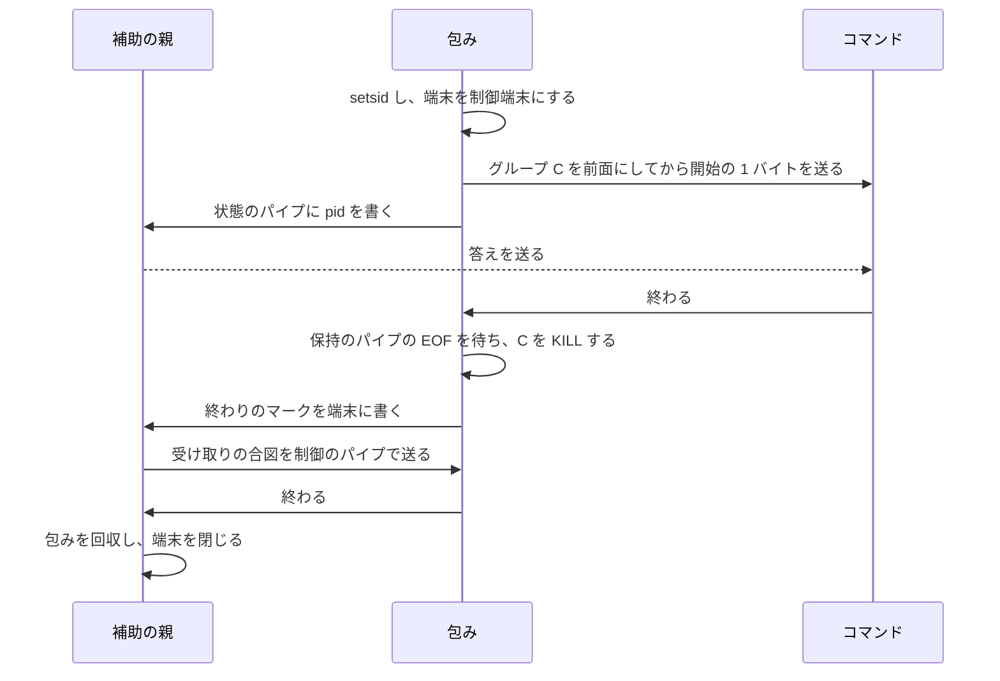

# 端末に依るテストを、時間と環境によらず通す

端末を使うテストを、OS の端末が要るかどうかで 4 つの層に分ける。端末の条件と時計を境界に集め、テストでは決めた値と出来事に替える。

この文書は、端末に依るテストが揺れる原因と、層の分け方・境界・補助・確認の行き先を書く。読み手は、原本のテストを変える人と、レビューの役である。確認 1 件ごとの行き先は [terminal-tests-map.md](terminal-tests-map.md) に書く。

## 目的と範囲

端末に依るテストが、機械の速さ・OS・並列の数によらず、毎回同じ結果になるようにする。上限や再試行で原因を隠さず、結果を決める入力から時間と環境を除く。

揺れる原因は、結果を決める入力に時間と環境が入っていることである。次のような作りは、起きる順が OS と負荷で変わるので、結果が揺れる。上限を延ばす、外す、失敗時に記録を残すことでは、この入力は残る。

- 疑似端末でスクリプト全体を流す。出力を読み切ったかは、子の終了と EOF、出力の途切れ、上限の時間から推し量る
- 質問への答えを、一定の時間出力がないことで送る。遅い機械では、質問を描き終える前に答えが届く
- スタブの `gh run watch` を決まった秒数だけ眠らせ、その間の読む回数を数える。回数は、眠る長さと機械の速さの比で変わる
- 描き方の確認が、ホストの端末の大きさと時計を読む
- パイプの読み手が先に終わる順で止まる（[公開のスクリプトのパイプ](#公開のスクリプトのパイプ)）

次の 4 つを目的にする。

1. 単独の実行と 12 並列の実行で、macOS と Linux のどちらでも同じ結果になる
2. 終わりを、子の終了や出力の途切れから推し量らない
3. 確認を 1 つも黙って消さず、弱めずに層へ割り当てる。確認しないものは、理由とともに [terminal-tests-map.md](terminal-tests-map.md) の「外す確認」に載せる
4. セットアップと `scripts/release.sh` の動作と画面を、テストの都合で変えない。ただし、実行の順で止まる公開のスクリプトのパイプは、入力を最後まで読む形で書いてある

次は対象にしない。

- `tests/run-one.sh` の 450 秒の時間の上限。残すが解決には数えず、働く場面は[残る危うさ](#残る危うさ)に書く
- `tests/stdin-tty-run.py` を使うテスト（install、install-command、host の一部）。端末の出力を読まず、期限もないため
- `lib/webhooks.sh` と `lib/host.sh` の再試行の `sleep`。回数で終わるので、眠る長さは結果を変えない

## 確認の分け方

確認は、OS の端末が要るかどうかで 4 つの層に分ける。かかる時間では分けない。

| 層 | 名前 | 確認すること | 端末と時計 |
| --- | --- | --- | --- |
| A | 端末なし | 答えの読み取り、計画、取り消しなどのファイルの入出力 | 使わない |
| B | 境界を置き換えて描く | 本物の描く関数とスクリプトに、決めた端末の条件と出来事を与えた画面 | 使わない。端末と時計の境界をスタブに替える |
| C | 端末の条件を確認する | 境界の関数と直の命令が、本物の端末で同じ値を返すこと。WINCH、入力の届き方 | 本物の端末。小さな確認のスクリプトだけを流す |
| D | 端末で対話する | 本物のスクリプトが 1 つの端末で問い、答えを受けて終わること | 本物の端末。時計はスタブ |

描き方、色、折り返し、行の書き換えは B で確認する。B が本物と同じ条件を受け取ることは C で確認する。D は、標準入力の端末の確認と行の規律が要る場面だけに置く。

## 端末の境界

端末の判定・大きさ・`tput`・入力の読み取りを、`lib/terminal.sh` の関数に集める。中身は端末の判定と `tput`・`stty`・`read` の命令そのものなので、通常の実行の動作は命令を直に呼ぶときと同じである。

`lib/ui.sh` は、自分のディレクトリの `lib/terminal.sh` と `lib/clock.sh` を `BASH_SOURCE` で探して読む。bash 3.2 でも動き、`scripts/release.sh` の `source lib/ui.sh` もそのまま使える。

| 関数 | 中身 | 呼ぶところ |
| --- | --- | --- |
| `ui_tty <in\|out\|err>` | `[[ -t 0 ]]`・`[[ -t 1 ]]`・`[[ -t 2 ]]` のどれか | `lib/ui.sh` の 41・42 行、`lib/questions.sh` の 28・152・205・698 行、`lib/extensions.sh` の 15 行 |
| `ui_tty_size <out\|err>` | 出す先の fd を `stty size` に渡し、行と桁を `ui_tty_value` に置く | `lib/ui.sh` の 215・216 行 |
| `ui_tty_tput <colors\|lines\|cols>` | `tput` を同じ引数で呼び、値を `ui_tty_value` に置く | `lib/ui.sh` の 39・222・225 行 |
| `ui_tty_read` | 受けた引数のまま `read` を呼ぶ | `lib/questions.sh` の 204 行、`lib/extensions.sh` の 14 行 |

`ui_size` は、読めなかったときに `tput`、LINES と COLUMNS、24 行と 80 桁の順に切り替える。`tput` も境界に入れるのは、B でホストの端末の定義を読まないためである。

`install.sh` は `lib/` を読めないので、`ui_tty` と `ui_tty_tput` の写しを持つ。`tests/install-test.sh` が照らす関数の一覧に 2 つを含め、写しがずれないようにする。

### 読み取りの約束

`ui_tty_read` は `IFS` も引数も変えず、呼ぶ側が `IFS= read -r` の形を持つ。どちらの呼ぶところもこの形なので、読み取りの結果は `read` を直に呼ぶときと同じである。

`lib/extensions.sh` の 14 行は `IFS= read -r extension_dir` で、前後の空白を除かず、空白を含む行はそのまま返す。

### 境界に移さないもの

`scripts/release.sh` の標準入力の端末の確認（346 行）と答えの読み取り（387 行）は、境界に移さない。テストの抜け道を作らず、本物の端末で確認する。

テストでは、補助の端末を標準入力だけにつなぎ、答えを先に打つ。B の層の公開のテストも、この 2 か所は本物の端末を通る。

## 時計の境界

経過の秒と眠りを、`lib/clock.sh` の 2 つの関数に集める。中身は `SECONDS` と `sleep` の命令そのものなので、通常の実行の動作は命令を直に呼ぶときと同じである。

| 関数 | 中身 | 呼ぶところ |
| --- | --- | --- |
| `clock_now` | `SECONDS` を `clock_value` に置く | `scripts/release.sh` の 418・424・425・428・617・626 行、`lib/ui.sh` の 678・709 行 |
| `clock_sleep <秒>` | `sleep` を同じ引数で呼ぶ | `scripts/release.sh` の 435・463 行 |

`tests/clock-stub.sh` が、テストの写しの `lib/clock.sh` に替わる。形は次の 2 つで、どちらも実際の時間を読まない。

- 止めた時計: `clock_now` は `CLOCK_STUB_NOW`（なければ 0）を返し、`clock_sleep` はすぐ戻る。経過は毎回 `0s` になる
- 進める時計: `clock_sleep` は出来事の FIFO に `sleep <秒>` を書き、時刻の fd から次の時刻を 1 行読む。`clock_now` は最後に読んだ時刻を返す

時刻の fd は、スタブを読んだときに 1 回だけ開く。bash 3.2 は `{fd}` を持たないので、決めた番号の fd を使う。

## 境界を置き換えて描く

B の層では、`lib/terminal.sh` を `tests/terminal-stub.sh` に替え、本物の描く関数で画面を作る。条件はすべて環境変数とファイルで決め、決めていない条件を読もうとしたら 125 で止まる。

端末と時計を境界に通さないと、`lib/ui.sh` の `tput` の切り替えと `SECONDS` は、テストでもホストの端末と時計を読む。結果が、流した端末と経過の秒に依ってしまうので、B の層は両方の境界をスタブに替える。

### スタブの条件

スタブは、次の条件から値を返す。ホストの端末と環境変数を読まないので、流す端末と CI によらず同じ画面になる。

| 環境変数 | 決めること |
| --- | --- |
| `TERM_STUB_TTY` | 端末と見なす fd を、`in`・`out`・`err` から空白で並べる。空なら端末なし |
| `TERM_STUB_SIZE` | `ui_tty_size` の行と桁（`<行> <桁>`）。`fail` は読めなかったことにする |
| `TERM_STUB_TPUT` | `tput` の色の数、行、桁（`<色> <行> <桁>`）。それぞれ数か `fail` |
| `TERM_STUB_EVENTS` | 出来事のファイル。`ui_tty_read` が順に読む |

B の流し方は、`TERM=xterm-256color` を決め、LINES と COLUMNS を外す。NO_COLOR は、確認ごとに付けるか外すかを決める。

部品の確認は、確認のスクリプトが `lib/` を読んだあとにスタブを読む。描く間に大きさを変える確認は、スタブだけにある `term_stub_size <行> <桁>` を呼ぶ。眠って待つ必要はない。

### 出来事のファイル

出来事のファイルは、1 行に 1 つの出来事を書く。`ui_tty_read` は呼ばれるたびに、次の答えか終わりまで読み進める。

| 行 | 意味 |
| --- | --- |
| `answer <文字列>` | `answer` と半角空白のあとの全部を、この読み取りの入力にする。空、空白、バックスラッシュも、そのまま渡す |
| `size <行> <桁>` | この読み取りを待つ間に大きさが変わったことにする。次の `ui_tty_size` から新しい値を返す |
| `eof` | 入力の終わり。`ui_tty_read` は 1 を返す |

答えは `read "$@" <<<"<文字列>"` で渡すので、`IFS` と `-r` の扱いは本物の `read` と同じになる。知らない行と、`eof` なしで尽きた出来事は、`terminal-stub:` と行の番号を出して 125 で止まる。

`in` が端末のときは、答えと改行を標準エラー出力に書き、端末のエコーを写す。この写しが本物のエコーと同じことは、C の層で確認する。

### 出力の受け方

出力は通常のファイルに受け、画面は `tests/ansi-to-png.py` の `Terminal` で組み立て直す。ファイルには端末の改行の変換がないので、組み立てる前に LF を CRLF に変える。

標準出力と標準エラー出力は別のファイルに受ける。どちらの出す先に色と書き換えが出たかを、混ぜずに確認できる。

### スクリプト全体を流す理由

部品の確認だけでは、セットアップと公開のスクリプトが境界を正しく呼び、手順をつなぐことを確認できない。そのため、スクリプト全体の流し方も B に置く。

全体の流し方は、テストの写しの `lib/terminal.sh` と `lib/clock.sh` をスタブに替えて流す。写しは、テスト用のパッケージ（`tests/setup-fixture.sh`）と公開のテストの作業ディレクトリである。

`lib/ui.sh` だけを写して流すテストも、`lib/terminal.sh` と `lib/clock.sh` のスタブを写す。対象は `tests/release-test-lib.sh`、`tests/build-assets-test.sh`、`tests/release-check-test.sh` である。

全体の流し方は、端末を作らず、子の終わりを `wait` で受ける。入力は決めた TERM・スタブの条件・時計・出来事のファイルだけなので、毎回同じ画面と終了コードになる。D の層は、本物の端末が要る場面にだけ少数を置く。

## 端末の補助

C と D の層は、1 つの補助 `tests/tty-session.py` で流す。補助は端末を 1 つだけ作り、終わりを終わりのマークと受け取りの合図で決める。標準ライブラリだけを使い、時計も期限も持たない。

### つなぎ方と答え方

端末は、指定した fd（標準入力、標準出力、標準エラー出力の組み合わせ）につなぐ。端末につながない fd は、補助が開く通常のファイルにつなぎ、パイプは使わない。端末の大きさと `TERM` は、始める前に決める。

答え方は 2 つある。

- 先に打つ形: コマンドが前面のグループになったあとに、答えを端末に書く。問いの画面を読まない確認に使う
- 台本の形: `expect <問いの全文>`、`send <答え>`、`resize <行> <桁>` の行を順に流す。`send` の改行は、端末の Enter（`\r`）で送る

台本の問いは、次のとおり探す。途中までの一致で答えを送らないためである。

- 出力から CSI の列を除いてから比べる
- 前に一致した位置の後ろから探し、読み取りの区切りをまたいでも見つける
- 問いの全文で比べる。断片や正規表現は使わない

知らない台本の行は、包みを起こす前に 125 で止まる。答えを送った位置は、出力のバイトの位置でマークのファイルに残し、公開の画面の確認が答えの前と後を分けるのに使う。

### プロセスと始め方

補助は、親、包み、コマンドの 3 つのプロセスで動く。包みは親から fork するので、実行ごとに作る値（nonce）はメモリにだけあり、引数と環境変数には出ない。

| プロセス | セッション | プロセスグループ | 役目 |
| --- | --- | --- | --- |
| 親 | テストのセッション | テストのグループ | 端末を読み書きし、終わりのマークを待つ |
| 包み | 新しいセッション W | W | 端末を制御端末にし、コマンドを始めて見張る |
| コマンド | W | 新しいグループ C | 確認するコマンド。前面のグループにする |
| コマンドの子孫 | W | C | コマンドが起こすプロセス |

`tests/run-one.sh` のセッションの停止は、テストのセッションにしか届かず、W と C には届かない。そのため、親が死んだら包みが C を止める作りを、制御のパイプで持つ。

包みとコマンドは、次の順で始める。コマンドが前面のグループになる前に、答えが届かないようにするためである。

1. 包みは `setsid` し、端末を制御端末として開き、SIGHUP を無視する
2. 包みが fork し、子は状態のパイプと制御のパイプを閉じ、開始のパイプを読んで止まる
3. 包みは、止まっている子を `setpgid(子, 子)` で新しい C に入れ、`tcsetpgrp` で C を前面にする。そのあとで状態のパイプに `pid <番号>` を書き、開始のパイプに決めた 1 バイトを書く
4. 子は、決めたバイトを読んだときだけ `exec` し、EOF なら `exec` せずに終わる。`exec` の失敗は CLOEXEC のパイプで包みに伝え、127 にする
5. 親は、状態のパイプで `pid <番号>` を読んでから、先に打つ答えを書く

C を作る `setpgid` は包みだけが呼ぶ。子も呼ぶと、macOS では同時の 2 回が競合し、どちらかが EPERM になるためである。

状態のパイプと開始のパイプは CLOEXEC にし、コマンドには残さない。始め方の確認は、`tcgetpgrp(0)` が自分のグループで、問いの前に読める入力がないことを、コマンドの中から見る。

### 包みの動き

包みは、SIGCHLD の自己パイプ、制御のパイプ、保持のパイプを 1 つの select で待つ。期限は付けない。

SIGCHLD の自己パイプには、`signal.set_wakeup_fd()` でインタプリタの C のハンドラが書く。Python のハンドラが動く前に届いた SIGCHLD でも、select が返る。理由は [ci-timeouts.md の「止まりの直し方」](ci-timeouts.md#止まりの直し方)にある。

- `waitpid` は WUNTRACED で呼ぶ。コマンドが止められたら、C を KILL して回収し、理由を出して 125 にする
- 制御のパイプが EOF になったら、親が死んだと見なす。C を KILL して回収し、マークを書かずに終わる
- 保持のパイプの書き込み側は、決めた番号の fd でコマンドに渡り、子孫にも引き継がれる。コマンドが終わったら、子孫の出力をマークの前に受けるため、保持のパイプの EOF まで待つ
- 保持のパイプが EOF になったら、C を KILL する。ESRCH は無視する
- 終わりのマーク（nonce と終了コード、改行なし）を端末に書き、親の受け取りの合図を待って終わる

マークは、コマンドと子孫の出力のあとに同じ端末の待ち行列へ書く。そのため、親はマークより前の出力をすべて読んでからマークに着く。

### 親の動き

親は、終わりのマークまで端末を読み、マークを出力から除いてから、受け取りの合図を制御のパイプで送る。そのあと包みを `waitpid` で回収し、端末を閉じる。

- 返す値は、コマンドの終了コード、シグナルで終わったときは 128+n、始められなかったときは 127 にする
- マークの前に状態のパイプが EOF になったら、包みが死んだと見なす。C を KILL して包みを回収し、125 にする
- 読み書きで例外が起きたら、C を KILL し、制御のパイプを閉じて包みを回収し、125 にする
- 補助が TERM を受けたら、C を KILL し、制御のパイプを閉じて包みを回収し、143 にする
- nonce の違うマークは出力として扱う。マークの形の文字列を、コマンドが偽って書けないためである

補助は、残ったプロセスを `kill(-pgid, 0)` で判定しない。残りの有無は、補助のテストが `ps` で確認する。

テスト専用の指定は 2 つある。`--hold-read <FIFO>` は、端末を読み始めるのを FIFO の EOF まで止める。`--watch <FIFO>` は、包みが自分の ID と C を書く。この fd は CLOEXEC で子では閉じるので、EOF が包みの終わりを示す。

### 終わり方

次の図は、通常の終わりの順序を示す。

### 状態の表

補助の状態と、出来事ごとの次の状態と返す値を、次の表に置く。どの終わり方でも、C を KILL して包みを回収してから返す。

| 状態 | 出来事 | すること | 次の状態と返す値 |
| --- | --- | --- | --- |
| 開始待ち | 状態のパイプに `pid` | 先に打つ答えを書く | 実行中 |
| 開始待ち | `exec` の失敗 | 包みが 127 をマークに載せる | マークの送信後 |
| 実行中 | コマンドが終わる | 終了コードを持つ | 子孫待ち |
| 実行中 | コマンドが止められる | C を KILL する | マークの送信後（125） |
| 子孫待ち | 保持のパイプの EOF | C を KILL する | マークの送信後 |
| マークの送信後 | 親がマークを読む | 受け取りの合図を送る | 正常の終わり（コマンドの値） |
| どこでも | 制御のパイプの EOF | 包みが C を KILL する | 親の終わり（包みはマークを書かない） |
| どこでも | マークの前に状態のパイプの EOF | 親が C を KILL する | 包みの終わり（125） |
| どこでも | 親の読み書きの例外 | C を KILL し、制御のパイプを閉じる | 入出力の例外（125） |
| どこでも | 補助への TERM | C を KILL し、制御のパイプを閉じる | 補助への TERM（143） |
| 起こす前 | 知らない台本の行 | 包みを起こさない | 起動失敗（125） |
| 開始待ち | 包みの fork の失敗 | 端末を閉じる | 起動失敗（125） |

### 大きさの変化を確認する

C の層では、WINCH を期限なしで同期する。カーネルは `TIOCSWINSZ` の ioctl の中で前面のグループへ SIGWINCH を送るので、補助が次の答えを送る前に届いている。

1. 確認のスクリプトが WINCH の trap を置き、問いを出して読む
2. 補助は台本の `resize` で `TIOCSWINSZ` を呼び、そのあと答えを送る
3. 確認のスクリプトは、割り込まれた読み取り（128 を超える値）なら読み直す
4. 読み取りのあと、trap が動いたことと、新しい大きさを確認する

bash の trap と Python のハンドラは、次の命令の前に動くので、読み取りのあとには必ず動いている。時計の待ちには頼らない。

## 補助の回帰テスト

`tests/tty-session-test.sh` が、補助が起きる順によらず同じ結果を返すことを確認する。順序は FIFO と `--hold-read` で作り、眠る長さに頼らない。

| ケース | 作り方 | 期待 |
| --- | --- | --- |
| T01 | 出力が 0、16、131072 バイト。端末の fd の組み合わせと、標準入力がファイルか端末か | 出力が決めたバイトと同じで、0 を返す |
| T02 | 読み始める前にコマンドが終わる（`--hold-read`） | 出力をすべて受け、0 を返す |
| T03 | 答えの直後の出力と、答えのあとの空の出力 | 答えのあとの出力が決めたバイトと同じ |
| T04 | 問いの全文が 4096 バイトの区切りをまたぐ | 1 回だけ答える |
| T05 | 台本の問いを出さずに終わる | 125 を返し、来なかった問いを出す。読んだ出力はファイルに残る |
| T06 | 7 で終わる | 7 を返す |
| T07 | 自分に TERM を送る | 143 を返す |
| T08 | 出力を閉じて生きたまま。FIFO で解放されたら 7 で終わる | 7 を返し、出力をすべて受ける |
| T09 | コマンドが終わったあとに子孫が書く | 子孫の出力を受け、0 を返し、プロセスが残らない |
| T10 | 子孫が保持のパイプを閉じて残る | 子孫が KILL され、`ps` に残らない |
| T11 | コマンドが SIGSTOP で止まる | 125 を返し、プロセスが残らない |
| T12 | 包みを KILL する | 125 を返し、プロセスが残らない |
| T13 | 親を KILL する | 見張りの FIFO が EOF になり、そのあと C が `ps` に残らない |
| T14 | 補助に TERM を送る。コマンドは TERM を無視する | 143 を返し、プロセスが残らない |
| T15 | ないコマンドを渡す | 127 を返し、端末と FIFO の fd が残らない |
| T16 | 始め方を確認するコマンド | `exec` の前に前面のグループで、問いの前に読める入力がない |
| T17 | 大きな答えを送る間、コマンドも大きく書く | 止まらずに終わり、出力が決めたバイトと同じ |
| T18 | 補助を同じプロセスで動かし、読み書きの例外と書きかけを起こす | 例外は 125 で C が残らず、書きかけは残りを送って 0。どれも `/dev/fd` が前後で同じ |
| T19 | 受け取りの合図のあとの EIO | T01 で確認する。マークのあとは読まないので、EIO を受けない |
| T20 | 台本の形で答える | エコーが問いの全文のあとに出る |
| T21 | 大きさを変えてから答える | trap が動き、新しい大きさを読める |
| T22 | 端末の入力で子を起こす bash | T16 と D の層のセットアップの対話で確認する |
| T23 | 正常の終わりの片付け | `/dev/fd` が前後で同じで、ファイルを閉じている |
| T24 | 知らない台本の行 | 包みを起こす前に 125 を返し、見張りの FIFO に ID が出ない |
| T25 | nonce の違うマークを出力に書く | マークとして扱わず、出力に残る |
| T27 | 子の終了の通知が、select に入る前に届く | 通知の自己パイプが読め、0 を返す |

T18・T23・T27 は、補助を取り込んで同じプロセスで動かし、例外か順序を差し込む。T27 の作り方は、[ci-timeouts.md の「止まりの再現の手順」](ci-timeouts.md#止まりの再現の手順)にある。ほかのケースは、補助を別のプロセスとして流す。

## 公開のテストの時計

公開のテストは、進める時計のスタブとスタブの `gh` で、経過と呼び出しの順を決める。決まった秒数だけ眠るスタブは使わない。

出来事は 1 つの FIFO にまとめるので、時計と `gh` の出来事は全順序で読める。

- スタブの `gh run view` は、呼ばれるたびに出来事の FIFO に `view` を書く
- スタブの `gh run watch` は、待ちの FIFO に `started` を書き、解放の FIFO を読むまで止まる
- テストは出来事の FIFO の書き込み側を開いたままにし、呼び出しの合間に EOF にしない
- 公開のスクリプトは `( release.sh …; echo "end $?" >出来事 )&` で流し、制御側は `end` まで読む
- 解放したあとは、止めた時刻を返し続ける。スピナーが余分に回っても、画面は組み立て直すので結果は変わらない

公開のテストでは、標準入力の端末の確認のため、補助の端末を標準入力だけにつなぎ、答えを先に打つ。出力はファイルに受け、スタブで `out` と `err` を端末と見なす。

| テスト | 確認すること |
| --- | --- |
| 読む間隔が 600 秒 | 時刻を 599、600、1199、1201 と返す。`view` の起きた時刻の並びが `600 1201` と同じ |
| ゲージの書き換え | 読む間隔 1 で、`view` が 2 回ちょうど |
| 失敗と空のゲージ | `view` を 1 回読んでから解放する |
| 端末でないとき | `view` が 0 回 |
| 実行が遅れて見つかる | 下の表の時刻で進め、回数と経過の表示が決めた値と同じ |
| 割り込み | `started` を読んでから TERM を送り、143 で、`gh` のスタブが `ps` に残らない |
| 進み具合の経過 | 止めた時計で `0s` ちょうど |

読む間隔 600 秒の確認は、`>=` を `>` に変えると `1201` だけになり、`/ 10` を足すと `599 1199` になる。回数だけでは `/ 10` を見逃すので、時刻の並びで確認する。

実行が遅れて見つかるテストは、`RELEASE_RUN_FIND_INTERVAL=1`、`GH_RUNS_DELAY=3`、待ちの表示の間隔 1 で流す。

| 出来事 | 返す時刻 |
| --- | --- |
| 1 回目から 3 回目の `sleep 1` | 1、2、3 |
| 1 回目の `sleep 0.1` | 5 |
| 2 回目の `sleep 0.1` | 5。ここで `run watch` を解放する |

期待は、`run list` が 4 回で `sleep 1` が 3 回、待ちの行が `3s` と `5s` で、最後の ✔ が `5s` である。割り込みのテストは、TERM のあとに時刻を 1 行書き、書き込みの EPIPE は無視する。

## 公開のスクリプトのパイプ

公開のスクリプトが変数の中身をパイプで読むところは、読み手の awk が入力を最後まで読む。読み手が書き手より先に終わる順でも、スクリプトは止まらない。

`set -euo pipefail` のもとで、awk が見つけた行で `exit` すると、書き手の `printf` が SIGPIPE を受けて、パイプが 141 で止まる。CHANGELOG.md はパイプの容量を超える大きさなので、止まるかは実行の順で決まる。そのため、awk は次のように読む。

| 行 | 読むもの | 読み方 |
| --- | --- | --- |
| 259 | origin のタグの出力から、バージョンのタグの行 | 最初に合った行だけを出し、マークを立てて残りの行を読み飛ばす |
| 304 | CHANGELOG.md の最初のバージョンの見出し | 最初の見出しのバージョンだけを出し、マークを立てて残りの行を読み飛ばす |
| 308 | CHANGELOG.md のバージョンの節 | 次の見出しでマークを立て、残りの行を読み飛ばす |

awk は `exit` を使わず、入力の終わりまで読んでから終わる。出す値と画面は、`exit` で読むときと変わらない。終了コードの 141 を無視する形にはしない。

回帰テストは `tests/release-pipe-test.sh` に置き、公開のテストの共通の補助で公開のスクリプトを流す。テストの写しの CHANGELOG.md には、先頭のバージョンの節のあとに 8 MiB ほどの古い節を足す。パイプの容量と awk が一度に読む量を足しても届かないので、読み手が先に終わる順を時間によらず強いる。

- 入力を最後まで読むスクリプトは、バージョンの確認を通って問いまで進む
- 304・308 行に `exit` を戻した写しは、終了コード 141、または 1 と Broken pipe の文で止まる。テストはこの写しも流して、止まることを確認する

macOS の bash 3.2 では、公開のスクリプトの EXIT trap のもとで、同じ SIGPIPE が 141 でなく 1 で返る。そのため 1 は、標準エラーに Broken pipe の文があるときだけ、止まったと数える。文のない 1 やほかの終了コードは止まったと数えず、テストは失敗する。入力を最後まで読むスクリプトは、終了コード 0 だけを通す。

259 行は、origin のタグの出力が 1 行ほどで容量に届かないので、回帰テストでは順を強いない。awk に `exit` が残らないことを検索で確認する。

## 確認の行き先

端末に依る確認は、すべて [terminal-tests-map.md](terminal-tests-map.md) の行き先に対応させる。1 件ごとに、確認の場所・条件・期待・ケース・ケースが確認することを書く。

| 確認 | 行き先 |
| --- | --- |
| 補助の終了コード、片付け、子孫、例外 | 補助の回帰テスト（T01 から T27） |
| `tests/ui-test.sh`、`tests/ui-steps-test.sh` などの描き方 | B。fd の判定と大きさの本物の値は C |
| `tests/questions-fold-test.sh`、`tests/confirmation-test.sh` の答え直し | B の全体の流し方と出来事のファイル |
| 公開のテストの `run_release` と `run_release_tty` | 補助の標準入力だけの端末と、B のスタブと時計 |
| `tests/release-screens.sh` の 5 つの場面 | D。マークのファイルで答えの前と後を分ける |
| `tests/terminal-screen-test.sh` の疑似端末の部分 | C。WINCH は期限なしの同期にする |

補助は、診断の JSON と時間切れと通常の形を持たない。そのため、これらは確認しない。理由は対応表の「外す確認」に書く。

## CI の端末の仕事

`.github/workflows/check.yml` の仕事 `terminal` は、端末に依るテストだけを流す。macOS と Linux、単独と 12 並列の組み合わせを、同じコミットで毎回流す。

| 項目 | 値 |
| --- | --- |
| OS | `macos-latest`、`ubuntu-24.04` |
| 並列の数 | `SQUAD_KIT_TEST_JOBS` が 1 と 12 |
| 時間の上限 | `scripts` の仕事と同じ 15 分 |
| 流すもの | `tests/run.sh` に、補助とスタブを使うテストのファイルを渡す |
| 合否 | `checks-passed` の `needs` に含める |

流すファイルは、`tty-session`・`terminal-stub`・`clock-stub`・`release-assertions`・`release-test-lib` のどれかを含む `tests/*-test.sh` で選ぶ。単独で流すと、重みの合計が Tests の仕事の時間の目安を超える。毎回流すかは人間が決める。

## 入力と信頼の表

補助とスタブは、テストが書いた入力と、プロセスの間の合図を読む。書き手と信頼する条件を次の表に置き、合わない入力は使わずに止まる。

| 入力（誰が書いた何か） | 読むところ | 信頼する条件 | 合わないとき |
| --- | --- | --- | --- |
| `TERM_STUB_*` と出来事のファイル（テストが書く） | 端末のスタブ | テストの写しの `lib/` にだけあるスタブが読む。配布物の `lib/terminal.sh` は読まない | 知らない行、尽きた出来事、決めていない条件は 125 で止まる |
| 時計のスタブの環境変数と FIFO（テストが書く） | 時計のスタブ | テストの写しにだけあるスタブが読む | 数でない時刻と知らない出来事は 125 で止まる |
| 状態のパイプの `pid <番号>`（包みだけが書く。CLOEXEC） | 補助の親 | 形が合う | C を KILL し、125 を返す |
| 開始のパイプの 1 バイト（包みだけが書く） | コマンドになる子 | 決めたバイトと同じ | `exec` せずに終わる |
| 制御のパイプの合図と EOF（親だけが書く） | 包み | 親だけが書き込み側を持つ | EOF は親の死と見なし、C を KILL して終わる |
| 端末の終わりのマーク（包みが書くが、コマンドも端末に書ける） | 補助の親 | 実行ごとの nonce が合う | 出力として扱い、マークと見なさない |
| 台本の行（テストが書く） | 補助の親 | 知っている形の行 | 包みを起こす前に 125 で止まる |
| `exec` の失敗のパイプ（子だけが書く。CLOEXEC） | 包み | 失敗のときだけ書かれる | 127 をマークに載せる |
| 標準入力の端末の確認と答え（利用者の端末） | `scripts/release.sh` の 346、387 行 | 本物の端末だけ。境界に移さない | 端末でなければ止まる |

配布物の `lib/terminal.sh` と `lib/clock.sh` は、環境変数でスタブに切り替わらない。スタブに替えるのは、テストが写しのファイルを差し替えるときだけである。

## 互換性

導入済みのプロジェクトでは、セットアップの動作、画面、登録は変わらない。配布物は `lib/terminal.sh` と `lib/clock.sh` を含む。

- `lib/terminal.sh` の関数は、端末の命令をそのまま呼ぶ。端末の判定と大きさ、色の数、入力の結果は、命令を直に呼ぶときと同じである
- `lib/clock.sh` の関数は、`SECONDS` と `sleep` をそのまま使う。経過の表示と待ちの長さは、命令を直に呼ぶときと同じである
- `scripts/release.sh` と `lib/ui.sh` は、経過と眠りを時計の関数を通して読むだけで、動作は命令を直に呼ぶときと同じである
- `scripts/release.sh` の 259・304・308 行の awk は、入力を最後まで読む。実行の順で止まることがない
- `install.sh` の `ui_init` は、`ui_tty` と `ui_tty_tput` を通すだけで、判定は命令を直に呼ぶときと同じである
- `lib/host.sh` の写しと読み込みは、外部コマンドではなく bash の展開で行う。置き場、名前、中身は変わらない
- 流し直しで変わるエージェントとオートパイロットの登録はない

## テスト

層ごとのテストと補助の回帰テストは `tests/run.sh` が拾い、Tests の仕事と端末の仕事で流れる。

- B の層は、スタブの条件ごとに画面と制御の列を確認する
- C の層は、境界の関数と直の命令が本物の端末で同じ値を返すこと、エコー、WINCH を確認する
- D の層は、セットアップと公開のスクリプトの対話を、終わりのマークまで流す
- 補助の回帰テストは、[補助の回帰テスト](#補助の回帰テスト)の表のケースを流す
- 時計の境界は、`clock_now` が直前の `SECONDS` 以上、直後の `SECONDS` 以下を置くことと、`clock_sleep` が `sleep` に同じ引数を渡すことを確認する
- 公開のスクリプトのパイプは、[公開のスクリプトのパイプ](#公開のスクリプトのパイプ)の回帰テストで確認する。入力を最後まで読むスクリプトは 0 で問いまで進み、`exit` を戻した写しは 141、または 1 と Broken pipe の文で止まる

次を、確かな結果として扱う。

1. 端末の仕事の 4 つの組み合わせと Tests の仕事が、同じコミットの最初の実行で通る
2. 流し直して通った結果で、最初の失敗を置き換えない。失敗があれば原因を直して新しいコミットで流す
3. テストのディレクトリに、眠って待つ作りの名前 `GH_WATCH_DELAY` が残らない。公開のテストと、`scripts/release.sh` と `lib/ui.sh` に、`SECONDS` と `sleep` が残らない
4. 補助のファイルに、時計・眠り・期限・アラームの呼び出しがない
5. 読む間隔の比較を `/ 10` に変えた写しで、公開の表示のテストが落ちる
6. `scripts/release.sh` の awk に `exit` が残らない

## 残る危うさ

`tests/run-one.sh` の 450 秒の上限は残る。上限は、待つ相手が来ないときに加え、遅くて終わらないテストも止める。そのため、上限で止まった失敗は、原因を直すまで解決に数えない。

次のときは、補助が期限を持たないので、上限まで止まってから失敗になる。

- コマンドが問いを出さずに入力を待つ
- 子孫が保持のパイプを持ったまま終わらない
- 子孫が止められたまま残る

子孫がグループ C を出ると、包みの KILL が届かない。原本のスクリプトにそうした子を足すときは、この作りを見直す。

親と包みが外から同時に KILL されると、C は残る。C は端末を閉じたときの SIGHUP を受けるが、それを無視するコマンドは残る。

B のスタブは、本物の端末の細部（行の規律、エコーの形）を写し切れない。本物と同じ値を返すことを C で確認し、行の規律は D で確認する。

パイプの回帰テストが順を強いるのは、足した古い節がパイプの容量より大きいからである。容量がそれより大きい OS では、`exit` を戻した写しも通り、テストは落ちる。そのときは、足す節を大きくする。

セットアップと CI の導入のスクリプトにも、読み手が先に終わるパイプがある。出力が 1 行ほどで容量に届かないので、直していない。出力が増えるときは、同じ形に直す。

## 検討した案

次の案は、時間と環境に依る入力を残すか、守る範囲を弱めるので選ばない。

| 案 | 選ばない理由 |
| --- | --- |
| 時間の上限を延ばす、外す | 上限の長さと機械の速さの比で、結果が変わったままになる |
| 失敗したら流し直す | 落ちる原因を残したまま、通る回数だけを増やす |
| 失敗したときに出力を記録する | 原因を調べやすくするだけで、結果は時間に依ったままになる |
| 終わりを推し量る補助を直し続ける | 終わりを推し量る作りのままで、起きる順を数え上げ切れない |
| pexpect などのライブラリを使う | CI に依存が増える。問いの待ち方が時間に依る点も変わらない |
| 公開の端末の確認にテストの抜け道を作る | 本物の端末の確認をしなくなる |
| C と D の補助を分ける | 終わりのマークと回収の作りが 2 つになり、同じ順序の確認が要る |
| 時計を境界に入れず、短い間隔で流す | 回数が眠る長さと機械の速さの比で決まったままになる |
| 補助の中で残ったプロセスを判定する | 判定と KILL の間に起きる順が残る。テストの `ps` で確認する |
| パイプの 141 を無視する | ほかの理由の失敗も隠れ、止まる原因が残る |
| 写しの終了コード 1 を、文によらず止まったと数える | ほかの理由の失敗と見分けられず、回帰テストが効かない |
| 書き手を FIFO で止め、読み手が終わってから残りを書く | 直した awk は入力の終わりまで終わらないので、書き手と読み手が待ち合って止まる |
