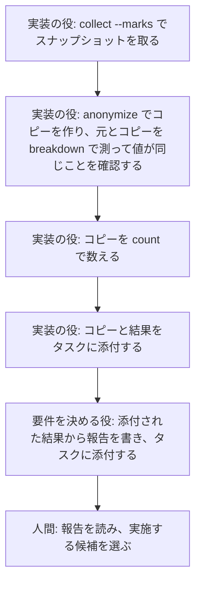

# 実装の開始から done までの時間の内訳を測る

実装まで進んだタスクの、実装の開始から `done` までの経過時間を、工程と待ちの区分に分けて測る手順の設計である。測った値から、工程を「残す」「条件付きで省く」「省く」に分けた報告を作る。

測る手順は、[metrics.md](metrics.md) の `scripts/metrics.py` が持つ。記録は、実行・状態の変化・コメントだけを読み、新しい記録を残さず、導入済みの役の動作に触れない。[metrics.md の 4 つの指標](metrics.md#数える)の数え方と出力にも触れない。

## 目的と範囲

目的は、実装の開始から `done` までの時間のうち、どの工程と待ちにどれだけかかっているかを、同じスナップショットから同じ数で測り直せるようにすることである。改善の候補は、この数を根拠に人間が選ぶ。

対象は次のとおりである。

- `scripts/metrics.py` の `collect` の引数 `--marks` と、手順 `breakdown`、`anonymize`、そのテスト
- 区分、待ちの種類、タスクの種類、修正につながった指摘の数え方の決まり
- 測った結果から報告を作り、タスクに添付する決まり

次は対象にしない。

- 改善の実施（役の手順やワークフローの変更）。報告から人間が選び、別のタスクにする
- 速度の目標値の決定。報告を見てから人間が決める
- 起票から実装の開始までの内訳。合計だけを出す
- 新しい記録を残す処理と、セットアップ・役のひな形・共通スキル・見張りのスクリプトの変更

## 測る流れと役

測りは、実装の役が集めて数え、要件を決める役が報告を書き、人間が実施する候補を選ぶ流れで進める。

| 順 | すること | 役 |
| --- | --- | --- |
| 1 | `collect --marks` でスナップショットを取る | 実装の役 |
| 2 | `anonymize` で添付用のコピーを作り、元とコピーの両方を `breakdown` で測って、値が同じことを確認する | 実装の役 |
| 3 | コピーを `count` で数え、人間のコメントと呼び出しの 1 タスクあたりの値を出す | 実装の役 |
| 4 | [結果の添付](#結果の添付)のとおり、コピーと結果をタスクに添付する | 実装の役 |
| 5 | 添付された結果から[報告](#報告)を書き、タスクに添付する | 要件を決める役 |
| 6 | 報告を読み、実施する候補を選ぶ | 人間 |

役の間の引き継ぎは、次の図のとおりである。



数えるのを実装の役にするのは、リポジトリのコマンドを流す役だからである。報告を要件を決める役にするのは、工程を省くかどうかと改善の候補は、何を満たすかを決める仕事だからである。

```bash
python3 scripts/metrics.py collect --project <プロジェクト ID> --marks --output tmp/metrics/snapshot.json
python3 scripts/metrics.py anonymize tmp/metrics/snapshot.json \
  --project-key <プロジェクトのマーク> --member-key <メンバーのマーク> \
  --output tmp/metrics/attach/snapshot.json --map tmp/metrics/anonymize-map.json
python3 scripts/metrics.py breakdown tmp/metrics/attach/snapshot.json \
  --cutoff <時刻> --project-key example --member-key anonymous \
  --output tmp/metrics/attach
```

手順は、すべて Git が無視する原本の `tmp/metrics/` で行う。

## 記録を読む

`collect` は `--marks` を受け取る。指定したときだけ、[metrics.md の記録を読む](metrics.md#記録を読む)の欄に、次の欄を加えて残す。省略したときのスナップショットには、次の欄がない。

`schema_version` は 1 で、最上位に `marks_version: 2` を持つ。`count` と `traces` は、このとき加わる欄を読まない。

`marks_version` は、マークの種類か読み方を変えるたびに 1 つ上げる。2 は、`previous_round` と `result_round` のマークを含む値である。`breakdown` は、2 のスナップショットだけを読み、古い値では結果を書かずに止まる。古い値のスナップショットのマークからは [`decide` が書いた依頼](#decide-が書いた依頼)を見分けられず、気づかないまま数字が変わるためである。

| 記録 | 加わる欄 | 中身 |
| --- | --- | --- |
| タスク | `important` | ラベルに名前が `重要` のものがあれば `true`、なければ `false` |
| タスク | `branch_type` | metadata の `branch` の、最初の `/` より前の部分。`feat`・`feature`・`fix`・`docs`・`release`・`test`・`chore`・`refactor`・`agent` のどれかならその値、ほかは `other`、`branch` がなければ `null` |
| コメント | `marks` | 本文から読んだマークの配列。下の表の種類と値だけを残す |
| コメント | `type` | CLI が返すコメントの種類（`comment`、`system` など） |
| 実行 | `trigger_comment_id` | 実行を起こしたコメントの ID。なければ `null` |
| 実行 | `limit_stop` | 状態が `failed` で、`error` が使用率の上限の文の形に合えば `true`、ほかは `false` |

ラベルと metadata は、今読んでいる `multica issue list` の応答にある。`trigger_comment_id` と `error` は `multica issue runs` の応答にある。`--marks` の有無によらず、読むコマンドは同じである。

コメントの本文は残さない。残すのは、決まった語のマークと、数・16 進の値だけである。

ブランチの名前はエージェントの名前を含むことがあるので、種類だけを残す。ラベルも、`重要` があるかどうかだけを残す。実行の `error` の本文も残さない。

### コメントのマーク

マークは、本文の行の先頭が決まった形に合うものを読む。書き手では絞らずに残し、信頼するかどうかは `breakdown` が[入力と信頼](#入力と信頼)の条件で決める。

| 種類 | 行の形 | 残す値 |
| --- | --- | --- |
| `review_kind` | `見直しの種類: <値>` | 値が `最終レビュー` なら `final`、`設計の見直し` なら `design`、`設計と PR の見直し` なら `design_pr`、ほかは `other` |
| `fix_request` | `修正の依頼: <N> 回目` | N |
| `request_commit` | `確認するコミット: <16 進>`。古い言い回しも読む | 値の先頭 12 文字を小文字にしたもの |
| `result_commit` | `確認したコミット: <16 進>`。古い言い回しも読む | 値の先頭 12 文字を小文字にしたもの |
| `result_mark` | 行の先頭が ❌、⚠️、✅ のどれか | `fail`、`warn`、`pass`。本文で最初に現れた 1 つだけ |
| `finding_counts` | `必須 <N> 件`・`推奨 <N> 件`・`高 <N> 件`・`中 <N> 件`・`低 <N> 件`（行の途中でもよい） | 読めた語ごとの N。語ごとに、本文で最初に現れた 1 つだけ |
| `usage_wait` | `使用率の待ち:` または `使用率の待ちの延長:` | なし |
| `ci_wait` | `マージの前の CI の待ち:` | なし |
| `limit_notice` | コメントの種類が `system` で、本文が使用率の上限の文の形に合う | なし |
| `previous_round` | 囲みの外の行が、行末の空白とタブを除いて `前の回: <ID>` と完全に一致する。ID は、空白を含まない 1 つの文字列 | なし |
| `result_round` | 行の先頭が `返事の回:`。囲みの中の行も読む | なし |

行の形は、今の決まりと、古い言い回しの両方を読む。古い言い回しは、過去のタスクにだけある、コミットの行の「確認」を別の語で書いた形である。その語は[用語の検査](terms.md#テスト)が止めるので、スクリプトと見本には、`tests/check-terms.py` と同じくコードポイントで書く。

行の形の正本は、スキル squad-handoff と見張りのスクリプト（[common/monitor/squad-review-next](../common/monitor/squad-review-next)）にある。行の形が変わったときは、新しい形を表に足し、古い形を消さない。過去のタスクを測り直せるようにするためである。

使用率の上限の文の形は、スクリプトの中の決まった正規表現の一覧にする。一覧に合わない上限の文は、[待ちの種類](#待ちの種類)で「そのほか」に入る。

`marks` は、`{"kind": <種類>, "value": <残す値>}` の配列で、上の表の順に並べ、同じ種類は本文で最初に現れた 1 つだけにする。値がない種類の `value` は `null` にする。`finding_counts` の値は、読めた語だけを `required`・`recommended`・`high`・`medium`・`low` の鍵に持つ 1 つのオブジェクトにする。

`previous_round` と `result_round` は、コメントが [`decide` が書いた依頼](#decide-が書いた依頼)かどうかを決めるためのマークである。行の形は、[review-next-step.md の制御記録の読み方](review-next-step.md#制御記録の読み方)に合わせる。

`前の回:` の行は、囲み（コードのブロック）の中にあれば読まない。依頼を囲みに入れて写したコメントを、依頼と読まないためである。

`返事の回:` の行は、囲みの中でも読む。囲みを閉じ忘れた結果を、結果でないものとして扱わないためである。ID の値は残さない。

囲みは、CommonMark の決まりで読む。字下げ 0〜3 でバッククォートか `~` を 3 つ以上続けた行で始まり、同じ文字を始まりの数以上続けて、後ろが空白とタブだけの行（字下げ 0〜3）で終わる。バッククォートの始まりの行は、記号の後ろにバッククォートを含まない。

閉じないまま本文が終わったら、終わりまでを囲みの中とする。引用と項目の中の囲みは読み分けない。囲みの外か中かを読むのは `previous_round` だけで、ほかのマークは、囲みの中の行も読む。

`finding_counts` の語の直前が、半角の英字・数字、または漢字（U+3400〜U+9FFF）のときは読まない。「実行中 9 件」のような別の語の一部を拾わないためである。かなや句読点の直後は読み、「指摘は必須 1 件」も数える。

## 測る対象と時間の窓

対象は、スナップショットで状態が `done` で、実装の役（`claude-implementer`、`codex-implementer`）の開始した実行が 1 回以上あるタスクである。実行の役は、[metrics.md の数える](metrics.md#数える)と同じ名前の規則で読む。

| 名前 | 決め方 |
| --- | --- |
| 実装の開始 | 実装の役の実行の、開始の時刻のうち最も早いもの |
| 終わり | `done` へ移った状態の変化のうち、最後のものの時刻 |
| 経過時間 | 終わりから実装の開始を引いた秒 |
| 起票から実装の開始まで | 実装の開始から、タスクの作られた時刻を引いた秒。合計と 1 タスクあたりの値だけを出し、内訳は出さない |

- 時刻は、秒の小数を切り捨ててから整数の秒で計算する。区分の合計が経過時間と 1 秒も違わないようにするためである
- `done` へ移った記録がないタスクと、終わりが実装の開始以前のタスクは、対象から外し、「測れなかったタスク」の数として出す
- 実行は、開始の時刻があるものだけを使い、窓（実装の開始から終わりまで）にかかる部分だけを数える。終了の時刻がない実行は、終わりの時刻で終えたとみなす
- 区切りの前後は、タスクの作られた時刻が `--cutoff` より前か、`--cutoff` 以後かで分ける

## 実行の区分

実行は、役と、実行を起こしたコメントのマークで、次の区分に分ける。

| 役 | 起こしたコメントのマーク | 区分 |
| --- | --- | --- |
| `claude-implementer`、`codex-implementer` | 問わない | 実装 |
| `claude-fixer`、`codex-fixer` | 問わない | 修正 |
| `code-reviewer` | 問わない | コードレビュー（1 回目、2 回目以降） |
| `security-reviewer`、`performance-reviewer`、`ux-reviewer` | 問わない | そのほかのレビュー（1 回目、2 回目以降） |
| `qa` | 問わない | E2E |
| `claude-principal`、`codex-principal` | `review_kind` が `final` | 最終レビュー（1 回目、2 回目以降） |
| `claude-principal`、`codex-principal` | `review_kind` が `design` か `design_pr` | 設計の見直し |
| `claude-principal`、`codex-principal` | 上のどれでもない | 不明 |
| `designer`、`planner` | 問わない | 設計と要件の直し |
| `orchestrator` | 問わない | リーダーの振り分け |
| 上にない役と、名前の規則に合わないエージェント | 問わない | 不明 |

起こしたコメントは、実行の `trigger_comment_id` が指すコメントである。マークは、そのコメントが[入力と信頼](#入力と信頼)の条件に合うときだけ読む。合わないときと、起こしたコメントがないときは、マークがないものとして扱う。

「設計の見直し」と「設計と要件の直し」は、レビュー・実装・待ちの区分とは別に立てる。最上位の役の設計の見直しを、最終レビューと分けるためである。実装のあとの設計の役・要件を決める役の実行（設計との差の扱いなど）を、「不明」に混ぜないためでもある。

### レビューの回

レビューの回は、タスクごと・役ごとに、依頼にある `request_commit` の値で数える。依頼は、リーダーが書いたものと、[`decide` が書いたもの](#decide-が書いた依頼)の両方を読む。

1. その役の実行を、開始の時刻、次に ID の順に並べる
2. 起こしたコメントの `request_commit` の値が、その役でまだ現れていなければ新しい回とし、すでに現れた値ならその値の回と同じ回とする。同じコミットの頼み直し（失敗した実行のやり直しなど）を、回として数えないためである
3. `request_commit` を読めない実行は、1 回ごとに新しい回とする
4. 1 つ目の回を「1 回目」、2 つ目から後を「2 回目以降」とする

そのほかのレビューの回は、3 つの役それぞれで数える。最終レビューの回は、最上位の 2 つの役を合わせて数える。

## 経過時間の割り当て

経過時間は、窓を、実行の作られた・開始・終了の時刻と状態の変化の時刻で区間に切り、区間ごとに 1 つの区分へ割り当てる。どの区間も 1 つの区分にだけ入るので、並行する実行を二重に数えず、区分の合計は経過時間に一致する。

実行中の実行が 1 つ以上ある区間は、実行中の区分のうち、次の順で最も上のものに割り当てる。

1. 実装
2. 修正
3. コードレビュー
4. そのほかのレビュー
5. E2E
6. 最終レビュー
7. 設計の見直し
8. 設計と要件の直し
9. リーダーの振り分け
10. 不明

同じ区分で 1 回目と 2 回目以降が並ぶときは、1 回目に割り当てる。順は、流れを前に進めている仕事を上にした。リーダーの実行は、ほかの役の実行と重なることが多いので下に置く。リーダーの実行だけが動いている時間が、リーダーの振り分けになる。

実行時間の合計は、経過時間の割り当てとは別に出す。区分ごとに、実行の窓にかかる秒をそのまま足すので、並行した分は重ねて数える。経過時間の割り当てとの差が、並行して進んだ時間になる。

`breakdown` は、タスクごとに区分の合計と経過時間を比べ、1 秒でも違えば結果を書かずに止まる。

## 待ちの種類

実行中の実行がない区間は、待ちとし、次の順で最初に当たる種類に分ける。

| 順 | 条件 | 種類 | 側 |
| --- | --- | --- | --- |
| 1 | 作られて、まだ開始していない実行がある | 起動 | エージェント側 |
| 2 | タスクの状態が `in_review` | 人間の返事 | 人間の返事待ち |
| 3 | 直前の動きに、`limit_stop` が `true` の実行の終了、`usage_wait` のマーク、`limit_notice` のマークのどれかがある | 使用率の上限 | エージェント側 |
| 4 | 直前の動きに、`ci_wait` のマークがある | CI | エージェント側 |
| 5 | 直前の動きに、メンバーのメンションを含むエージェントのコメントがある | 人間の返事 | 人間の返事待ち |
| 6 | 上のどれでもない | そのほか | エージェント側 |

- 直前の動きは、その待ちの直前に実行が動いていたひと続きの時間の始めより後から、待ちの始めまでの記録である。待ちの理由は、止まる直前に書かれるためである
- タスクの状態は、区間の始めより前の、最後の状態の変化の後の状態である
- `in_review` は、人間の判断・承認・マージを待つ状態と決まっている（スキル squad-handoff の「タスクの状態と担当」）。人間を呼ばずに `in_review` のまま返事を待つ時間も、人間の返事待ちに入る
- 起動は、合意した 4 つの種類（人間の返事・使用率の上限・CI・そのほか）のうち「そのほか」の内訳として出す
- エージェント側の時間は、実行中の区分のすべてと、待ちのうち使用率の上限・CI・起動・そのほかの合計である。人間の返事待ちと「不明」は、どちらにも足さずに別に出す

その行がない記録では、CI の待ちはほぼ 0 になる。`マージの前の CI の待ち:` の行は、[マージの前に CI を待つ決まり](principal-review.md#マージの前に-ci-を待つ)で書く行で、その行がない記録には CI の待ちが出ないためである。その記録の CI の待ちは「そのほか」に入る。報告には、この読み方を添える。

## タスクの種類

種類は、互いに重なってよい。1 つのタスクが 2 つの種類に入ることも、どれにも入らないこともある。

| 種類 | 判定 |
| --- | --- |
| 文書だけ | `branch_type` が `docs` |
| 小さい実装 | 実装の役の実行時間の合計が 1,800 秒以下で、ちょうど 1,800 秒は入り、1,801 秒は入らない。設計の役が書くフェーズの見積もり（`小さい`・`大きい`）とは別で、実績の秒だけで決まる |
| 重要 | `important` が `true` |

- 文書だけは、ブランチの種類で決める。ブランチの種類は、最後の変更の種類で決める決まり（スキル squad-handoff の「PR を作る・実装を積む」）なので、文書だけの変更は `docs` になる
- PR のファイルの一覧は Multica の記録になく、読まない
- 文書だけに当たるタスクは少ない。設計の役だけで書いた文書のタスクは実装の役の実行がなく、対象に入らないためである
- 古い形のブランチ（`agent/…`）のタスクと、種類を付け違えたタスクは、文書だけに入らない
- 重要は、スナップショットを取った時点のラベルで決める。付け外しの履歴は読まない
- 小さい実装の実行時間は、実行ごとの秒の小数を切り捨ててから足す

## 修正につながった指摘の数え方

指摘は、レビューと E2E の結果のコメントと、修正の依頼を、時刻でつないで数える。指摘の中身は読まない。

| 名前 | 決め方 |
| --- | --- |
| 結果 | 書き手が `code-reviewer`・`security-reviewer`・`performance-reviewer`・`ux-reviewer`・`qa`・最上位の役のどれかで、`result_commit` のマークがある、窓の中のコメント |
| 結果の工程と回 | 同じ書き手の、コメントの時刻以前に開始した最後の実行の区分と回 |
| 指摘のない結果 | `result_mark` が `pass`。マークがなく、`finding_counts` で読めた数がすべて 0 のものも含む |
| 指摘のある結果 | `result_mark` が `fail` か `warn`。マークがなく、`finding_counts` で読めた数に 1 以上があるものも含む |
| 指摘を読めない結果 | `result_mark` も `finding_counts` もない結果 |
| 修正の依頼 | `fix_request` のマークが[入力と信頼](#入力と信頼)の条件に合う、窓の中のコメント。リーダーが書いたものと、[`decide` が書いたもの](#decide-が書いた依頼)である |
| 修正の依頼の根拠の結果 | 前の修正の依頼（なければ実装の開始）より後で、その修正の依頼以前の結果のうち、役ごとに最後の 1 件。指摘のない結果は除く |
| 修正につながった結果 | どれかの修正の依頼の根拠になった結果 |
| ほかの工程と重なる結果 | 修正につながった結果のうち、同じ修正の依頼に、ほかの工程の根拠の結果があるもの |
| その工程だけの修正の依頼 | 根拠の結果が 1 つの工程だけの修正の依頼 |
| レビュー以外の修正の依頼 | 根拠の結果がない修正の依頼（コンフリクト、CI の失敗など） |

工程ごとに、次を出す。そのほかのレビューは、3 つの役ごとにも出す。

- 通ったタスクの数（その区分の実行が窓の中に 1 回以上あるタスク）と、結果の数
- コードレビュー・そのほかのレビュー・最終レビューは、工程の合計に加えて、1 回目と 2 回目以降の行にも同じ数を出す。結果の回は、結果の工程と同じ実行の回である
- 回の行を足すと工程の合計になるのは、下の表で「足せる」列だけで、「足せない」列は足せない
- 指摘のある結果・指摘のない結果・指摘を読めない結果の数
- 修正につながった結果の数と、そのうちほかの工程と重なる数
- その工程だけの修正の依頼の数
- `finding_counts` で読めた指摘の数を、マージを止めるもの（必須・高・中）と止めないもの（推奨・低）に分けて出す。件数を読めなかった結果の数を並べて出し、0 件としては足さない

### 回の行と工程の合計

回の行を足すと工程の合計になるかは、列ごとに決める。タスクや修正の依頼を 1 つずつ数える列は、回の行が同じタスクや同じ修正の依頼を重ねて数えるので、足せない。この表の「出力のキー」の列は、`breakdown.json` の工程の行のキーである。

| 列 | 出力のキー | 回の行を足すと工程の合計に | 理由 |
| --- | --- | --- | --- |
| 通ったタスク | `task_count` | 足せない | 1 回目と 2 回目以降の両方を通ったタスクは、両方の回の行に入る。工程の値は重複を除いたタスクの数である |
| 結果 | `results` | 足せる | 結果は 1 つの回にだけ入る |
| 指摘のある | `with_findings` | 足せる | 結果の数なので、結果と同じ |
| 指摘のない | `without_findings` | 足せる | 結果の数なので、結果と同じ |
| 指摘を読めない | `unreadable` | 足せる | 結果の数なので、結果と同じ |
| 修正につながった | `led_to_fix` | 足せる | 根拠の結果は 1 つの回にだけ入り、修正の依頼ごとに数える |
| うち重なる | `overlapping` | 足せない | 重なりの相手が行ごとに違う。工程の行は別の工程、回の行は同じ工程の別の回も相手にする |
| その工程だけの修正の依頼 | `only_fix_requests` | 足せない | 修正の依頼ごとに 1 回数える。1 回目と 2 回目以降の結果が根拠に混ざる修正の依頼は、工程の行には入り、どちらの回の行にも入らない |
| 必須・高・中の件数 | `finding_counts.blocking` | 足せる | 結果ごとの件数の合計 |
| 推奨・低の件数 | `finding_counts.non_blocking` | 足せる | 結果ごとの件数の合計 |
| 件数を読めなかった結果 | `finding_counts.unreadable_results` | 足せる | 結果の数 |

`breakdown.md` は、通ったタスクの列の見出しに「重複を除く」と書き、足せない列を数え方の限りに載せる。そのほかのレビューの役の行も、通ったタスク・重なり・その工程だけの修正の依頼は、役の行どうしや工程の行に足さない。`breakdown.md` での列の並べ方は、[`breakdown.md` の指摘の表](#breakdownmd-の指摘の表)に書く。

回の行と工程の合計の関係が、次の場合で変わらないことを、テストで確認する。各列は「1 回目 / 2 回目以降 / 工程の全体」の順で、`breakdown.md` の行と同じ値を並べる。

| 場合 | 通ったタスク | 結果 | 修正につながった | うち重なる | その工程だけの修正の依頼 |
| --- | --- | --- | --- | --- | --- |
| 固定見本（全件）のコードレビュー | 5 / 2 / 5 | 2 / 2 / 4 | 2 / 1 / 3 | 1 / 0 / 1 | 1 / 1 / 2 |
| 1 回目だけに指摘があるタスク | 1 / 1 / 1 | 1 / 1 / 2 | 1 / 0 / 1 | 0 / 0 / 0 | 1 / 0 / 1 |
| 2 回目以降だけに指摘があるタスク | 1 / 1 / 1 | 1 / 1 / 2 | 0 / 1 / 1 | 0 / 0 / 0 | 0 / 1 / 1 |
| 両方の回に指摘があるタスク | 1 / 1 / 1 | 1 / 1 / 2 | 1 / 1 / 2 | 0 / 0 / 0 | 1 / 1 / 2 |
| 上の 3 つのタスクを合わせたもの | 3 / 3 / 3 | 3 / 3 / 6 | 2 / 2 / 4 | 0 / 0 / 0 | 2 / 2 / 4 |
| 1 回目だけを通ったタスク | 1 / 0 / 1 | 1 / 0 / 1 | 1 / 0 / 1 | 0 / 0 / 0 | 1 / 0 / 1 |
| 1 回目と 2 回目以降の結果が同じ修正の依頼の根拠（そのほかのレビュー） | 1 / 1 / 1 | 1 / 1 / 2 | 1 / 1 / 2 | 1 / 1 / 0 | 0 / 0 / 1 |

数え方の限りは次のとおりで、報告に添える。

- 重なりの相手は、行ごとに決める
  - 工程の行は、ほかの工程の根拠の結果を相手にする
  - 回の行は、ほかの工程か、同じ工程のほかの回の根拠の結果を相手にする
  - そのほかのレビューの役の行は、ほかの役かほかの工程の根拠の結果を相手にする
  - 同じ修正の依頼に、セキュリティと UX の結果だけがあるときは、そのほかのレビューの行は重ならず、役の行はたがいに重なる
- 回の行と役の行の「その工程だけの修正の依頼」は、根拠の結果がすべて、その回かその役の中にある修正の依頼である。1 回目と 2 回目以降の結果が根拠に混ざる修正の依頼は、どちらの回の行にも入らない
- 重なりは、同じ修正の依頼にまとめられたかどうかで数える。指摘の中身が同じかどうかは、今の記録の決まった行からは読めない
- この数は、中身の重なりの上限になる
- その工程だけの修正の依頼は、その工程がなければ出なかった修正の数の下限になる
- 指摘の件数は、結果のコメントに決まった行がなく、読めない結果がある。古いタスクのセキュリティのレビューは、ほぼ読めない
- 設計の見直しの指摘は、修正の依頼の行を使わずに設計の役へ戻るので、結果の数と指摘のある結果の数だけを出す

## 入力と信頼

`breakdown` は、コメントのマークでタスクの時間を分ける。タスクのコメントは人間もどの役も書けるので、書き手を確認できたマークだけを使う。書き手は、コメントの `author_type` と `author_id` で確認し、本文の名乗りでは確認しない。役は、`author_id` のエージェントの名前から、名前の規則で読む。

| 入力（誰が書いた何か） | 読むところ | 信頼する条件 | 合わないとき |
| --- | --- | --- | --- |
| `review_kind`・`request_commit`・`fix_request`・`usage_wait`・`ci_wait` のマーク（人間もどの役も書ける） | 実行の区分、レビューの回、待ちの種類、修正の依頼 | `author_type` が `agent` で、表の下の 2 つのどちらかに合う | マークを読まずに飛ばし、飛ばしたマークの数を結果に出す |
| `previous_round`、`result_round` のマーク（人間もどの役も書ける） | 上の行の、`decide` が書いた依頼かどうかの判定 | 上の行の書き手の条件に合うコメントのものだけを使う。このマークだけでは、何も信頼しない | 判定に使わない。上の行のマークは飛ばす |
| `result_commit`、`result_mark`、`finding_counts` のマーク（人間もどの役も書ける） | 修正につながった指摘 | `author_type` が `agent` で、書き手の役がレビューの役、`qa`、最上位の役のどれか | マークを読まずに飛ばし、飛ばしたマークの数を結果に出す |
| `limit_notice` のマーク（ランタイムがエージェントの名前で書く） | 待ちの種類 | `author_type` が `agent` で、コメントの種類が `system` | マークを読まずに飛ばす |
| メンバーのメンション（人間もどの役も書ける） | 待ちの種類の 5 | `author_type` が `agent` | 待ちの理由に使わない |
| 実行の `limit_stop`（ランタイムが書く `error` から `collect` が決める） | 待ちの種類の 3 | 実行の状態が `failed` | `false` として扱う |
| ラベル `重要`（人間とリーダーが付ける） | タスクの種類 | 名前が `重要` と一致する。集計の分け方にだけ使い、手順の分かれ目には使わない | `false` として扱う |
| metadata の `branch`（CLI を使えるどの役も書ける） | タスクの種類 | 種類が決まった一覧にある。集計の分け方にだけ使う | `other` として扱い、文書だけに入れない |
| スナップショットのファイル（測る人が渡す） | `breakdown` の入力 | `marks_version` が 2 で、`--marks` で加わる欄がすべてある | 結果を書かずに止まり、`--marks` で取り直すよう伝える |
| スナップショットのファイル（測る人が渡す。`collect` が書く） | `anonymize` の入力 | `validate_snapshot` を通る形で、置き換える元の値（ID・コミットの値・タスクの識別子・エージェントの名前）が、`anonymize` が読む欄から漏れなく得られる。元の値の探し方は、表の下に書く | 形が合わなければ、コピーと対応表を書かずに止まる。読む欄から得た元の値が未知の欄に残っていれば、[残った値の検査](#残った値の検査)で止まる |

`review_kind` などのマークの書き手は、`author_type` が `agent` で、次のどちらかに合うものにする。

- 書き手の役が `orchestrator` である
- 書き手の役がレビューの役・`qa`・最上位の役のどれかで、同じコメントに `previous_round` のマークがあり、`result_round` のマークがない（[`decide` が書いた依頼](#decide-が書いた依頼)）

`anonymize` の元の値は、読む欄にあるものだけを探す。読む欄になく未知の欄にだけある識別子は、探す元の値に入らないので、残った値の検査でも見つからない。

### `decide` が書いた依頼

レビューと E2E・最終レビューの次の依頼は、リーダーではなく、返事を書いた役の実行が `squad-review-next decide` で書く。頼み直し・1 回目の修正の依頼・最終レビューの依頼・使用率の待ち・CI の待ちの記録がこれに当たる。作者は、レビューの役・`qa`・最上位の役のどれかになる。この仕組みは、[review-next-step.md の決める実行と一度だけ書く仕組み](review-next-step.md#決める実行と一度だけ書く仕組み)に書く。

書き手をリーダーだけに絞ると、これらのマークを読めず、`decide` が頼んだ最終レビューの実行が「不明」に入り、修正の依頼と待ちが数えられない。

これらの役は、結果も書く。結果は依頼の行を写すことがあるので、役だけでは信頼しない。次の 3 つがそろうコメントだけを、`decide` が書いた依頼として読む。

| 条件 | 決め方 | 理由 |
| --- | --- | --- |
| 作者 | `author_type` が `agent` で、役がレビューの役（`code-reviewer`・`security-reviewer`・`performance-reviewer`・`ux-reviewer`）・`qa`・最上位の役のどれか | `decide` が次の依頼を書くのは、レビューと E2E の回と最終レビューの回で、流すのはその回の返事を待つ役の実行である。返事を待つ役は、この役のどれかになる |
| 依頼の形 | `previous_round` のマークがある | `decide` は、書くコメントのすべてに `前の回: <ID>` の行を置く。行は囲みの外で完全に一致するものだけを読むので、引用の記号や項目の記号を付けた写しと、囲みに入れた写しは当たらない |
| 結果でない | `result_round` のマークがない | 役の結果は、`squad-review-wait report` が `返事の回:` の行を足して書く。結果に写された依頼の行を読まない |

- リーダーが書いたマークは、役だけで信頼する。リーダーの依頼は `前の回:` の行を持たないためである
- CI の待ちの規則で起きたリーダーが `decide` で書いたものも、リーダーのマークとして読む
- 人間が書いたマークは、`前の回:` の行があっても読まない
- 人間と、実装・修正・設計・要件の役のコメントは読まない
- 条件に合わないコメントの依頼のマークは、飛ばしたマークに数える。`previous_round` と `result_round` そのものは、飛ばしたマークに数えない
- `decide` より前の時期のタスクには `前の回:` の行がなく、レビューの役が書いた依頼のマークは飛ばす。その時期の依頼はリーダーが書いているので、読み落としは増えない

制御記録の条件のうち、次の 3 つは確認しない。理由は [`decide` が書いた依頼の読み方](#decide-が書いた依頼の読み方)に書く。

- 指す回が認める回であること
- 作者がその回の決める実行の役であること
- 時刻の前後

## 結果の形

`breakdown` の入力は、スナップショットと、`--cutoff`・`--project-key`・`--member-key`・`--output` である。環境や今の時刻を読まず、同じ入力からは 1 バイトも違わない結果を書く。

| ファイル | 中身 |
| --- | --- |
| `breakdown.json` | 集計の正本。タスクごとの行を持たない |
| `breakdown.md` | 同じ値を人が読む表にしたもの |
| `breakdown-tasks.json` | タスクごとの経過時間、区分ごとの割り当て、種類。確認用で、識別子はスナップショットにある値のまま出す |

集計は、次のまとまりごとに出す。

- 全件、区切りの前、区切りの後
- 文書だけ、小さい実装、重要

まとまりごとの中身は次のとおりである。

| 部分 | 中身 |
| --- | --- |
| タスクの数 | 対象の数。全件には、対象から外した数（実装の役の実行がない、`done` でない、測れなかった）も出す |
| 経過時間 | 合計と 1 タスクあたりの値 |
| 区分ごとの割り当て | 区分と待ちの種類ごとの秒、経過時間に対する割合、1 タスクあたりの値、通ったタスクの数。レビューと最終レビューは 1 回目と 2 回目以降を分ける |
| 側ごとの合計 | エージェント側、人間の返事待ち、不明 |
| 実行時間の合計 | 区分ごとの、並行を重ねて数えた秒 |
| 起票から実装の開始まで | 合計と 1 タスクあたりの値 |
| 工程ごとの指摘 | [修正につながった指摘の数え方](#修正につながった指摘の数え方)の数。`breakdown.md` では、[2 つの表](#breakdownmd-の指摘の表)に分けて出す |
| 不明の内訳 | 役ごとの秒と実行の数。名前の規則に合わないエージェントは 1 つにまとめる |
| 飛ばしたマーク | [入力と信頼](#入力と信頼)で飛ばしたマークの、種類ごとの数 |

秒は整数で持ち、時間への直しと割合は、表示するときに小数第 1 位までの文字列にする。丸めは [metrics.md の数える](metrics.md#数える)と同じく、浮動小数点を使わずに行う。

### `breakdown.md` の指摘の表

`breakdown.md` は、「工程ごとの指摘:」と「そのほかのレビューの役ごとの指摘:」のそれぞれを、2 つの表に分けて出す。11 の値を 1 つの表に並べると 12 列になり、右端の「件数を読めなかった結果」を見落としやすいためである。

| 出す順 | 表 | 列（左から） |
| --- | --- | --- |
| 1 | 結果と修正への寄与 | 工程/通ったタスク（重複を除く）/結果/指摘のある/指摘のない/指摘を読めない/修正につながった/うち重なる/その工程だけの修正の依頼 |
| 2 | 指摘の件数 | 工程/結果/件数を読めなかった結果/必須・高・中の件数/推奨・低の件数 |

表の名前は、この文書で呼び分けるためのもので、`breakdown.md` には出さない。

- 2 つの表は、同じ行を同じ並びで持つ
  - 工程ごとの指摘は、工程の行・そのすぐ下の回の行・「設計の見直し」の行・「工程を読めない」の行である
  - 役ごとの指摘は、役の行である
- 「結果」の列は、両方の表に置き、同じ `results` の値を出す。指摘の件数の表だけで、結果のうち件数を読めなかった数を読めるようにするため
- 各セルは、`breakdown.json` の同じ行の値をそのまま出す。列と出力のキーの対応は、[回の行と工程の合計](#回の行と工程の合計)の表のとおりで、数え方は `breakdown.json` と共通である
- キーのない欄は `-` にする。「設計の見直し」の行は、指摘の件数の表では「結果」だけが数で、残りの 3 列は `-` になる
- 2 つの表の間には空行だけを置き、表の名前も説明の文も置かない。2 つの表は、見出しの行で見分ける
- 「工程ごとの指摘:」と「そのほかのレビューの役ごとの指摘:」の行、修正の依頼の表、「数え方の限り:」の注記は、それぞれ 1 つずつ出す。表は分けない

分けるのは `breakdown.md` の表だけで、`breakdown.json` と `breakdown-tasks.json` には表がなく、キーも値も表の分け方によらない。選ばなかった分け方は、[指摘の表の分け方](#指摘の表の分け方)に書く。

## 匿名にする

`anonymize` は、スナップショットから添付用のコピーを作る。[metrics.md の置き場所と公開の範囲](metrics.md#置き場所と公開の範囲)の手で行う置き換えを、識別子まで広げてスクリプトにしたものである。

| 欄 | 置き換え |
| --- | --- |
| エージェントの名前 | 既知の役は `example-<役>-anonymous`、ほかは `other-agent-001` からの連番 |
| タスクの ID と識別子 | `task-0001` と `TASK-1` からの連番 |
| コメント・実行・エージェント・メンバー・プロジェクトの ID | 種類ごとの連番 |
| `request_commit` と `result_commit` の値 | 値ごとの連番。同じ値には同じ別名を使う |

- 連番は、種類ごとに、元の ID の昇順に、桁をそろえて付ける。置き換えたあとも ID の順が変わらないので、ID で並べる決まりの結果が元と同じになり、`breakdown` と `count` の値が元と一致する
- 時刻、状態、使用量、マークの種類は変えない
- 対応表は `--map` のファイルに書く。呼ぶ人間の別名を `count` の `--human` に渡すために使い、添付しない
- 置き換えたコピーに、元のエージェントの名前・タスクの識別子・ID が残っていれば、コピーを書かずに止まる。調べ方は[残った値の検査](#残った値の検査)に書く

時刻は残るので、Multica の記録を読める人は、時刻を照らしてタスクを見分けられる。記録を読める人はもともとタスクを読めるので、時刻は置き換えない。

### 残った値の検査

`anonymize` は、コピーと対応表を書く前に、置き換えたコピーに元の値が残っていないかを調べる。調べる対象と止まるときの動作は下の表のとおりで、探し方は、規模が増えても時間が伸びにくいものにする。

| 項目 | 決めたこと |
| --- | --- |
| 調べる文字列 | 置き換えたあとのコピーの、キーと値のすべての文字列。スクリプトが読まない未知の欄も含む |
| 元の値 | 対応表にある、置き換える前の値のすべて。ID、コミットの値、タスクの識別子、エージェントの名前である |
| 残っているとみなすとき | 元の値のどれかが、調べる文字列のどれかに、一部としてでも含まれるとき |
| 止まるときの動作 | コピーと対応表を書かず、既存の出力も書き換えない。エラーの文言に、一致した値を出さない |

探し方は、次の順にする。

1. 元の値を、文字数ごとの集合に分ける
2. 調べる文字列から、重複を除く
3. 重複を除いた文字列ごと、元の値の文字数ごとに、その文字数の部分を先頭から 1 文字ずつずらして取り出し、同じ文字数の集合にあるかを見る
4. 1 つでも集合にあれば止まる

文字列が元の値を含むことと、その文字列から取り出した同じ文字数の部分のどれかが元の値と等しいことは、同じである。このため結果は、すべての文字列とすべての元の値の組を調べる総当たりの探し方と変わらない。元の値が文字列の先頭・途中・末尾のどこにあっても見つかる。ある元の値の途中まで一致したあとに、別の元の値が現れる文字列でも見つかる。

時間は、元の値の文字数の種類の数と、重複を除いた文字列の文字数の合計に比例する。元の値の数には比例しない。総当たりの探し方は、文字列の数と元の値の数の両方に比例するので、タスクが 2 倍になると時間は約 4 倍になる。

- 重複を除くのは、キーと、状態やマークの種類などの同じ値が何度も現れるためである。除いても、調べる文字列の種類は変わらない
- 検査は、置き換えのあと、コピーと対応表を書く前に行う。検査は置き換えと対応表の作り方に触れないので、同じ入力からは、検査がないときと 1 バイトも違わないコピーと対応表が出る
- 空の文字列の識別子や名前があるときは、残っているとして止まる。長さ 0 の部分は、どの文字列からも取り出せるためである
- 標準ライブラリだけで書き、検査のための外部のライブラリを `import` しない

選ばなかった探し方は、[残った値の探し方](#残った値の探し方)に書く。

### `anonymize` の想定する規模と許容時間

`anonymize` は、次の規模で、次の時間に収める。性能を見る役は、`anonymize` についてはこの節を基準にする。

| 項目 | 値 |
| --- | --- |
| 上限規模 | タスク 500 件、コメント 25,000 件、実行 17,000 件のスナップショット。1 か月（31 日）分の計測を覆う |
| 許容時間 | 上限規模の、元の値が残っていないスナップショットで、`anonymize` 1 回につき 30 秒以内 |
| 許容時間の対象 | コマンドの起動から終了まで。読み込み・形の確認・置き換え・残った値の検査・コピーと対応表の書き出しを含む |
| 対象に含めない | `collect`、`count`、`breakdown` の時間。上限規模を超える入力での時間 |

上限規模を超える入力も、拒まずに処理する。時間を約束しないだけである。測る範囲を期間で絞る引数は持たない。

上限規模は、1 回の計測で集めるのを 1 か月分までと置いて決めた。1 か月分のタスク・コメント・実行の見込みを、実際の増え方から出し、それを 2〜3 割上回る値に丸めた。

許容時間の 30 秒は、実際のデータで総当たりの探し方にかかる時間が、困っていない長さであることから決めた。1 か月を超える範囲を測るようになったときは、上限規模と許容時間を決め直す。

探し方による時間の違いは、[残った値の探し方](#残った値の探し方)に書く。選んだ探し方は、上限規模でも許容時間に収まり、元の値の数に時間が比例しない。総当たりの探し方は、件数の 2 乗で伸びるので、上限規模では許容時間を大きく超える。

合成したスナップショットは、同じ件数の実際のデータより時間がかかる側にある。合成するときは、ID を UUID の形にし、時刻をすべて違う値にする。コメントにはマークと人間のメンションを、実行には使用量と、きっかけのコメントの ID を持たせる。

許容時間は、`anonymize` を変える PR で手元で 1 回測って確認し、コマンド・規模・時間・機種を PR の確認に残す。CI では確認しない。時間は機種で変わるためで、[`decide` の許容時間](decide-record-read.md#想定する規模と許容時間)と同じ扱いである。CI で毎回確認するのは、[テスト](#テスト)にある検出のケースである。

実際のデータのスナップショットは、リポジトリに置かない。合成するスクリプトもリポジトリに置かず、測った PR のコメントに残す。時間を CI で確認せず、測り直すのは上限規模か探し方を変えるときだけのためである。

`AGENTS.md` の「性能の想定規模と許容時間」には、この節へのリンクが 1 文だけある。数字は写さない。同じ決まりを 2 か所に置かないためである。

## 結果の添付

実装の役は、測ったタスクのコメントに、次を添付する。どれも `anonymize` のコピーと、コピーから作った結果である。

| ファイル | 中身 |
| --- | --- |
| `snapshot.json` | 置き換えたスナップショット |
| `breakdown.json`、`breakdown.md`、`breakdown-tasks.json` | コピーを `breakdown` で測った結果 |
| `metrics.json`、`metrics.md` | コピーを `count` で数えた結果 |

コメントには、`breakdown` と `count` に渡した引数のすべてと、コピーの SHA-256 を書く。添付したスナップショットとコメントの引数で流し直すと、添付した結果と 1 バイトも違わないことを、添付の前に確認する。

添付の前に、添付するファイルに、元のエージェントの名前・タスクの識別子・個人名・メールがないことを `grep` で確認する。元の名前と識別子は、元のスナップショットから読む。元のスナップショット、元から作った結果、対応表は添付せず、リポジトリにも置かない。原本に置くのは、手順と、合成した見本によるテストだけである。

## 報告

報告は、要件を決める役が、添付された結果から書き、`report.md` として同じタスクに添付する。タスクの識別子とエージェントの名前を書かず、役は `code-reviewer` などの役の名前で書く。

報告には、次を入れる。

1. 測った範囲（対象の数、外した数、区切りの時刻）と、使った結果のファイルの SHA-256
2. 区分ごとの時間の表。全件、区切りの前後、タスクの種類ごとに、`breakdown.md` の表を写す
3. 工程ごとの分け方の表（すべての区分を「残す」「条件付きで省く」「省く」のどれかに分ける）。根拠の数字（通ったタスクの数・修正につながった結果の数・重なる数・その工程だけの修正の依頼の数）を添える
4. 改善の候補の表。候補ごとに、見込める時間の短縮、品質への影響、人間の手間への影響を書く
5. 数え方の限り（[待ちの種類](#待ちの種類)と[修正につながった指摘の数え方](#修正につながった指摘の数え方)にあるもの）

### 工程の分け方

分け方は、次の決まりを出発点にする。数字だけで決まるので、同じ結果からは同じ出発点になる。

| 分け方 | 条件 |
| --- | --- |
| 残す | 人間による設計の承認とマージ。実装・修正・リーダーの振り分け・待ちと、確認の工程のうち下の 2 つに当たらないもの |
| 条件付きで省く | 確認の工程で、全件ではその工程だけの修正の依頼が 1 件以上あるが、あるタスクの種類か 2 回目以降の回では、通ったタスクが 10 件以上で 0 件のもの。省く条件は、その種類か回にする |
| 省く | 確認の工程で、全件で通ったタスクが 10 件以上あり、その工程だけの修正の依頼が 0 件のもの |

- 確認の工程は、コードレビュー・そのほかのレビュー（役ごと）・E2E・最終レビュー・設計の見直しである
- 通ったタスクが 10 件未満の工程と種類は、根拠が弱いとして省く側に分けず、件数を添えて「根拠が弱い」と書く
- 設計の見直しは、修正の依頼で数えられないので、指摘のある結果の数で同じ条件を見る
- 要件を決める役は、数字に出ない品質の理由（秘密や権限を守る確認など）があるとき、出発点と違う分け方にしてよい。そのときは、出発点の分け方と、変えた理由を並べて書く
- 実装・修正・リーダーの振り分け・待ちは省けないが、短くする候補は改善の候補に書ける

### 改善の候補

報告は、改善の候補を次の欄で並べる。どの候補を実施するかは、人間が決める。

| 欄 | 書くこと |
| --- | --- |
| 見込める時間の短縮 | 1 タスクあたりの時間で、対象のタスクの種類と件数を添える。省く候補は、その区分の経過時間の割り当ての 1 タスクあたりの値を上限にする |
| 品質への影響 | その工程だけの修正の依頼の数と、省いたときに見つからなくなる見込みの指摘 |
| 人間の手間への影響 | 1 タスクあたりの人間のコメントと呼び出しが増えるか減るか。`metrics.md` の値と、目標（コメント 4 件以下、呼び出し 3.5 回以下）を並べ、悪くする候補にはそう書く |

どの候補を実施するかは、人間が決める。報告は候補を並べるだけで、手順を変えない。

## 互換性と影響を受ける利用者

この設計は、導入済みのプロジェクトの動作に触れない。扱うのは、原本の開発用のスクリプトとテスト、文書だけで、セットアップが配置・登録するものに触れないためである。

- セットアップを流し直しても、エージェント・オートパイロット・スキル・スクワッドの登録と、ホストの共有のファイルは変わらない
- `collect` は、`--marks` を省略すると、マークの欄を持たないスナップショットを書く。`count` と `traces` はマークの欄を読まず、入力と出力は `--marks` の有無によらない
- 新しい記録を残さない。役が書くコメントの行も求めない

影響を受けるのは、原本を変える人と、測る人だけである。測る人の要るものは、[metrics.md の互換性と影響を受ける利用者](metrics.md#互換性と影響を受ける利用者)と同じである。

[`breakdown.md` の指摘の表](#breakdownmd-の指摘の表)を 2 つに分ける前のスクリプトで作った `breakdown.md` は、同じスナップショットと引数で流し直しても、1 バイトも違わない結果にはならない。変わるのは表の形だけで、値は同じである。添付済みの `breakdown.md` と `report.md` は、作ったときのコミットのスクリプトで同じ結果になるので、取り直さない。

[残った値の検査](#残った値の検査)の探し方によらず、`anonymize` のコピー・対応表・止まる条件・エラーの文言は同じである。探し方で決まるのは、かかる時間だけである。

## テスト

`breakdown` と `anonymize` のテストは、`tests/metrics-breakdown-test.sh` に置き、合成した見本（`tests/fixtures/metrics/breakdown/`）で確認する。外部の CLI とサーバーには触れない。見本の ID と名前は作ったもので、実際のタスクの値を使わない。

| 確認すること | 見本の作り方 |
| --- | --- |
| 固定した見本の結果が、期待する結果と 1 バイトも違わず、2 回流しても同じ | 見本のスナップショットと、期待する 3 つのファイル |
| タスクごとの区分の合計（不明を含む）が、経過時間と一致する | `breakdown-tasks.json` のすべてのタスク |
| 並行した実行を二重に数えず、実行時間の合計は別に出る | 実装とリーダー、2 つのレビューが重なる実行 |
| 人間の返事待ちと、エージェント側の時間が分かれる | `in_review` の待ちと、`in_progress` の待ち |
| 使用率の上限と CI の待ちが、それぞれの種類に入る | `limit_stop` の実行、`usage_wait` と `ci_wait` のマークのあとの待ち |
| 起動の待ちが、そのほかの内訳に出る | 作られてから開始までが空いた実行 |
| 最上位の役の設計の見直しと最終レビューが分かれ、マークのない実行は不明になる | `review_kind` が `design`、`final`、マークなしの 3 つの実行 |
| `decide` が書いた最終レビューの依頼で起きた最上位の役の実行が、不明でなく最終レビューに入る | レビューの役が書き、`review_kind` が `final` で、`previous_round` があり `result_round` がないコメントで起きた実行 |
| `decide` が書いた頼み直しの `request_commit` が読まれ、同じコミットの頼み直しが同じ回になる | リーダーの依頼と同じコミットを、レビューの役が `previous_round` 付きで頼み直した実行 |
| レビューの 1 回目と 2 回目以降が分かれ、同じコミットの頼み直しは同じ回になる | 2 つのコミットの依頼と、同じコミットの頼み直し |
| 実装の実行の合計がちょうど 1,800 秒のタスクは小さい実装に入り、1,801 秒は入らない | 1,800 秒と 1,801 秒のタスク |
| 区切りの前後が、作られた時刻で分かれる | 区切りの 1 秒前、ちょうど、1 秒後に作られたタスク |
| 実装の役の実行がないタスクと、`done` でないタスクが対象に入らない | それぞれのタスク |
| 起票から実装の開始までは、合計だけが出る | 結果のキーの一覧 |
| 文書だけと重要が、`branch_type` と `important` で決まる | 種類の違うタスク |
| 修正につながった結果、重なる結果、その工程だけの修正の依頼が数えられ、件数を読めない結果が 0 件にならない | 2 つの工程の結果のあとの修正の依頼、1 つの工程だけの修正の依頼、マークのない結果 |
| 回の行と工程の合計の関係が、表の列ごとに合う。足せる列は回の行を足すと工程の合計になり、足せない列（通ったタスク、うち重なる、その工程だけの修正の依頼）は足し上げた値と違う | 「回の行と工程の合計」の表の全部の行と、同じ節の場合の表の全部の行。1 回目だけに指摘があるタスク、2 回目以降だけにあるタスク、両方にあるタスク、固定見本の初回 5 件・再確認 2 件・全体 5 件を含む |
| そのほかのレビューの役ごとの重なりが、別の役か別の工程の根拠で数えられる | セキュリティと UX の結果が同じ修正の依頼の根拠のとき、セキュリティだけのとき、コードレビューの結果も根拠のとき |
| `decide` が書いた 1 回目の修正の依頼が数えられ、根拠の結果が修正につながった結果になる | レビューの役が書き、`fix_request` が 1 で、`previous_round` があり `result_round` がないコメントと、その前の指摘のある結果 |
| `decide` が書いた使用率の待ちと CI の待ちの記録が、それぞれの待ちの種類に入る | レビューの役と最上位の役が書き、`previous_round` がある `usage_wait` と `ci_wait` のあとの待ち |
| リーダーでも `decide` の依頼でもないコメントのマークを読まず、飛ばした数が出る | 表の下に挙げる 4 つのコメント。それぞれで、実行の区分・修正の依頼の数・待ちの種類が変わらない |
| `marks_version` がないか、2 でないスナップショットで止まる | `marks_version` がない見本 `tests/fixtures/metrics/snapshot.json` と、`marks_version` を 1 にした見本 |
| `anonymize` のコピーの結果が元と同じで、元の名前と識別子が残らない | 見本を置き換えて測り、入力の SHA-256 と識別子の別名を除いて比べる |

リーダーでも `decide` の依頼でもないコメントの見本は、次の 4 つである。

- メンバーが `previous_round` 付きで書いた `fix_request` と `review_kind`
- 実装・修正・設計の役が `previous_round` 付きで書いたもの
- レビューの役が `previous_round` なしで書いたもの
- レビューの役の、`previous_round` と `result_round` の両方があるもの

`collect --marks` は、`tests/metrics-collect-test.sh` が CLI のスタブで確認する。見るのは、次の 3 つである。

- マークと `--marks` で加わる欄だけを残して本文と `error` の文を残さないこと
- ブランチの名前を残さないこと
- `--marks` を省略したスナップショットに、マークの欄がないこと

`previous_round` は、次の本文で確認する。

- `decide` が書く形の依頼では残る
- `前の回:` の行が次のときは残らない
  - バッククォートと `~` の囲みの中にある
  - 閉じない囲みの後ろにある
  - 引用の記号か項目の記号の後ろにある
  - 行頭の空白の後ろにある
  - ID の後ろに別の語が続く
- 囲みを閉じた後ろの行では残る

`result_round` は、囲みの外と中のどちらの `返事の回:` の行でも残る。どちらのマークも、`前の回:` の ID を残さない。スタブの応答に持たせる欄は、[CLI の実物の見本](../tests/fixtures/cli/README.md)の取り方に従う。

[`breakdown.md` の指摘の表](#breakdownmd-の指摘の表)の分け方は、上の表の 1 行目にある、固定した見本の結果と期待する結果の比較で確認する。この確認のための専用のケースは置かない。表の形が出るのは `breakdown.md` だけで、`breakdown.json` と `breakdown-tasks.json` の値は、期待する `breakdown.json` との比較と、ほかのケースが確認しているためである。

[残った値の検査](#残った値の検査)の探し方は、`tests/metrics-anonymize-check.py` が、次の 3 つのケースで確認する。確認するのは、探し方によって壊れうる見つけ方だけである。

| ケース | 見本の作り方 |
| --- | --- |
| 未知の欄のキーに、元の値が残る | 見本に、元の値を含むキーの未知の欄を足す。元の値は、エージェントの名前・タスクの識別子・コメントの ID の 3 種類で、それぞれ確認する |
| 元の値が、長い文字列の先頭・途中・末尾にある | 見本の未知の欄に、元の値と 1,000 文字以上の別の文字をつないだ文字列を置く。3 つの位置のそれぞれで確認する |
| ある元の値の途中まで一致したあとに、別の元の値が現れる | 見本に、名前が `abcd` と `bc` のエージェントを足し、未知の欄に `xabce` を置く。同じ見本から `xabce` を外すと止まらないことも確認する |

どのケースも、「未知の欄の値に残る」ケースと同じことを確認する。確認する中身は、次のとおりである。

- 終了コードが 0 でないこと
- 標準エラーに「残っています」があり、残った値がないこと
- コピーと対応表が書かれないこと
- 先に置いたコピーと対応表が変わらないこと

コピーと対応表の出力は、`anonymize` のほかのケースが確認する。

上限規模での時間は、テストにしない。[`anonymize` の想定する規模と許容時間](#anonymize-の想定する規模と許容時間)のとおり、手元で 1 回測る。

4 つの指標は、`tests/metrics-test.sh` が確認する。`--marks` で取った見本を `count` に渡した結果は、マークの欄を除いた見本の結果と 1 バイトも違わない。

## 残る危うさ

- マークは決まった行だけを読むので、行の形から外れたコメントは読めない。読めなかった分は、「不明」「そのほか」「指摘を読めない結果」として数に出るので、少なく見せることはない
- `decide` が書いた依頼は、作者の役と、`前の回:` の行があり `返事の回:` の行がないことで読む
  - レビューの役・`qa`・最上位の役が、結果でないコメントに、依頼の行と `前の回:` の行を囲みの外の行頭へそのまま写すと、依頼として読まれる
  - 役のコメントは `report` と `decide` が書くので起きにくく、起きても変わるのは集計の区分と数だけである
  - 人間の書いた行では起きない
- 囲みは、引用と項目の中のものを読み分けない。引用の記号や字下げの付いた `前の回:` の行は完全に一致しないので、読まれない
- 読み違えるのは、項目の中で開いた囲みを項目の外の行まで続くと読むときで、依頼を読まない側に倒れる
- 待ちの種類の 3〜5 は、直前の動きから推す。止まった理由を書かずに終えた実行のあとの待ちは「そのほか」になる
- 文書だけのタスクは少なく、種類ごとの数字は根拠が弱い。報告は件数を添える
- 重なりは修正の依頼の単位で数えるので、指摘の中身の重なりより多く出る
- `anonymize` の時間は CI で確認しないので、あとの変更で遅くなっても CI は通る。`anonymize` を変える PR では、性能を見る役が[想定する規模と許容時間](#anonymize-の想定する規模と許容時間)を基準に確認する
- 残った値の検査の時間は、未知の欄に長い文字列が多いほど伸びる。上限規模に 2,000 文字の文字列を 2,000 個足しても、許容時間には収まるが、時間は目に見えて伸びる
- スナップショットには本文を残さないので、長い文字列はない
- 識別子か名前が文字列でないスナップショットは、検査の中のエラーで止まり、何も書かない。このときの文言は Python のエラーの文で、探し方によって変わる
- 探し方によらず決まっているのは、残った値で止まるときの文言だけである

## 検討した案

決めた事柄ごとに、選んだ案と、選ばなかった案の理由を表に並べる。

### 記録の残し方

決まったマークだけをスナップショットに残す案を選んだ。本文を添付に広げない今の決まりを保てるためである。

| 案 | 選ばなかった理由 |
| --- | --- |
| 決まったマークだけをスナップショットに残す（選んだ） | 本文を添付に広げない今の決まりを保てる |
| コメントの本文をスナップショットに残す | 本文には個人名や識別子が入る。匿名にできず、添付の範囲が広がる |
| [procedure-review.md の跡](procedure-review.md#跡の形)の定義でマークを読む | 跡は合ったコメントの ID だけを残し、回の数やコミットの値を残せない。定義は見直しのたびに書くファイルで、区分の決まりを原本に固定できない |

### `decide` が書いた依頼の読み方

作者の役、`前の回:` の行、`返事の回:` の行がないことの 3 つで読む案を選んだ。残すマークは 2 つで、本文も ID も残さないためである。

| 案 | 選ばなかった理由 |
| --- | --- |
| 作者の役、`前の回:` の行、`返事の回:` の行がないことの 3 つで読む（選んだ） | 残すマークは 2 つで、本文も ID も残さない。結果への写しと、囲み・引用の中の写しを数えない |
| 作者の役だけを、レビューの役、`qa`、最上位の役へ広げる | この役は結果も書く。結果や知らせに写された `修正の依頼:` や `見直しの種類:` の行を、依頼として数える |
| 制御記録の条件をすべて確認する（指す回、決める実行の役、時刻） | 指す回の ID・返事を待つ役・決める記録をスナップショットに残し、`squad-cli-lib` の判定を測るスクリプトにも持つことになる。残りの理由は表の下に書く |
| すべてのマークを、囲みの外の行だけから読む | リーダーの依頼と役の結果のマークの読み方も変わる。`decide` が書いた依頼を読むために、ほかのマークの数字まで動かす理由がない |
| 依頼の種類を、実行の記録か新しい記録に残す | 新しい記録を残さない決まりに反する。過去のタスクも測れない |

制御記録の条件をすべて確認する案を選ばなかった残りの理由は、次のとおりである。

- 判定が 2 か所に分かれ、片方だけ変わると食い違う
- この集計は手順の分かれ目に使わず、読み違えても変わるのは区分と数だけなので、そこまで確認しない

### 割り当ての決め方

区間ごとに、順の最も上の 1 つの区分へ割り当てる案を選んだ。合計が経過時間に一致し、同じ結果になるためである。

| 案 | 選ばなかった理由 |
| --- | --- |
| 区間ごとに、順の最も上の 1 つの区分へ割り当てる（選んだ） | 合計が経過時間に一致し、同じ結果になる |
| 重なった区間を、実行中の区分で等分する | 区分の時間が、並行の数で変わり、工程を省いたときの短縮を読みにくい |
| 実行時間の合計だけを出す | 並行を重ねるので、合計が経過時間を超え、待ちと比べられない |

### 人間の返事待ちの決め方

状態が `in_review` の待ちを人間の返事とし、ほかはメンションで補う案を選んだ。状態の意味が決まっていて、人間を呼ばずに返事を待つ時間も入るためである。

| 案 | 選ばなかった理由 |
| --- | --- |
| 状態が `in_review` の待ちを人間の返事とし、ほかはメンションで補う（選んだ） | 状態の意味が決まっていて、人間を呼ばずに返事を待つ時間も入る |
| 人間のメンションから、次のメンバーのコメントまでを人間の返事とする | 人間がコメントを書かずにマージや状態の変更で答える時間と、メンションのない待ちが入らない。過去の記録では、経過時間の 1 割ほどが漏れる |

### 文書だけの判定

ブランチの種類で決める案を選んだ。Multica の記録だけで決まり、同じスナップショットから同じ結果になるためである。

| 案 | 選ばなかった理由 |
| --- | --- |
| ブランチの種類で決める（選んだ） | Multica の記録だけで決まり、同じスナップショットから同じ結果になる |
| PR の変更したファイルの一覧で決める | GitHub の記録で、合意した「今ある記録」（実行・状態の変化・コメント）の外にある。残りの理由は表の下に書く |
| タスクの題名や本文の語で決める | 語の選び方で結果が変わり、決まった形がない |

PR の変更したファイルの一覧で決める案を選ばなかった残りの理由は、次のとおりである。

- `gh` のログインが要り、スナップショットだけから測り直せない
- 判定はより正確になるので、人間が求めるときは、ファイルの一覧から決めた種類をスナップショットに足す形で設計し直す

### 重なる指摘の数え方

同じ修正の依頼にまとめられた結果を重なりとする案を選んだ。今ある決まった行だけで数えられるためである。

| 案 | 選ばなかった理由 |
| --- | --- |
| 同じ修正の依頼にまとめられた結果を重なりとする（選んだ） | 今ある決まった行だけで数えられる |
| 指摘の中身を読んで、同じ指摘かどうかを決める | 本文を残すことになり、読む人で結果が変わる |
| 重なりを出さない | 工程を省く判断に、ほかの工程と重なる指摘の数が要る |

### 指摘の表の分け方

2 つの表に分け、指摘の件数の表にも「結果」を置く案を選んだ。「件数を読めなかった結果」が左から 3 列目に来て、同じ表の「結果」と比べられるためである。

| 案 | 選ばなかった理由 |
| --- | --- |
| 2 つの表に分け、指摘の件数の表にも「結果」を置く（選んだ） | 「件数を読めなかった結果」が左から 3 列目に来て、同じ表の「結果」と比べられる |
| 2 つの表に分け、「結果」は 1 つ目の表だけに置く | 結果のうち件数を読めなかった数を読むのに、2 つの表の同じ行を見比べることになる |
| 1 つの表のまま、列の並びだけを変える | 12 列のままで横に長い。どの列を左へ寄せても、ほかの列が右端に残る |
| 2 つの表のそれぞれに、名前や説明の文を付ける | 同じ文が、6 つのまとまりの 2 か所ずつに繰り返される。表は見出しの行で見分けられる |

### 残った値の探し方

探し方ごとの時間は、[`anonymize` の想定する規模と許容時間](#anonymize-の想定する規模と許容時間)の上限規模で比べた。

| 案 | 選ばなかった理由 |
| --- | --- |
| 元の値を文字数ごとの集合に分け、重複を除いた文字列の部分を集合で引く（選んだ） | 上限規模でも許容時間に収まり、時間が元の値の数に比例しない。標準ライブラリだけで、10 行ほどで書ける |
| 総当たりの探し方のまま、文字列の重複だけを除く | 上限規模では、許容時間をはるかに超えても終わらない。ID と時刻は重複しないので、調べる組がほとんど減らない |
| 元の値をすべて並べた 1 つの正規表現で探す | 上限規模では、許容時間をはるかに超えても終わらない。標準ライブラリの `re` は、並べた候補を位置ごとに順に試す |
| 調べる文字列を 1 つにつなぎ、元の値ごとに探す | 上限規模で許容時間に近く、余裕が小さい。残りの理由は表の下に書く |
| 複数の語を 1 回の走査で探す手順（Aho–Corasick）を、自分で書く | 測っていない。残りの理由は表の下に書く |
| 複数の語を探す外部のライブラリを使う | 標準ライブラリだけで動かす決まりに合わない |

調べる文字列を 1 つにつなぐ案を選ばなかった残りの理由は、次のとおりである。

- 時間が元の値の数に比例するので、規模が増えると超える
- つなぐ文字を含む元の値があると、結果が変わりうる

自分で書く案を選ばなかった残りの理由は、次のとおりである。

- コードが増え、一致しなかったときに戻る先を誤ると、残った値の見落としになる
- 選んだ探し方で許容時間に足りる

### 添付するもの

識別子まで置き換えたスナップショットと結果を添付する案を選んだ。添付だけで結果を測り直せ、識別子と名前を広げないためである。

| 案 | 選ばなかった理由 |
| --- | --- |
| 識別子まで置き換えたスナップショットと結果を添付する（選んだ） | 添付だけで結果を測り直せ、識別子と名前を広げない |
| 集計の結果だけを添付する | スナップショットがないと、報告の数字を測り直せない |
| [metrics.md](metrics.md) の手で行う置き換えのまま、エージェントの名前だけを置き換える | 添付にタスクの識別子が残る |
