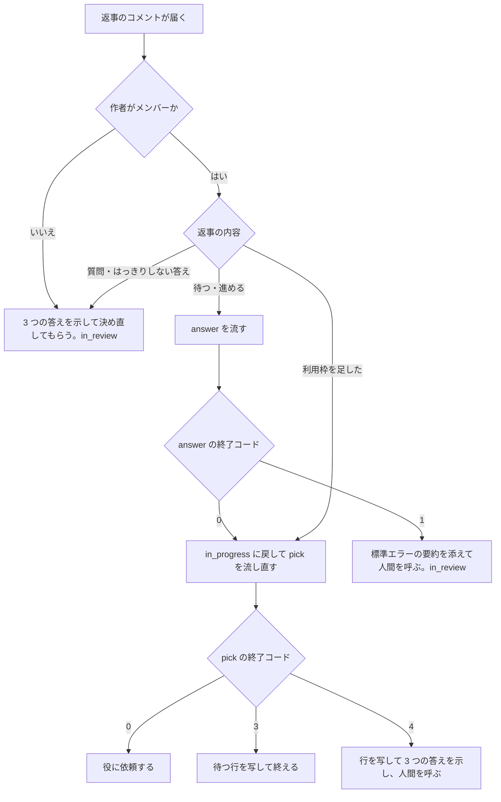

# 使用率が上限に近いときの人間の答えを、スクワッドのすべてのタスクに効かせる

使用率が上限に近く、待つと通算 24 時間を超えるとき、人間は「待つ」「進める」「利用枠を足した」の 3 つから答える。「待つ」と「進める」の答えは、リーダーがスクリプトで記録に残し、同じスクワッドのすべてのタスクとすべての工程に、期限まで効く。

この文書は、原本を変える人に向けて、人間を呼ぶ行と答えの記録の形・置き場を書く。答えが効く時刻と「進める」のときの回し先、依頼に添える行も書く。リーダーの手順と、その理由も扱う。使用率の待ちの基本の決まりは [review-next-step.md の「使用率の待ち」](review-next-step.md#使用率の待ち)にあり、この文書はその上に重ねる決まりを書く。

## 目的と範囲

人間が答えても同じことをもう一度聞かれないよう、答えを記録に残す。記録がないと、次の 3 つが起きる。

1. 人間を呼ぶ行に再開の時刻も上限に近い枠もなければ、人間は何を決めるのかを行から読めない。初めての待ちでも、リセットが 24 時間より先なら同じ行が出る
2. 人間が待つと答えても、待ち始めを数え直すだけでは、リセットが 24 時間より先のままなら、次の `pick` もまた終了 4 になる
3. 上限に近いまま進めるという答えを残せなければ、答えがタスクと工程ごとになり、同じスクワッドの別のタスクでも同じことを聞かれる

人間の答えを決まった形の記録に残し、`pick` がその記録を読んで判定を変える。次は、記録があっても変わらない。

- 人間を呼ぶ時機。最初に待ち始めた時刻から再開の時刻までが 24 時間を超えると分かった時点で待たずに呼び、24 時間以内は呼ばずに待つ
- 上限に近いとする 80% のしきい値、空いている系統へ回す決まり、モデルを下げず工程を飛ばさない決まり
- 「利用枠を足した」の扱い。記録を書かずに `pick` を流し直す
- 「進める」のあとで役の実行が使用上限に達したときの扱い

次は対象にしない。

- 期限のない「常に進める」の設定
- 実際に待った時間で 24 時間を数える変更と、24 時間の上限をなくす変更
- 答えの効く範囲を、工程の 1 回やタスクの中だけにすること

## 人間を呼ぶ時機と行

呼ぶ時機は、待ち始めから再開の時刻までが通算 24 時間を超えると分かったときである。行とコメントは、人間が何を決めるのかを読める形にする。

### 人間を呼ぶ行

`squad-usage-wait pick` が終了 4 で出す行は、次の形である。再開の時刻と待ち始めは RFC3339 の UTC で、上限に近い枠と使用率は、待つ行と同じ書き方にする。

```text
使用率の待ち: <工程> は <再開の時刻> まで待つと通算 24 時間を超える。待ち始め: <最初に待ち始めた時刻>。<上限に近い枠と使用率>
```

行は `使用率の待ち:` で始まり `通算 24 時間を超える` を含むので、[制御記録の読み方](review-next-step.md#制御記録の読み方)の「24 時間を超えた人間の呼び出し」の判定に当たる。人間の呼び出しの計測も、同じ語で数える。

工程のあとを ` は ` にするのは、待つ行（`使用率の待ち: <工程> を <再開の時刻> まで待つ。`）と取り違えないためである。待ち始めは、待つ行だけから読み、人間を呼ぶ行からは読まない。

### 人間を呼ぶコメント

終了 4 を受けたリーダーと `decide` は、人間を呼ぶコメントに 3 つの答えを示す。`decide` が書く本文は、メンションに続けて次の文にする。そのあとに `前の回:` の行、`使用率の待ち:` の行、紐付けの行を置く。

```text
使用率が上限に近く、再開の時刻まで待つと通算 24 時間を超えます。「待つ」「進める」「利用枠を足した」のどれかを返事してください。
「待つ」は、下の行の再開の時刻まで、人間を呼ばずに待ちます。
「進める」は、上限に近いまま役を選んで頼みます。使用上限に達すると、役の実行が止まることがあります。
「利用枠を足した」は、使用率を読み直して続けます。
「待つ」と「進める」は、このスクワッドのすべてのタスクに、上限に近い枠のリセット時刻まで効きます。
```

文は、[読める本文](review-next-step.md#読める本文)の形（字下げ、引用、入れ子の項目を使わない）で書く。リーダーが手で呼ぶときも、同じ 3 つの答えと、効く範囲を書く。

## 答えの記録

「待つ」と「進める」の答えは、リーダーが `squad-usage-wait answer` で記録に残す。記録はタスクのコメントで、探すためのマークをタスクの metadata に置く。答えを変えるときは、古い記録をリーダーのコメントで取り消す。スクリプトは記録の行と取り消しの行だけを読み、人間の文の意味は読まない。

### 行の形

記録は、人間の答えのコメントへの返信として書く。コメントの 1 行目を次の形にし、ほかの行は置かない。

```text
使用率の答え: <待つ | 進める>。答えた時刻: <答えのコメントの時刻>。期限: <答えが効く最後の時刻>。スクワッド: <スクワッドの ID>。<上限に近い枠と使用率>
```

時刻は RFC3339 の UTC（末尾 `Z`）で書く。期限を引き継いだ記録（[期限の決め方](#期限の決め方)）は、末尾を `前の答えの期限を引き継いだ` にする。

行を `使用率の待ち:` で始めないのは、制御記録の種類と人間の呼び出しの計測に当てないためである。行に `24 時間を超える` の語も入れない。

### 記録の取り消し

答えを変えるとき、`answer` は、新しい記録を書く前に、古い記録を取り消す。取り消しは、古い記録と同じ返信先（古い答えのコメント）への返信として書く。コメントの 1 行目を次の形にし、ほかの行もメンションも置かない。

```text
使用率の答えの取り消し: <記録のコメントの ID>。新しい答えのタスク: <タスクの識別子>
```

取り消す相手は、取り消しがなく、期限が今より後の記録のすべてである。[answer の I/F](#answer-の-if) の手順 3 を通ったあとなので、どれも新しい答えより古い。期限を過ぎた記録は、もう効かないので取り消さない。

取り消した記録は、期限の前でも、二度と使わない。取り消しを古い記録と同じタスクに置くのは、古い記録を読める実行が、必ず取り消しも読めるようにするためである。マークが消されて新しい記録を見つけられなくても、古い記録は取り消されたままなので、判定は古い答えに戻らない。効いている記録がないときの、今の判定（人間を呼ぶ側）になる。

取り消しを 1 件でも書けなければ、`answer` は新しい記録を書かずに終了 1 で終わる。古い記録を残したまま新しい記録を書くと、マークの差し替えで古い答えに戻せるためである。取り消しだけが書かれた状態では、効いている記録がなく、次の `pick` は今の判定になる。同じ引数で流し直せば、残りの取り消しと新しい記録を書ける。

### 置き場と探し方

記録を置いたタスクの metadata に、`usage_answer_squad` をキー、スクワッドの ID を値として置く。`pick` は、`multica issue list --metadata usage_answer_squad=<スクワッドの ID>` でマークのあるタスクを探し、そのタスクのコメントから記録と取り消しを読む。一覧は完了と取り下げのタスクも返すので、記録を置いたタスクが閉じても読める。

マークは、`pick` が読むタスクを絞るためだけに使い、信頼の根拠にしない。マークは誰でも書けて、誰でも消せる。マークを付けても、[記録と読む条件](#記録と読む条件)に合う記録がなければ、判定は変わらない。

マークを消すと、`pick` はそのタスクの記録を見つけられない。このとき、見える記録は取り消されたものか期限を過ぎたものだけなので、今の判定（人間を呼ぶ側）になり、古い答えには戻らない。

`answer` は、マークに頼らずに記録を探す。取り消す相手を、マークを消して隠せないようにするためである。絞り込みのない `multica issue list` でワークスペースのタスクを読み、`last_activity_at` が今から 8 日前より後のタスクのコメントから、記録と取り消しを読む。担当、プロジェクト、metadata での絞り込みは、ほかの役が値を変えられるので使わない。

一覧は、[一覧の読み方](#一覧の読み方)のとおり、作成の順に重ねて読む。並びがページの間で動いて、読んでいないタスクが残らないようにするためである。

8 日で足りるのは、期限が今より後の記録が、必ず 8 日以内に書かれているためである。期限は長くても週のリセット時刻で、記録を書いた時刻から 7 日以内になる。そのうえで、期限が記録のコメントの時刻から 8 日を超える記録は読まないと決める（[記録と読む条件](#記録と読む条件)）。コメントを書くとタスクの `last_activity_at` が進むので、記録を書いたタスクは 8 日のあいだ範囲に入る。

`answer` は、終える前に、次の順でマークと記録を整える。記録を書かずに終了 0 で終わるときも行う。このときの使う記録は、8 日以内に動きのあったタスクと、マークのあるタスクを合わせて読み、その中から決める。マークのあるタスクは、動きが 8 日より前でも読む。

1. 取り消しがなく期限が今より後の記録が 2 件以上あれば、答えた時刻が最も新しいもの以外を取り消す。同時に流れた 2 つの `answer` が、互いの記録を読む前に書いたときのためである
2. 使う記録（[記録と読む条件](#記録と読む条件)）のあるタスクにマークがなければ、期限を過ぎていても置き直す。記録を書いたあとは、マークを読み直して確認する
3. マークのあるタスクのうち、記録はあるが、使う記録も、取り消しがなく期限が今より後の記録もないタスクからマークを外す。外したあとにそのタスクを読み直し、そういう記録があれば置き直し、読み直せなければ記録があるものとして置き直す

手順 1 も、マークに頼らずに行う。記録を書いたあとに、絞り込みのない一覧を読み直し、[answer の I/F](#answer-の-if) の手順 3 を始めた時刻の 10 分前より後に動きのあったタスクのコメントを読み直す。どちらの `answer` も、書いてから読み直すので、少なくとも片方が相手の記録を読む。記録を書かなかったときは、手順 3 で読んだ結果で行う。

手順 3 でマークを外すのは、`pick` が読むタスクを増やし続けないためである。読み直すのは、同時に流れた別の `answer` が、そのタスクに新しい記録を書いたあとでマークを外さないためである。読み直せないときに置き直すのは、新しい記録があるかどうかを決められないまま、マークのないタスクを残さないためである。マークは信頼の根拠でないので、余分に残っても判定は変わらず、次に整えるときに外れる。

使う記録のタスクのマークは、期限を過ぎても外さない。`pick` は、[期限のあとの数え直し](#期限のあとの数え直し)に使う期限を、マークから見つけたその記録から読むためである。外すと、`pick` は期限を読めず、期限より前の待ち始めを引き継いで、すぐに人間を呼び直す。

このマークは、別のタスクに新しい記録が書かれ、その記録が使う記録になったときに、手順 3 で外れる。期限を過ぎて残るマークは、スクワッドに 1 件だけである。

記録のないタスクのマークは外さない。同時に流れた別の `answer` が、マークを置いて記録を書く前のことがあるためである。

手順 1 の取り消しを書けないときと、手順 2 のマークを置けないときは、`answer` は終了 1 で終わる。マークを外せないだけなら、失敗にしない。

手順 3 で読み直せずに置き直したときは、標準エラーに警告を出して次のタスクへ進み、失敗にしない。置き直せなければ、終了 1 で終わる。マークを外す前の読み取りに失敗したタスクは、マークを外さずに飛ばす。

### 記録と読む条件

次のすべてに当たるコメントだけを、記録と読む。

1. 作者がエージェントで、作者の ID が、`pick` が名簿を読んだスクワッドのリーダーである
2. 本文の 1 行目が、上の形に端から端まで合う
3. 行のスクワッドの ID が、そのスクワッドの ID である
4. 行の期限が、記録のコメントの時刻から 8 日以内である。コメントの時刻は、プラットフォームが付けた作成の時刻を使う

合わないコメントは、読まずに飛ばす。リーダーでない役や人間が直接書いた行、別のスクワッドの記録、引用や 2 行目より後の行では判定は変わらない。

使う記録は、条件に合い、取り消しのないもののうち、答えた時刻が最も新しい 1 件だけにする。答えた時刻が同じなら、記録のコメントが新しい方にする。記録のコメントの時刻でなく答えた時刻で並べるのは、2 つのタスクで続けて答えたときに、リーダーが処理した順でなく、人間が答えた順で新しい答えを決めるためである。

その 1 件の期限が今より後なら、記録は効いている。期限を過ぎていれば、効いていない。取り消された記録は、ない記録と同じに扱い、期限の前でも使わない。

次のすべてに当たるコメントだけを、取り消しと読む。

1. 作者がエージェントで、作者の ID が、そのスクワッドのリーダーである
2. 本文の 1 行目が、[記録の取り消し](#記録の取り消し)の形に端から端まで合う
3. 行の ID が、同じタスクにある記録のコメントの ID である

取り消す記録は、返信の親でなく、行の ID で決める。合わないコメントは読まずに飛ばし、記録は取り消されていないものとして読む。リーダーでない役や人間が同じ文字を書いても、記録は取り消されない。

## 答えが効く時刻

答えは、枠ごとではなく、1 つの期限の時刻で持つ。期限までは、あとから別の枠が上限に近くなっても、同じ答えに従う。

### 期限の決め方

期限は、`answer` を流した時点の、その工程の[再開の時刻](review-next-step.md#再開の時刻)にする。決め方は `pick` と同じで、上限に近い枠のリセット時刻、複数の枠が近ければ遅い方、両方の系統が近ければ系統ごとの早い方である。答えたときに複数の枠が上限に近ければ、待つ行の再開の時刻と同じ時刻になる。

人間を呼ぶ行の再開の時刻を写さずに読み直すのは、返事までに使用率が変わることがあるためである。使用率が変わっていなければ、行に出した再開の時刻と同じになる。

`answer` を流した時点で、その工程の系統に空きが戻っていれば、新しい期限を決められない。空きが戻っているとは、使用率を読めて、その工程の `pick` が待たずに役を選ぶ状態のことである。

このとき、効いている記録があり答えが違えば、その期限を引き継いで記録する。効いている記録がなければ、記録しない。次の `pick` は役を選ぶので、人間は呼ばれない。

使用率を読めないときは、空きが戻っているときと分ける。読めないとは、その工程の `pick` が、[使用率を読めないときの代わりの決まり](review-next-step.md#工程ごとの動き)で役を選ぶ状態のことである。このとき `answer` は、効いている記録の有無によらず、何も書かずに終了 1 で終わる。

読めないまま終了 0 にしないのは、答えが残らないためである。次の `pick` が使用率を読めると、終了 4 に戻り、答えた直後の人間をもう一度呼ぶ。終了 1 なら、リーダーは `pick` へ進まず、答えを記録できなかったことを人間に知らせる（[answer の I/F](#answer-の-if)）。

効いている記録と同じ答えは、記録しない。同じ答えを重ねて、人間に聞かないまま期限を延ばさないためである。

### 別の枠があとから上限に近くなったとき

期限までは、答えたときに近くなかった枠や系統が上限に近くなっても、同じ答えに従う。答えを枠ごとに持つと、期限の前に人間を呼び直すことになり、スクワッドのすべてのタスクに効くという要件に合わないためである。期限は、長くても週のリセット時刻までである。

Codex が利用不可で週の使用率が 80% 未満のときは、再開の時刻が 60 分後と週のリセット時刻の早い方になるので、期限も同じになる。

### 期限のあとの数え直し

期限を過ぎたら、今の判定に戻る。このとき、期限より前に書かれた待つ行と人間を呼ぶ行は、待ち始めの引き継ぎに使わない。期限のあとは、新しい待ちとして数え直す。

これは、[待ち始めの続きを切るもの](review-next-step.md#24-時間を超えるとき)の 3 つ目である。ほかの 2 つは、工程の再開と、古い形の延長の行である。切るのに使う期限は、スクワッドの使う記録 1 件の期限だけにする。

期限は、`answer` の整え方で保つ。使う記録のタスクのマークは、期限を過ぎても外れないので（[置き場と探し方](#置き場と探し方)）、`pick` は期限を読み続けられる。

期限のあとに、別のタスクで `answer` が記録せずに終わっても、マークは外れず、期限で数え直す判定は変わらない。期限は、新しい記録が使う記録になるまで、待ち始めの続きを切る。期限を過ぎた記録の読み取りに、期限からの経過の上限は置かない。

数え直したあと、また上限に近く、リセットが 24 時間より先なら、`pick` は終了 4 で人間を呼ぶ。24 時間以内なら、呼ばずに待つ。

## pick の判定

`pick` が記録を読むのは、今の決まりで待つか人間を呼ぶと決まったときだけにする。使用率が 80% 未満のときと、空いている系統へ回せるときは、記録を読まずに役を選ぶ。記録の有無で、空いているときの動きは変わらない。

起こしの一覧は、記録とは別に読む。`pick` が終了 0、3、4 で行を出す前に 1 回読む（[起こしを 1 件に保つ](#起こしを-1-件に保つ)）。

| 効いている記録 | 動き | 終了コード |
| --- | --- | --- |
| ない。見える記録がすべて取り消されているときを含む | 今の 24 時間の判定。待ち始めは[期限のあとの数え直し](#期限のあとの数え直し)に従う | 3 か 4 |
| 待つ | 24 時間の判定をせず、起こしを置いて待つ | 3 |
| 進める | 上限に達していない系統の役を選ぶ。頼める系統がなければ、起こしを置いて待つ | 0 か 3 |

`squad-review-next decide` から呼んだ回も、同じ `pick` を通るので、同じ判定になる。`decide` が `pick` を呼ぶ前から記録が効いていれば、「進める」なら次の依頼を書いて人間を呼ばず、「待つ」なら起こしを置いて終わる。`decide` は、`pick` の終了コードだけで分かれ、記録の有無を見ない。

`decide` がすでに人間を呼んだ回は、これと分ける。人間が答えたあと、同じ回の `decide` は流し直さず、リーダーが続きを頼む（[decide が人間を呼んだ回](#decide-が人間を呼んだ回)）。

記録の読み取りに失敗したとき（一覧やコメントを読めない）は、標準エラーに理由を出して終了 1 にする。読めないまま、人間を呼ぶ側にも進める側にも倒さないためである。一覧を読み直してもそろわないとき（[一覧の読み方](#一覧の読み方)）も、同じに終了 1 にする。

### 「待つ」が効いているとき

起こしは、今の再開の時刻と記録の期限の、早い方に置く。置いてある起こしがそれより遅ければ、新しく置いて、遅い起こしを消す（[起こしを 1 件に保つ](#起こしを-1-件に保つ)）。出す行は、待つ行の末尾に 1 文が付く形である。

```text
使用率の待ち: <工程> を <再開の時刻> まで待つ。待ち始め: <最初に待ち始めた時刻>。<上限に近い枠と使用率>。人間の答えで待つ（期限 <期限>、答えのタスク <タスクの識別子>）
```

期限の時刻に起きたリーダーは、`pick` を流し直す。記録は期限を過ぎているので、今の判定に戻る。

「進める」が効いていて頼める系統がないときは、同じに待ち、末尾の 1 文だけが違う。人間が「待つ」と答えたときと、読み分けられるようにするためである。

```text
使用率の待ち: <工程> を <再開の時刻> まで待つ。待ち始め: <最初に待ち始めた時刻>。<上限に近い枠と使用率>。人間の答えで進めるが、頼める系統がないので待つ（期限 <期限>、答えのタスク <タスクの識別子>）
```

### 起こしを 1 件に保つ

使用率の待ちの起こしは、タスクごとに、工程と回の組につき、待っているあいだだけ 1 件にする。待っていないときは 0 件にする。再開した工程の起こしが残ると、あとで起きたリーダーが、再開済みの工程をもう一度頼むためである。

対象の起こしは、`multica issue wakeup list` の要素のうち、次のすべてに当たるものである。使う起こしと消す起こしを、同じ照合で決める。

| 欄 | 条件 |
| --- | --- |
| `enabled` | 真。発火した `at` の起こしは偽になるので、対象にならない |
| `agent_id` | 名簿のリーダーの ID |
| `instruction` の 1 行目 | `使用率の待ちの起こしで起きました。` |
| `instruction` の工程の行 | `工程: <工程>` の行がある |
| `instruction` の回の行 | `--round` がないときは、`回:` で始まる行がない。あるときは、`回: <回のコメントの ID>` の行がある |

回の違う起こしと別の工程の起こしは、使わず、消さない。宛先がリーダーでない起こしも同じに扱う。回のない `pick` は、回のある起こしを使わず、自分の起こしを置く。

`pick` が終了 0、3、4 で行を出す前に、起こしの一覧を 1 回読む。扱いは、次のとおりにする。

| 終わり方 | 起こしの扱い |
| --- | --- |
| 終了 0（役を出す） | 対象の起こしをすべて消す。対象の経路は、下の段落のとおりにする |
| 終了 3（待つ） | 使う起こしを 1 件決め、ほかの対象の起こしをすべて消す |
| 終了 4（人間を呼ぶ） | 対象の起こしをすべて消す。残ると、起きたリーダーが人間をもう一度呼ぶためである |

終了 0 で起こしを消すのは、80% 未満のときと、空いている系統へ回すときの両方である。「進める」で選ぶときと、片系統で使用率を読めずに選ぶときも同じに消す。

終了 3 で使う起こしは、次の順で決める。

1. 対象の起こしのうち、`再開の時刻:` の行を時刻として読めるものから最も早いものを候補にし、同じ時刻なら一覧で先のものにする。読めない起こしは候補にしない
2. 候補がないときは、新しく置いてそれを使う。記録が効いていて、候補の再開の時刻が置く時刻（今の再開の時刻と期限の早い方）より遅いときも同じにする
3. そうでなければ、候補を使い、新しく置かない。待つ行の再開の時刻は、候補の時刻にする

再開の時刻は、指示の行で読む。記録が効いていないときは、候補が今の再開の時刻より遅くても置き直さない。

再開の時刻を読めない起こしだけがあるときは、それを使わず、新しく置いて、読めない起こしを消す。起きる時刻を読めない起こしに、待ちを任せないためである。

削除は、`multica issue wakeup delete <タスク> <起こしの ID> --output json` を呼び、終了コードだけを読む。`squad-pr-watch` がコンフリクトの見張りを消すのと同じ呼び方で、約束にしない。

新しく置くときは、置けたあとに、ほかの起こしを消す。先に消すと、置けなかったときに起こしが 0 件になり、待ったまま起きないためである。置けなければ、何も消さずに終了 1 にする。

消す相手は、置く前に読んだ 1 回の一覧から決め、置いたあとに読み直さない。同時に流れた 2 つの `pick` が、互いの置いた起こしを消して 0 件にしないためである。このとき 2 件が残ることがあるが、次の `pick` で 1 件になる。

起こしの一覧を読めないときと、消せないときは、役の行も待つ行も人間を呼ぶ行も出さずに、標準エラーに理由を出して終了 1 にする。消せなかったときは、一覧を 1 回読み直し、その起こしがなくなっているか `enabled` が偽なら、消えたものとして続ける。同時に流れた別の `pick` が先に消したときと、消す直前に発火したときのためである。

終了 3 で新しく置いたあとに消せずに終了 1 で終わったときは、流し直すと、置いた起こしを候補にして、残りを消す。終了 0 と 4 で消せずに終わったときも、流し直せば同じ判定から続く。

宛先と指示で起こしを見分けるので、ほかの役が同じ形の起こしをリーダー宛てに置くと、`pick` はそれを対象として読む。信じる範囲は[入力と信頼の表](#入力と信頼の表)に書く。

### 「進める」のときの回し先

両系統の構成では、`squad-dispatch-pick` の引数 `--allow-near` で決める。除外で片方でも残るときは、引数の有無で動きを変えない。空いている系統へ回す決まりを変えないためである。

除外で両方が除かれるときだけ、`--allow-near` が除外を次のとおり緩める。

1. 上限に達した系統を除く。達したとは、枠の使用率が 100% 以上か、Codex が利用不可のことである
2. 残った系統が 1 つなら、その系統にする。2 つなら、通常の順（優先する系統、使ってよい量との差が大きい方、同じなら Claude）で決める
3. 残る系統がなければ、終了 2 で終わる

`振り分け:` の行の理由には、両方の系統が上限に近いので、人間の答えで選んだことを書く。

`squad-usage-wait` は、`squad-dispatch-pick` が終了 2 で終わったあと、先に記録を読む。「進める」が効いているときだけ、同じ引数に `--allow-near` を付けてもう一度呼ぶ。終了 0 ならその役を出し、終了 2 なら、頼める系統がないときの行を出して待つ（[「待つ」が効いているとき](#待つが効いているとき)）。

片系統の構成と、要件を決める役・設計の役では、その系統が上限に達していなければその役を選ぶ。達していれば、同じ行を出して待つ。

上限に達した系統へ頼まないのは、頼んでも役の実行が使用上限で必ず止まり、止まったことを知らせる起こしがないためである。待てば、リセット時刻の起こしで続きから進む。どちらの答えでも、期限までは人間を呼ばない。

### 依頼に添える行

「進める」で選んだときは、`振り分け:` の行の、工程のマークの前に 1 文が入る。

```text
振り分け: <理由などの中身>。人間の答えで進める（期限 <期限>、答えのタスク <タスクの識別子>）。工程: <工程>
```

行は `振り分け:` で始まり `。工程: <工程>` で終わる形を保つ。工程の再開の読み取り、`decide` の依頼、最終レビューの回は、行をそのまま読める。リーダーと `decide` は、行を依頼にそのまま写す。

依頼を受けた役と、あとで読む人間は、この 1 文で上限に近いまま頼まれたことを読める。根拠の答えがあるタスクも分かる。

## answer の I/F

`answer` は、リーダーの実行だけが流す。人間の答えを読み分けるのはリーダーで、スクリプトは答えの語（引数）と、答えのコメントの作者だけを確認する。

```text
squad-usage-wait answer <タスク> <工程> <待つ | 進める> <答えのコメントの ID>
```

工程は、人間を呼んだ `使用率の待ち:` の行の工程にする。その行がないタスクで答えを変えるときは、次に頼む工程にする。工程は、期限を決める系統を選ぶためだけに使い、答えの効く範囲は狭めない。

スクリプトは、次の順に進める。

1. 呼び出した実行（`MULTICA_AGENT_ID`）が、そのスクワッドのリーダーでなければ、何も書かずに終了 1 で終わる
2. 答えのコメントが、そのタスクのコメントでないか、作者がメンバーでなければ、何も書かずに終了 1 で終わる
3. スクワッドの記録と取り消しを、マークに頼らずに読む（[置き場と探し方](#置き場と探し方)）。答えのコメントの時刻以後の答えた時刻を持つ記録があれば、取り消しの有無によらず書かない
4. [期限の決め方](#期限の決め方)で期限を決め、記録しないと決まれば新しい記録を書かない。使用率を読めなければ、何も書かずに終了 1 で終わる
5. 記録を書くときは、先に、取り消しがなく期限が今より後の記録をすべて取り消す（[記録の取り消し](#記録の取り消し)）。1 件でも書けなければ、新しい記録を書かずに終了 1 で終わる
6. タスクにマークを置き、答えのコメントへの返信で記録を書く
7. マークと記録を整える（[置き場と探し方](#置き場と探し方)）。手順 3 と 4 で記録を書かないと決まったときも行い、そのあと終了 0 で終わる

手順 3 で書かないのは、流し直しや古い答えの処理で、新しい答えを上書きしないためである。

標準出力は 1 行にする。記録したときは記録の行を、書かなかったときは `使用率の答え: 記録なし。<理由>` を出す。

| 終了コード | 意味 | 呼んだ側がすること |
| --- | --- | --- |
| 0 | 記録した。または、記録は要らない（空きが戻っている、同じ答えが効いている、より新しい答えがある） | タスクを `in_progress` に戻し、`pick` を流し直す |
| 1 | 使い方と作者、読み取りと書き込みの誤り。具体例は、下の段落のとおりにする | `pick` を流さず、標準エラーの要約を添えて人間を呼ぶ。タスクは `in_review` のままにする |

終了 1 には、使用率を読めないときと、取り消しを書けないときを含む。一覧を読み直してもそろわないときと、外したマークを置き直せないときも含む。

使用率を読めずに終了 1 で終わったときは、標準エラーに、使用率を読めず答えを記録していないことを出す。リーダーは人間に、答えを記録できなかったことと、同じ答えをもう一度返事すれば記録し直すことを知らせる。

マークも記録も書いていないので、同じ引数で流し直せば記録できる。取り消しを書けずに終わったときも、同じ引数で流し直せば、続きから書ける。

一覧がそろわずに終わったときも、同じ引数で流し直す。記録を書く前なら何も書いておらず、書いたあとなら、記録を増やさずに続きを整える。

使用率の読み取りは 90 秒で打ち切る。`answer` は、そのうえ 8 日以内に動きのあったタスクのコメントを読むので、コマンドの時間切れは 600 秒以上にする。`pick` は 120 秒以上でよい。

## CLI の出力の約束に足す読み取り

`squad-cli-lib` の約束に、次の読み取りがある。見本は、ほかの約束と同じく実物から採り、`tests/fixtures/cli/` に置く。

| 約束 | コマンド | 読む欄 |
| --- | --- | --- |
| `issue-list` | `multica issue list --metadata usage_answer_squad=<スクワッドの ID> --limit 100 --offset <数> --sort created_at --direction asc --output json` | `issues[].id`、`issues[].identifier`、`has_more`、`total` |
| `issue-list-all` | `multica issue list --limit 100 --offset <数> --sort created_at --direction asc --output json` | `issues[].id` と `issues[].identifier`、`issues[].last_activity_at` と `has_more`、`total` |

どちらも、[一覧の読み方](#一覧の読み方)のとおりに読む。`total` は、絞り込んだあとの件数で、0 以上の整数である。`issue-list-all` は `answer` だけが使い、絞り込みの引数を渡さない。

完了と取り下げのタスクも返る。`last_activity_at` が空か、時刻として読めないタスクは、8 日の範囲の内として読む。読むタスクを減らす側に倒さないためである。

名簿を読む関数は、`squad_cli_read_roster` と `squad_cli_read_roster_for_caller` である。返す名簿に、名簿を決めたスクワッドの ID を欄 `squad` で入れる。`pick` と `answer` が、名簿と同じスクワッドで記録を探すためである。

マークの書き込みと取り外しは、`squad-pr-watch` が metadata を書くのと同じく、`multica issue metadata set` と `multica issue metadata delete` を呼ぶ。記録と取り消しのコメントは、約束 `issue-comment-add` で書き、約束 `issue-comments` で読む。起こしは、約束 `issue-wakeups` で読み、`agent_id` と `enabled`、`instruction` を使う。起こしの削除は、約束にせず `multica issue wakeup delete` を呼ぶ（[起こしを 1 件に保つ](#起こしを-1-件に保つ)）。

### 一覧の読み方

どちらの一覧も、同じ 1 つの関数で作成の順に読む。ページは 1 件ずつ重ねる。並びがページの間で動くと、読んでいないタスクが残り、`answer` が取り消す相手を見落とすためである。

並びは `--sort created_at --direction asc` で決める。作成の時刻は役が変えられず、新しいタスクは末尾に足されるので、読み終えたページの並びが動かない。既定の並びは、役がタスクを並べ替えると動くので使わない。

読む手順は次のとおりにする。

1. `--offset 0` から読む
2. 2 ページ目からは、先頭のタスクの ID が、前のページの末尾の ID と同じことを確認し、先頭の 1 件を捨てる
3. `has_more` が真なら、`--offset` を「返った件数 − 1」だけ進めて次を読む。返った件数が 2 件未満なら、そろわないものとして扱う
4. `has_more` が偽になったら、読んだタスクの ID に重複がないことと、読んだ件数が最後の応答の `total` と同じことを確認する

手順 2〜4 の確認に 1 つでも合わなければ、読んだ分を捨てて、最初から読み直す。読み直しは 2 回までにする。3 回読んでもそろわなければ、標準エラーに理由を出して終了 1 にする。

重複した ID を、黙って 1 件にまとめない。コマンドが失敗したときと、欄の形が約束に合わないときは、読み直さずに終了 1 にする。

件数が `total` と同じで重複がなければ、読んでいるあいだにタスクが増減していない限り、全件を読んでいる。重ねて読むのは、タスクが消えるのと作られるのが重なり、件数が合ったまま 1 件を飛ばすときのためである。前のタスクが消えると並びが 1 件ずれ、境目の ID が合わなくなる。

`answer` は、一覧がそろうまで何も書かない。記録を書いたあとの読み直し（[置き場と探し方](#置き場と探し方)の手順 1）でそろわないときは、書いた記録を残して終了 1 で終わる。同じ引数で流し直せば、記録を増やさずに続きを整える。

1 ページに収まるあいだは、確認が 1 つの応答の中で済み、読み取りは増えない。

### jq への渡し方

大きさを決められない JSON は、外のコマンドの引数にも環境変数にも載せない。標準入力か、スクリプトの一時ディレクトリのファイルで渡す。Linux は引数 1 つを 131,072 バイト未満に限るので、タスクの数や本文の長さで上限を超えると、jq が起動できずに終了 1 になるためである。

| 値 | 渡し方 |
| --- | --- |
| 一覧のページとタスクの配列、コメントの配列と記録・取り消しの配列、起こしの配列とその ID の配列 | 標準入力（ヒアストリング、パイプ）か、一時ファイルを `--slurpfile` で渡す。`--argjson` と `--arg` では渡さない |
| 数値と時刻、ID と工程の名前、使用率の読み取りの決まった形と記録 1 件 | 引数で渡してよい |
| 配列から切り出した行や ID を繰り返す入力 | 切り出しを変数への代入で行い、失敗を確認してから、ヒアストリングで繰り返しに渡す |

`squad-usage-wait` のコードは、この表に照らして確認する。表に載らない値は、件数が増えるかを決めてから、表に行を足す。

配列から行を切り出して繰り返すときは、切り出しを変数への代入で行い、jq が失敗したら読み取りの誤りとして終了 1 にする。プロセス置換と、関数の引数の中のコマンド置換は使わない。失敗を、0 回の繰り返しや空の値と区別できないためである。

## 入力と信頼の表

人間を呼ぶかどうかの関所の判定は、タスクのコメントで変わる。読む入力ごとに、信頼する条件を置く。

| 入力（誰が書いた何か） | 読むところ | 信頼する条件 | 合わないとき |
| --- | --- | --- | --- |
| タスクのコメントの `使用率の答え:` の行（リーダーが `answer` で書く。ほかの役と人間も同じ文字は書ける） | `pick` と `answer` の、効いている記録の判定 | 作者がエージェントで名簿を読んだスクワッドのリーダーの ID であり、1 行目が形に合い、行のスクワッドの ID がそのスクワッドである。期限がコメントの時刻から 8 日以内で、同じタスクにその記録の取り消しがない | 読まずに飛ばして判定を変えず、取り消された記録は期限の前でも使わない |
| タスクのコメントの `使用率の答えの取り消し:` の行（リーダーが `answer` で書く。ほかの役と人間も同じ文字は書ける） | `pick` と `answer` の、記録が取り消されたかの判定 | 作者がエージェントで、そのスクワッドのリーダーの ID。1 行目が形に合い、行の ID が同じタスクの記録のコメントの ID | 読まずに飛ばす。記録は取り消されていないものとして読む |
| タスクの metadata の `usage_answer_squad`（誰でも書けて、誰でも消せる） | `pick` が、記録のあるタスクを探す一覧。`answer` は、取り消す相手を探すのに使わない | 信頼しない。`pick` が読むタスクを絞るためだけに使い、記録と取り消しは上の条件で読む | マークがなければそのタスクの記録を読まず、見える記録に効いているものがなければ今の判定（人間を呼ぶ側）にする。マークの欠けで、取り消された答えには戻らない |
| 絞り込みのないタスクの一覧の `last_activity_at`（プラットフォームが付ける。役は、コメントなどを書いて進めることだけできる） | `answer` が、記録と取り消しを探すタスクの範囲 | 読むタスクを絞るためだけに使う。今から 8 日前より後のタスクを読み、空や読めない値のタスクも読む | 一覧やコメントを読めなければ、何も書かずに終了 1 |
| タスクの一覧の並びと `total`（プラットフォームが返す。役は、タスクの作成と並べ替え、マークの付け外しで一覧を動かせる） | `pick` と `answer` が、一覧を読み切ったかの判定（[一覧の読み方](#一覧の読み方)） | 作成の順で読み、ページの境目の ID が重なり、ID に重複がなく、件数が `total` と同じ。役が動かせる既定の並びは使わない | 最初から読み直し、3 回読んでもそろわなければ終了 1 にする。記録を書く前なら何も書かず、書いたあとなら書いた記録を残す |
| 起こしの `agent_id` と指示（`squad-usage-wait` がリーダー宛てに置く。ほかの役も、同じ形の起こしを置ける） | `pick` が、使う起こしと消す起こしを決める（[起こしを 1 件に保つ](#起こしを-1-件に保つ)） | `enabled` が真で `agent_id` が名簿のリーダーの ID であり、指示の 1 行目がマークで、工程と回が合う。起きる時刻を決めるためだけに使い、役を選ぶ判定と人間を呼ぶ判定には使わない | 使わず、消さない。条件に合っても再開の時刻を読めない起こしは、使わずに消す |
| 人間の答えのコメント（メンバーが書く） | リーダーが答えを読み分ける。`answer` は作者の種類だけを確認する | そのタスクのコメントで、作者がメンバー。リーダーが、3 つの答えのどれかをはっきり読める | `answer` は書かずに終了 1。質問やはっきりしない答えでは、リーダーは `answer` を流さず、もう一度決めてもらう |
| `answer` を流す実行（`MULTICA_AGENT_ID`） | 記録を書いてよいかの判定 | そのスクワッドのリーダーの ID | 何も書かずに終了 1 |
| 古い形の人間を呼ぶ行と延長の行（エージェントが書く。延長の行はリーダー） | 待ち始めの数え直し | 延長の行は、作者がリーダーで、人間を呼ぶ行より後 | 読まずに飛ばす |
| 人間を呼ぶコメントの `前の回:` と `使用率の待ち:` の行（`decide` を流した役かリーダーが書く。ほかの役と人間も同じ文字は書ける） | リーダーが、`decide` が呼んだ回かどうかと、頼む工程と回を読む（[decide が人間を呼んだ回](#decide-が人間を呼んだ回)） | 作者が、その回の返事を待つ役かリーダーのエージェントで、行が引用や囲みの中でなく行の頭にある | `decide` が呼んだ回として扱わず、リーダーが呼んだときの手順で進める。頼む回を決められなければ、依頼を書かずに人間を呼ぶ |
| 使用率の読み取り（`squad-usage-read` の出力） | 期限と再開の時刻、上限に達したかの判定 | 読んだ時刻が 30 分以内で、欄がそろう | `answer` は何も書かずに終了 1 で終わる。`pick` は使用率を読めないときの代わりの決まりに従う |

答えた人間が、スクワッドの持ち主かどうかは確認しない。延長の行も、答えたメンバーを限らない。タスクにコメントを書けるメンバーは、返事で流れを進められる。

## リーダーの手順

リーダーは、人間の答えを読み分け、「待つ」と「進める」のときに `answer` を流す。記録の行は手で書かない。古い形の延長の行は書かない。

次の図は、人間の答えから `answer` と `pick` へ進み、終了コードで依頼・待ち・人間の判断に分かれる流れを示す。



`leader-dispatch.md` の「役の選び方」の表の終了 4 の行は、`使用率の待ち:` の行を写して人間を呼び、3 つの答えを示して決めてもらう。「使用率の待ちで人間が答えたとき」の節は、次の表のとおりである。

| 人間の返事 | リーダーがすること |
| --- | --- |
| 待つ、進める | `squad-usage-wait answer <タスク> <工程> <待つ \| 進める> <返事のコメントの ID>` を流す。`answer` が終了 0 なら、タスクを `in_progress` に戻し、止めた工程の `pick` を流し直す |
| 利用枠を足した | `answer` を流さず、`in_progress` に戻して `pick` を流し直す |
| 質問、はっきりしない答え、エージェントのコメント | `answer` を流さず、3 つの答えを示して、もう一度人間に決めてもらう。`in_review` のままにする |

`pick` が終了 0 なら頼み、終了 3 なら行を写して終える。

`answer` が終了 1 で終わったときは、`pick` を流さず、標準エラーの要約を添えて人間を呼ぶ。使用率を読めなかったときは、答えを記録できなかったことと、同じ答えをもう一度返事してほしいことを書く。取り消しの行も、記録の行と同じく、手で書かない。`leader-dispatch.md` の、`answer` のコマンドの時間切れの案内は、600 秒以上である。

効いている答えを人間が変えたいと書いたときも、同じ `answer` を流す。人間を呼んでいないタスクのコメントでもよい。変えたあとは、新しい答えに従う。

`leader-principal.md` の「pick の結果」の表の終了 4 の行は、3 つの答えを示すことと、この節の名前に合わせている。`orchestrator.md` の「場面と手順」の、実装・修正の依頼の行の場面に、使用率の待ちで人間が答えたときがある。

### decide が人間を呼んだ回

`decide` が人間を呼んだ回の続きは、人間が答えたあと、リーダーが頼む。同じ回の `decide` は流し直さない。

`decide` が書いた人間を呼ぶコメントは、[制御記録の読み方](review-next-step.md#制御記録の読み方)の「24 時間を超えた人間の呼び出し」で、書き済みの依頼と数える。答えのあとに同じ回の `decide` を流し直すと、`次の依頼: 書き済み` で終わり、次の依頼も起こしも書かれない。3 つの答えのどれでも同じである。

この数え方は答えのあとも同じで、続きは、この節の下の手順でリーダーが頼む。数え方をそのままにした理由は、検討した案の [decide が人間を呼んだ回の続きの案](#decide-が人間を呼んだ回の続きの案)に書いた。

人間を呼ぶコメントに `前の回:` の行があれば、`decide` が呼んだ回である。コメントは、[入力と信頼の表](#入力と信頼の表)の条件で読む。返事は上の表で扱い、止めた工程の `pick` を次のとおり流す。

1. 工程は、人間を呼ぶコメントの `使用率の待ち:` の行の工程にする。`fix` か `principal` で、`principal` は手順のとおり系統を添える
2. `--round` は渡さない。渡すと、置かれる起こしの指示が同じ回の `decide` の流し直しになり、起きたあとに書き済みで止まる
3. 頼む回は、その工程の最新の人間を呼ぶコメントの、`前の回:` の行が指す回にする

`pick` の結果は、次のとおりに扱う。

| `pick` の終了コード | リーダーがすること |
| --- | --- |
| 0 | その回の依頼を、手で頼む手順で書く。`fix` と `principal` の手順は、下の段落のとおりにする |
| 3 | 待つ行を写して終える。`前の回:` の行は置かない |
| 4 | 行を写し、3 つの答えを示して人間を呼ぶ |

`fix` は、`leader-review-wait.md` の `修正の依頼が 2 回目から` の行と同じに扱う。`principal` は、`leader-principal.md` の手で最終レビューを頼む手順で頼む。

`fix` では、回の ❌ の結果を読む。`leader-flow.md` の「修正の依頼の前に確認する順」で確認し、修正の依頼を書くか人間を呼ぶ。`修正の依頼: <N> 回目` の行は、`leader-principal.md` の「修正の依頼の数え方」で数える。`直す指摘:` の行は `decide` だけが書くので、置かない。

`principal` では、依頼に `前の回: <頼む回のコメントの ID>` の行を置き、`返事を待つ役:` と `確認するコミット:` の行、`squad-review-wait watch` は手順のとおりにする。

頼む前に、人間を呼ぶコメントより後に、その工程の `振り分け:` の行を持つ依頼がないことを確認する。あれば頼み済みなので、頼まない。古い起こしや流し直しで、同じ回の依頼を 2 つ書かないためである。

「待つ」のあとに終了 3 で置かれる起こしは、`--round` なしの `pick` が置くので、指示に回も `decide` の流し直しもない。起きたリーダーは、`leader-dispatch.md` の「使用率の待ちの起こしで起きたとき」の手順 1 と 2 のとおり、同じ `pick` を流し直す。終了 0 なら、上の表のとおり、その回の依頼を手で書く。`pick` が終了 0 か 4 で終わると、同じ工程の回のない起こしは消える（[起こしを 1 件に保つ](#起こしを-1-件に保つ)）。

`decide` が前に置いた、回のある起こしが残っていることがある。回のない `pick` は、回のある起こしを消さない。指示に `decide` の流し直しがあっても、その回を指す人間を呼ぶコメントがあれば、`decide` を流し直さず、この節の手順で進める。起こしで起きたときの手順 3 に、この条件がある。

## 古い形の行との互換性

古い形の行が残るタスクでも、判定を誤らない。

| 残る行 | 読み方 |
| --- | --- |
| 古い形の人間を呼ぶ行（`使用率の待ち: <工程> の待ちが通算 24 時間を超える`） | 延長の行を数える目安として読む。制御記録と計測でも、人間の呼び出しとして数える |
| 延長の行（`使用率の待ちの延長: <工程>。決めた人: <名前>`） | 人間を呼ぶ行より後でリーダーが書いたものだけ、待ち始めの続きを切る |
| 待つ行と `振り分け:` の行 | 形が同じなので、古い行も新しい行も同じに読む |

古い形の行だけが残るタスクで、`pick` は読めない行として終了 1 にしない。記録がなければ、24 時間の判定になる。古い形で人間を呼んだタスクでも、人間の返事をこの節の上の手順で扱い、`answer` で記録できる。`answer` は、人間を呼ぶ行の形を確認しないためである。

## テスト

スクリプトのテストは、`tests/` のファイルに置く。使用率と `multica` はスタブにし、本物の CLI は呼ばない。`tests/squad-usage-wait-test.sh` は、[テストの所要時間](#テストの所要時間)のとおり分けてあり、下の表のケースは、分けたファイルのうち節が合うものにある。

| 対象 | 確認すること |
| --- | --- |
| `squad-usage-wait pick` の呼ぶ時機 | 初回の待ちで、リセットが 24 時間以内なら終了 3 で起こしを置き、24 時間より先なら終了 4 で起こしを置かないこと。終了 4 の行に、再開の時刻と待ち始め、上限に近い枠があり、`通算 24 時間を超える` を含むこと |
| `squad-usage-wait pick` の呼ぶ時機 | 80% 未満なら、記録があっても終了 0 で、タスクの一覧を読まないこと |
| `pick` の「待つ」 | 記録があると、同じタスクの同じ工程と別のタスク、別の工程が終了 3 になり、起こしが再開の時刻と期限の早い方に置かれること。置いてある起こしが期限より遅ければ、期限の時刻に新しく置き、遅い起こしが消えること |
| `pick` の「待つ」 | 期限を過ぎ、リセットが 24 時間より先なら終了 4 に戻り、24 時間以内なら終了 3 で待ち始めが数え直されること |
| `pick` の「進める」 | 記録があると、同じタスクと別のタスク、別の工程が終了 0 で、`役:` と 1 文を持つ `振り分け:` の行を出すこと。行が `。工程: <工程>` で終わること |
| `pick` の「進める」 | 期限を過ぎると終了 4 に戻ること。片系統で上限に達しているときと両系統とも達しているときは、終了 3 になり、行の末尾が、頼める系統がないときの文であること |
| 起こしを 1 件に保つ | 終了 3 で、対象の起こしが 2 件以上あれば、再開の時刻の最も早い 1 件だけが残り、新しく置かないこと。再開の時刻を読めない起こしだけがあれば、新しく置いて、読めない起こしが消えること |
| 起こしを 1 件に保つ | 終了 0 では、80% 未満と空いている系統へ回すとき、「進める」と片系統で使用率を読めないときのどの経路でも、対象の起こしがすべて消えること。終了 4 でも、対象の起こしがすべて消えること |
| 起こしを 1 件に保つ | 回の違う起こしと別の工程の起こし、宛先がリーダーでない起こしと `enabled` が偽の起こしは、使われず、消えないこと。起こしの一覧を読めないときと、消せないときは、役の行も待つ行も人間を呼ぶ行も出さずに終了 1 になること |
| 起こしを 1 件に保つ | 消せなかった起こしが、読み直すとなくなっているか無効なら、続けること。新しく置けないときは、ほかの起こしを消さないこと |
| 起こしを 1 件に保つ | 置いたあとに消せずに終了 1 になっても、流し直すと 1 件になり終了 3 になること |
| 記録と読む条件 | リーダーでない役や人間の行、別のスクワッドの ID や 2 行目の行、形に合わない行では判定が変わらないこと。答えた時刻の新しい記録に従い、答えを変えると判定が変わること |
| 記録と読む条件 | マークがあって記録のないタスクで終了 1 にならないこと。一覧を読めないとき終了 1 になること |
| 記録と読む条件 | 期限がコメントの時刻から 8 日を超える記録を読まないこと |
| 記録の取り消し | 取り消された記録に、期限の前でも従わないこと。リーダーでない役や人間の行、別のタスクにある行や別の記録の ID の行、2 行目や形に合わない行では、記録が取り消されないこと |
| マークの差し替えを拒むこと | あるタスクに期限内の「進める」を記録し、あとから別のタスクで「待つ」に変えた状態を作る。新しい記録のタスクのマークを消し、古い記録のタスクのマークだけを残しても、`pick` が終了 0 にならず、効いている記録がないときの判定（終了 3 か 4）になること |
| マークの差し替えを拒むこと | 両方にマークがあれば「待つ」に従うこと。マークをすべて消すと、今の判定になること |
| マークの差し替えを拒むこと | `answer` を流す前に古い記録のタスクのマークを消しておいても、`answer` が古い記録を取り消すこと。`pick` が、絞り込みのない一覧を読まないこと |
| `squad-usage-wait answer` | 記録の行、マーク、返信先が決まりどおりであること。リーダーでない実行、メンバーでない作者、別のタスクのコメントで、何も書かず終了 1 になること |
| `squad-usage-wait answer` | 同じコメントで流し直しても、記録が増えないこと。効いている記録と違う答えで新しい記録が書かれ、同じ答えでは書かれないこと |
| `squad-usage-wait answer` | 空きが戻っているとき、記録しないか、期限を引き継いで、終了 0 になること。使用率を読めないとき、効いている記録の有無によらず、記録もマークも書かず終了 1 になり、標準エラーに理由が出ること |
| `squad-usage-wait answer` | 答えを変えると、古い記録と同じタスクに取り消しが書かれ、そのあとに新しい記録が書かれること。取り消しを書けないとき、新しい記録を書かず終了 1 になり、流し直すと記録できること |
| `squad-usage-wait answer` | 絞り込みのない一覧を `has_more` が偽になるまで読み、8 日前より後のタスクと、`last_activity_at` を読めないタスクのコメントだけを読むこと。使う記録のタスクのマークが欠けていれば、置き直すこと |
| `squad-usage-wait answer` | 取り消しがなく期限内の記録が 2 件あれば、新しい方のタスクにマークがなくても、古い方を取り消すこと。効いている記録のないタスクのマークが外れること |
| `squad-usage-wait answer` | 記録のないタスクのマークと、外したあとに新しい記録が見つかったタスクのマークは残ること。マークを外したあとの読み直しに失敗したとき、マークが置き直され、標準エラーに警告が出て、終了 0 になること |
| `squad-usage-wait answer` | その置き直しにも失敗したとき、終了 1 になること |
| 期限を過ぎた記録のマーク | タスク A の待ち始めを 48 時間前にし、タスク B の記録の期限を 60 秒前にする。空きのあるときにタスク C で `answer` を流すと、記録せずに終了 0 になり、B のマークが残ること |
| 期限を過ぎた記録のマーク | そのあとは使用率 90%、リセットが 2 時間後で A の `pick planner` が終了 3 になり、待ち始めが今になること。B より新しい記録が別のタスクにあれば、B のマークが外れること |
| 期限を過ぎた記録のマーク | B の動きが 8 日より前でも、マークがあれば、`answer` が B の記録を使う記録と読んでマークを残し、`pick` が期限で数え直すこと（`tests/squad-usage-wait-answer-tidy-test.sh`） |
| 一覧の読み方 | どちらの一覧のコマンドにも `--sort created_at --direction asc` があること。102 件の一覧を、ページを 1 件重ねて読み、全件を 1 回ずつ読むこと |
| 一覧の読み方 | 次のページの先頭が前のページの末尾と違うとき、ID が重複するとき、件数が `total` と違うとき、続きがあるのに 2 件未満のときに最初から読み直すこと。読み直してそろえば、2 ページ目にある古い記録を取り消して終了 0 になること |
| 一覧の読み方 | 3 回読んでもそろわなければ、取り消しも記録もマークも書かずに終了 1 になること。`pick` のマークの一覧でも、そろわなければ終了 1 になること |
| jq への渡し方 | 説明の大きいタスク 100 件のページ（JSON が 1MB を超える）と、記録が 131,072 バイトを超える読み取りを使う。`answer` が終了 0 になり、`tests/arg-limit-lib.sh` の jq の包みが拒んだ呼び出しの記録が空であること |
| jq への渡し方 | 期限を過ぎた記録が 800 件あるタスクでも `answer` が終了 0 になり、`answer_records`・`answer_tidy`・`clear_wakeups`・`wait_or_exceed` に 131,072 バイトを超える配列を渡しても、包みが拒んだ呼び出しがないこと。`squad-usage-wait` に、プロセス置換と、関数の引数の中のコマンド置換がなく、`--arg` と `--argjson` に渡す値が件数の増えない値に限られること（`tests/squad-usage-wait-jq-test.sh`） |
| jq への渡し方 | 切り出しと配列の読み取りの 8 か所で、jq を 1 回失敗させると、`answer` と `pick` が終了 1 になり、そのあとの書き込みや起こしの削除をしないこと（`tests/squad-usage-wait-jq-fail-test.sh`） |
| `squad-dispatch-pick --allow-near` | 片方が空いているとき、引数の有無で出力が変わらないこと。両方が上限に近いとき、達していない系統を選び、両方が残れば通常の順で選ぶこと |
| `squad-dispatch-pick --allow-near` | 両方が達しているとき、終了 2 になること。引数がないとき、除外のケースが引数なしで同じ結果になること |
| 古い形の行 | 古い形の人間を呼ぶ行と延長の行だけが残るタスクで、`pick` が終了 1 にならず、24 時間の判定になること |
| `decide` と制御記録 | `decide` が `pick` を呼ぶ前から記録が効いている回で、「進める」なら次の依頼を書いて人間を呼ばず、「待つ」なら起こしを置いて終わること。`decide` が人間を呼んだ回で、同じ回の `decide` を流し直すと、`次の依頼: 書き済み` で終わり、依頼も起こしも増えないこと |
| `decide` と制御記録 | 制御記録の判定が、古い形と新しい形の人間を呼ぶ行を、どちらも人間の呼び出しとして数えること。記録の行と、1 文を末尾に持つ待つ行を、人間の呼び出しと数えないこと |
| `decide` の人間を呼ぶコメント | 終了 4 から人間を呼ぶ本文を、`tests/squad-review-next-decide-fix-test.sh` が完全一致で確認する。3 つの答えと効く範囲があること、`前の回:` の行と `使用率の待ち:` の行、紐付けの行がこの順で続くことを確認する |
| `decide` が人間を呼んだ回の続き | `decide` が人間を呼んだコメントのあるタスクで、答えを記録したあと、`--round` なしの `pick` が「進める」なら終了 0、「待つ」なら終了 3 になること。終了 3 で置く起こしの指示に、`回:` の行と `decide` の流し直しの文がないこと（`tests/squad-usage-wait-test.sh`） |
| `squad-cli-lib` の約束 | `issue-list` と `issue-list-all` の欄を、実物の見本で照合すること。コマンドに並び順の引数があり、`total` を照合すること |
| `squad-cli-lib` の約束 | 名簿にスクワッドの ID が入ること |
| `tests/agent-templates-test.sh` | `leader-dispatch.md` に `squad-usage-wait answer` と 3 つの答えの指示があり、延長の行を書く指示がないこと。`decide` が人間を呼んだ回は、`decide` を流し直さず、`--round` なしの `pick` から手で頼む指示があること |
| `tests/agent-templates-test.sh` | リーダーの指示の大きさの上限を超えないこと |
| `tests/leader-eval` | 人間が待つと答えたときと、進めると答えたときに、`answer` を流してから `pick` を流し直すこと。質問には `answer` を流さず、もう一度決めてもらうこと |
| `tests/leader-eval` | `decide` が人間を呼んだ回への返事で、`decide` を流さず、`--round` なしの `pick` のあとに依頼を手で書くこと。場面の一覧と基準の形は、`tests/leader-eval-test.sh` で確認する |

評価の場面は 4 つある。待つと答えた keep-27、質問した keep-28、進めると答えた add-45 と、`decide` が `fix` で人間を呼んだ回に答えた add-46 である。場面の見本に、`answer` と、そのあとの `pick` の応答を置く（[leader-eval-picks.md](leader-eval-picks.md)）。

### テストの所要時間

`squad-usage-wait` のテストは、テスト 1 本が CONTRIBUTING.md の上限 150 秒を超えないよう、節の境目で次の 11 本と共通の部分に分けてある。重い処理を減らし、ケースは減らさない。重みが実測とずれると、シャードの分け方が偏り、macOS の 1 本が時間の上限で止まるので、重みは実測の秒数で書く。

| ファイル | 置くもの |
| --- | --- |
| `tests/squad-usage-wait-test-lib.sh` | テストではない共通の部分。作業ディレクトリとスタブ（`squad-dispatch-pick`・`squad-usage-read`・`date`・`multica`）、名簿と見本、`reset`・`run`・`run_answer` などの補助の関数 |
| `tests/squad-usage-wait-test-lib.sh` | テストとして拾われないよう `-test.sh` で終えない |
| `tests/squad-usage-wait-test.sh` | 「両系統の構成」から「起こしの重複の防止」までの節。答えの記録を使わない `pick` |
| `tests/squad-usage-wait-count-test.sh` | 「24 時間の数え方」から「使い方の誤り」までの節 |
| `tests/squad-usage-wait-answer-test.sh` | 節「answer: リーダーの実行が、人間の答えを記録の行と索引のマークで残す」のうち、記録とマーク、使用率と使い方のケース |
| `tests/squad-usage-wait-answer-cancel-test.sh` | 同じ節のうち、答えを変えたときの取り消しと、マークに頼らない探し方のケース |
| `tests/squad-usage-wait-answer-tidy-test.sh` | 節「answer が終える前に、マークと記録を整える」と、[テスト](#テスト)の表の「期限を過ぎた記録のマーク」 |
| `tests/squad-usage-wait-records-test.sh` | 節「pick が答えの記録を読む」 |
| `tests/squad-usage-wait-proceed-test.sh` | 節「pick の「進める」」 |
| `tests/squad-usage-wait-cancel-test.sh` | 節「取り消し、8 日の条件、起こしの置き直し（pick）」と、表の「起こしを 1 件に保つ」 |
| `tests/squad-usage-wait-list-test.sh` | 表の「一覧の読み方」と「jq への渡し方」 |
| `tests/squad-usage-wait-list-test.sh` | 大きな一覧を使うケースをここに集める |
| `tests/squad-usage-wait-jq-test.sh` | 表の「jq への渡し方」のうち、大きな配列を渡すケースと、渡す値の静的な確認 |
| `tests/squad-usage-wait-jq-fail-test.sh` | 表の「jq への渡し方」のうち、jq の失敗を注入するケース |

重い処理は、次のとおり減らす。

1. 共通の準備は、ファイルの始めに 1 回だけ行う。ケースごとの `reset` は、ベースの見本を写すだけにし、作り直さない
2. 大きな見本（説明の大きいタスク 100 件のページと、102 件の一覧）は、ファイルの中で 1 回だけ作り、ケースは写して使う
3. `multica` のスタブの 1 回の呼び出しで起こす `jq` は 1 回までにする。`--content-file` などの引数の取り出しは、`jq` でなく bash の引数の走査で行う
4. 読み取りの見本の照合（`cli-stub.py` の `emit`）は、約束を確認するので減らさない
5. 同じ準備と同じ引数で流すケースは、1 回流して、出力・終了コード・書き込みの確認をまとめる。準備か引数が違うケースはまとめない
6. 時刻は `date` のスタブで進め、`sleep` で待たない

確認を保つため、ケースの `echo 'PASS …'` の行は、文を変えずにどれかのファイルに置き、行を消したりまとめたりしない。

分けたファイルは、どれも macOS の CI で 120 秒以内を目安にし、150 秒を上限にする。目安を上限より下に置くのは、CI の秒数が流すたびに揺れても、上限を超えないためである。

重みは、次のとおり決める。

1. ファイルを分けた直後の初期値は、分ける前のファイルの macOS の CI の秒数を、分けたファイルの手元の `==== PASS` の行の秒数の比で分け、切り上げた値にする。手元と CI の速さの差を、分ける前の実測で埋めるためである
2. 分けたあとの CI が流れたら、macOS の `==== PASS` の行の秒数を、そのまま重みに写す（CONTRIBUTING.md の「テストを書く決まり」）。写す push は、`tests/test-weights` だけを変える
3. 重みを 150 などで頭打ちにしない。実測が 120 秒を超えるファイルは、ケースの境目でさらに分け、1 からやり直す

## 手順を足す条件

リーダーの手順に、`answer` を流す手順と、`decide` が人間を呼んだ回の続きを頼む手順がある。[手順を足す条件](../CONTRIBUTING.md#手順を足す条件)の 2 つを次に書く。

`answer` を流す手順が防ぐ失敗は、人間が待つと答えても次の `pick` でまた呼ばれること、進めるという答えを残せないこと、別のタスクで同じことを聞かれることである。

`decide` が人間を呼んだ回の続きを頼む手順が防ぐ失敗は、人間が答えたあとに同じ回の `decide` を流し直すと、書き済みで終わり、次の依頼も起こしも書かれずにタスクが止まることである。

働いた跡は、次に残る。

- 人間の答えのコメントへの返信に、`使用率の答え:` の行のコメントが残る。記録を置いたタスクの metadata に、`usage_answer_squad` が残る
- 答えを変えたときは、古い記録と同じ返信先に、`使用率の答えの取り消し:` の行のコメントが残る
- 「進める」で頼んだ依頼の `振り分け:` の行に、人間の答えで進めることと、期限、答えのタスクが残る
- 「待つ」で待ったタスクのコメントの `使用率の待ち:` の行に、人間の答えで待つことと、期限、答えのタスクが残る
- `decide` が人間を呼んだ回では、`前の回:` の行を持つ人間を呼ぶコメントのあとに、リーダーが書いた依頼の `振り分け:` の行が残る

## 残る危うさ

記録と取り消しは、リーダーが書いたコメントを信じる。リーダーの実行が `answer` を使わずに記録や取り消しの行を手で書けば、スクリプトは見分けない。リーダーは `pick` を流す実行そのものなので、[制御記録の読み方](review-next-step.md#制御記録の読み方)と同じ信じ方である。手順に、行を手で書かないことを書く。

`answer` は、人間を呼んだあとの返事かどうかを確認しない。メンバーのコメントがあれば、人間を呼ぶ前でも記録できる。答えを読み分けるのはリーダーで、質問には流さないことを、手順と評価の場面で確認する。

`decide` が人間を呼んだ回の続きは、リーダーが手で書く依頼になる。`fix` の 1 回目の依頼も、`decide` が自動で書く依頼でなく、手の依頼になる。頼む回の読み取りと、頼み済みの確認は、スクリプトでなくリーダーの判断である。手順と評価の場面で確認する。

使用率を読めないあいだは、`answer` が答えを記録できず、タスクは `in_review` のまま止まる。人間は、リーダーの知らせを読んで、もう一度返事をする。読めない状態が続くと、返事のたびに同じ知らせになる。

「進める」のあいだ、80% から 100% の系統へ頼むので、役の実行が途中で使用上限に達して止まることがある。止まったあとは、使用上限での停止の扱いに従う。人間を呼ぶコメントに、止まることがあると書く。

「進める」で両方の系統が上限に近いときの順は、通常の順と同じにしている。Claude の 5 時間の枠は順に入らないので、5 時間の枠が 99% の Claude を選ぶことがある。順を変えると、系統の選び方の決まりから外れるので、変えない。

期限は、答えたときの再開の時刻なので、Codex が利用不可だけのときは 60 分後になる。期限のあとは待ち始めを数え直すので、すぐに人間を呼び直すことはない。

`pick` は、上限に近いときに一覧とコメントを読むので、80% 未満のときより読み取りが 1〜2 回多い。「進める」で両方の系統が達しているときは、使用率の読み取りが 3 回になる。読み取りが遅いと、案内の時間切れ 120 秒を超えることがある。超えたときは、誤りとして人間に返る。

`answer` は、8 日以内に動きのあったタスクの数だけ、コメントを読む。タスクの多いワークスペースでは、案内の時間切れ 600 秒を超えることがある。超えたときは、誤りとして人間に返り、答えは記録されない。

`answer` は人間の答えごとにしか流れないので、その読み取りは `pick` ごとには起きない。

取り消しは、リーダーのコメントが消されず、書き換えられないことに頼る。CLI の案内では、コメントを書き換えられるのは、作者と、ワークスペースのオーナー・管理者である。ほかの役が、リーダーのコメントやタスクを消せるかどうかは、確認していない。取り消しのコメントを消せる役がいれば、取り消した答えに戻せる。

`answer` が読むタスクの範囲は、コメントを書くとタスクの `last_activity_at` が進むことに頼る。進むことは実物で確認した。ほかの役が古い時刻へ戻す操作は CLI に見当たらないが、プラットフォームの決まりとしては確認していない。

マークを消されると、効いている答えが `pick` から見えなくなり、人間がもう一度呼ばれる。人間が答え直すと、`answer` がマークを置き直す。消され続ければ、呼び出しが繰り返す。判定は人間を呼ぶ側に倒れるだけで、取り消した「進める」で進むことはない。

期限を過ぎた使う記録のマークを消されたときも、`pick` は期限で数え直せず、期限より前の待ち始めを引き継いで人間を呼ぶ。そのタスクの動きが 8 日以内なら、次の `answer` がマークを置き直す。8 日より前なら、`answer` からも見えず、人間が答えて新しい記録ができるまで戻らない。どちらも、人間を呼ぶ側に倒れるだけである。

取り消しを書いたあとに新しい記録を書けなかったときは、効いている記録がなくなる。`answer` は終了 1 で終わり、リーダーが人間を呼ぶ。流し直すまで、ほかのタスクも今の判定になる。

2 つのタスクで違う答えが同時に処理されると、どちらの `answer` も、相手の記録を読む前に自分の記録を書くことがある。あとに読み直す `answer` が、整えるときに、マークに頼らずに古い方を取り消す。それまでの数十秒のあいだだけ、新しい方のマークを消されると、`pick` は古い方に従う。

流し直しの前に置かれた起こしのうち、工程が再開済みのものは、そのタスクの同じ工程の `pick` が次に流れるまで残る。残ったまま発火すると、起きたリーダーが `pick` を流し、空いていれば同じ工程をもう一度頼む。流し直しの直後だけの危うさで、動いているタスクがないときに流し直す、という案内で避ける。

同じタスクの同じ工程の `pick` が同時に流れると、起こしが 2 件残ることがある。次の `pick` で 1 件になる。片方が役を出し、もう片方が待つと決めたときは、待つ方の置いた起こしが残り、発火すると `pick` が流し直される。

起こしは、宛先と指示で見分ける。ほかの役が同じ形の起こしをリーダー宛てに置くと、`pick` はそれを使い、自分の置いた起こしを消すことがある。指示の時刻と実際の発火の時刻が違えば、起きるのが遅れる。

起こしの再利用は、同じ指示を信じる。影響は起きる時刻だけで、役を選ぶ判定と人間を呼ぶ判定には及ばない。

`pick` は、行を出す前に起こしの一覧を 1 回読む。80% 未満で役を出すときも読むので、`pick` ごとに読み取りが 1 回ある。読めないときと消せないときは終了 1 になり、`pick` が誤りで止まることがある。流し直せば続く。

一覧の並びは、作成の時刻が同じタスクの順まではプラットフォームの決まりを確認していない。順がページの間で入れ替わると、境目の ID と重複、件数のどれかが合わず、読み直しになる。入れ替わりが続くと、`answer` と `pick` が終了 1 になる。

マークの一覧は、マークの付け外しで件数が動く。マークが 100 件を超えるスクワッドで、読んでいるあいだにマークを付け外しされ続けると、`pick` が終了 1 になる。誤りとして人間に返るだけで、取り消した答えには戻らない。

タスクが消えるのと作られるのが、境目より後ろで重なったときは、件数が合ったまま、消えたタスクを読まない。消えたタスクの記録は、どの読み方でも読めないので、判定は変わらない。

## 検討した案

記録は答えたタスクのコメントに置き、取り消しもコメントとして残す。ほかの置き場や期限、回し先などの案を選ばなかった理由は、次のとおりである。

### 記録の置き場

答えの記録のための専用のタスクを 1 つ作る案は採らなかった。タスクの作成と、閉じたり消したりされたときの作り直しが要り、導入先のタスクの一覧に運用のタスクが増える。答えたタスクのコメントに置けば、人間の答えのすぐ下に、どう扱われたかが残る。

記録を metadata だけに置く案は採らなかった。metadata は書き手を記録しないので、リーダーが書いたことを確認できない。コメントは作者が残るので、制御記録と同じ条件で信頼できる。

マークをやめて、`pick` が毎回、動きのあったタスクのコメントをすべて読む案は採らなかった。上限に近いあいだ、`pick` のたびにタスクの数だけ読むことになる。読むのを `answer` だけにすれば、読み取りは人間の答えごとで済む。

タスクの検索で行を探す案は採らなかった。実物で確認すると、コメントにある日本語の句が検索に当たらなかった。取りこぼしがあると、取り消す相手を見落とす。検索の結果に本文がなく、作者を確認するには結局コメントを読む。

ホストのファイルに置く案は採らなかった。リーダーと `decide` を流す役の実行が同じホストとは限らず、人間が読めない。

### 取り消しの持ち方

マークだけを直して、記録の形を変えない案は採らなかった。マークは誰でも書けて消せるので、どのマークを見せるかを、ほかの役が選べる。古い記録が効かないことを、古い記録と同じタスクに残せば、どのマークを見せられても古い答えには戻らない。

新しい記録に、置き換えた古い記録の ID を書く案は採らなかった。新しい記録のタスクのマークを消されると、古い記録からは、新しい記録があることを読めない。

`pick` が「進める」に従う前だけ、マークに頼らずに読み直す案は採らなかった。「進める」が効いているあいだ、スクワッドのすべての `pick` が、動きのあったタスクの数だけコメントを読む。取り消しを書けば、`pick` の読み取りは増えない。

`answer` が取り消す相手をマークで探す案は採らなかった。答える前に古い記録のタスクのマークを消しておけば、取り消されない記録を残せる。担当やプロジェクトで絞る案も、ほかの役が値を変えられるので同じである。

リーダーの実行の一覧から、記録を書いたタスクを探す案は採らなかった。一覧は実行の結果の本文を含んで重く、遡れる範囲が狭い。`answer` を流した実行のタスクと、記録を置いたタスクが同じとも限らない。

答えの記録のための専用のタスクに置く案は、上の理由に加えて、専用のタスクを見つける手がかりを隠されると 2 つ目が作られ、同じ問題が残るので採らなかった。

古い記録のコメントを書き換えて取り消す案は採らなかった。書き換えると、いつ取り消されたかがタスクに残らない。返信なら、追記だけで読める。

取り消しを書けなくても新しい記録を書く案は採らなかった。[記録の取り消し](#記録の取り消し)に書いた。

### 記録の書き手

リーダーが行を手で書く案（延長の行と同じ）は採らなかった。期限とスクワッドの ID を手で写すと、形を外れた行が読まれずに飛ばされ、人間が答えたのにまた呼ばれる。スクリプトが使用率を読んで書けば、形と期限がそろう。

人間が決まった形の行を直接書く案は採らなかった。人間の書いた行は、数えない決まりである。人間は言葉で答え、読み分けはリーダーが行う。

### 期限の取り方

人間を呼ぶ行から期限を読む案は採らなかった。行を写したコメントの作者は `decide` を流した役のこともあり、どの行への答えかをスクリプトが決めるには、人間の返事と行の対応を読む必要がある。返事までに使用率が変わることもある。

答えを枠ごとに持つ案は採らなかった。[別の枠があとから上限に近くなったとき](#別の枠があとから上限に近くなったとき)に書いた。

答えを変えたときに、いつも前の期限を引き継ぐ案は採らなかった。変えた答えも、その時点の人間の答えなので、その時点で上限に近い枠のリセット時刻まで効かせる。

期限を過ぎた記録のマークを外し、期限を別の場所で持つ案は採らなかった。待つ行や人間を呼ぶ行に期限を書き写すと、行を書くのは次の `pick` からなので、期限の前に終了 4 で止まったタスクは、書き写す機会がない。`pick` がマークに頼らずに古い記録を探すと、上限に近いあいだ、`pick` のたびにタスクの数だけ読む。使う記録のマークを 1 件残せば、`pick` の読み取りは増えない。

使用率を読めないときに、人間を呼ぶ行の再開の時刻を期限に使う案は採らなかった。行から期限を読む案と同じ理由である。記録せずに終了 0 にする案を採らなかった理由は、[期限の決め方](#期限の決め方)に書いた。

### 「進める」の回し先

両方の系統が上限に近いとき、リセットの近い系統を選ぶ案と、5 時間の枠を順に入れる案は採らなかった。系統の選び方の決まりに合わせ、通常の順をそのまま使う。

上限に達した系統にも頼む案は採らなかった。[「進める」のときの回し先](#進めるのときの回し先)に書いた。

`squad-usage-wait` が自分で系統を選ぶ案は採らなかった。優先する系統と使ってよい量の決まりが `squad-dispatch-pick` と 2 か所になり、片方だけ変わる。

### decide が人間を呼んだ回の続きの案

人間が答えたあと、`decide` の人間を呼ぶコメントを書き済みと数えない案は採らなかった。[一度だけ書く](review-next-step.md#一度だけ書く)の関所を緩めることになる。数えなくする条件、答えの信頼、同じ回の依頼を 2 つ書かないことを、決まりとテストに足す必要がある。手で頼む手順に回せば、`decide` と制御記録は変わらない。

リーダーが `pick` に `--round` を渡す案は採らなかった。終了 3 で置かれる起こしの指示が、同じ回の `decide` の流し直しになる。起きたあとに書き済みで終わり、同じところで止まる。

リーダーが写す待つ行のコメントに `前の回:` の行を置く案は採らなかった。手で書いた行が、制御記録の判定に入る。頼む回は、人間を呼ぶコメントから読める。

### 依頼に添える行の案

`振り分け:` の行とは別に、新しい行を依頼に添える案は採らなかった。リーダーと `decide` が写す行が 2 つになり、写し忘れが起きる。`振り分け:` の行の中に 1 文を入れれば、写す手順は 1 つで済む。

### 起こしの持ち方の案

期限より遅い起こしを残したまま、期限の時刻に新しい起こしを足す案は採らなかった。期限の時刻に起きて工程が再開したあと、遅い起こしが発火し、再開済みの工程をもう一度頼む。

起きたリーダーが、工程が再開済みかどうかを手順で確認する案は採らなかった。リーダーの判断に頼り、手順が増える。スクリプトが消せば、起こしは発火しない。

消せないときに、警告だけを出して行を出す案は採らなかった。残った起こしが、同じ再依頼を起こす。終了 1 にすれば、流し直しで 1 件に戻る。

回を見ずに、工程だけで消す案は採らなかった。回のない `pick` が、`decide` の別の回の待ちを消す。回のある起こしで起きたリーダーは `decide` を流し直し、[一度だけ書く](review-next-step.md#一度だけ書く)の確認が、同じ回の依頼を 2 つ書かせない。

使う起こしの照合を工程だけのままにし、消す起こしだけ回と宛先を見る案は採らなかった。使う範囲と消す範囲がずれ、使う起こしのほかに消せない起こしが残る。

再開の時刻を、起こしの実際の発火の時刻の欄で読む案は採らなかった。約束に欄を足し、値がないときの扱いを決める必要がある。指示の行は `pick` が書くので、指示の行の読み方で足りる。

置いたあとに一覧を読み直して、消す相手を決める案は採らなかった。同時に流れた 2 つの `pick` が、互いの置いた起こしを消して 0 件にする。

起こしの作者で見分ける案は採らなかった。`pick` は、リーダーの実行のほか、`decide` を流す役の実行からも呼ばれるので、作者を 1 つに決められない。

### 一覧の読み方の案

既定の並びのまま、件数だけを照合する案は採らなかった。役がタスクを並べ替えると、件数が同じまま、読んでいないタスクが残る。

重複した ID を 1 件にまとめて続ける案は採らなかった。重複は並びが動いたマークで、まとめると読み落としを隠す。

更新の時刻で並べる案は採らなかった。コメントを書くだけで順が動く。

ページを重ねず、件数と重複だけで確認する案は採らなかった。タスクが消えるのと作られるのが重なると、件数が合ったまま 1 件を飛ばす。重ねても、読み取りは 100 件につき 1 件ぶん増えるだけである。

そろわないときに、読めた分で続ける案は採らなかった。取り消す相手を見落としたまま、新しい記録を書く。

### jq への渡し方の案

大きさを見て、引数と標準入力を切り替える案は採らなかった。分かれ目が OS で違い、片方の経路だけがテストされる。大きさの決まらない値は、いつも標準入力かファイルで渡す。

### テストの所要時間の案

分けずに、重みを実測の秒数に直すだけの案は採らなかった。テスト 1 本の上限 150 秒を超え、`tests/test-runner-test.sh` が失敗する。1 本ごとの時間の上限 450 秒にも近く、ケースを足すと時間切れになる。

ケースを減らして縮める案も採らなかった。確認が減り、直した不具合が戻っても気づけない。スタブの見本の照合をやめる案も採らなかった。CLI の出力の約束からずれても気づけなくなる。

重みを 150 で頭打ちにする案は採らなかった。CONTRIBUTING.md の決まりに合わず、実測との差でシャードの分け方が偏る。上限を超えたことも、重みから読めなくなる。

`answer` のテストを、分けずに速くするだけで 120 秒に収める案は採らなかった。大きく縮める必要があり、見本の照合を保つと見込みが立たない。節の境目で分ければ、ケースを変えずに収まる。
