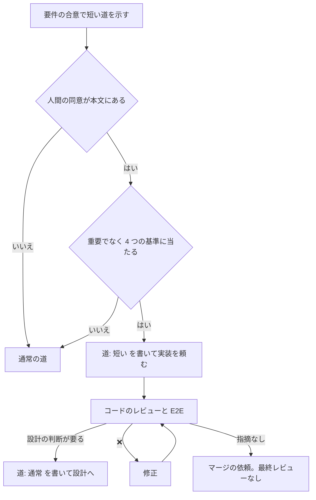

# スクワッドの Claude の使用量を減らす

1 つのタスクで使う Claude の使用量を、流れと文の両方から減らす。小さいタスクは設計と最終レビューを飛ばす短い道で進め、長い実行は作業の区切りで次の実行へ渡す。毎回読む文を半分以下にし、リーダーの CLI の呼び出しをまとめ、リーダーと Claude の修正の役の思考の深さを medium にする。

この文書は、7 つの変更の決めたことと理由、テスト、使用量の見積もりの測り方を書く。承認のときに人間が確認する 4 つの点は、[承認のときに確認すること](#承認のときに確認すること)にまとめた。

## 目的と範囲

目的は、タスクを止めずに、1 タスクあたりの Claude の使用量を減らすことである。実行ログの集計では、どの役も文脈が大きいまま呼び出しを重ねていた。毎回読む文が大きく、長い実行は圧縮を何度も挟んでいた。

この設計が決めるものは、次の 7 つである。番号は、合意した要件の番号に合わせた。

1. 小さいタスクの[短い道](#小さいタスクの短い道)
2. 長い実行の[区切り](#長い実行の区切り)
3. [読み方の 3 つの決まり](#読み方の決まり)
4. リーダーの[呼び出しのまとめ](#リーダーの呼び出しのまとめ)
5. 毎回読む文の[分け方と大きさの上限](#毎回読む文を軽くする)
6. リーダーと Claude の修正の役の[思考の深さ](#思考の深さ)
7. [使用量の見積もりと測り方](#使用量の見積もりと測り方)

次は対象にしない。

- 仕事を Codex へ移すこと。Codex の役の値と流れは変えない
- 原本の外の手元の設定。Claude Code のフックや、ホストの設定ファイルを含む
- マージのあとの使用量の測り直し。測り方だけを決める
- 圧縮の前（呼び出し 20 回ほど）で実行を区切ること
- 短い道からコードのレビューを外すこと

合意の記録と、集計の結果は、タスクのコメントにある。

## 承認のときに確認すること

人間が承認のときに確認する点は、次の 5 つである。4 つは合意で残った点で、5 つ目は設計の中で選んだ点である。

| 点 | 決めたこと | 詳しい節 |
| --- | --- | --- |
| Codex の役に区切りを入れるか | 入れない。Claude で動く実装・修正・設計の役だけにする | [区切りを Codex の役に入れない理由](#区切りを-codex-の役に入れない理由) |
| 手順を足す理由 | 要件 1〜4 の手順に、根拠・働いた跡・仕組みにしない理由を書いた | [手順を足す条件の記載](#手順を足す条件の記載) |
| ひな形の形式を変えるか | 変えない。今の front matter の条件の書き方で足りる | [ひな形の形式を変えない理由](#ひな形の形式を変えない理由) |
| 半分以下に届かないところ | 見張りの 3 役だけが届かない。ほかの 14 役とリーダーの場面は届く | [半分以下に届かない役](#半分以下に届かない役) |
| 見張りの 3 役に読み方の決まりを読ませるか | 読ませない。読み方の決まりの対象からも外す | [半分以下に届かない役](#半分以下に届かない役) |

### 区切りを Codex の役に入れない理由

区切りは、Claude で動く実装・修正・設計の役だけに入れる。Codex の役は、今の動きのまま変えない。理由は次の 5 つである。

1. 区切りの値は、Claude の実行ログから決めた。圧縮は文脈が約 11.7 万〜12.7 万トークンで起き、値はこの動きに合わせてある
2. Codex の実行ログは集計になく、同じ値が合うかを確認していない
3. 減らしたいのは Claude の使用量である。Codex の実行を区切っても、Claude の使用量は減らない
4. あとから入れるのは小さい変更で済む。区切りを使う役は、役の指示の 1 行で決まる（[区切りを使う役](#区切りを使う役)）
5. Codex の実行ログを集計したあと、値と合わせて入れるかを決められる

設計の役は、ランタイムに Claude があれば Claude で動き、Codex だけの構成では Codex で動く。そのため、設計の役の指示では、区切りの行を `<!-- IF runtime-claude -->` の中に置く。

### ひな形の形式を変えない理由

思考の深さの変更（要件 6）は、`common/agents/FORMAT` の今の書き方で書ける。front matter の中でも `<!-- IF runtime-claude -->` と `<!-- ELSE -->` が使え、セットアップは条件を当てたあとの `thinking_level` を登録する。リーダーの指示は、すでにこの形で Claude と Codex のモデルを書き分けている。

区切りの行と短い道の段落も、今の条件の書き方で置ける。拡張との契約、`skeleton/` の記入欄、オートパイロットの指示の形は変えない。

### 半分以下に届かない役

見張りの 3 役（`ci-monitor`、`usage-monitor`、`dependabot-merger`）は、半分以下に届かない。届く値は今の大きさのままで、次のとおりである。

| 役 | 届く値（バイト） | 半分の値（バイト） |
| --- | --- | --- |
| `ci-monitor` | 3,671 | 1,835 |
| `usage-monitor` | 3,380 | 1,690 |
| `dependabot-merger` | 5,080 | 2,540 |

3 役は共通スキルを持たず、毎回読む文は役の指示だけである。移す先の参照がないため、半分にするには規則を削るか、新しいスキルを割り当てることになる。規則は削らないと合意しており、スキルを割り当てると登録が変わり、毎回読む文がかえって増える。3 役は集計の実行にも出てこない。

同じ理由で、3 役は読み方の決まりの対象からも外す。決まりは共通スキルに置くので、3 役へ届けるには役の指示に写すしかない。写すと決まりが 2 か所になり、「1 か所に置く」に反する。3 役は決まったスクリプトを流す役で、大きなファイルを読まない。

残りの 14 役とリーダーの場面は、すべて半分以下に届く見込みである。値は[大きさの上限](#大きさの上限)の表にある。

## 小さいタスクの短い道

小さいタスクは、設計の役、設計の承認、最上位の役の最終レビューを飛ばす。コードのレビューと E2E は残し、人間のマージの判断へ回す。

短い道で進むのは、人間が同意し、リーダーが重要でないことを確認したタスクだけである。途中で設計の判断が要るとわかったら、設計から通常の道へ戻す。



### 小さいタスクの 4 つの基準

次の 4 つがすべて当たるタスクだけを小さいとする。1 つでも当たらないか、当たるかを決められなければ、通常の道にする。

1. 重要のマークがない
2. 契約・外部の I/F・データの形・権限を変えない
3. 設計の選択がなく、要件と受け入れ条件だけから実装を始められる
4. 実装が 1 つのフェーズで終わる見込みである

### 同意の記録

要件を決める役は、合意の問いで、4 つの基準に当たるタスクに「短い道」で進むかを尋ねる。人間が同意したら、タスクの本文の「受け入れ条件」の節の末尾に、次の 1 行を置く。

```text
道: 短い（人間の同意を得た）
```

同意がなければ、この行を置かない。行がないタスクは、要件を決める役がある構成では通常の道にする。

要件を決める役がない構成では、リーダーが同じ 4 つの基準で決める。このときの同意は、リーダーが合意の問いで尋ね、人間の返事のコメントで受ける。

### 道の記録

リーダーは、道を決めたら、自分のコメントに次の行を置く。`squad-review-next decide` は、この行で最終レビューを飛ばすかを決める。

| 行 | 置くとき |
| --- | --- |
| `道: 短い` | 短い道で実装を頼むコメント |
| `道: 通常` | 短い道から通常の道へ戻すコメント |

行の置き方は、ほかの制御の行と同じに、[読める本文](review-next-step.md#読める本文)の囲みの外の「ほかの行」とする。

リーダーは、`道: 短い` を書く前に、次のすべてを確認する。

1. 本文に `道: 短い（人間の同意を得た）` の行がある。要件を決める役がない構成では、人間の同意の返事がある
2. 本文の行の前に、要件を決める役が短い道を尋ねた問いがあり、そのあとに人間の返事がある。要件を決める役がない構成では、この確認は要らない
3. 重要のラベルがない
4. リーダー自身が、4 つの基準に当たると読む

どれかが当たらなければ、通常の道にする。本文は人間もほかの役も直せるので、本文の行だけでは信頼しない（[入力と信頼の表](#入力と信頼の表)）。

### 短い道の実装の依頼

短い道の実装の依頼は、設計の文書とフェーズの一覧を指さない。受け入れ条件を、そのまま確認する対象にする。成功の条件の表は作らない。

実装の役は、受け入れ条件ごとに確認した方法と結論を、引き継ぎの確認したことに書く。設計の判断が要るとわかったら、実装を止め、引き継ぎに次の行を置いてリーダーへ返す。

```text
設計の判断: 要る（<判断が要る点>）
```

### 通常の道へ戻す

次のどれかが起きたら、リーダーは `道: 通常` を書き、設計の役に設計を頼む。設計の承認から先は、通常の道のとおりに進める。

- 実装の役が `設計の判断: 要る` の行を返した
- レビューか E2E の結果に `設計への指摘: あり` がある。`decide` の表の 7 でリーダーが起きる
- 人間が重要のマークを付けた

積んだコミットは、設計の役が残すか戻すかを決める。

### 最終レビューを飛ばす条件

`decide` は、短い道のタスクでだけ、表の 9 の最終レビューの依頼を飛ばす。短い道とするのは、次の両方が当たるときである。

1. `analyze` の欄 `short_path` が `true` である
2. 重要のラベルがない。ラベルは `decide` がその場で読み、読めなければ今のとおり失敗で終わる

`short_path` は、リーダーのコメントのうち、`道:` で始まる行を持つ最も新しいものの値が `短い` なら `true` にする。行がない、値が読めない、最新が `通常` のときは `false` にする。リーダーのコメントの見分け方は、[decide-record-read.md の記録の読み方](decide-record-read.md#記録の読み方)の 3 つの条件と同じにする。

欄がないか読めないときは、`decide` は失敗で終わる。最終レビューを飛ばす側に誤らないためである。

マージの依頼の確認の 2 は、短い道では、PR の今の head を組の `確認するコミット:` と照合する。マージを頼むコメントには、`前の回:` の行のあとに `道: 短い（最終レビューなし）` の行を置く。人間が、最上位の役が見ていないことを読めるようにするためである。

### 道ごとの工程

短い道で飛ばすのは、設計に関わる工程と最終レビューだけである。

| 工程 | 通常の道 | 短い道 |
| --- | --- | --- |
| 要件の合意 | する | する。短い道への同意も受ける |
| 最上位の役の要件の見直し（要件を決める役がない構成） | する | する |
| 設計と設計の承認 | する | しない |
| 重要なタスクの設計の見直し | する | 当たらない。重要なタスクは短い道にしない |
| 実装 | フェーズごと | 1 つのフェーズ |
| コードのレビューと E2E | する | する |
| 最上位の役の最終レビュー | する | しない |
| 人間のマージの判断 | する | する |

## 長い実行の区切り

Claude で動く実装・修正・設計の役は、呼び出しが 100 回か、圧縮が 3 回の、早い方で区切る。区切るのは作業の区切りだけで、引き継ぎのコメントを書いたあと、同じ役の続きの実行を起こして終わる。リーダーの実行は挟まない。

### 区切りの値

値は、共通スキルの参照に置く値のファイル `run-cut-values` の 1 か所にする。役の指示と共通スキルの本文には、値を書かない。

```text
CALLS=100
COMPACTIONS=3
MAX_CONSECUTIVE=5
```

| キー | 意味 |
| --- | --- |
| `CALLS` | 区切る呼び出しの回数。今の実行の道具の呼び出しの数で数える |
| `COMPACTIONS` | 区切る圧縮の回数 |
| `MAX_CONSECUTIVE` | 続けて区切ってよい回数。超えたら区切らずリーダーへ返す |

値を変えると、`squad-run-cut check` の判定が変わる。測り直したあとは、このファイルだけを直す。

100 回と 3 回は、集計から選んだ。実装の役は、100 回を超えた先で役のトークンの 51% を使い、4 回目の圧縮から先で 46% を使う。60 回にすると、設計の役の実行の 61% が区切りに当たり、引き継ぎの読み直しが増える。

### 区切りを使う役

区切りを使う役は、役の指示に、共通スキルの「実行の区切り」に従う 1 行を持つ役である。今は次の 3 役にする。

| 役 | 置き方 |
| --- | --- |
| `claude-implementer` | 条件なしで置く |
| `claude-fixer` | 条件なしで置く |
| `designer` | `<!-- IF runtime-claude -->` の中に置く |

### 区切りの判定

役は、作業の区切りに来るたびに、`squad-run-cut check` を流して区切るかを決める。呼び出しの数はスクリプトが数え、圧縮の数は役が数えて渡す。

```text
squad-run-cut check <タスク> <自分のエージェントの ID> <圧縮の回数>
```

- スクリプトは、`multica issue runs <タスク> --active` から自分のエージェントの動いている実行を選ぶ。`multica issue run-messages` の `tool_use` の数を、呼び出しの数とする
- 出力は `区切り: <要る | 要らない> 呼び出し=<数> 圧縮=<数>` の 1 行で、終了コード 0 にする
- 実行を選べないか、メッセージを読めないときは、呼び出しを数えずに圧縮の数だけで決め、`呼び出し=未確認` と出す
- 使い方の誤りは終了コード 2 にする

圧縮の数は、役が、実行の中で受け取った「前の会話の要約」の数で数える。圧縮のあとに要約を読み、そこに書かれた回数に 1 を足す。

作業の区切りは、ブランチを壊れた状態で残さない点にする。

| 役 | 作業の区切り |
| --- | --- |
| 実装の役 | テストと lint が通る状態でコミットを push したあと |
| 修正の役 | 1 件の指摘の直しを push したあと |
| 設計の役 | 設計の文書の節を push したあと。draft PR がまだなければ、作ったあと |

### 区切りの引き継ぎ

区切るときは、引き継ぎのコメントを書いて `squad-run-cut post` で投稿する。スクリプトは、行を確認して投稿し、自分を起こす起こしを作る。

```text
区切り: <続けて区切った回数> 回目
済んだこと: <push したコミットと、終えた作業>
残り: <残っている作業>
次に読む場所: <ファイルと節、コメント、PR のコメント>
```

```text
squad-run-cut post <タスク> <ファイル> <自分のエージェントの ID> [--parent <コメントの ID>]
```

- 4 つの行のどれかがないか、空のときは、投稿せずに終了コード 2 で止まる
- コメントには、スクワッドもリーダーもメンションしない
- 続けて区切った回数は、きっかけのコメントより後に同じ役が書いた `区切り:` のコメントの数で数える
- 回数が `MAX_CONSECUTIVE` に届いたら、投稿も起こしも作らず、終了コード 4 で止まる。役は、通常の引き継ぎでリーダーへ返す
- 起こしは `multica issue wakeup create <タスク> --kind at --after 1m --agent-id <自分のエージェントの ID> --instruction-file <ファイル>` で作る。`--parent` は、きっかけのコメントのスレッドにする
- 起こしの指示は、`区切りの続きで起きました。` で始め、区切りのコメントの ID を続ける
- 出力は `投稿: <コメントの ID>` と `起こし: <起こしの ID>` の 2 行で、終了コード 0 にする。投稿のあとに起こしを作れなければ、終了コード 3 で止まる

終了コード 3 のとき、役は起こしを作れなかったことを書いた通常の引き継ぎで、リーダーへ返す。

### 続きの実行

`区切りの続きで起きました。` で起きた実行は、同じ役のまま、区切りのコメントから続ける。リーダーの依頼は読み直さず、区切りのコメントの「次に読む場所」から読む。

続きの実行も、区切りの判定を同じ値で流す。最後に作業を終えた実行が、通常の引き継ぎでリーダーへ返す。

## 読み方の決まり

読み方の 3 つの決まりは、共通スキルの毎回読む部分の「読み方」の節の 1 か所に置く。共通スキルを持つすべての役が読む。

1. 大きいファイルは、`grep` か行の範囲で、要る所だけを読む。目安は 300 行を超えるファイルである
2. 同じ実行の中で、同じファイルを読み直さない。自分で書き換えたあとと、圧縮のあとに要る所だけを読むのは除く
3. `multica` の CLI の出力は、`--compact`、`--summary`、`jq` で要る欄に絞る

役の指示とリーダーの参照にある、同じ趣旨の文は、この節へのリンクに置き換える。見張りの 3 役は対象外である（[半分以下に届かない役](#半分以下に届かない役)）。

## リーダーの呼び出しのまとめ

リーダーが毎回組み合わせて流す読み取りと書き込みを、2 つのスクリプトにまとめる。どちらも、既存の `squad-` のスクリプトと同じ置き場所と配り方にする。`squad-preflight` の確認と終了コードは変えない。

### squad-task-read

```text
squad-task-read <タスク> [--since <RFC3339>]
```

タスク・コメントの差分・PR・CI・実行の状態を、1 つの JSON で出す。PR のないタスクでも動き、`pr` と `ci` を `null` にする。

| 欄 | 中身 |
| --- | --- |
| `schema_version` | `1` |
| `task` | ID・識別子・タイトル・状態・ラベル・metadata（`repository`・`branch`・`pr_url` ほか）・担当 |
| `comments` | `--since` より後のコメントの、ID・親の ID・作者の種類と ID・時刻・本文。`--since` がなければ全件 |
| `pr` | metadata の `pr_url` の PR の、URL・状態・draft か・head の SHA・マージの可否。`pr_url` がなければ `null` |
| `ci` | PR の head のチェックの名前と結論。PR がなければ `null` |
| `runs` | 実行の ID、エージェントの ID、状態、始まりの時刻 |
| `errors` | 読めなかった欄の名前と理由の配列 |

タスクを読めないときは、終了コード 1 にする。PR か CI か実行を読めないときは、その欄を `null` にして `errors` に理由を足し、終了コード 0 にする。使い方の誤りは 2 にする。

PR と CI の読み取りは GitHub への読み取りなので、リーダーが実行の始めに流した `squad-preflight` のあとに使う。

### squad-task-post

```text
squad-task-post <タスク> --status <状態> --content-file <ファイル> [--parent <コメントの ID>]
```

コメントを投稿してから、状態を変える。状態を変えた理由が、いつもコメントに残るようにするためである。

| 結果 | 出力 | 終了コード |
| --- | --- | --- |
| 両方できた | `投稿: <コメントの ID>` と `状態: <前> -> <後>` | 0 |
| 投稿できなかった | 標準エラーに理由。状態は変えない | 1 |
| 使い方の誤り | 標準エラーに使い方 | 2 |
| 投稿のあと、状態を変えられなかった | `投稿: <コメントの ID>` と、標準エラーに理由 | 3 |

終了コード 3 のときは、リーダーが状態の変更だけを `multica issue status` で流し直す。投稿を流し直すと、同じコメントが 2 つになるためである。

### リーダーの指示での使い方

リーダーの指示の「始めに確認すること」は、タスクとコメントと PR と実行の読み取りを `squad-task-read` の 1 回にする。人間を呼んで止まるときと、状態を変えて結果を書くときは、`squad-task-post` を使う。決まった行を読む見張りのスクリプト（`squad-pr-watch` など）は、そのまま使う。

## 毎回読む文を軽くする

役が毎回読む文を、常に読む部分と、要るときに読む部分に分ける。規則は削らずに移す。

毎回読む文は、役の指示と、共通スキル squad-handoff の本体（`SKILL.md`）である。プロジェクトの検証のスキルは、導入先が記入するので数えない。

### 共通スキルの分け方

`SKILL.md` を、どの役も毎回要る決まりだけにし、16,000 バイト以下にする。ほかの節は、`references/` の参照のファイルへ移す。`SKILL.md` の末尾に、場面から参照を引く索引を置く。

| 置き場所 | 節 |
| --- | --- |
| `SKILL.md`（常に読む） | 表のあとに並べる 12 の節 |
| `references/repo-target.md` | タスクの作業先を決める |
| `references/writing-forms.md` | コメントと本文の型、タスクの本文、本文の書き方と引き継ぐときの見本 |
| `references/pr.md` | 「PR を作る・実装を積む」「PR の本文の置き場所と順序」「PR にレビューやテストの結果を書く」「PR の状態を書く」「画像を載せる」 |
| `references/review-reply.md` | レビューと E2E の返事を返す |
| `references/human-ops.md` | 人間に操作を頼む前に、更新を知らされたときに照合する |
| `references/missing-fill.md` | 記入が足りずに止まるとき |
| `references/new-task.md` | 新しいタスクを作るとき、サブエージェント |

`SKILL.md` に残す 12 の節は、次のとおりである。

1. このプロジェクトの値
2. 実行の始めの確認
3. 書き込んでよいリポジトリ
4. タスクの状態と担当
5. 呼ぶ人間
6. 本文の書き方（見本を除く）
7. タスクのコメントを書く
8. 引き継ぐとき（見本を除く）
9. 人間を呼んで止まるとき
10. 読み方
11. 実行の区切り
12. 場面と参照の索引

索引は、「この場面に入ったら、この参照を読む」を 1 行ずつ並べる。場面は次の 8 つである。

1. 作業先を決める
2. PR を作る・積む
3. 結果を PR に書く
4. レビューの返事を返す
5. 人間に操作を頼む
6. 照合する
7. 記入が足りない
8. タスクを作る

役の指示が今 `SKILL.md` の節を名前で指している所は、参照のファイルの節を指すように直す。節の名前は変えない。

### リーダーの参照の分け方

リーダーの参照を、場面ごとに読むファイルが半分以下になるよう分ける。リーダーの指示の「場面と手順」の表も、分けた場面に合わせて細かくする。

| 今のファイル | 分けたあとのファイル | 移す節 |
| --- | --- | --- |
| `leader-flow.md` | `leader-request.md` | 作業先・複数のリポジトリ・要件と設計・フェーズを頼む・依頼の書き方・短い道 |
| | `leader-design-diff.md` | 設計との差の扱い（`leader-dispatch.md` の設計との差も合わせる） |
| | `leader-fix-request.md` | 自動の依頼の数え方、修正の依頼の前に確認する順 |
| | `leader-repeat.md` | 同じ誤りの残りの節 |
| `leader-dispatch.md` | `leader-dispatch.md` | 設計との差のほかは変えない |
| `leader-principal.md` | `leader-principal.md` | 重要のマーク・時機・記録・手戻り・修正の依頼の数え方 |
| | `leader-principal-pick.md` | 返事の待ち方、最上位の役の選び方 |
| | `leader-principal-design.md` | 要件の見直し・設計の見直し・設計の役がない構成とその設計の直し・手戻りと重なる |
| | `leader-principal-final.md` | 設計と PR の見直し・最終レビュー・セキュリティ・2 つの役の結果・見る範囲 |
| | `leader-principal-diagnose.md` | 診断を頼む |
| | `leader-principal-reshow.md` | 見せ直し、設計を承認し直したとき |
| `leader-review-wait.md` | `leader-review-request.md` | 役がない、依頼、照合、ほか |
| | `leader-review-reply.md` | 返事で起きたとき（進むとき） |
| | `leader-review-stuck.md` | `decide` が決められないときの理由の表 |
| `leader-pr-checks.md` | `leader-pr-link.md` | 紐付け、食い違い |
| | `leader-pr-ci.md` | 知らせ、起きたときの確認、CI、その場の確認 |
| | `leader-pr-merge.md` | マージの前・コンフリクト・規則・マージ待ち・人間を呼ぶコメントに添える行 |
| `leader-run-status.md` | `leader-run-status.md` | 状態、起きたときの確認、方針を変える追加 |
| | `leader-run-stop.md` | 実行の停止、止めたあと |

1 つの場面は、決まった参照だけを読む。場面の中で止まる値が出て別の手順が要るときは、別の場面に移り、その場面の参照を読む。たとえば、マージへ回す場面で `link-check` が食い違いを出したら、食い違いの場面へ移る。

### 大きさの上限

上限は、作業を始めたときの main の大きさの半分（切り捨て）にする。基準の大きさは、テストのフィクスチャに固定する。

役の毎回読む文の基準は、役の指示と `SKILL.md`（51,211 バイト）の和である。見込みは、`SKILL.md` を 16,000 バイトとし、役の指示に足す行を含めた値である。

| 役 | 基準 | 上限 | 見込み |
| --- | --- | --- | --- |
| `claude-principal` | 68,120 | 34,060 | 33,000 前後 |
| `codex-principal` | 68,116 | 34,058 | 33,000 前後 |
| `codex-fixer` | 67,404 | 33,702 | 32,300 前後 |
| `claude-fixer` | 67,323 | 33,661 | 32,300 前後 |
| `codex-implementer` | 66,903 | 33,451 | 32,500 前後 |
| `claude-implementer` | 66,822 | 33,411 | 32,500 前後 |
| `orchestrator` | 64,938 | 32,469 | 31,300 前後 |
| `designer` | 63,802 | 31,901 | 28,800 前後 |
| `security-reviewer` | 60,891 | 30,445 | 25,700 前後 |
| `code-reviewer` | 60,076 | 30,038 | 24,900 前後 |
| `qa` | 58,736 | 29,368 | 23,600 前後 |
| `ux-reviewer` | 58,324 | 29,162 | 23,100 前後 |
| `performance-reviewer` | 57,591 | 28,795 | 22,400 前後 |
| `planner` | 55,580 | 27,790 | 21,200 前後 |

リーダーの場面の基準は、その場面が今読む参照の和である。分けた場面は、もとの場面の基準を引き継ぐ。見込みは、移す節の今の大きさの和である。

| 場面 | 読む参照 | 基準 | 上限 | 見込み |
| --- | --- | --- | --- | --- |
| 新しい要望・作業先・要件・設計・フェーズ | `leader-request.md` | 40,052 | 20,026 | 10,200 前後 |
| 設計との差 | `leader-design-diff.md` | 40,052 | 20,026 | 2,700 前後 |
| 実装・修正の依頼、使用率の待ち | `leader-dispatch.md`、`leader-fix-request.md`、`leader-principal.md` | 112,327 | 56,163 | 37,000 前後 |
| 重要の判断 | `leader-principal.md` | 62,169 | 31,084 | 17,000 前後 |
| 最上位の役に要件・設計の見直しを頼む | `leader-principal-design.md`、`leader-principal-pick.md` | 62,169 | 31,084 | 21,000 前後 |
| 最上位の役に最終レビューを頼む | `leader-principal-final.md`、`leader-principal-pick.md` | 62,169 | 31,084 | 23,000 前後 |
| 最上位の役に診断を頼む | `leader-principal-diagnose.md`、`leader-principal-pick.md` | 62,169 | 31,084 | 10,000 前後 |
| 設計を承認し直した・見せ直す | `leader-principal-reshow.md`、`leader-principal-pick.md` | 62,169 | 31,084 | 11,000 前後 |
| レビュー・E2E の依頼 | `leader-review-request.md` | 8,148 | 4,074 | 3,300 前後 |
| レビュー・E2E の返事で起きた | `leader-review-reply.md` | 8,148 | 4,074 | 2,000 前後 |
| `decide` が決められない | `leader-review-stuck.md` | 8,148 | 4,074 | 2,700 前後 |
| PR を受け取る・食い違い | `leader-pr-link.md` | 26,430 | 13,215 | 5,500 前後 |
| CI の知らせ・その場の確認 | `leader-pr-ci.md` | 26,430 | 13,215 | 11,400 前後 |
| マージへ回す・人間を呼ぶ | `leader-pr-merge.md` | 26,430 | 13,215 | 9,000 前後 |
| 進捗・遅れ・方針を変える追加 | `leader-run-status.md` | 12,578 | 6,289 | 6,100 前後 |
| 実行の停止 | `leader-run-stop.md` | 12,578 | 6,289 | 5,800 前後 |
| PR があり、ほかのきっかけ | `leader-pr-ci.md`、`leader-run-status.md` | 39,008 | 19,504 | 17,500 前後 |
| 同じ失敗が続く | `leader-repeat.md`、`leader-principal.md`、`leader-principal-diagnose.md` | 102,221 | 51,110 | 41,000 前後 |

診断を頼む手順は、最終レビューと分けて `leader-principal-diagnose.md` に置く。同じ失敗の場面が最終レビューの参照まで読むと、見込みが 63,000 前後になり上限を超えるためである。

`leader-run-status.md` は、上限との差が 1 割に満たない。実装で足す文は、ほかの参照に置く。

### 大きさのテスト

`tests/base-size-test.sh` を足し、上限を超えたら落ちるようにする。

1. フィクスチャ `tests/fixtures/base-size/baseline.tsv` に、役と場面ごとの基準の大きさを置く。値は、作業を始めたときの main（`491bef8`）で測った値である
2. 役ごとに、役の指示と `SKILL.md` のバイト数の和を求め、基準の半分（切り捨て）以下かを見る。見張りの 3 役は、フィクスチャで対象外と書く
3. リーダーの指示の「場面と手順」の表を読み、行ごとに「読む参照」のファイルのバイト数の和を求める。フィクスチャにない場面の行があれば落ちる
4. 落ちるときは、役か場面、今の大きさ、上限を出す

役の指示のバイト数は、条件を当てる前の原本のファイルで数える。条件を当てたあとは構成ごとに大きさが変わり、比べる基準が決まらないためである。

### 規則を残す確認

分けたあとも、分ける前のすべての規則が、常に読む部分か要るときに読む部分のどちらかに残っていることを、テストで確認する。

`tests/fixtures/base-size/rules.tsv` に、分ける前の `SKILL.md` とリーダーの参照の、見出しと固定の行（`確認したコミット:` など）の一覧を置く。テストは、一覧のどれもが分けたあとのどこかのファイルに 1 回だけあることを見る。2 回以上あれば、決まりを写したとして落とす。

## 思考の深さ

Claude で動くリーダーと修正の役の思考の深さを、high から medium にする。QA は今のまま medium で、Codex で動く役の値は変えない。

| 役 | ランタイム | 前 | 後 |
| --- | --- | --- | --- |
| `orchestrator` | Claude | high | medium |
| `orchestrator` | Codex | high | high |
| `claude-fixer` | Claude | high | medium |
| `qa` | Claude | medium | medium |
| `codex-fixer` | Codex | 変えない | 変えない |

リーダーの front matter は、今の `IF runtime-claude` の枝の `thinking_level` を medium にし、`ELSE` の枝は high のまま残す。

```text
<!-- IF runtime-claude -->
model: claude-sonnet-5-5
thinking_level: medium
<!-- ELSE -->
model: gpt-6.2-sol
thinking_level: high
<!-- ENDIF -->
```

`claude-fixer` は、Claude にしか置かない役なので、`thinking_level: medium` にする。

high にした理由は、原則の判断に考える量を回すためだった（[leader-principles.md のモデルと思考の深さ](leader-principles.md#モデルと思考の深さ)）。今回は使用量を減らすことを先にし、判断が浅くなっていないかは、リーダーの評価の場面を medium で流して確認する。修正の役は、レビューの指摘が場所と直し方を示すので、考える量を減らしても直せる見込みである。

導入済みのプロジェクトは、セットアップを流し直すと、登録の思考の深さが medium に変わる。

## 手順を足す条件の記載

この変更は、[手順を足す条件](../CONTRIBUTING.md#手順を足す条件)の範囲のファイル（役のひな形と共通スキル）に、要件 1〜4 の手順を足す。根拠は 4 つとも、合意された要件による新しい手順なので、要件の合意を失敗の記録に代える。合意の記録はタスクのコメントにある。

働いた跡は、[跡の形](procedure-review.md#跡の形)のどれかで書く。仕組みにしない理由は、手順ごとに表で書く。

### 要件 1 の短い道

働いた跡は、リーダーのコメントの `道: 短い` の行である。

| 項目 | 値 |
| --- | --- |
| 形 | `kind: "comment"` |
| `pattern` | `(?m)^道: 短い` |
| `author_type` | `agent` |

仕組みが止める範囲と、手順に残す範囲は分けた。最終レビューを飛ばすかは、`decide` が記録とラベルから決める（仕組み）。4 つの基準に当たるかの判断と、人間の同意の確認は、要件を決める役とリーダーの手順に残す。

| 案 | 選ばなかった理由 |
| --- | --- |
| `decide` が PR の差分の行数やファイルの数で、小さいタスクを決める | 差分が小さくても、契約や権限を変えるものと、設計の選択があるものを見分けられない |
| 人間が付けるラベルで短い道を決め、役は判断しない | ラベルはほかの役も付けられる。要件を決める役が問わなければ、人間は基準に当たるかを知らないまま付けることになる |

### 要件 2 の区切り

働いた跡は、区切った役のコメントの `区切り:` の行である。

| 項目 | 値 |
| --- | --- |
| 形 | `kind: "comment"` |
| `pattern` | `(?m)^区切り: [0-9]+ 回目` |
| `author_type` | `agent` |

仕組みが止める範囲と、手順に残す範囲は分けた。呼び出しの数え方・値との比べ方・引き継ぎの行の確認・続きの起こしは、`squad-run-cut` がする（仕組み）。作業の区切りを選ぶこと・圧縮を数えること・引き継ぎの中身を書くことは、役の手順に残す。

| 案 | 選ばなかった理由 |
| --- | --- |
| Claude Code のフックが呼び出しを数え、100 回で実行を止める | フックは原本の外の手元の設定で、合意で対象外にした。止めた所が編集の途中かテストが通った後かを見分けられず、壊れたブランチを残す |
| Multica の実行の上限で止める | 原本から設定できない。止まる所が作業の区切りかを見分けられず、引き継ぎのコメントも残らない |

### 要件 3 の読み方の決まり

働いた跡は、コメント・状態の変化・実行の形では残らない。跡の定義は `trace: null` にし、見直しでは「判定できない」になる。効いたかは、要件 7 の測り方の集計で、同じファイルの読み直しの数と、1 回の呼び出しの文脈の大きさを人間が見る。

仕組みが止める範囲と、手順に残す範囲は分けた。リーダーの CLI の読み取りは、`squad-task-read` が要る欄に絞って出す（仕組み）。ほかの役の、ファイルと CLI の読み方は、手順に残す。

| 案 | 選ばなかった理由 |
| --- | --- |
| フックで、同じファイルの 2 回目の読み取りと、大きいファイルの全体の読み取りを止める | フックは原本の外の手元の設定で、合意で対象外にした。書き換えたあとや圧縮のあとの、要る読み直しを見分けられず、誤って止める |
| すべての CLI の呼び出しを、絞って出すスクリプトに包む | 役ごとに要る欄が違い、決まった欄に絞ると要る値を落とす。リーダーの決まった読み取りだけを `squad-task-read` に包んだ |

### 要件 4 のまとめた呼び出し

働いた跡は、コメント・状態の変化・実行の形では残らない。跡の定義は `trace: null` にし、見直しでは「判定できない」になる。手順は、今ある読み取りと書き込みの手順を、スクリプトの呼び出しに置き換えるもので、まとめた読み取りと書き込みそのものが仕組みである。

| 案 | 選ばなかった理由 |
| --- | --- |
| リーダーの指示を変えず、スクリプトだけを足す | リーダーは指示にある呼び出しを流すので、スクリプトがあっても使われない |

## 入力と信頼の表

短い道は、最終レビューというガードを飛ばすので、飛ばす判断が読む入力の書き手を確認する。区切りの続きも、同じ役が続きを始める入力を確認する。

| 入力（誰が書いた何か） | 読むところ | 信頼する条件 | 合わないとき |
| --- | --- | --- | --- |
| タスクの本文の `道: 短い（人間の同意を得た）` の行（要件を決める役が書く。人間もほかの役も本文を直せる） | リーダーが `道: 短い` を書く前の確認 | 要件を決める役が短い道を尋ねた問いがあり、そのあとにメンバーの返事がある。重要のラベルがなく、リーダーが 4 つの基準に当たると読む | 通常の道にする |
| リーダーのコメントの `道: 短い`・`道: 通常` の行（ほかの役や人間も同じ形の行を書ける） | `decide` の `short_path` | 作者の種類がエージェントで、作者の ID が名簿のリーダーで、読める本文の囲みの外の「ほかの行」にある。最も新しいものだけを使う | 読まずに飛ばし、通常の道（最終レビューを頼む）にする |
| 重要のラベル（人間とリーダーが付ける） | `decide` が短い道かを決めるとき | その場で読めた | 読めなければ `decide` は失敗で終わり、何も書かない |
| `analyze` の出力の `short_path` の欄 | `decide` の表の 9 とマージの依頼の確認の 2 | 欄がある | `decide` は失敗で終わり、何も書かない |
| 実装の役の `設計の判断: 要る` の行（ほかの役も書ける） | リーダーが通常の道へ戻すとき | 作者が、そのタスクで実装を頼んだ役である | 読まずに飛ばす。戻す側の判断なので、迷ったら通常の道に戻す |
| `区切り:` のコメント（ほかの役や人間も同じ形の行を書ける） | 続きの実行が、どこから続けるかを読むとき。`squad-run-cut post` が続けて区切った回数を数えるとき | 作者が自分のエージェントで、起こしの指示が指すコメントの ID と同じ | 読まずに飛ばし、通常の引き継ぎでリーダーへ返す |
| 起こしの指示の `区切りの続きで起きました。` の行（起こしを作れる人が書ける） | 続きの実行の始め | 起こしの指示が指すコメントが、上の条件を満たす | 続けず、通常の引き継ぎでリーダーへ返す |

## 使用量の見積もりと測り方

見積もりは、作業を始める前の 2 週間の実行ログの集計を前とし、変更ごとの減る割合を掛け合わせて後とする。1 タスクあたりの使用量を、前を 100 として表す。

### 測り方

測り方は、前の集計と同じ実行ログの集計である。Claude の実行ログを役ごとに集め、呼び出しごとの入力（キャッシュの書き込みと読み出しを含む）を足したトークンを使用量とする。1 タスクあたりの値は、期間のトークンの和を、期間に実行のあったタスクの数で割る。

マージのあとに同じ集計を同じ長さの期間で流せば、前と後を比べられる。測り直しは、この設計の対象にしない。

### 見積もり

集計の前の値は、実行 542 件、呼び出し 43,401 回、トークン約 35.2 億である。日本語の文は、1 バイトを約 0.3 トークンとして換算した。

| 変更 | 減る分の見積もり | 根拠 |
| --- | --- | --- |
| 毎回読む文を半分以下 | 全体の 8% | 1 回の呼び出しで約 1 万トークン減る。平均の文脈は約 8 万で、圧縮のあとは減る分が小さいので、12% を割り引いた |
| リーダーの場面の参照 | 全体の 3.5% | 実装・修正の依頼の場面で、参照が約 112,000 から約 37,000 バイトになる。リーダーの使用量 25.6% の約 14% |
| 長い実行の区切り | 全体の 9% | 100 回を超えた先のトークン（実装 51%、設計 24%、修正 33%）の 4 割。続きの実行は文脈が小さく始まる |
| 短い道 | 全体の 7% | 小さいタスクを 3 割と仮定した。設計の役 21.2% と、最上位の役 5.8% の半分を、その割合だけ減らす |
| 呼び出しのまとめ | 全体の 2% | リーダーの 1 回の実行で、呼び出しが 5 回ほど減る |
| 思考の深さ | 数えない | 思考は出力のトークンで、入力を数えるこの集計には出ない |

変更の効き目は重なるので、残る割合を掛け合わせる。後は 100 × 0.92 × 0.965 × 0.91 × 0.93 × 0.98 で、約 73 になる。小さいタスクの割合は仮定なので、1 割なら約 77、5 割なら約 70 になる。

## 文書と指示の変更

この文書のほかに、次のファイルを変える。

| ファイル | 変えること |
| --- | --- |
| `common/skills/squad-handoff/SKILL.md` | [共通スキルの分け方](#共通スキルの分け方)のとおり分け、読み方と実行の区切りの節と、場面の索引を足す |
| `common/skills/squad-handoff/references/` の参照 | 共通スキルとリーダーの参照を、表のとおりに分ける。リーダーの参照に短い道を足し、まとめた呼び出しを使う |
| `common/skills/squad-handoff/references/run-cut-values` | 新しく足す |
| `common/skills/squad-handoff/references/squad-run-cut`、`squad-task-read`、`squad-task-post` | 新しく足す |
| `common/skills/squad-handoff/references/squad-review-next` | `analyze` の欄 `short_path`、表の 9、マージの依頼の確認の 2、マージを頼むコメントの行 |
| `common/agents/orchestrator.md` | 思考の深さ、場面と手順の表、始めの確認でまとめた呼び出しを使う、短い道の確認 |
| `common/agents/claude-fixer.md` | 思考の深さ、区切りの行 |
| `common/agents/claude-implementer.md` | 区切りの行、短い道の実装と `設計の判断:` の行 |
| `common/agents/codex-implementer.md` | 短い道の実装と `設計の判断:` の行 |
| `common/agents/designer.md` | `IF runtime-claude` の中に区切りの行 |
| `common/agents/planner.md` | 合意の問いで短い道を尋ね、同意を本文に残す |
| 役の指示のうち、共通スキルの節を名前で指すもの | 移した先の参照を指す |
| `tests/` | [テスト](#テスト)の確認を足し、思考の深さの期待を直す |
| `docs/principal-review.md`、`docs/review-next-step.md`、`docs/decide-record-read.md`、`docs/leader-principles.md` | 短い道と思考の深さに合わせて直した。この文書と同じコミットで直した |
| `docs/README.md` | 索引の「役の指示と、タスクが進む流れ」の表に、この文書の行を足した |
| `MANIFEST` | `bash scripts/manifest.sh` で作り直す |

`VERSION` と `CHANGELOG.md` は、バージョンを上げる PR で書く。

## 互換性と影響を受ける利用者

導入済みのプロジェクトは、ホストでセットアップを流し直すと、新しい指示とスキルと登録になる。流し直すまでは、前の指示のままで動く。

| 利用者 | 変わること |
| --- | --- |
| 導入済みのプロジェクトの担当 | 流し直すと、リーダーと Claude の修正の役の思考の深さが medium に変わる。小さいタスクでは、要件の合意のときに短い道を尋ねられ、マージの依頼に最終レビューなしの行が付く |
| 原本を変える人 | `SKILL.md` とリーダーの参照に文を足すときは、役ごとと場面ごとの上限を守る。超えるとテストが落ちる |
| 拡張を書く人 | 拡張との契約は変わらない。`SKILL.md` の節を名前で指していた拡張は、移した先の参照の節を指す |

エージェントの数と登録の名前、スクワッド、オートパイロットは変わらない。登録で変わるのは、2 つの役の思考の深さだけである。

区切りの続きは起こしで始まるので、流し直した直後から、区切りを使う役の実行に起こしが付く。起こしは、作った役の実行が始まったあとに消える。

## テスト

関連テストを足し、直す。どれも `bash tests/run.sh tests/<テスト>.sh` で流す。

| テスト | 確認すること |
| --- | --- |
| `tests/base-size-test.sh`（新しく足す） | 役と場面の大きさが上限以下で、フィクスチャにない場面で落ちる。規則の一覧がどこかに 1 回だけある |
| `tests/agent-templates-test.sh` | Claude のリーダーと修正の役が medium、Codex のリーダーが high、QA が medium。区切りの行が 3 役にだけあり、設計の役では `IF runtime-claude` の中にある |
| `tests/project-runtimes-test.sh`、`tests/project-runtimes-first-test.sh`、`tests/setup-runtimes-test-lib.sh` を使うテスト | 流し直しで、2 つの役の登録の思考の深さが medium になる |
| `tests/squad-run-cut-test.sh`（新しく足す） | 呼び出しと圧縮のどちらかが値に届くと `要る` で、値のファイルを変えると判定が変わる。行の欠けで投稿せず、上限の回数で終了 4 になり、起こしを正しい引数で作る |
| `tests/squad-task-read-test.sh`（新しく足す） | 1 つの JSON に欄がそろい、PR のないタスクで `pr` と `ci` が `null` になる。読めない欄が `errors` に出る |
| `tests/squad-task-post-test.sh`（新しく足す） | 投稿のあとに状態が変わり、投稿の失敗で状態を変えない。状態の失敗で終了 3 になる |
| `tests/squad-review-next-decide-final-test.sh` | `short_path` が `true` で重要のラベルがなければ、最終レビューを頼まずマージの依頼へ進む。ラベルがあれば頼む |
| `tests/squad-review-next-decide-control-test.sh` | リーダー以外が書いた `道: 短い` を読まず、最新の `道: 通常` で `false` になる。欄がなければ失敗で終わる |
| `tests/squad-review-next-decide-merge-test.sh` | 短い道で、head を組のコミットと照合し、マージを頼むコメントに `道: 短い（最終レビューなし）` の行がある |
| `tests/squad-preflight-test.sh` | 変えずに通る |

## 残る危うさ

- 短い道のタスクは、最上位の役が見ないまま人間へ回る。マージを頼むコメントの行で、人間が見分ける
- 4 つの基準の判断を誤ると、設計の要るタスクが短い道に入る。実装の役とレビューの返しで通常の道へ戻すが、積んだコミットの手戻りが出る
- 区切りの続きは、起こしの時刻に使用率が上限に近くても始まる。そのときは、今の使用率の決まりで止まる
- 圧縮の数は役が数えるので、数え間違えると区切りが遅れる。呼び出しの数はスクリプトが数えるので、区切りが無くなることはない
- 思考の深さを medium にしたリーダーが、原則の判断を浅く済ませることがある。評価の場面で確認するが、評価にない場面は残る
- 見積もりの小さいタスクの割合は仮定である

## 検討した案

| 案 | 選ばなかった理由 |
| --- | --- |
| 短い道でもコードのレビューを外す | 合意で対象外にした。最上位の役も設計の役も見ないので、レビューまで外すと誰も見ないまま人間へ回る |
| 短い道の記録を、タスクの metadata に置く | metadata はほかの役も書け、書き手を確認できない。コメントなら作者を確認でき、今の制御の行と同じ読み方で読める |
| 区切りの値を、役の指示に書く | 値が役の数だけ写る。直すときにどれかを直し忘れる |
| 区切りの続きを、リーダーが頼む | リーダーの実行が 1 回増え、その分の使用量が増える |
| 呼び出しの数を、役が自分で数える | 圧縮のあとは前の回数が分からない。実行のメッセージの数はスクリプトで読める |
| 共通スキルを、役ごとのスキルに分ける | 登録とスキルの割り当てが変わり、合意の範囲を超える。同じ決まりが役ごとに写る |
| 見張りの 3 役に、読み方の決まりを写す | 決まりが 2 か所になる。3 役は大きなファイルを読まない |
