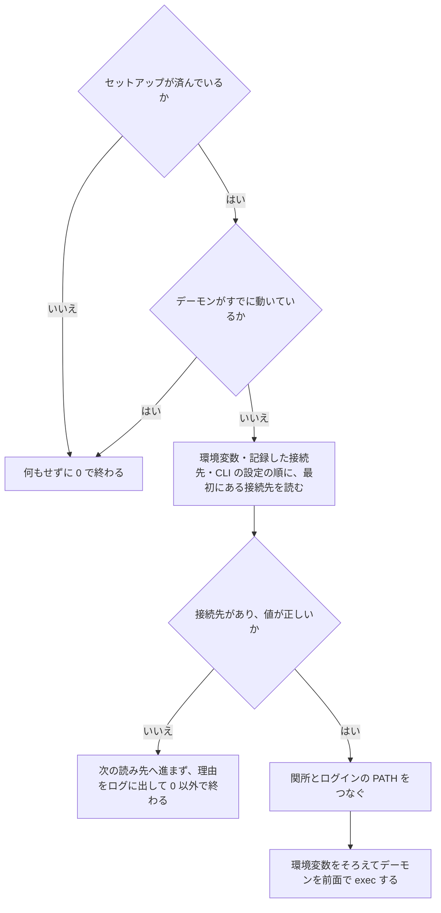
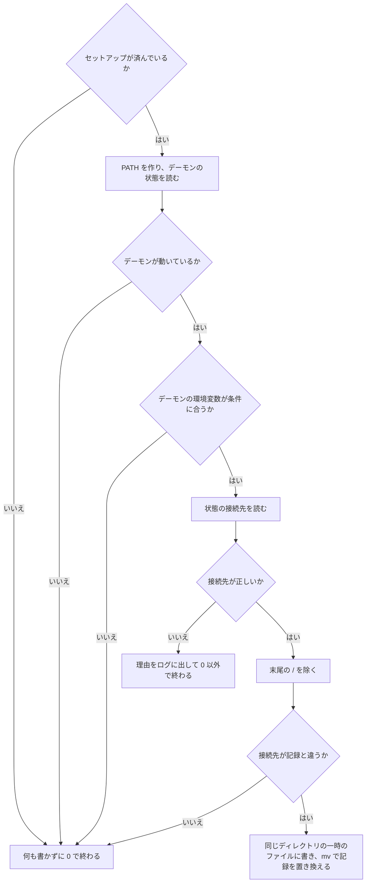

# VM に閉じ込めて動かす

セットアップを、ホストではなく軽い VM の中で流せるようにする。Mac は Lima の VM、Windows は WSL の専用のディストリを、原本のスクリプトのコマンド 1 つで作る。中では Linux のセットアップをそのまま流し、エージェントからホストのホームを読めないようにする。

この文書は、VM を作るスクリプトを変える人に向けて、設計とその理由を書く。使う人への手順は `README.md` と `manual.md` に、バージョンを出す前の確認は `CONTRIBUTING.md` に書く。

## 目的と範囲

エージェントを普段のユーザーで動かすと、ホームの SSH の鍵や普段の `gh` のトークンも読める。VM に閉じ込めれば、エージェントが読めるのは VM のディスクだけになり、ホストに残るのも Lima（または WSL）と VM のディスクだけになる。

対象は、Mac の Lima と、WSL 2 の専用のディストリの 2 つである。次は対象にしない。

- コンテナ（Dev Container など）での閉じ込め。テストの Docker で閉じ込めが崩れ、イメージの保守も増えるため
- 別の OS ユーザーでの閉じ込めと、Linux のホストの上の VM
- VM の中のセットアップを、Linux のホストと別のものにすること。`setup.sh` と `lib/` に VM のための分岐はない
- VM を作って中でセットアップを流す通しの確認を、CI で流すこと。バージョンを出す前に人が確認する

## 置くもの

原本の `vm/` には、ホストで動かすスクリプトが 2 つと、VM の中に置くファイルがある。ホストのスクリプトは、どちらも同じ中のファイルを使う。

| ファイル | 動く場所 | 役目 |
| --- | --- | --- |
| `vm/lima.sh` | Mac（bash 3.2） | Lima の VM を作る・起動する・止める・消す・確認する |
| `vm/wsl.ps1` | Windows（PowerShell 5.1 以上） | WSL の専用のディストリを、同じように扱う |
| `vm/guest/provision.sh` | VM の中（root） | 道具、Docker、デーモンの自動の起動を入れる。Lima では名前解決に公開 DNS を足す |
| `vm/guest/start-daemon` | VM の中（使う人） | デーモンを、セットアップと同じ環境で前面で起動する |
| `vm/guest/record-server` | VM の中（使う人） | 動いているデーモンの接続先を、次の起動のために記録する |
| `vm/guest/verify.sh` | VM の中（使う人） | 閉じ込め、Docker、自動の起動を確認する |

中のファイルは、VM の `/usr/local/lib/multica-squad-vm/` に置く。`.gitattributes` で `vm/` の `*.sh` と `vm/guest/*` を `eol=lf` にする。Windows で clone しても、改行が CRLF になって中で動かなくなるのを防ぐため。

ホストで使う原本は、VM を作るためだけのもので、秘密は含まない。`docs/install.md` の[手動の手順](install.md#手動の手順)のとおりに、Release の配布物を検証して展開したものを使い、VM を作ったあとは消してよい。

Windows のホストでは、PowerShell で同じ手順（`gh release download`、`gh attestation verify`、`tar -xzf`）を流す。VM の中では、`docs/install.md` の [1 行のコマンド](install.md#1-行のコマンド)で、改めて取ってきて流す。ホストの原本を中へ渡さないのは、中の確認をホストの状態に頼らないためである。

## コマンドの形

どちらのスクリプトも、作る・起動する・止める・消す・確認するの 5 つの操作を持つ。名前を省くと `multica-squad` を使う。

```bash
bash vm/lima.sh create [--name NAME] [--cpus N] [--memory GIB] [--disk GIB]
bash vm/lima.sh start|stop|verify [--name NAME] [--force]
bash vm/lima.sh delete [--name NAME] [--force] [--yes]
```

```powershell
powershell -ExecutionPolicy Bypass -File vm\wsl.ps1 create [-Name NAME] [-User USER]
powershell -ExecutionPolicy Bypass -File vm\wsl.ps1 start|stop|verify [-Name NAME] [-Force]
powershell -ExecutionPolicy Bypass -File vm\wsl.ps1 delete [-Name NAME] [-Force] [-Yes]
```

- `create` は、同じ名前の VM があれば、何も変えずに止まる。作り直すときは、先に `delete` する
- `create` は、作ったあとに `verify` を流し、通らなければ VM を消して止まる。閉じ込めの設定が効いていない VM を残さないため
- `create` の最後に、中に入るコマンドと、中でセットアップを流す手順の案内を出す
- 引数の誤りと、Lima・WSL のバージョンが足りないときは、何も変えずに止まる

中に入るときは、Lima なら `limactl shell NAME`、WSL なら `cmd /c "set WSLENV=&& wsl -d NAME"` を使う（WSL の理由は「閉じ込めの設定」の WSL）。スクリプトには中に入る操作がない。どちらの道具にもある操作で、包んでも得るものがないため。

## 閉じ込めの設定

ホストのファイルの共有と、ホストの鍵の持ち込みを、VM を作るときに切る。使う人が設定を足さなくても、作った時点で閉じ込められているようにする。

### Lima

`limactl create` に Ubuntu 24.04 の雛形を渡し、次の項目を上書きして作る。上書きは `--set` で渡し、使う人の Lima の既定の設定ファイルには書かない。

| 項目 | 値 | 理由 |
| --- | --- | --- |
| `mounts` | 空 | 既定ではホストのホームを読み取りで共有するため |
| `ssh.forwardAgent` | `false` | ホストの SSH の鍵を、エージェントに使わせないため |
| `ssh.forwardX11` | `false` | 画面の転送は使わないため |
| `ssh.loadDotSSHPubKeys` | `false` | ホストの `~/.ssh` を読まないため |
| `containerd.system`、`containerd.user` | `false` | Docker を使い、Lima の containerd は入れないため |
| `cpus`、`memory`、`disk` | 引数の値 | [割く資源の目安](#割く資源の目安) |

作ったあと、起動する前に、`limactl list --json` で実際の設定を読み、共有と鍵の転送が切れていることを確認する。使う人の Lima の既定の設定（`_config/default.yaml` や `override.yaml`）が上書きを打ち消すことがあるため。切れていなければ、起動せずに VM を消して、その設定ファイルを案内して止まる。

ポートの転送は、Lima の既定のままにする。中の `127.0.0.1` で待つポートが、ホストの `127.0.0.1` に見える。Codex と Multica のログインが、ホストのブラウザから中の待ち受けに戻るのに使うため。中からホストのファイルは読めないので、閉じ込めは崩れない。

使う Lima は 1.0.0 以上の正式なバージョンにする。[1.0.0 の create の実装](https://github.com/lima-vm/lima/blob/v1.0.0/cmd/limactl/start.go)で `--set` と Ubuntu 24.04 の雛形が使えることを確認した。`lima.sh` はバージョンが足りなければ止まる。

`limactl list --json` は、[1.0.0 の Instance の定義](https://github.com/lima-vm/lima/blob/v1.0.0/pkg/store/instance.go)どおり、VM ごとに JSON のオブジェクトを返す。`config` は既定と上書きを適用した実効設定で、空の `mounts` は省略される。ホストに JSON 用の道具を追加しないよう、Mac 標準の `plutil` で読み取る。

### WSL

`wsl --install Ubuntu-24.04 --name NAME --location DIR --no-launch` で、普段のディストリとは別に作る。置き場所 `DIR` は `%LOCALAPPDATA%\multica-squad\NAME` である。作ったあと、root で `provision.sh` を流し、`/etc/wsl.conf` を次の内容にする。

```ini
[boot]
systemd=true

[automount]
enabled=false
mountFsTab=false

[interop]
enabled=false
appendWindowsPath=false

[user]
default=USER
```

- `automount` を切り、Windows のドライブ（`/mnt/c` など）を見えなくする。初回起動で作られた空の `/mnt/c` は残ってよい
- 共有の有無は mount で判定する
- `interop` を切り、中から Windows の実行ファイルを呼べなくする。Windows の PATH も足さない
- `systemd` を入れ、デーモンと Docker を自動で起動する
- 書いたあと `wsl --terminate NAME` で止め、次の起動から設定を効かせる

`provision.sh` を流す最初の起動だけは、まだドライブが見える。この起動では、`wsl.ps1` が渡した原本を読むだけにし、使う人のログインはまだない。WSL 全体の設定（`%USERPROFILE%\.wslconfig`）は変えない。ほかのディストリにも効き、ホストに設定が残るため。

WSL は、[公開された 2.6.1 の実装](https://github.com/microsoft/WSL/blob/2.6.1/src/windows/common/WslClient.cpp)で、`--name`・`--location`・`--no-launch` と `WSL_UTF8` を確認した。最低のバージョンを 2.6.1 とし、`wsl.ps1` は `wsl --version` が足りなければ止まる。子の `wsl.exe` に `WSL_UTF8=1` を渡し、UTF-8 で出力を読む。作るときは `--version 2` も渡し、普段の WSL の既定を変えずに WSL 2 にする。

初回は `--no-launch` で通常のシェルを開かず、`-u root --exec` で `wslpath` と準備のスクリプトを流す。[コマンドを明示した起動](https://github.com/microsoft/WSL/blob/2.6.1/src/windows/service/exe/LxssInstance.cpp)は対話の初回設定を始めない。使う人と `wsl.conf` を用意してからディストリを止め、次の起動で閉じ込めを効かせる。

Windows で `WSLENV` を設定していると、`wsl.exe` は挙がった変数（トークンなど）をゲストの起動したプロセスへ渡す。ドライブの共有と Windows の実行を切っても、これは残り、常駐する `sleep` の環境から使う人が読める。そのため `wsl.ps1` は、どの `wsl.exe` にも `WSLENV` を渡さず（呼び出し元の環境は変えない）、手で入るときも `cmd /c "set WSLENV=&& wsl -d NAME"` を使う。

Docker Desktop を使っている人は、このディストリの WSL の統合を切ったままにする。統合を入れると、Docker Desktop が Windows 側のファイルと実行ファイルを中に持ち込むため。`verify` で、統合で入るファイルがないことも確認する。

### 使う人と root

WSL では、使う人に sudo を持たせない。中の root は、`automount` を切っていても、`mount -t drvfs` で Windows のドライブをつなぎ直せるため。root の作業は、Windows 側の `wsl -d NAME -u root` から行う。

Lima では、Lima の既定どおり、使う人に sudo を残す。共有の装置を作らない VM では、中の root でもホストのファイルを読めないため。中で `apt-get` を使う手順が、Linux のホストと同じに書ける。

### 閉じ込めない範囲

ネットワークは閉じ込めない。中からインターネットに出られることは、Multica と GitHub と AI のサービスに必要なため。中からホストで待ち受けるサービスにも届くので、手順書に書いて、使う人がホストで開くサービスに気を付けられるようにする。

Lima の VM の名前の問い合わせは、Lima の DNS に加えて公開 DNS にも出る（[名前解決](#名前解決)）。

## 中の準備

`provision.sh` は、VM の中で root として動き、道具と Docker とデーモンの自動の起動を入れる。Lima では、名前解決に公開 DNS も足す。何度流しても同じ結果になるように書く。

中での呼び出しは `bash provision.sh lima|wsl USER` である。確認は使う人として `bash verify.sh lima|wsl` を流す。テストでは `SQUAD_VM_ROOT` で、設定の書き込み先と `/proc` などの読み取り先の根を一時の置き場へ変える。

1. Lima では、名前解決に公開 DNS を足す（[名前解決](#名前解決)）。WSL では何もしない
2. `manual.md` の Ubuntu 24.04 の道具（`bash zsh git jq gh zip unzip python3 tzdata libdigest-sha-perl coreutils findutils procps`）を入れる。`gh` は、GitHub の公式の apt のリポジトリ（`cli.github.com/packages`）から入れる
3. WSL では、使う人を `useradd` で作る。sudo の群には入れない
4. Docker を rootless で入れる（[Docker](#docker)）
5. 使う人の linger を入れる（`loginctl enable-linger USER`）
6. デーモンの自動の起動の unit と、接続先を記録する timer を置き、有効にする（[デーモンの自動の起動](#デーモンの自動の起動)）
7. WSL では、`/etc/wsl.conf` を書く

`gh` は、Ubuntu の標準のバージョンでは証明を検証できない。そのため、GitHub の公式の apt のリポジトリの鍵と `sources` を置き、そこから入れる（`docs/install.md` の[必要な `gh` のバージョン](install.md#必要な-gh-のバージョン)）。

`multica`、`claude`、`codex` は入れない。どれをどの手順で入れるかは、使う人と組織が決めるため。中で `manual.md` の「受け取る人の準備」のとおりに、使う人のホームの下（`~/.local/bin` など）へ入れる。

中のファイルの渡し方は、Lima では `limactl copy` で一時の置き場へ写し、`limactl shell NAME sudo bash` で流す。WSL では、最初の起動でまだ見える Windows のドライブから、`wslpath` で変えたパスの原本を root で流す。

## Docker

Docker は rootless で動かす。docker の群に入れた人は、`docker run --privileged` で中の root になれ、WSL ではドライブをつなぎ直せてしまうため。Lima でも同じ形にし、手順と確認を 1 つにする。

- Docker の公式の apt のリポジトリから、rootless に要るもの（`docker-ce`、`docker-ce-rootless-extras`、`uidmap` など）を入れる
- root の `docker.service` と `docker.socket` は止めて、無効にする
- 使う人として `dockerd-rootless-setuptool.sh install` を流し、使う人の systemd の `docker.service` を有効にする
- `docker context use rootless` を設定する。デーモンは環境変数を消して起動するので、`DOCKER_HOST` に頼らず、`~/.docker/config.json` の context でつなぐため

実装では、[公式の Ubuntu の apt 手順](https://docs.docker.com/engine/install/ubuntu/#install-using-the-apt-repository)で、鍵と `docker.sources` を置く。`dbus-user-session` と `apparmor` も入れる。[公式の rootless の前提](https://docs.docker.com/engine/security/rootless/#prerequisites)どおり、使う人の従属 UID と GID が足りなければ、既存の範囲に重ならない 65,536 個を割り当てる。

初回のログイン前でも導入できるよう、linger を入れ、`systemctl start user@UID.service` でユーザーの systemd を起動してから installer を流す。`runuser` で使う人に切り替え、`HOME`、`XDG_RUNTIME_DIR`、`DBUS_SESSION_BUS_ADDRESS` を渡す。[installer の systemd 判定](https://github.com/moby/moby/blob/master/contrib/dockerd-rootless-setuptool.sh)に必要な環境をそろえるためで、全体の自動起動の方式には関わらない。

テストの MySQL などのコンテナは、使う人の権限で動く。公開したポートは、Lima では既定の転送でホストの `127.0.0.1` にも見える。

## デーモンの自動の起動

VM を起動すると、中に入らなくてもデーモンが動くようにする。systemd の unit で、セットアップと同じ環境のデーモンを前面で起動する。セットアップ自体には、この仕組みのための分岐がない。

### unit

`/etc/systemd/system/multica-squad-daemon.service` を置き、有効にする。

```ini
[Unit]
Description=Multica daemon for multica-squad-kit
Wants=network-online.target
After=network-online.target

[Service]
Type=simple
User=USER
ExecStart=/usr/local/lib/multica-squad-vm/start-daemon
Restart=on-failure
RestartSec=30

[Install]
WantedBy=multi-user.target
```

使う人の systemd ではなく、`User=` を付けた system の unit にする。使う人のログインの有無に関わらず、起動の順が決まるため。linger は、rootless の Docker を起動時に動かすために入れる。

### 起動の環境をセットアップとそろえる

`start-daemon` は、`lib/host.sh` の `prepare_daemon` と同じ環境でデーモンを起動する。セットアップを流し直したとき、`daemon_has_agent_env` が起動中のデーモンを正しいものと見なし、止めずに済むようにするため。

セットアップとデーモンの状態を確認し、接続先を選んで起動する流れは、次の図のとおりである。



1. セットアップがまだなら（`~/.multica-agent/bin/gh` がない）、何もせずに 0 で終わる。VM を作った直後は、ログインもセットアップもまだのため
2. `multica daemon status --output json` で、すでに動いていれば 0 で終わる。セットアップが起動したデーモンと二重にしないため
3. サーバーの URL は、`MULTICA_SERVER_URL`・記録した接続先（[接続先を残す](#接続先を残す)）・`multica config show` の順に、最初にあるものから読む。確認の方法は `lib/host.sh` の `choose_server` と同じにする
4. PATH を、`$HOME/.multica-agent/bin:` と、`bash -lc` で読んだ使う人のログインの PATH をつないで作る。`~/.local/bin` に入れた道具を見付けるため
5. `env -i HOME USER SHELL=/bin/zsh PATH CODEX_HOME=$HOME/.multica-agent/codex MULTICA_SERVER_URL` で、`multica daemon start --foreground` を exec する

接続先がどれもないか、読んだ値が正しくなければ、理由をログに出して 0 以外で終わる。正しくない値のときに次の読み先へ進まないのは、別のサーバーへ黙ってつながないためである。

`prepare_daemon` の `env -i` に渡す変数の名前と、`start-daemon` の名前が同じであることを、CI のテストで照らし合わせる。片方だけを変えると、セットアップの流し直しのたびにデーモンが止められるため。

セットアップがデーモンを止めて起動し直すと、unit の前面のデーモンは終わり、以後はセットアップが起動したデーモンが動く。次に VM を起動したときから、また unit が起動する。

Multica の `multica daemon autostart` は使わない。引数を受けず、`CODEX_HOME` と関所の PATH を渡せないため。

### 接続先を残す

セットアップが選んだ接続先を、動いているデーモンから読んで VM の中に記録し、次の起動で `start-daemon` が使う。セットアップは `MULTICA_SERVER_URL` や質問で選んだ URL でデーモンを起動し、CLI の既定は変えない。unit は環境変数を受けないので、記録がないと、再起動のあとに CLI の既定の別のサーバーへつなぐか、既定がなければ起動できないため。

記録は、`record-server` を使う人として 1 分ごとに流す timer で取る。

`/etc/systemd/system/multica-squad-record-server.service` は、`Type=oneshot`、`User=USER`、`ExecStart=/usr/local/lib/multica-squad-vm/record-server` である。

`/etc/systemd/system/multica-squad-record-server.timer` は、`OnBootSec=1min`、`OnUnitActiveSec=1min`、`WantedBy=timers.target` である。`provision.sh` は `systemctl enable --now` で、有効にしてすぐ開始する。セットアップの前の実行は何もせず、セットアップの終わりから 1 分以内に最初の記録を取るためである。

`record-server` は、次の順に動く。記録を変えないときは、何も書かずに 0 で終わる。

記録の元になるデーモンの判定と、接続先の置き換えの流れを、次の図に示す。



1. セットアップがまだなら（`~/.multica-agent/bin/gh` がない）、何もしない
2. PATH を `start-daemon` と同じに作り、`multica daemon status --output json` を読む。動いていなければ、何もしない
3. 動いているデーモンの環境変数を `ps eww` で読み、`daemon_has_agent_env` と同じ条件で照合する。条件に合わなければ、何もしない
4. 状態の `.server_url` を、`start-daemon` と同じ規則で確認し、末尾の `/` を除く。正しくなければ、理由をログに出して 0 以外で終わる
5. 記録と違えば、同じディレクトリの一時のファイルに書いてから `mv` で置き換える。書きかけの記録を `start-daemon` が読まないようにするため

記録の元にするのは、セットアップか `start-daemon` が起動したデーモンだけである。手で別の設定で起動したデーモンの接続先を残さないためである。

記録は `~/.config/multica-squad-vm/server-url` に、URL を 1 行で置く。ホストには何も残さず、VM を消すと一緒に消える。セットアップを別の接続先で流し直すと、次の記録で新しい接続先に変わる。記録を消せば、`start-daemon` は CLI の既定に戻る。

セットアップを終えてから最初の記録までの 1 分ほどの間に VM を止めると、記録は残らない。そのときは、次の起動で CLI の既定を使う。この間を閉じるため、`verify` は、デーモンの確認が通ったあとに `record-server` を 1 回流し、記録した接続先を動いているデーモンの接続先と照合する。手順書では、セットアップのあとに `verify` を流すよう案内し、この間を待たずに閉じる。

### WSL のディストリを止めない

WSL は、ディストリにつながる `wsl.exe` がなくなると、少しあとにディストリを止める。`wsl.ps1 start` は、窓を出さずに `wsl.exe -d NAME --exec sleep infinity` を起動しておき、窓をすべて閉じてもディストリを動かし続ける。

この `wsl.exe` は、Windows からサインアウトするまで動く。Windows の起動時やサインイン時に自動で動かす設定（タスク スケジューラなど）は入れない。ホストに残るものを、WSL と VM のディスクだけにするため。Windows を起動し直したあとは、`wsl.ps1 start` を流す。

起こした `wsl.exe` の PID、起動時刻、ディストリの名前は、中の root だけが書ける `/var/lib/multica-squad-vm/keepalive.json` に置く。止めるときは PID と起動時刻、実行ファイルと引数が一致するものだけを止める。PID が別のプロセスに使われていたら、そのプロセスは止めない。ホストに PID の記録は置かない。

Lima の VM も、Mac を起動し直したあとは `lima.sh start` で起動する。Mac のログイン時に自動で起動する設定（`limactl start-at-login`）は、同じ理由で入れない。

## 名前解決

Lima の VM では、作った時点で、systemd-resolved に公開 DNS（`1.1.1.1` と `8.8.8.8`）を足す。Lima の DNS（`192.168.5.2`）は経路に残す。WSL の VM の名前解決は変えない。

### 足す理由

Lima の DNS が、IPv6 の問い合わせ（AAAA）に 1 回 4 秒ほどかかることがある。`getent` などは IPv4 と IPv6 の両方を引くので、名前を引くたびに待ちが入る。`multica` のコマンドは、1 回 8 秒ほどになった。

公開 DNS を足した VM では、Lima の DNS が遅いままでも、`getent hosts github.com` が 0.06 秒、`multica agent list` が 0.27 秒で返った。遅さは出たり消えたりし、原因は Mac か Lima の側にある。VM の中からは直せないので、問い合わせの先を足して避ける。

### 置く設定

`provision.sh lima` は、最初に `/etc/systemd/resolved.conf.d/multica-squad-dns.conf` を次の内容で置き、`systemctl restart systemd-resolved` を流す。ディレクトリは `0755`、ファイルは `0644` にする。

```ini
[Resolve]
DNS=1.1.1.1 8.8.8.8
```

- 置くのは、道具を入れるより前にする。`provision.sh` 自身の `apt-get` と `curl` も名前を引くので、遅さを先に避けるため
- 何度流しても、同じ内容で置き直して起動し直す。内容は固定で、二度流しても結果は変わらない
- 起動し直しが失敗したら、`provision.sh` は 0 以外で終わる。`create` は、ほかの準備の失敗と同じく VM を消して止まる
- ファイルの名前に `multica-squad-` を付ける。原本が置いたものと分かり、外すときに使う人の設定と取り違えないため
- `provision.sh wsl` は、このファイルを置かず、systemd-resolved も起動し直さない

### Lima の DNS を残す仕組み

全体の設定の `DNS=` は、systemd-resolved の通信路ごとの DNS を置き換えない。[resolved.conf](https://www.freedesktop.org/software/systemd/man/latest/resolved.conf.html) の `DNS=` は、通信路ごとの DNS と並べて問い合わせると書いている。Lima の DNS は、VM の通信路（`eth0`）の DNS として DHCP で入るので、そのまま残る。

[systemd-resolved](https://www.freedesktop.org/software/systemd/man/latest/systemd-resolved.service.html) は、経路の名前の指定がない問い合わせを、既定の経路の通信路の DNS と全体の DNS の両方へ出す。最初に成功した答えを返し、すべて失敗したときだけ最後の失敗を返す。

このため、公開 DNS が先に答える名前は速く返る。ホストの DNS でだけ引ける名前は、公開 DNS が「ない」と答えても、Lima の DNS の成功した答えが返る。その名前では、Lima の DNS が答えるまで待つ。

### 使う人に示すこと

名前の問い合わせが、Lima の DNS と並んで Cloudflare と Google にも出る。社内の名前を引いたときも、その名前が公開 DNS に届く。`manual.md` の「閉じ込めて動かす」に、このことと外し方を書く。

外すときは、VM の中でファイルを消し、`systemctl restart systemd-resolved` を流す。`resolvectl status` から公開 DNS が消え、Lima の DNS だけに戻る。`provision.sh` を流し直すと、また足される。

公開 DNS を足していない Lima の VM は、VM の中で同じファイルを置き、systemd-resolved を起動し直せば、新しく作った VM と同じ状態になる。作り直しも、専用のサブコマンドも要らない。`manual.md` の手順は、使う人の sudo で流す次の形にする。

```bash
sudo install -d -m 0755 /etc/systemd/resolved.conf.d
printf '[Resolve]\nDNS=1.1.1.1 8.8.8.8\n' | sudo tee /etc/systemd/resolved.conf.d/multica-squad-dns.conf >/dev/null
sudo systemctl restart systemd-resolved
resolvectl status
```

外す手順は次の形にする。

```bash
sudo rm -f /etc/systemd/resolved.conf.d/multica-squad-dns.conf
sudo systemctl restart systemd-resolved
resolvectl status
```

### 確認しないこと

`verify` は、この設定を確認しない。`verify` が確認するのは閉じ込めと自動の起動で、名前解決の先は閉じ込めに関わらない。外した VM や、足す前に作った VM で、`verify` が通らなくならないようにするため。

## 止める・消す

止める・消す前に、中のデーモンの実行中のタスクを確認する。動いている作業を、知らないうちに止めないため。

- 中で `multica daemon status --output json` を読み、`lib/host.sh` と同じく、実行中のタスク数の最大を見る
- 1 つ以上あるか、数が分からなければ、何もせずに止まる。`--force` を付けたときだけ進める
- `multica` がない、またはデーモンが動いていなければ、そのまま進める

止めるときは、Lima は `limactl stop` を流す。WSL は、`start` で起動した `wsl.exe` を止めてから、`wsl --terminate NAME` を流す。

消すときは、消す VM の名前と、中のログインと作業コピーがなくなることを示して、確認を求める。`--yes` を付けたときは聞かない。Lima は `limactl delete` を流す。WSL は `wsl --unregister NAME` を流し、置き場所のフォルダを消す。

[Lima の通常の削除](https://github.com/lima-vm/lima/blob/v1.0.0/pkg/instance/delete.go)は停止中だけを受け付けるため、タスク数を確認してから `limactl stop`、`limactl delete` の順に流す。`--force` を付けたときだけ、動いていても強制で削除する。

消したあと、ホストに残るのは Lima（または WSL）と、その取り込んだイメージの控えだけになる。Lima のイメージの控えは `limactl prune` で消せることを、手順書に書く。

## 確認する

`verify` は、中で `verify.sh` を使う人の権限で流し、閉じ込めと自動の起動を確認する。`create` の最後と、バージョンを出す前の確認で使う。1 つでも通らなければ、通らなかった項目を出して 0 以外で終わる。

| 確認すること | Lima | WSL |
| --- | --- | --- |
| ホストのファイルの共有がない | `virtiofs`、`9p`、`sshfs` の mount がなく、`/Users` がない | `drvfs`、Windows のドライブの `9p`、`/mnt/<ドライブ>` の mount がなく、`/mnt/c` がないか空のディレクトリである |
| ホストの鍵がない | `SSH_AUTH_SOCK` がない | `SSH_AUTH_SOCK` がない |
| Windows の実行ファイルを呼べない | 対象外 | `WSLInterop` の binfmt がなく、`cmd.exe` を呼べない |
| 使う人が root になれない | 対象外 | `sudo -n true` が失敗する |
| Docker | `docker run --rm hello-world` が通り、そのあとも上の項目が成り立つ | 同じ |
| 自動の起動 | unit と記録の timer が有効で、linger が入っている | 同じ |

セットアップのあとに流すと、デーモンが動いていることを確認し、その環境変数を `daemon_has_agent_env` と同じ条件で照合する。続けて、接続先を記録し、記録した接続先をデーモンの接続先と照合する（[接続先を残す](#接続先を残す)）。セットアップの前に流したときは、この項目を飛ばしたことを出す。

## ログインと認証

ログインは、すべて VM のディスクに置く。VM を止めて起動し直しても残り、VM を消すとなくなる。

- Claude Code と Codex は、`manual.md` の「ホストとエージェント用のログイン」と同じく、`~/.multica-agent` の下へログインする。Codex は、ブラウザから戻れないときに `codex login --device-auth` を使う
- Multica は、中で `multica login` を流す
- GitHub は、中で `gh auth login` を流し、Git は HTTPS で `gh auth setup-git` を使う。ホストの SSH の鍵は持ち込まない
- 中には鍵束がないので、`gh` のトークンは VM の `~/.config/gh/hosts.yml` に平文で残る。読めるのは VM の中だけである

## 割く資源の目安

既定は、CPU 4、メモリ 8 GiB、ディスク 100 GiB である。エージェントの並行の実行と、テストの MySQL を同時に動かせる大きさにしてあるため。

Lima のディスクは、使った分だけホストのディスクを使う。WSL のメモリは、WSL 全体の設定で決まり（既定はホストの半分）、ディストリごとには決められない。`wsl.ps1` は引数で受けず、手順書で `.wslconfig` を案内する。WSL のディスクも、使った分だけ伸びる。

## テストと CI

スクリプトのテストは `tests/` に置き、CI の `scripts` ジョブの両 OS で流す。外の道具は、ほかのテストと同じくスタブにする。

| テスト | 確認すること |
| --- | --- |
| `tests/vm-lima-test.sh` | スタブの `limactl` に渡す上書きと、バージョンの不足と同じ名前での停止。起動前の設定の確認で消して止まること、止める・消す前のタスク数の扱い、確認の求め |
| `tests/vm-guest-test.sh` | 中の準備（Lima だけの名前解決の設定を含む）と、デーモンの起動・接続先の記録・確認 |
| `tests/vm-wsl-test.sh` | スタブの `wsl.exe` を置いた `pwsh` で、`wsl.ps1` の各操作が渡す引数と、バージョン・名前・タスク数での停止 |

`tests/vm-guest-test.sh` では、次を確認する。

- `provision.sh` が書く `wsl.conf` と unit、sudo の群に入れないこと、二度流しても同じこと
- `provision.sh lima` が、[名前解決](#名前解決)の設定の内容のファイルを置き、最初の `apt-get update` より前に systemd-resolved を起動し直すこと。起動し直しが失敗したら 0 以外で終わり、デーモンの unit を有効にしないこと
- `provision.sh wsl` が、名前解決の設定のファイルを置かず、systemd-resolved を起動し直さないこと
- `start-daemon` の 5 つの手順と、接続先を環境変数・記録・CLI の設定の順に読むこと
- CLI の既定が記録と違うときと、CLI の設定がないときに、記録した接続先で起動すること
- `record-server` が、デーモンが動いていないときと、`daemon_has_agent_env` の変数を持たないときに記録を変えないこと
- `verify.sh` の各項目の成否
- `gh` の apt のリポジトリの鍵と `sources` を、書き込み先の根の下に置くこと

テストの仕組みと構文は、次のとおりである。

- `provision.sh` と `verify.sh` は、書き込む先と読む先の根（`/etc` など）を環境変数で差し替えられるようにし、テストは一時の置き場で流す
- `tests/vm-guest-test.sh` が、`start-daemon` の変数の名前を、`lib/host.sh` の `prepare_daemon` の `env -i` の行と照らし合わせる
- `wsl.ps1` は、ドットで読み込んだときは操作を流さない形にし、テストで `Start-Process` などを差し替える
- `wsl.ps1` は PowerShell 5.1 の構文だけで書き、BOM 付きの UTF-8 で保存する。5.1 は BOM のない日本語を読み違えるため

`pwsh` がない手元では、`tests/vm-wsl-test.sh` を飛ばしたことを出して通す。CI では `SQUAD_KIT_REQUIRE_PWSH=1` を設定し、`pwsh` がなければ失敗にする。GitHub の [macOS](https://github.com/actions/runner-images/tree/main/images/macos) と [Ubuntu 24.04](https://github.com/actions/runner-images/blob/main/images/ubuntu/Ubuntu2404-Readme.md) の構成表で、PowerShell が含まれることを確認した。

`scripts/check.sh` は、`vm/*.sh` と `vm/guest/*` の `bash -n` と、`pwsh` があるときの `wsl.ps1` の構文の確認を行う。

## 検討した案

デーモンは、セットアップと同じ環境を使い、`User=` を付けた system の unit で起動する。接続先は動いているデーモンから読んで記録する。名前解決は、Lima だけで、systemd-resolved の全体の設定に公開 DNS を足し、Lima の DNS を残す。

| 案 | 選ばなかった理由 |
| --- | --- |
| Multica の `multica daemon autostart` で起動する | 引数を受けず、`CODEX_HOME` と関所の PATH を渡せない |
| 使う人の systemd の unit で起動する | 起動の順が linger とログインに左右される。system の unit に `User=` を付ければ足りる |
| Docker を root で動かし、docker の群に入れる | 群の人は中の root になれ、WSL ではドライブをつなぎ直せる |
| `gh` を Ubuntu の標準の apt から入れる | 2.45.0 で、`gh attestation` を持たず、入口の検証が流せない |
| WSL を Ubuntu のイメージから `wsl --import` で作る | イメージの URL と照合値を原本で保つ手間が増える。公式の `wsl --install` で足りる |
| Windows のタスク スケジューラや `limactl start-at-login` で自動で起動する | ホストに設定が残り、「消したあとに残るのは Lima（WSL）と VM のディスクだけ」にならない |
| 接続先を `verify` のときだけ記録する | `verify` を流さずに VM を止めると、記録が残らない |
| セットアップの前に `multica config set` で CLI の既定を手で合わせる | 手作業で、セットアップが CLI の既定を変えない方針と食い違う。合わせ忘れると黙って別のサーバーへつなぐ |
| `lima.sh` と `wsl.ps1` の `stop` のときに接続先を記録する | ホストの再起動や、`limactl` と `wsl` で直に止めたときに記録されない |
| systemd の path の unit で、Multica の設定のファイルの変化を見て記録する | Multica が中に置くファイルの名前と形に頼る。動いているデーモンの接続先は、どのファイルにも残らない |
| Lima のポートの転送をすべて切る | Codex と Multica のログインがホストのブラウザから戻れなくなる。中からホストのファイルは読めないままなので、閉じ込めには効かない |
| WSL でも使う人に sudo を残す | 中の root が `mount -t drvfs` でドライブをつなぎ直せる |
| Lima の DNS が IPv6 の問い合わせに遅くなる原因を直す | 原因は Mac か Lima の側にあり、VM の中から調べられない。遅さが出たり消えたりするので、直しても確認しにくい |
| IPv6 の問い合わせだけを止める | 公開 DNS が IPv6 の問い合わせにもすぐ答えるので、重ねる理由がない。IPv6 だけの名前も引けなくなる |
| Lima の DNS を外し、公開 DNS だけにする | ホストの DNS でだけ引ける名前（社内の名前など）が引けなくなる |
| VM を作るときの Lima の設定（`dns` など）で入れる | 効くかを確認していない。既存の VM を直すには、止めて設定を変える手順になる |
| `create` の引数で DNS を選べるようにする | 引数と文書とテストが増える。使いたくない人は、手順書の外し方で外せる |
| `verify` で公開 DNS があることを確認する | 外した VM と、足す前に作った VM で `verify` が通らなくなる。名前解決の先は閉じ込めに関わらない |
| WSL の VM にも同じ設定を入れる | WSL では遅さを確認していない。WSL は名前解決の設定を自分で作るので、同じ形で効くかも確認していない |
