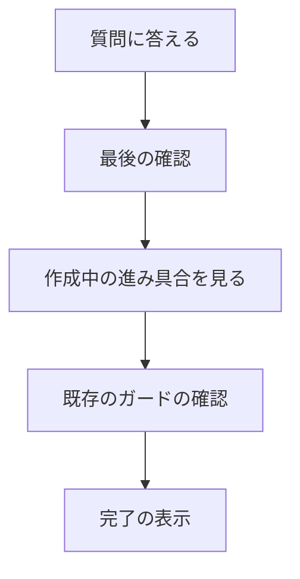
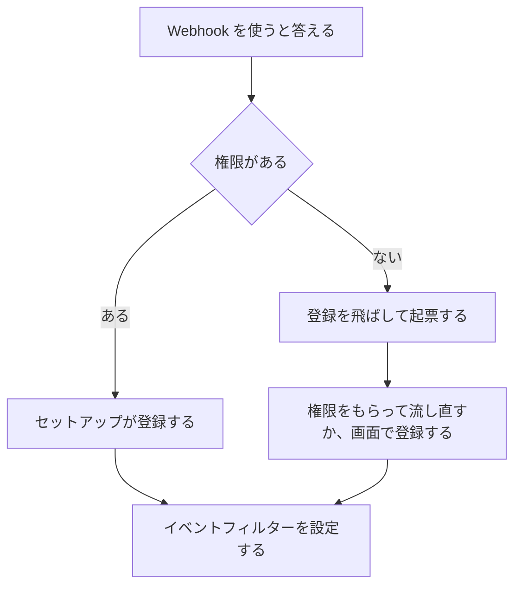
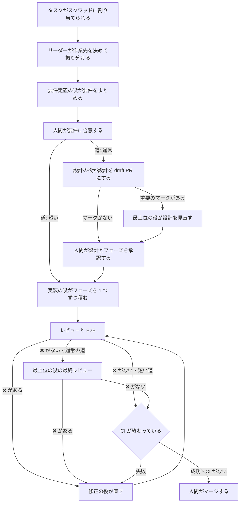
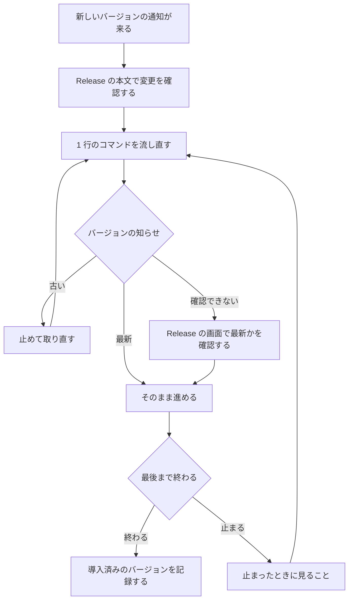

# Multica のスクワッドの導入と更新

プロジェクトのスクワッド、役ごとのエージェント、共通スキル、見張りとホストの設定を用意する。プロジェクト固有の検証コマンドは、ひな形に人が記入する。

最短の手順は [README のクイックスタート](README.md#クイックスタート) にある。この文書は、作業の順に次の章で詳しく書く。

1. [受け取る人の準備](#受け取る人の準備): 道具、ログイン、GitHub 連携をそろえる
2. [原本を取る](#原本を取る): 1 行のコマンドで、配布物を取って検証し、セットアップを流す
3. [初めて導入する](#初めて導入する): 質問に答え、最後の確認で `yes` と答える
4. [導入後に自動で行うことと、起票するタスク](#導入後に自動で行うことと起票するタスク): 完了の表示を確認し、起票されたタスクを片付ける
5. [タスクが進む流れ](#タスクが進む流れ): 導入したスクワッドで、タスクがどの役を順に通り、どこで人間を待つかを読む
6. [最上位の役の最終レビューと重要のマーク](#最上位の役の最終レビューと重要のマーク): 短い道を除くすべてのタスクの最終レビューと、リスクを表すマーク、導入済みのプロジェクトへの影響を確認する
7. [導入済みの配布物を入れ直す](#導入済みの配布物を入れ直す): ZIP で導入済みなら、先にここを読み、片付けてから入れ直す
8. [閉じ込めて動かす](#閉じ込めて動かす): ホストのホームをエージェントに読ませたくないなら、先にここを読み、VM の中で動かす
9. [PC を起動し直したあと](#pc-を起動し直したあと): VM を使わないホストで、デーモンの起動入口を流す
10. [更新と、途中で止まったあとの再実行](#更新と途中で止まったあとの再実行): 同じ 1 行のコマンドを流し直す。止まったときもここを見る

## 受け取る人の準備

macOS または Linux（WSL 2 を含む）の担当者のアカウントで実行する。bash は 3.2 以上にし、`/bin/bash` と `/bin/zsh` を使えるようにする。macOS は標準の bash 3.2 と zsh、Linux の自動テストは Ubuntu 24.04 の bash と zsh を使う。

Git、zip、unzip、shasum が要る。標準の Unix の道具（find、sort、date、ps など）も要る。さらに、次の道具を PATH から使えるようにする。ガードは、エージェントの実行で、許可していないリポジトリへの `gh` の書き込みと `git push` を止める仕組みである。

| 道具 | 用途 |
| --- | --- |
| `multica` | サーバーへのログイン、設定の登録、デーモンとランタイム |
| `jq` | CLI の応答と質問の答えを読む |
| `gh`（2.102.0 以上） | ホストのガードと、エージェントの GitHub 操作。PR への画像の添付（`--attach`）、配布物の取得と証明の検証 |
| Python 3.11 以上（`python3` と標準の `tomllib`・`zoneinfo`）、タイムゾーンデータ | 既存の Codex 設定を TOML として読み、使用上限のリセット時刻を読む |
| `claude` と `codex` の一方または両方 | エージェントのランタイム。使うものだけを入れる（[片方だけのランタイムで動かす](#片方だけのランタイムで動かす)） |

PR に画像を載せるには、リポジトリへの push の権限が要る。

不足した道具はスクリプトの案内に従って入れる。`multica`、`jq`、`gh`、Python は Homebrew なら次で入れられる。Homebrew の `gh` は 2.102.0 以上である。

Claude Code と Codex CLI は、利用する組織の手順で導入する。Codex CLI は 0.171.0 以上にする。Codex で動く役のモデル（`gpt-6.2-sol` と `gpt-6.2-astra`）は、0.171.0 で使えるようになったため。`python3` が古い場合は PATH を確認する。

TOML を読めない環境では、回答の保存や登録を始める前に止まる。`claude` と `codex` が両方ともなければ、質問を始める前に止まる。

```bash
brew install multica-ai/tap/multica jq gh python
```

Linux は Homebrew を使わずに導入できる。Ubuntu 24.04 では次で道具をそろえる。`gh` は、Ubuntu の標準の apt のものが 2.45.0 で、配布物の証明を検証する `gh attestation` を持たない。そのため、GitHub の公式の apt のリポジトリから入れる。

他のディストリビューションでは同等のパッケージを使い、Python が 3.11 以上、`gh` が 2.102.0 以上であることを確認する。

```bash
sudo apt-get update
sudo apt-get install bash zsh git jq zip unzip python3 tzdata libdigest-sha-perl coreutils findutils procps ca-certificates curl
sudo install -d -m 0755 /etc/apt/keyrings
sudo curl -fsSL https://cli.github.com/packages/githubcli-archive-keyring.gpg -o /etc/apt/keyrings/githubcli-archive-keyring.gpg
sudo chmod 0644 /etc/apt/keyrings/githubcli-archive-keyring.gpg
sudo tee /etc/apt/sources.list.d/github-cli.sources >/dev/null <<EOF
Types: deb
URIs: https://cli.github.com/packages
Suites: stable
Components: main
Architectures: $(dpkg --print-architecture)
Signed-By: /etc/apt/keyrings/githubcli-archive-keyring.gpg
EOF
sudo apt-get update
sudo apt-get install gh
gh --version
python3 -c 'import tomllib; from zoneinfo import ZoneInfo; print(ZoneInfo("Asia/Tokyo"))'
```

`gh --version` の 1 行目が `gh version 2.102.0` 以上であることを確認する。

Multica は [公式 CLI 導入手順の Linux 向けバイナリ](https://github.com/multica-ai/multica/blob/main/CLI_INSTALL.md#option-b-download-from-github-releases-macoslinux-no-homebrew) から導入できる。Claude Code と Codex も Linux 向けのものを使う。jq は Ubuntu 24.04 の 1.7 でも動く。

WSL は WSL 2 だけを対象とする。Windows 側の `wsl --list --verbose` でバージョン 2 を確認し、作業コピーと Git・Multica・ランタイム・認証をすべて WSL 内の Linux 側にそろえる。

Windows 側の exe は使わない。セットアップは既知の WSL 1 のカーネルと、Windows の Git Bash などを、回答の保存や登録より前に拒否する。

Linux と WSL 2 の認証済み実行と常駐は、VM を使わない普段のユーザーでは、実機では未確認である。ホストのホームを読ませたくないときは、[閉じ込めて動かす](#閉じ込めて動かす)。WSL 2 は [Microsoft の Linux 互換性の説明](https://learn.microsoft.com/en-us/windows/wsl/compare-versions)、[Claude Code の対応環境](https://code.claude.com/docs/en/setup)、[Codex の WSL 対応](https://learn.chatgpt.com/docs/windows/wsl) に基づく。自動テストで確認する範囲は [変更の進め方](CONTRIBUTING.md#テストで確認する範囲) にある。

Multica で、使用するサーバーにログインしておく。サーバーの URL が CLI に設定されていなければ質問される。

CLI に設定済み、または `MULTICA_SERVER_URL` があれば、そのサーバーが使われる。違うサーバーを使うときは、実行前に CLI の設定と環境変数を確認する。セットアップは CLI の既定のサーバーやワークスペースを変更しない。

```bash
multica config show
multica auth status
```

未ログインなら、接続先を確認して `multica login` を行う。設定済みの接続先以外へログインするときの指定方法は `multica login --help` とスクリプトの案内に従う。

登録する本人の認証を使う。エージェントの環境変数の取得・設定など、人間の権限が必要な操作があるため、エージェントの認証で導入を代行しない。

### GitHub 連携とリポジトリの紐付け

ワークスペースのオーナーか管理者が、事前に次を済ませる。

1. 新しく使うならワークスペースを作る。既存のものへ足すなら、そのワークスペースを使う
2. スクワッドに参加する人を招待し、実行する人が登録・編集に必要な権限を持つことを確認する
3. ワークスペースの設定 → コードで GitHub 連携を設定し、プロジェクトのリポジトリを許可する。自前サーバーで GitHub App が未設定なら、サーバーの管理者が GitHub 連携を先に用意する
4. ワークスペースの設定 → コードで、作業先のリポジトリが GitHub 連携につながっていることを画面で確認する
5. ワークスペースの設定の「After PRs merge, move the issue to」が Done であることを画面で確認する
6. 担当者の Git と `gh` の認証で、そのリポジトリを読めることを確認する

GitHub 連携は、PR をタスクに紐付けるための前提である。つながっていないと、スクリプトもタスクの画面も、PR を紐付けられない。サーバーは、リポジトリが連携につながり、PR が同期されるまで、その PR を見つけられないためである。

役の引き継ぎに「サーバーが PR を見つけられない」とあれば、まず連携を確認する。つないでから、タスクの画面で PR の URL を指定して紐付ける。

マージ後の移動先は、マージでタスクを `done` にするための前提である。Done でないと、PR がタスクに紐付いても、マージでタスクが `done` にならない。この場合は、人間がタスクを `done` にする。

セットアップは、この 2 つの設定を自動で変えない。

```bash
multica workspace list --output json
multica repo list --output json
gh auth status
```

ここで見るのは、導入先のサーバー・ワークスペースであること。CLI の既定のワークスペースが違えば、接続先を合わせてから確認する。実際のセットアップでは、所属するワークスペースの一覧から選ぶ。

選ぶリポジトリが一覧になければ、セットアップは案内を出して止まる。スクリプトが GitHub の接続や許可を勝手に増やすことはない。

エージェントが書き込めるのは、ここで選ぶプロジェクトのリポジトリの一覧だけにする。ほかのプロジェクトに紐付いたものは選べず、対象と理由を表示する。

普段の Git と `gh` の認証を使うため、追加の GitHub ログインをセットアップが実行することはない。

### ホストとエージェント用のログイン

このホストの Multica デーモンは一つにする。デスクトップアプリなど別の起動元のデーモンは、動いている作業がないことを確認して人間が止める。セットアップは必要なら CLI のデーモンを起動し直すが、実行中のタスクがある、またはタスク数が不明なら止めない。

使うランタイムには、普段の設定から切り離した置き場で一度ずつログインする。使わないランタイムのログインとオンラインは確認しない。

未ログインならスクリプトが止めて案内するので、そのときに使うものだけ次を実行し、同じセットアップを流し直す。

```bash
CLAUDE_CONFIG_DIR="$HOME/.multica-agent/claude" claude
CODEX_HOME="$HOME/.multica-agent/codex" codex login
```

認証情報の値を 原本、プロジェクトの説明、質問の答えやコメントに書かない。Git と `gh` の認証は引き継ぐが、Claude と Codex の個人の hook・プラグイン・MCP などの設定は実行へ持ち込まない。ホスト上では OS ユーザーの権限で動くため、実行環境と渡す認証の範囲は管理者が決める。

#### キットがエージェント用の設定に書くこと

セットアップは、使うランタイムのエージェント用の設定を、流し直すたびにキットの値へそろえる。変わりがなければ書き込まない。

Claude の共有の設定は、置き場の `settings.json` である。次の 8 つのキーだけをキットが持ち、人が足したほかのキーは残す。

- `syncClaudeAiSkills` と `syncClaudeAiPlugins` を `false` にする。人が claude.ai で使うスキルとプラグインを、役に混ぜない
- `disableWorkflows` を `true`、`autoMemoryEnabled` を `false`、`cleanupPeriodDays` を `30` にする
- `skillOverrides` で、無人の実行に要らない 14 のスキルを止める。`code-review`・`simplify`・`security-review`・`claude-api`・`verify`・`run` は止めない
- `permissions.deny` に、`Monitor`・`ScheduleWakeup`・`RemoteTrigger` を足す。人が書いた項目は残し、重ねては足さない
- `pluginConfigs` の `cc-plugin-agents-md@builtin` に、`instructionFiles` を `claude-md` で置く

`pluginConfigs` と `skillOverrides` は、キットの項目だけを替える。人がキットのキーに別の値を書いていたときは、キットの値で上書きして警告する。

同じ設定が、人がエージェント用のログインで開く端末にも効く。止めたスキルとツールは使えず、人が書いた `theme` などのキーは変わらない。

`AGENTS.md` の自動読み込みは入れない。最後のキーは、Claude Code の既定が変わっても読み込まないための値である。役は、指示の手順で、チェックアウトの `AGENTS.md` を読む。

役の設定も、流し直しで合わせる。変更は、役の次の実行から効き、デーモンの再起動は要らない。

| 対象 | 書くこと |
| --- | --- |
| Claude のモデルの役の環境変数 | `CLAUDE_CODE_DISABLE_BACKGROUND_TASKS=1`、`CLAUDE_CODE_DISABLE_CRON=1`、`DISABLE_AUTOUPDATER=1`。Claude 以外のモデルの使用上限の見張りが、Claude の置き場を使うときは、`DISABLE_AUTOUPDATER` だけを付ける |
| Codex のモデルの役の引数 | `-c project_doc_max_bytes=65536`。指示文書を読む上限を 64 KiB に上げる |
| Codex の `config.toml` | マークのあるファイルに、`check_for_update_on_startup=false` と `[analytics] enabled=false` を置く |

マークのない人の `config.toml` は、キットが書き替えない。そのファイルに 2 つのキーがなければ警告する。

#### 設定のために新しく止まる場合

次のときは、セットアップが止まる。表示を読んで直し、同じセットアップを流し直す。

| 表示 | 直すこと |
| --- | --- |
| 「Codex の設定が厳しい検証を通りません」 | マークのない人の `config.toml` を、表示の手順で検証のコマンドを端末で流し、出力の行のキーを直すか消す |
| 「検証のプロセスの停止を確認できませんでした」 | 表示された `ps -A -o pid,pgid,stat,command` で、表示されたグループの番号が同じプロセスのうち、状態が `Z` で始まらないものを確認して止める。そのあと、同じセットアップを流し直す |
| 「Claude の設定を合わせられません」とシンボリックリンクと出る | `settings.json` を、実体のファイルに置き換える |
| 「Claude の設定を合わせられません」と JSON として読めない、または形が違うと出る | 表示された箇所を、正しい JSON と形に直す |

Codex の設定の検証は、`codex app-server --strict-config` で 30 秒までかける。古い Codex は、警告して進む。時間切れでは、検証のプロセスのグループへ TERM を送り、5 秒待って KILL を送る。停止を確認できたときだけ警告して進み、確認できないときは上の表のとおり止まる。

#### 流し直したあとの戻し方

動いているタスクがないときに戻す。まず、前のバージョンの原本で、セットアップを流し直す。そのあとで、残るものを手で消す。

1. エージェント用の置き場の `settings.json` から、上の 8 つのキーを消す。`pluginConfigs`・`skillOverrides`・`permissions.deny` は、キットの項目だけを消す
2. Claude のモデルの役ごとに、`multica agent env get` で今の custom_env を読み、3 つの変数を消したファイルを `multica agent env set --custom-env-file` で書く。Claude の置き場を使う Codex の使用上限の見張りは、`DISABLE_AUTOUPDATER` だけを消す
3. Codex のモデルの役ごとに、`multica agent update --custom-args` で、`-c` と `project_doc_max_bytes=65536` を除いた配列を書く

`config.toml` は、前のバージョンの流し直しで戻る。マークのない人のファイルは、キットが変えていないので、戻す作業はない。

#### 同じバージョンにそろえる

同じホストのすべてのプロジェクトは、同じバージョンの原本で流し直す。古いバージョンで流し直すプロジェクトがあると、設定の一部が入れ替わる。

- マークのある `config.toml` の 2 つのキーは、古いバージョンの流し直しで消える。新しいバージョンで流し直すと戻る
- `settings.json` のキーと、役の 3 つの変数と引数は、古いバージョンは知らないので残る

`config.toml` の 2 つのキーは、更新の確認と利用状況の送信を切るだけで、役の判断は変わらない。

#### 役の実行に足すガード

セットアップは、役が許していないリポジトリへ書き込めないようにする。そのために、`gh` と git の認証、フック、MCP の設定を足す。設計の理由は [docs/agent-guards.md](docs/agent-guards.md) にある。流し直したあとの、役の次の実行から効き、デーモンの再起動は要らない。

- 役の環境変数で、本物の `gh` の認証の置き場を空のディレクトリにする。本物の `gh` を絶対パスで呼ぶと未認証で止まり、PATH の `gh` は今と同じく動く
- 役の git の認証情報を、許すリポジトリだけに渡す。許していない非公開のリポジトリは、HTTPS では fetch もできず、そのリポジトリへの SSH の push も止める
- Claude の役に、守りを外すコマンドと書き込みを止める PreToolUse のフックと、最後のコメントがない終わり方を 3 回まで続けさせる Stop のフックを置く。Codex の役には、同じフックを役の引数で渡す
- 役は、作業ディレクトリの外を Write と Edit で書けない。Claude の役は、作業ディレクトリの直下の `.mcp.json` を読み込まない
- Codex のフックは、信頼の記録がないと飛ばされる。セットアップが、`config.toml` に信頼を書く

人がエージェント用のログインの端末で使う Claude Code では、フックは何もしない。deny と書き込みの禁止は効く。

フックは同じ OS の利用者のプロセスを完全には閉じ込めない。スクリプトのファイルに書いて流すなど、書き方を変えれば照合をすり抜けられる。環境変数の層が守りの中心である。

#### ガードのために新しく止まる場合

ガードが効かない状態では、警告だけで進まず止まる。表示を読んで直し、同じセットアップを流し直す。

| 止まる場合 | 止まる所 | 直し方 |
| --- | --- | --- |
| 流した端末か起動する端末に、`GH_TOKEN`・`GITHUB_TOKEN`・`GH_ENTERPRISE_TOKEN`・`GITHUB_ENTERPRISE_TOKEN` のどれかがある | セットアップ、`start-daemon` | 端末の設定（シェルの起動ファイルなど）から変数を消し、新しい端末で流し直すか、起動し直す。空の値は止めない |
| 役の環境にトークンの変数がある | 役の実行 | デーモンの起動の設定から変数を消し、デーモンを起動し直す。止まった実行では、`multica` のほかのコマンドが止まる |
| 空の `gh` の置き場にファイルがある | セットアップ、役の実行 | 表示された置き場の中のファイルを消し、流し直す |
| 空の置き場でも、本物の `gh` が認証される | セットアップ | `gh auth status` の表示から認証の置き場（環境変数、キーチェーン、設定ファイルなど）を探して外す。そのあと流し直す |
| `hooks/list` を読めない、キットのフックの値がない、またはキットのフックに当たる項目が 2 つ以上ある | セットアップ | 表示の手順で、`codex --version` で Codex が新しいことと、`config.toml` がフックを無効にしていないことを確認し、流し直す |
| ランタイムに Codex を選んでいて、マークのない人の `config.toml` に信頼がない | セットアップ | 表示された信頼の行をそのファイルに足すか、キットの `config.toml` に替えて、流し直す。止まった時点では、何も書き換えていない |
| ランタイムに Codex を選んでいて、`hooks/list` が PreToolUse か Stop を無効と返すか、有効と判定できない | セットアップ | 先に `codex --version` で Codex が新しいことと、フックを無効にしている設定がないことを確認する。`config.toml` の `[hooks.state."<鍵>"]` に `enabled = false` があるときだけ、消すか `true` にして流し直す（設定ファイルがまだない初回導入では、編集するものはない） |
| 既存の `settings.json` に `disableAllHooks: true` がある | セットアップ | このキーはすべてのフックを無効にし、役のガードが動かない。キーを `false` にするか消してから流し直す |
| 新しいガードのファイル（`git-credential`・`git-ssh`・`pre-tool-use`・`stop`・`shell_split.py`）が、マークのない既存のファイルか、原本と違う内容のまま残っている | セットアップ | 表示されたファイルの中身を確認し、不要なら移すか消してから流し直す。人のファイルは上書きしない |
| 人の `gh` の置き場が見つからない | セットアップ | `gh auth login` でログインしてから流し直す |
| 役の実行で、SSH の URL のリポジトリが LFS（`git-lfs-authenticate`）を使う | 役の実行 | 役の実行では SSH の LFS を使えず、「SSH のコマンドを判定できないので止めた」と出る（許可の一覧の問題ではない）。LFS のオブジェクトが要るときは、人が役の外で扱う |
| キットの SSH のコマンドを、リモートコマンドなしで呼ぶ（git の `-G`・`-V` の照会は通る） | 役の実行 | 端末で接続するときは、本物の `ssh` を使う |
| 同じホストのほかのプロジェクトを流し直したあと、まだ流し直していないプロジェクトの Claude の役が、`multica` のほかのコマンドを使う | 役の実行 | そのプロジェクトでも、このキットでセットアップを流し直す |

トークンの変数の値は、表示しない。デスクトップアプリなど、キットの外から起動したデーモンの環境は、セットアップと `start-daemon` では見られない。そのときも、役の実行で止まる。

#### ガードの戻し方

動いているタスクがないときに戻す。まず、前のバージョンの原本で、セットアップを流し直す。そのあとで、残るものを手で消す。

1. エージェント用の置き場の `settings.json` から、キットのフックの項目と、`permissions.deny` のキットの項目（`Read` の認証情報の置き場と `PushNotification`）と `permissions.blockWritesOutsideWorkingDirectories` を消す
2. 役ごとに、`multica agent env get` で今の custom_env を読み、`GH_CONFIG_DIR`・`SQUAD_KIT_GH_CONFIG_DIR`・`GIT_CONFIG_KEY_1` 以降の変数と値を消す。`GIT_CONFIG_COUNT` は `1` に戻して、`multica agent env set --custom-env-file` で書く
3. Codex の役ごとに、`multica agent update --custom-args` で、フックの引数を除いた配列を書く
4. Claude の役ごとに、拡張の MCP がなければ、`multica agent update <役の ID> --mcp-config null` で MCP の設定を外す（`null` が解除の値で、役の ID は `multica agent list` で調べる）
5. エージェント用の置き場の `guard/` を消す

#### ガードと古いバージョンの混在

同じホストのすべてのプロジェクトは、同じバージョンの原本で流し直す。古いバージョンで流し直すプロジェクトがあると、ガードの一部が入れ替わる。

| もの | 古いバージョンで流し直したとき |
| --- | --- |
| `gh` のガード | 古いものに戻り、新しいバージョンのプロジェクトの役は PATH の `gh` も未認証になる。止まる側に倒れるので、新しいバージョンで流し直せば戻る |
| `config.toml` の信頼 | 古いバージョンが置き換えて消す。新しいバージョンのプロジェクトの Codex の役は、フックが飛ばされる |
| `settings.json` のフックと deny | 古いバージョンは知らない項目を消さないので、残る |
| 役の環境変数 | `GIT_CONFIG_COUNT` が `1` に戻り、git の認証の指定が外れる。`GH_CONFIG_DIR` は残る |
| `guard/` のスクリプト | 古いバージョンは消さないので、残る |

### 片方だけのランタイムで動かす

Claude Code か Codex の片方だけのホストでも導入できる。質問の「使うランタイム」で選んだものだけを確認して使い、ない方で動いていた役は、ある方のモデルで動かす。ただし最上位の役は移さず、ない方の最上位の役は置かない。

要件定義の役は、ある方の最上位のモデルで動かす。両方を選ぶと、両系統の実装・修正と最上位の役が置かれる。

| 役 | 両方 | Claude Code だけ | Codex だけ |
| --- | --- | --- | --- |
| リーダー・QA | Claude | Claude | Codex |
| 要件定義 | Fable 5.2 | Fable 5.2 | GPT-6.2 Astra |
| 設計 | Opus 5.5 | Opus 5.5 | GPT-6.2 Sol |
| Claude の実装・修正 | Claude | Claude | 外れる |
| Codex の実装・修正 | Codex | 外れる | Codex |
| レビューの 4 役 | Codex。Codex の実装・修正を外したら Claude | Claude | Codex |
| PR の CI、Dependabot、使用上限の見張り | Codex | Claude | Codex |
| 最上位の役 | Fable 5.2 と GPT-6.2 Astra の 2 体 | Fable 5.2 の 1 体 | GPT-6.2 Astra の 1 体 |

ある方へ移す役のモデルは、そのランタイムの実装の役と同じものにする。最上位の役だけは移さない。要件定義の役は、移した先でも最上位のモデル（Fable 5.2 か GPT-6.2 Astra）で動かし、実装の役のモデルには下げない。Claude の最上位を Codex のモデルで動かすと 2 体とも GPT-6.2 Astra になり、Fable 5.2 の役がなくなるためである。

思考の深さ・同時実行数・指示・スキル・環境は役ごとに変えない。原本で確認したモデルだけを使い、思考の深さは作業の重さに合わせた値なので、ランタイムが変わっても保つ。

リーダーは、残った一系統に実装と修正を回し、その系統の枠が 80% 以上なら人間を呼ぶ。最上位の役も、置いてある 1 体を呼ぶたびに枠を読み、80% 以上なら人間を呼ぶ。両方あるときは、両系統の使用率を読んで振り分ける。

片方だけのときのレビューは実装と同じ系統のモデルになり、別の系統の目は得られない。これは片方だけで動かす前提として受け入れる。

使用上限の見張りは、使うランタイムの枠だけを見る。Claude Code だけのときは、見張りも Claude の枠で動くので、上限に達すると見張りも止まる。

そのあいだの失敗は Multica の失敗の通知で受信箱に届き、戻ったことはリセット後の最初の回で知らせる。見張りを外さないのは、上限の前の警告が見張りの主な役目のため。

ホストの準備では、使うランタイムのコマンド、ログイン、オンラインのランタイムだけを求める。Codex を使わないときは、Codex の設定ファイルを置かず、確認もしない。

デーモンを起動する環境は、両方のときと同じにする。完了時のログインの案内も、使うランタイムの分だけを出す。

使うランタイムは、毎回の質問で明示して選ぶ。入っているコマンドから毎回決める案は、コマンドやログインが一時的に欠けただけで、黙って役のモデルが変わり、系統が名簿から外れるので選ばない。「外す役」から決める案も、系統を外してもほかの役がそのランタイムを使うので選ばない。

## 原本を取る

[README のクイックスタート](README.md#クイックスタート) の 1 行のコマンドを貼って流す。原本は clone せず、Release の配布物を検証してから取る。更新するときも同じ 1 行のコマンドを流し直す。

コマンドは、最新の Release の入口のスクリプト（`install.sh`）を取ってきて、そのまま流す。貼る側では何も検証しない。バージョンの決定と配布物の検証は、すべて入口が行う。

入口は、`gh` のバージョンと端末（`/dev/tty`）を確認してから、次を順に行う。

1. 最新のバージョンを読んで画面に出す。バージョンを渡したときは、最新を読まずにそのバージョンを使う
2. 配布物と `SHA256SUMS` を取り、両方の証明を検証し、`SHA256SUMS` の行を配布物のチェックサムと照合する
3. 配布物の中の一覧を検証する。展開先の外へ書くもの、リンク、決まった置き場の外のものがあれば止まる
4. 新しい空のディレクトリへ展開し、展開した `setup.sh` を流す。質問には端末から答える
5. 終わったら、成否によらず一時の置き場を消す

検証のどこかで失敗したら、その先は流れず、セットアップも始まらない。入口は途中で切れても、最後の 1 行まで届かなければ何も流れない。配布物の証明は `gh attestation verify` で検証する。リポジトリ、発行のワークフロー、タグ、GitHub の用意した環境で作られたことの 4 つをそろえる。

- `gh` は 2.102.0 以上が要り、古いか読めないときは、必要なバージョンを出して何も取らずに止まる。入れ方は [受け取る人の準備](#受け取る人の準備) にある
- `gh` のログイン（`gh auth login`）が要る。配布物の取得と証明の検証が、GitHub の API を使うため
- 特定のバージョンを入れるときは、コマンドの末尾を `| bash -s -- v1.0.0` にする。省くと最新のバージョンを使い、そのバージョンを画面に出す
- 端末がないとき（端末のない CI など）は、何も取らずに止まる。入口を `install.sh` というファイルに保存して、`bash install.sh` で流す
- macOS の zsh と Linux の bash のどちらに貼っても同じに動く

1 行のコマンドは、入口のスクリプト自身を検証せずに流す。信頼するのは、HTTPS と GitHub の Release までである。公開した Release は、不変の Release とタグの ruleset で差し替えられない（[CONTRIBUTING のリポジトリの設定](CONTRIBUTING.md#リポジトリの設定)）。

中身を見てから流したいときと、入口のスクリプトを検証したいときと、入口のスクリプトを使いたくないときは、[README の手動の手順](README.md#手動の手順) を使う。取得・証明・チェックサム・一覧・展開・閲覧・実行を 1 つずつ流し、読んだファイルと流すファイルが同じになる。

展開した `VERSION` が、指定したバージョンと違うときも止まる。共通スキルやタスクのリンクのタグは、展開した `VERSION` から決まるので、バージョンの混ざった導入にならない。

起動時に、拡張のディレクトリを聞く。拡張を使わないときは Enter。

使うときは [拡張の形式](EXTENSIONS.md) に従って用意し、毎回同じディレクトリを指定する。原本のタグと拡張の `kit-version` が違うと、登録前に止まる。

拡張のディレクトリは、起動時の引数でも渡せる。拡張を毎回別の一時フォルダに組み立てるプロジェクトでは、組み立てたスクリプトから、そのパスを引数にして流す。

1 行のコマンドの末尾の `bash` を、`bash -s -- --extension <拡張のディレクトリ>` にする。バージョンも指定するときは、`bash -s -- v1.0.0 --extension <拡張のディレクトリ>` にする。手動の手順では、最後の `bash "$W/multica-squad-kit-$V/setup.sh"` の末尾に足す。

```bash
curl -fsSL https://github.com/drecom/multica-squad-kit/releases/latest/download/install.sh | bash -s -- --extension <拡張のディレクトリ>
```

- 引数で渡すと、拡張のディレクトリの質問を出さない。渡したディレクトリは、質問で答えたときと同じく存在と形式を確認し、`kit-version` を原本と照合して、合わないときは何も登録せずに止まる
- 相対パスは、コマンドを流したディレクトリから見る
- ワークスペースの選択と、最後の確認の `yes` は、引数があっても人が入れる
- 引数で渡せるのは、拡張のディレクトリだけである。ほかの答えは保存済みの答えが既定になるので、Enter で進める

## 初めて導入する

「原本を取る」の 1 行のコマンドを実行する。テストを流す必要はない。

最初に macOS、MANIFEST のファイル一覧とハッシュを確認する。ファイルの欠落・改変・余分なファイル・シンボリックリンクがあれば、登録やホストの変更を始めずに止まる。欠損した原本は直して通そうとせず、1 行のコマンドを流し直して、原本を取り直す。

初めての導入は、次の流れで進む。



### 質問への答え方

各質問は、次の順に出る。

- 題の行: `? 題  ●●●○○○○○○` の形で、● が答えた数、○ が残りを表す
- 説明
- 例
- 番号付きの候補
- 入力の行

サーバーが設定済みなら全 9 問、未設定なら URL を含む全 10 問になる。URL の質問は ● を数えず、○ だけで出る。

端末に色が出ていて、入力も端末のときは、答えた質問を `✔ 題  答え` の 1 行に縮める。縮めた行の題は、9 問のうち最も長い題にそろえる。質問が端末の高さに収まらないときと、答える前に端末の大きさが変わったときは縮めず、入力の行のあとに `✔` の行を足す。端末でないときは縮めず、質問をそのまま順に出す。

答えによって出さない質問は、`· 題  理由` の 1 行で示す。たとえば Dependabot の役を外すと、最後の「Dependabot の PR の Webhook」はこの 1 行だけになる。

入力の行は `›` で始まり、既定値がある場合は灰色で示す。Enter だけならその値を使う。ワークスペースには既定値を設けず、必ず番号を入力する。

不正な入力は `✖ 理由` の行を出し、題を繰り返さずに新しい入力の行へ戻る。質問中に中断（Ctrl-C）しても、答えや登録設定は書き込まない。

#### サーバーの URL

> ```text
> このホストのデーモンが接続する Multica サーバーです。管理者から案内された URL を入力します。
> ```

例: `https://multica.example.test（例ではなく、案内された実際の URL を入力）`

既定値はない。CLI または環境変数に設定済みなら、この質問は出ず、その接続先を使う。ホストのデーモンは一つなので、別のサーバーへつながるデーモンを重ねて作らない。

入力した URL が `https://` で始まらない、応答しない、ログインしていないときは、同じ質問で入力し直す。ログインが必要なら表示されたコマンドを別のターミナルで実行する。設定済みの接続先の不備で止まったときは、CLI の設定とログインを直してから流し直す。

#### ワークスペース

> ```text
> エージェントのチームを作る置き場です。自分が入っているものから選びます。
> ```

例: `1（一覧の番号）`

既定値はない。前回の答え、CLI の設定、環境変数にワークスペースがあっても使わない。

候補が一つでも、表示された番号を必ず一つ入力する。Enter だけならこの質問に戻る。CLI の既定は変更しない。

候補が 0 件なら、ワークスペースを作るか管理者に招待してもらうよう案内して止まる。一覧にない番号や複数の選択は、この質問で直す。

#### プロジェクト

> ```text
> タスクを入れる場所です。今あるものを番号で選ぶか、新しい名前を入力すると作ります。
> ```

例: `1、または Demo Project のような新しい名前`

既定値は前回の答え。既存の名前を入力しても、一つだけ同名のものがあればそれを使う。

候補が 0 件なら「まだプロジェクトがありません。新しい名前を入れると作ります」と出るので、名前を直接入力する。新規作成を選ぶために `0` を入れる方式ではない。空、一覧にない番号、数字だけの新しい名前は、この質問で直す。

#### プロジェクトの区別

> ```text
> プロジェクトの短い名前です。一式の名前の先頭に付き、同じプロジェクトなら全員が同じ値を使います。人の目印とは別です。
> ```

例: `demo、shop（英小文字で始まる英小文字と数字の2〜12文字）`

既定値は前回の答え、なければプロジェクト名から英小文字と数字だけを残して作った値。形に合う既定がなければ、自分で入力する。

先頭は英小文字、全体は英小文字と数字の 2〜12 文字にする。大文字、ハイフン、記号は使えない。形が違う、または別プロジェクトの保存済みの答えと衝突する場合は、同じ質問で直す。

#### リポジトリ

> ```text
> このプロジェクトのエージェントが作業し、書き込める場所です。選んだものだけに push と PR ができ、複数選べます。
> ```

例: `1 3、または 1,3（1つ以上）`

候補が二つなら `1 2、または 1,2（1つ以上）`、一つなら `1（候補は一つです）` が例になる。番号を空白かカンマで区切り、一つ以上を選ぶ。

既定値は前回の選択、なければ候補が一つのときはその一つ。前回の一つのリポジトリの答えも、一要素の選択として読む。

ワークスペースに紐付いた候補から選ぶ。候補と選べないものは、URL ではなく最後の確認と同じ `OWNER/REPO` の形にそろえて表示する。

ほかのプロジェクトに紐付いたものは選べず、一覧の下にプロジェクト名と理由が出る。現在のプロジェクト自身のリポジトリは候補に残る。

候補が 0 件なら、ワークスペースの設定 → コードでの GitHub 連携と許可の手順を案内して止まる。管理者に依頼し、候補を確認してから流し直す。選択なし、`0`、一覧にない番号は、この質問で直す。

選択はコード作業と定期処理の対象になる。別のリポジトリの既存の GitHub の issue にも紐付ける場合は、拡張の [紐付け先の指定](EXTENSIONS.md#紐付け先とコード作業先を分ける)を使う。追加分は最後の確認のリポジトリの種類に、「紐付けだけ」を添えて並べ、定期処理を増やさない。

#### メンバーの区別

> ```text
> 導入する人の短い目印です。一式の名前の末尾に付き、その人のホストと AI の利用枠で動く一式を見分けます。1人でも必要です。
> ```

例: `member1（名字の頭と番号など。英小文字で始まる英小文字と数字の2〜12文字）`

既定値は前回の答え、なければログイン中のメールアドレスの `@` より前から英小文字と数字だけを残して作った値。プロジェクトの区別と同じ文字の形にする。

ほかの人が作った同名のスクワッドと衝突したら、同じ質問で別の目印に直す。作成者が自分なら再実行として受け付ける。

スクワッド名は大文字・小文字を区別せずに探し、既存の名前と ID を保つ。表記の違いだけの候補が複数あれば、登録前に止まる。メンバーの区別は、プロジェクトごとの値とは別で、同じプロジェクトでも導入する人ごとに変える。

#### スクワッドに入れる人間

> ```text
> 要件の確認・設計の承認・マージの判断で呼ばれる人です。ワークスペースのメンバーから複数選べます。
> ```

例: `1 2、または 1,2（0なら人間を入れない）`

自分一人の一覧なら `1（自分）、または0（入れない）` が例になる。既定値は前回の答え、なければ自分。

番号を空白かカンマで区切る。人間を入れないときは `0` だけを入力する。

自分の所属を確認した一覧から選ぶため、候補は 0 件にならない。自分を取得できなければメンバーの確認を案内して止まる。一覧にない番号や `0` とほかの番号の混在は、この質問で直す。

#### 使うランタイム

> ```text
> エージェントを動かすランタイムです。このホストに入っていて、エージェント用にログインするものを選びます。
> ```

例: `1（両方）、2（Claude Code だけ）、3（Codex だけ）`

既定値は前回の答え。前回の答えにこの項目がなければ両方になり、この項目のない答えで導入したプロジェクトは Enter だけで同じ構成になる。

前回の答えがなければ、入っているコマンドに合わせる。両方あれば両方、片方だけならその片方にする。

候補には、それぞれのコマンドが見つかったかを添える。コマンドが見つからないランタイムを含む番号は、理由と入れ方を表示してこの質問で直す。役ごとにどちらのモデルで動くかは、[片方だけのランタイムで動かす](#片方だけのランタイムで動かす)を参照する。

#### 外す役

> ```text
> 要らない役を番号で選びます。リーダーは必須で、実装・修正は少なくとも一系統を残します。
> ```

例: `5 7、または 5,7（0なら何も外さない）`

既定値は前回の答え、なければ `0`（すべて残す）。役のキーや `none` ではなく、画面の番号を入力する。番号が一覧にない、Claude と Codex の実装・修正を両方外した場合は、この質問で直す。

候補ごとに、役の名前と担当することの下へ、一緒に外れるものを種類ごとの見出しで分けて出す。端末では、長い選択肢を使える幅で折り返し、続く行を説明の開始位置にそろえる。見出しは次の 4 つで、該当するものがない見出しは出さない。名前は、それまでの答え（プロジェクトの区別、メンバーの区別、リポジトリ）で展開した実際の名前にする。

- `エージェント:` 外れるエージェントの名前。二つあるときは「、」で区切る
- `オートパイロット:` 一緒に外れるオートパイロットの名前。リポジトリごとのものは、選んだリポジトリの数だけ「、」で区切って並べる
- `見張り:` 一緒に外れる、オートパイロットではない見張り
- `ほかに変わること:` 返事を待つ役の一覧や振り分け先から外れること、人間が補うこと、Webhook を使うかを聞かず登録をしないこと

| 番号 | 役 | 担当すること | エージェント | オートパイロット・見張り | ほかに変わること |
| --- | --- | --- | --- | --- | --- |
| 1 | 要件定義 | 要望をまとめて人間と合意する | `<p>-planner-<m>` | なし | 要件は人間に補ってもらう。最上位の役が、人間の用意した要件を次の役へ回す前に見直す |
| 2 | 設計 | 設計と実装のフェーズを作る | `<p>-designer-<m>` | なし | 設計は人間に補ってもらい、最上位の役が見直す |
| 3 | Claude の実装・修正 | 新規実装と指摘の修正を行う | `<p>-claude-implementer-<m>`、`<p>-claude-fixer-<m>` | なし | 振り分け先から外れる。Codex だけのときは選ばなくても外れる |
| 4 | Codex の実装・修正 | 新規実装と指摘の修正を行う | `<p>-codex-implementer-<m>`、`<p>-codex-fixer-<m>` | なし | `振り分け先から外れる。レビューの4役はClaudeのモデルになる`。Claude Code だけのときは選ばなくても外れる |
| 5 | コードレビュー | 正しさとテストを確認する | `<p>-code-reviewer-<m>` | なし | 返事を待つ役の一覧から外れる |
| 6 | セキュリティ | 危険な実装を確認する | `<p>-security-reviewer-<m>` | オートパイロット: リポジトリごとの「週 1 回の依存ライブラリの脆弱性チェック `<p>` `<OWNER/REPO>`」 | 返事を待つ役の一覧から外れる |
| 7 | UX | 画面の使いやすさを確認する | `<p>-ux-reviewer-<m>` | なし | 返事を待つ役の一覧から外れる |
| 8 | パフォーマンス | 遅さや負荷を確認する | `<p>-performance-reviewer-<m>` | なし | 返事を待つ役の一覧から外れる |
| 9 | QA | `動作とE2Eを確認する` | `<p>-qa-<m>` | なし | 返事を待つ役の一覧から外れる |
| 10 | PR の CI の見張り | `CIの結果を知らせる` | `<p>-ci-monitor-<m>` | 見張り: リーダーが PR ごとに置く CI の見張り | なし |
| 11 | 使用上限の見張り | AI の使用上限を見張る | `<p>-usage-monitor-<m>` | `オートパイロット: 「使用上限の見張り <p>-<m>」` | なし |
| 12 | Dependabot の PR | 更新を週次で扱う | `<p>-dependabot-merger-<m>` | オートパイロット: リポジトリごとの「Dependabot の PR の週次の確認 `<p>` `<OWNER/REPO>`」 | Webhook を使うかを聞かず、GitHub への Webhook の登録をしない |

表の `<p>` はプロジェクトの区別、`<m>` はメンバーの区別である。プロジェクトの区別 `shop`、メンバーの区別 `member1`、リポジトリ `acme/app` と `acme/api` を選んだときは、次のように出る。

```text
  常に入る役:
  リーダー（orchestrator）: 振り分けと進行を担当します。必須のため外せません。
    エージェント: shop-orchestrator-member1
  Claude の最上位のレビュー（claude-principal）: 短い道を除くすべてのタスクの最終レビューと、重要なタスクの設計の見直しをします。外せません。
    エージェント: shop-claude-principal-member1
  Codex の最上位のレビュー（codex-principal）: 短い道を除くすべてのタスクの最終レビューと、重要なタスクの設計の見直しをします。外せません。
    エージェント: shop-codex-principal-member1
  外せる役:
    （略）
    6  セキュリティ: 危険な実装を確認する。
         エージェント: shop-security-reviewer-member1
         オートパイロット: 週 1 回の依存ライブラリの脆弱性チェック shop acme/app、週 1 回の依存ライブラリの脆弱性チェック shop acme/api
         ほかに変わること: 返事を待つ役の一覧から外れる
    （略）
    10  PR の CI の見張り: CIの結果を知らせる。
          エージェント: shop-ci-monitor-member1
          見張り: リーダーが PR ごとに置く CI の見張り
    （略）
    0  何も外さない
```

「常に入る役」にリーダー（orchestrator）を先に表示し、必須で外せないことを説明する。リーダーもエージェントの一つなので、ほかの役と同じ `エージェント:` の見出しで名前を出す。

続けて、使うランタイムの最上位の役を、Claude、Codex の順に表示する。最上位の役は外す役の候補に出さず、番号も付けない。ほかの役をどう外しても登録される。

使うランタイムにない系統の最上位の役は、表示せず、登録もしない。答えのファイルで最上位の役を外そうとしたときは、直すよう求める。最上位の役の働きは、[最上位の役の最終レビューと重要のマーク](#最上位の役の最終レビューと重要のマーク)を参照する。

続く「外せる役」だけに 1〜12 の番号を付ける。要件や設計を外しても、リーダーがそれを代行することはない。必要な内容は人間に補ってもらい、次の有効な役へ回す。要件定義を外したときは、最上位の役が人間の要件を次の役へ回す前に見直す。

使うランタイムにない系統の実装・修正は、その役の行の末尾に「（使うランタイムにないため外れます）」を添え、答えに含めなくても外す。同じ系統の最上位の役も、一緒に置かない。保存する答えには自分で選んだ番号だけを残し、ない系統は毎回の実行で足す。

あとで両方に変えたとき、その系統が既定で外れたままにならないようにするため。残った系統を外す答えは、両方を外したときと同じくこの質問で直す。最後の確認では、ない系統を外す理由を添えた `-` の行で表示する。

#### Dependabot の PR の Webhook

> ```text
> Dependabot の PR を、週次のスケジュールに加えて Webhook でも起動するかを選びます。使うときは、リポジトリごとに GitHub へ Webhook を登録し、登録やフィルターの設定をタスクで頼みます。
> ```

例: `1（使わない）、2（使う）`

既定値は前回の答え、なければ `1`（使わない）。Dependabot の役を外したときは、見出しに聞かないことだけを示し、使わないとして保存する。

- `1` 使わない
  - 週次のスケジュールだけで Dependabot の PR を扱う
  - [Dependabot の Webhook の登録](#dependabot-の-webhook-の登録)を試みず、フィルターの設定と登録のタスクも起票しない
  - 前の実行で作ったトリガーと GitHub の Webhook は消さずに残す
  - トリガーが残っているリポジトリは、完了の表示に警告を出し、「OWNER/REPO の Dependabot の Webhook を外す」を起票する
  - 残っているかを読めなかったリポジトリは、警告だけを出す
- `2` 使う
  - リポジトリごとに Webhook を登録し、フィルターの設定を起票する
  - 登録を飛ばしたか失敗したリポジトリは、登録のタスクも起票する

週次のスケジュールだけでも、Dependabot の PR はその週のうちに扱える。Webhook は PR が開いたときにすぐ動かしたいときだけ使う。

この項目のない前の答えは、使わないとして読む。そのときは、Webhook が登録済みの場合があるので質問に警告を添え、使わないを選んだ場合は残ったトリガーを上のとおり起票する。

### 二つの区別と、最後の確認

プロジェクトの区別 `shop` は、みんなで使うシステムの目印。メンバーの区別 `member1` は、導入する人と、その人のホスト・AI の利用枠の目印である。

この組み合わせなら、エージェントは `shop-designer-member1`、スクワッドは `SHOP-MEMBER1`、プロジェクトの検証スキルは `shop-verify` となる。別の人が `member2` で導入すれば、`shop-designer-member2` と `SHOP-MEMBER2` を持ち、検証スキルは同じ `shop-verify` を使う。

流し直すときに区別を変えると、別の一組になる。古い目印が新しい形に合わないときも、既存の一式を勝手に改名・削除せず、警告と新しい名前を確認する。既存の一式の扱いは担当者と確認する。

最後の確認では、これから作るもの・直すものを、種類ごとに字下げして並べる。名前ごとに、次のマークを付ける。

- `+`: 新しく作る
- `~`: 今あるものを直す
- `·`: そのまま使う
- `!`: 別の担当の設定を保持
- `-`: 外す

答えた値と見出しの説明は繰り返さず、空の種類は出さない。

外す役の行には、一緒に外れるエージェントやオートパイロット、見張りなどを灰で添える。外れた拡張の役は、エージェントを残すことを添える。紐付け専用のリポジトリには「紐付けだけ」を添え、コード作業先と区別する。

最後に記号ごとの件数と `? 保存して作りますか`、`yes/no` を出す。既定は `no` で、入力を受け付けなかったときは `✖` と理由を出して聞き直す。一覧や問いは出し直さない。端末で色が出て入力も端末なら、聞き直した入力と理由だけを、受け付けた入力へ置き換える。

UUID を含む答えの保存先のパスは、この確認や通常の保存完了の表示には出さない。

内容を確認して `yes` と答える。既定の `no` や中断なら答えも登録設定も保存しない。確認後に答えを保存し、共有ホスト、共通設定、プロジェクトの順に変更する。

途中で private の初期化用エージェントが見えても、完了まで手動で仕事を頼まない。停止用の指示と完成した環境で実 ID を確保し、スクワッドの器を作る。全役の本指示を実 ID で展開・検証してから、指示・環境・スキルを合わせ、最後にワークスペースへ公開する。仮 ID や空の値は登録しない。

### 作成中の進み具合

確認後には、公開の画面と同じ、手順の一覧を標準エラー出力へ出す。手順は、次の 13 個である。

- ホスト
- 共通のラベルとスキル
- プロジェクトとリポジトリ
- エージェントの ID
- スクワッド
- 指示とスキル
- エージェントの設定
- エージェントの公開
- スクワッドのメンバー
- オートパイロット
- Webhook
- 導入の確認
- タスクの起票

端末では、同じ行を書き換えて出す。始める前の手順は `○`、動いている手順はスピナーとゲージ、終わった手順は `✔` と値で示す。端末でないときや色を出さないときは、書き換えず、終わった手順の行を順に出す。

エージェントの ID の準備、設定、公開は別の手順として数え、ID の準備だけを全体の完了とは扱わない。手順が止まったときは、その手順を `✖` にして、扱っていた名前を添え、同じ理由のエラーで止まる。

総数は外した役を除いた実際の対象である。既存の設定を使う場合も進み具合に数える。

完了の表示の `+` の件数は新規作成だけなので、この進み具合とは異なる。途中で失敗したら、表示した対象と理由を確認して直し、同じ答えで流し直す。

### 既存のガードの確認

「マークのない既存のファイルをそのまま使います」は、共有ホストの既存ファイルを保持する表示である。続けて、使う `gh` と `pre-push` の実際のファイル、Codex の `config.toml` を表示する。マークのないファイルに管理のマークを足したり、別のプロジェクトの許可を足したりして確認を通してはならない。

プロジェクトの許可ファイルを更新する前、エージェントを作る前に、選んだすべてのリポジトリを確認する。本物の `gh` が先の PATH で、同じひな形の一時的な起動ファイルを読ませた bash・zsh を起こす。起動直後と、Claude の実行と同じ順で PATH を書き戻したあとの両方で、通常の `gh` がホストのガードを選ぶことを確認する。

専用の一時許可ファイルに選択全件を入れた場合は通り、空の一時許可ファイルを使う場合は、同じ選択先を両方のガードが拒否することを確認する。両方を確認してから各リポジトリの成功を表示する。共有の `allowed-repos` や別のプロジェクトのファイルは変えない。

プロジェクトのシェル起動ファイルは、許可ファイルの指定と、ガードのディレクトリを PATH の先頭に置く処理を持つ。ランタイムが本物の `gh` を先に置いても、非ログインの bash・zsh の起動時に戻す。

Claude はコマンドごとに `env.sh` を読む。Codex はログインシェルとシェルのスナップショットを使わない。設定の詳細は [エージェントの実行でガードと見張りを PATH から選ぶ](docs/agent-path.md) を参照する。

既存の導入先への反映は、同じプロジェクトでセットアップを流し直す。

`gh` は、書き込みのガードを通って GitHub の入力検証まで届くことを確認する。Git 参照の API へ `ref=invalid` のみを渡す。

必須の SHA を渡さず、作成できない参照名を使い、422 または空リポジトリなどの 409 の JSON 応答を確認する。正しい参照名・SHA に置き換えない。

[GitHub の参照作成 API](https://docs.github.com/en/rest/git/refs#create-a-reference) の入力条件に従い、参照や GitHub の issue・コメントは作らない。`pre-push` は、一時的な空リポジトリで新規更新の行を実際の hook へ渡す。リモートへの push は行わない。

次のどれかの場合は、対象・理由・直し方を表示して止まる。

- 選択全件を入れても拒否された
- 空の許可でも通った
- 認証・接続が失敗した
- 応答を判定できない

GitHub が要求を拒否しただけの結果や、ガードの実行失敗は、空の許可による拒否と扱わない。

導入済みのプロジェクトの許可と起動ファイルは保持する。共通のスキル・ラベルや新規のプロジェクトは、その前に作成済みの場合がある。直したあと同じセットアップを流し直す。

Codex を使うときは、Codex の設定も確認する。Codex の設定は、ログインシェルを使わず確認した起動ファイルを読むため、TOML として解釈したトップレベルの `allow_login_shell` が真偽値の `false` であることを確認する。引用キーも同じ設定として扱う。

複数行文字列の内容や、別テーブルの同名キーをトップレベルの設定とは扱わない。キーがない、型が違う、TOML が不正な場合は既存の設定を保持して止まる。

表示された実ファイルを共有ホストの管理者と確認する。`gh` と `pre-push` が `SQUAD_KIT_ALLOWED_REPOS` を使う必要がある。

固定の共有許可だけを読むガードなら、同居する全プロジェクトの管理者と調整して対応させる。自動では既存のガード・設定を置き換えない。

GitHub 側まで届かない場合は `gh auth status`、GitHub の対象リポジトリの権限、接続先を確認する。ガードを迂回したり、別プロジェクトのリポジトリを許可へ足したりしない。

頭が違う文が出たときは、前のバージョンのガードか、マークのないガードを置いたホストである。表示した標準エラーの頭が「gh のガード:」「git push のガード:」でないことで見分ける。マークのあるガードは、確認の前のホストの準備で新しいものに置き換わるので、ここでは止まらない。次の順で直す。

1. 同居するすべてのプロジェクトの管理者と合意し、どのプロジェクトでも動いているタスクがないことを確認する
2. マークのない `gh` と `pre-push` を、消すか、ガードのディレクトリの外へ移す。マークを足して通すことはしない
3. 同じセットアップを流し直す。セットアップが、マークのある新しいガードを置いて確認する
4. 同居するほかのプロジェクトも、同じバージョンで流し直す

自分で作ったガードを使い続けるときは、2 で片付けずに、拒否の文の頭を新しい頭に直す。`SQUAD_KIT_ALLOWED_REPOS` を読むことなど、この節の決まりはそのまま守る。

### 表示の色とマーク

セットアップと、タグと Release を出すコマンド（`scripts/release.sh`）の画面は、出力の種類ごとに決まった色と文字のマークを付ける。色が出ない環境でも、マークだけで種類が分かる。色の変更はできない。

| 種類 | 文字のマーク | 色を付ける範囲 | 色（xterm の 256 色の番号） | 黒の背景との比 | 白の背景との比 |
| --- | --- | --- | --- | --- | --- |
| 質問の題 | 行頭の `?` と題 | `? 題` | 太字の青（32、`#0087d7`） | 5.45 | 3.86 |
| 説明 | 題の次の行（字下げ 2）に置く。例も同じ | 行全体 | 灰（244、`#808080`） | 5.32 | 3.95 |
| 選択肢 | 字下げ 4 の行頭の番号（例: `5`） | 番号 | 太字の紫（98、`#875fd7`） | 4.65 | 4.52 |
| 既定の答え | 入力の行の `›` のあとの値 | 値 | 灰（244、`#808080`） | 5.32 | 3.95 |
| 成功 | 質問の答えの `✔`、最後の確認と完了の表示の `✔` と `+` | マーク | 緑（28、`#008700`） | 4.47 | 4.70 |
| 警告 | 行頭の `警告:`。質問に添える注意、最後の確認、完了の表示では `!` | 行頭の `警告:` は行全体。`!` はマークだけ | 太字の橙（166、`#d75f00`） | 5.53 | 3.80 |
| エラー | 行頭の `エラー:`。入力を受け付けない理由と完了の表示の失敗は `✖` | 行頭の `エラー:` は行全体。`✖` はマークだけ | 太字の赤（196、`#ff0000`） | 5.25 | 4.00 |
| 完了の案内 | 完了の表示の見出しの行（`✔` とプロジェクト名）。`scripts/release.sh` では `✔` とバージョンの見出しの行 | `✔` と名前 | 太字の青緑（30、`#008787`） | 4.82 | 4.36 |
| 動いている | スピナー（`⠋⠙⠹⠸⠼⠴⠦⠧⠇⠏`）、ゲージの進んだ部分 `━` | マーク | 青（32、`#0087d7`） | 5.45 | 3.86 |
| 今の問い | 入力の行の `›`、質問の進みの `●` | マーク | 青（32、`#0087d7`） | 5.45 | 3.86 |
| まだの分 | まだの手順の `○` と名前、まだの質問の `○`、ゲージの残りの部分 `─` | マークと名前 | 灰（244、`#808080`） | 5.32 | 3.95 |
| 補足 | 値に添える補足（パス・件数と時間・名前の規則・理由）・`·` と `-` の行・Release の本文の左の罫線 `│`・端末でない出力の `…`・公開で変わったあとの URL の `→` | 補足の値とマーク | 灰（244、`#808080`） | 5.32 | 3.95 |

エラーは、処理が止まるときと、入力を受け付けずに同じ質問へ戻るときに出す。警告は、処理は続くが人が確認するべきときに出す。

たとえば「マークのない既存のファイルをそのまま使います」は警告で、完了の表示の `!` の行もこれに当たる。最後の確認の種類は太字、`~` の行は既定の色、`·` と `-` と補足の値は灰で出す。名前は既定の色にし、`·` の行は名前も灰にする。

作成中の手順は、動いている行をスピナーとゲージの青、済んだ行を `✔` の緑で出す。失敗した行を `✖` の赤、まだの行を灰で出す。

色は、明るい背景と暗い背景の両方で読める中間の明るさのものに限る。黒（`#000000`）と白（`#ffffff`）のどちらに対しても、コントラスト比を 3.5 以上にする。

端末のテーマで別の色に置き換わりやすい基本の 16 色は使わず、256 色の番号で指定する。黄や明るい水色のように、白い背景で読めない色は使わない。

次のどれかに当たるときは、色を付けず、制御文字も出さない。標準出力と標準エラー出力は、それぞれ実行の始めに一度だけ判定する。

- 出す先が端末ではない。ファイルへの書き込みや、`bash setup.sh 2>&1 | tee setup.log` のようなパイプがこれに当たる
- 環境変数 `NO_COLOR` が設定されている。値が空でも色を付けない
- 環境変数 `TERM` が `dumb`、空、または未設定である
- 端末が 256 色に対応していない（`tput colors` が 256 未満）

色は画面の表示だけに付ける。起票するタスクの本文・失敗の理由・保存する答え・ログのファイルには、出す先が端末でも色の制御文字を入れない。失敗の理由としてタスクや完了の表示に写す文からは、`エラー:` のマークも外す。

## 導入後に自動で行うことと、起票するタスク

セットアップは、最後に導入の確認と、Webhook を使うと答えたときは Dependabot の Webhook の登録を自動で行い、結果を完了の表示に出す。人間に残る作業は、対象のプロジェクトへタスクとして起票する。同じ答えで流し直しても、タスクと自動の作業は二重に作らない。

完了時には、今回実際に作成したエージェント・スクワッド・オートパイロットの件数を表示する。既存利用・更新は新規作成に数えず、同じ答えで流し直すと作成は 0 件になる。

失敗した途中の処理では完了を表示しない。ログインしていない初回はホストの準備で案内して止まるので、案内どおりログインしてから流し直す。

### 完了の表示

完了の表示は、標準出力に、次の塊を順に出す。塊の間は空行 1 行で区切り、行のない塊は空行ごと出さない。色が付かない出力でも、同じマークと配置で出す。色は[表示の色とマーク](#表示の色とマーク)に従う。

1. 見出し: `✔` とプロジェクト名に、灰でワークスペース名と今回作った件数（`+9 エージェント` のように、0 の種類は出さない）を添える
2. 導入の確認: 項目ごとに 1 行。一致は `✔` と名前、要確認は `!` と名前に灰の理由を添える
3. Webhook: Webhook を使うと答えたとき、選んだリポジトリごとに 1 行で、トリガー・GitHub への登録・ping の配信の結果をマークで出す。作成・既存・成功は `✔`、飛ばしたのは `·`、配信の記録がないのは `!`、失敗は `✖` にする

   配信に HTTP の状態コードがあれば灰で添える。飛ばしたときと失敗したときは灰の理由を添える。前の実行のトリガーが残っているリポジトリは、`!` とリポジトリ名に灰の警告を添えた行にする。
4. 起票したタスク: 1 件 1 行で、新規は `+`、既存は `·`、identifier とタイトルを出す。起票できなかったタスクは `✖` とタイトルに灰の理由を添える
5. 次にすること: 行頭に青の `›` を付けた案内を出す。エージェント用のログインが切れた場合のログインコマンドは、最後に太字で、字下げを深くして出す

自動の作業が失敗しても、セットアップは止めずに最後まで進める。失敗した作業はタスクに起票し、表示に理由を出す。

起票そのものに失敗したときは、登録は済んでいるので完了を表示し、終了コードを 0 以外にする。流し直すと、まだないタスクだけを起票する。

### 導入の確認

セットアップは、人間が画面で見る項目を Multica の CLI で読み直して確認する。作成・更新の直後の値は使わず、読み直した現在の状態を定義と比べる。要確認の項目と、読み直しに失敗した項目は、「導入の確認で要確認になった項目を直す」に起票する。

- 共通スキル `squad-handoff` と、ラベル「開発」「運用」「検証」「指示の改善」「重要」が一つずつある
- 選んだ役のエージェントが、プロジェクトとメンバーの完成名でそろい、モデル・ランタイム・ワークスペースへの公開・スキルの割り当てが定義と合う。最上位の役は、使うランタイムの系統だけを数える
- スクワッドのリーダーと指示、有効で role を持つ役、選んだ人間が正しい。PR の CI、使用上限、Dependabot の見張りの 3 役は名簿にない
- 残した役のオートパイロットが、名前・有効・スケジュール・Asia/Tokyo で [オートパイロットの指示](common/autopilots.md)と合う
- `multica runtime list --output json` で、使うランタイムがすべてオンラインである

### Dependabot の Webhook の登録

Dependabot の役を残し、[Dependabot の PR の Webhook](#dependabot-の-pr-の-webhook) で使うと答えたとき、確認の対象のリポジトリだけに登録する。使わない答えでは登録せず、対象から外したリポジトリにも登録やフィルターの設定を起票しない。

対象は、拡張の [`autopilot-targets.json`](EXTENSIONS.md#autopilot-targetsjson) で絞れる。設定がなければ、選んだすべてのリポジトリに登録する。対象から外したリポジトリに前のトリガーが残っていれば、削除せず、[外す手順](#dependabot-の-webhook-を外す)を起票する。

管理する登録がなければ、警告も起票もしない。一覧や登録を読めないときは、確認できないと表示する。

トリガー・権限・登録・ping の順に進め、進めない手順で、そのリポジトリの残りを飛ばす。飛ばしたリポジトリは「OWNER/REPO に Dependabot の Webhook を登録する」に起票する。ほかのリポジトリとセットアップの残りは続ける。

1. トリガー: 管理するオートパイロット「Dependabot の PR の週次の確認 <プロジェクトの区別> OWNER/REPO」を使う。Webhook のトリガーがあれば再利用し、なければ `multica autopilot trigger-add --kind webhook` で作る

   週次のスケジュールは残す。`autopilot get` の `can_write` が偽のときと、作成に失敗したときは進めない。有効と確認できないトリガーも進めず、持ち主の確認を頼む。手動の無効化は解除しない。
2. 権限: `gh api repos/OWNER/REPO` の `permissions.admin` が真で、Webhook の一覧を読めることを確認する。管理者でないときと、`gh` の token に `admin:repo_hook` がなく一覧を読めないときは、どちらかを理由に表示する
3. 登録: Webhook の一覧に、トリガーの URL を宛先に持つものがあれば、有効・イベントが `pull_request` だけ・Content type が `application/json` と確認して再利用する。不一致なら変更せず、理由を表示して登録のタスクに残す

   なければ、この設定で作る。トリガーに署名の秘密があり、その値を取れないときは登録せずに進めない。
4. ping: 新しく作った Webhook は、配信履歴から `ping` の配信を 30 秒ほど待って読み、HTTP の状態コードを表示する。既存の Webhook には ping を送り直さず、最新の配信を表示する

   届かないか 2xx 以外のときは、理由を添えて起票する。

イベントフィルターを設定するまでは、ping や Dependabot 以外の PR のイベントでも週次の確認が動く。週次の確認は Dependabot の PR がなければ、何も変えずに終わる。フィルターの設定は、「OWNER/REPO の Dependabot の Webhook のフィルターを設定する」で人間に頼む。

トリガーの URL は token を含む認証情報なので、セットアップは表示、ログ、タスクの本文に出さない。URL の受け渡しと、フィルターを自動にしない理由は [導入後の自動の作業と起票の設計](docs/setup-completion.md) にある。

### 起票するタスク

人間に残る作業は、セットアップの最後に対象のプロジェクトへタスクとして起票する。本文には、何をするかと、この原本の手順の節へのリンクを書く。

リンクは、取り出したタグの GitHub の URL にする。

| タイトル | 担当 | 起票するとき | ラベル |
| --- | --- | --- | --- |
| OWNER/REPO の Dependabot の Webhook のフィルターを設定する | セットアップを流した人 | Dependabot の役を残し、Webhook を使うとき、確認の対象のリポジトリごと | 運用 |
| OWNER/REPO に Dependabot の Webhook を登録する | セットアップを流した人 | Webhook を使い、確認の対象で登録を飛ばしたか失敗したとき、リポジトリごと | 運用 |
| OWNER/REPO の Dependabot の Webhook を外す | セットアップを流した人 | Dependabot の役を残し、Webhook を使わない答えか確認の対象外で、前のトリガーが残るリポジトリごと | 運用 |
| OWNER/REPO に AGENTS.md と作業別のルールを置く | プロジェクトのスクワッド | リポジトリごと | 指示の改善 |
| プロジェクトの説明と検証スキルを記入する | セットアップを流した人 | プロジェクトに 1 つ | 指示の改善 |
| スクワッドの動きを試す | セットアップを流した人 | プロジェクトに 1 つ | 検証 |
| 共通スキル squad-handoff を更新する | 共通スキルを作った人 | 共通スキルの更新を飛ばしたとき | 指示の改善 |
| 外した役のエージェントを消すか決める | セットアップを流した人 | 役・リポジトリ・定期確認の対象を外したとき | 運用 |
| OWNER/REPO の増減を説明と検証スキルに反映する | セットアップを流した人 | 足したか外したリポジトリごと | 指示の改善 |
| 導入の確認で要確認になった項目を直す | セットアップを流した人 | 導入の確認に要確認があったとき | 運用 |

セットアップを流した人は `multica user profile get` の ID で決める。共通スキルを作った人は、スキルの作成者がワークスペースのメンバーならその人、いなければセットアップを流した人にする。人が担当のタスクは todo で作る。

スクワッドが担当のタスクは backlog で作る。作った時点でスクワッドが動き出し、説明の記入と動きの試しより先に進むのを防ぐため。本文に、二つのタスクを終えてから todo にすることを書く。

タイトルと本文の定義は原本のファイルに置き、セットアップはそれを展開する。登録を頼むタスクの本文には、権限がないときの手順（[人間が行う Webhook の登録](#人間が行う-webhook-の登録)）と、権限のある人が流し直せば自動で登録されることを書く。外した役のタスクの本文には、残したエージェントと、一時停止したオートパイロットの名前を並べる。

起票する前に、対象のプロジェクトのタスクを完了と取り下げも含めて読み、すでに起票した対象を除く。判定はタスクの metadata のマークで行うので、人がタイトルを直しても二重に作らない。

同じ対象は一度だけ起票するので、やり直しが要るときは人がタスクを開き直す。判定の詳細は [導入後の自動の作業と起票の設計](docs/setup-completion.md#二重に作らないための判定) にある。

### プロジェクトのひな形を記入する

「OWNER/REPO に AGENTS.md と作業別のルールを置く」と「プロジェクトの説明と検証スキルを記入する」の手順である。[プロジェクトのひな形の案内](skeleton/README.md)に従い、既存のファイルを丸ごと上書きせず、必要な内容を取り入れる。ひな形の未記入を成功扱いにしない。

AGENTS.md と作業別のルールは各リポジトリに置く。プロジェクトの説明には、各リポジトリに何が入り、どんなタスクを受けるかを書く。検証スキルはプロジェクトに一つで、リポジトリごとの節にテスト・lint・E2E・監査の手順を記入して確認する。

セットアップはプロジェクトの説明と `demo-verify` のようなスキルを、なければひな形から作り、あれば変更しない。プロジェクトで育てた説明や検証手順は、担当者が Multica の説明・スキルにも反映する。

「プロジェクトの説明と検証スキルを記入する」を終える前に、検証が要るタスクを振ると、役は推測で検証せずに止まる。そのときの報告には、記入のタスクの識別子と今の状態が書かれる。先に記入のタスクを片付け、止まったタスクに返事をすれば再開する。

### スクワッドの動きを試す

「スクワッドの動きを試す」の手順である。検証用の小さなタスクをこのプロジェクトのスクワッドへ割り当て、選んだ役への引き継ぎ、結果、担当と状態の扱いを確認する。

専用の検証用リポジトリとタスクを使い、使うランタイムの通常の実行で、許可されていないリポジトリへの `gh` の書き込みと `git push` が拒否されることも確認する。ガードを迂回して試さない。共有ホストに既存のプロジェクトがある場合は、その実行も導入済みの許可を使い続けることを確認する。

`git push` の `pre-push` は、接続先の参照を取得した後に呼ばれる。存在しないリポジトリや権限のない接続先では、その前に GitHub が拒否するため、ガードの確認にはならない。既存の空のリポジトリへの `git push --dry-run` で、更新を送らずに確認できる。

検証先は、実行する認証に書き込み権限があり、許可一覧の外にあるものを使う。ガードの拒否理由と終了コードを残し、GitHub のエラーと区別する。実際の更新や許可一覧の変更はしない。

### タスクの作業先

リーダーが、最初に振り分ける前にタスクの metadata の `repository` に `OWNER/REPO` を書く。リポジトリが一つならそれを使い、複数ならプロジェクトの説明の役割とタスクの本文から決める。

どこにも当たらない、二つ以上に当たるなどで決まらなければ、人間に確認して止まる。一覧にない値も受け付けない。

要件定義の役がなく最上位の役がある構成では、二つ以上のリポジトリにまたがる親で止まらない。このときリーダーは、親に `repository` を書かない。要件の見直しの前に、リポジトリごとの sub-issue を担当なしの `backlog` で作り、それぞれの `repository` と stage を書く。

設計・実装・修正はその作業先を checkout する。レビューと QA は依頼の PR の URL のリポジトリを使い、結果はその PR へ書く。

一つのタスクは一つのリポジトリ・PR とし、要望が複数にまたがるときは、要件の合意でリポジトリごとの sub-issue に分ける。先に入れる順に stage を付け、合わせる I/F は親の要件に残す。要件定義の役がないときは、リーダーが分ける。詳しい決まりは [共通スキル](common/skills/squad-handoff/SKILL.md)を参照する。

### 人間が行う Webhook の登録

Dependabot の Webhook は、使うと答えたときだけ登録する。登録はセットアップが行い、人間に残るのはイベントフィルターの設定と、権限がないときの登録である。

Dependabot の Webhook の登録は、権限で分かれて、次の流れで進む。



Webhook だけのプロジェクトの拡張は、セットアップがトリガーまで作り、残りを人間が行う。どれも [オートパイロットの指示](common/autopilots.md)で、対象と担当、書き込むリポジトリを確認する。

URL の token は認証情報として扱い、原本、リポジトリ、タスクや チャット に貼らない。Multica の画面で編集できる人が取得して直接登録する。

通常の CLI の取得結果では URL が伏せられるため、ログに出る形で取得し直さない。

#### Dependabot のイベントフィルター

「OWNER/REPO の Dependabot の Webhook のフィルターを設定する」の手順である。オートパイロットを編集できる人が次の順に行う。

1. Multica で「Dependabot の PR の週次の確認 <プロジェクトの区別> OWNER/REPO」を選び、Webhook のトリガーを開く。トリガーがなければ、先に Webhook の登録のタスクを済ませる
2. プロジェクトで受け取ると決めた PR のアクションにイベントフィルターを絞り、対象のリポジトリと Dependabot の PR だけが入ることを確認する
3. GitHub の配信履歴と Multica のトリガー・実行履歴で、許可したイベントが届き、関係のないものが動かないことを確認する

#### 権限がなくて登録を飛ばしたとき

「OWNER/REPO に Dependabot の Webhook を登録する」の手順である。表示された理由に合わせて、次のどれかで登録する。

- リポジトリの管理者で、`gh` の token に `admin:repo_hook` がない
  - `gh auth refresh -h github.com -s admin:repo_hook` で権限を足し、同じ答えでセットアップを流し直す
  - 既存のトリガーを使い、登録と ping の確認まで自動で行う
- リポジトリの管理者でない
  - 管理者に権限を渡してもらってから流し直すか、管理者に画面で登録してもらう
- オートパイロットを編集できない
  - 持ち主か管理者に編集の権限をもらってから流し直す

画面で登録するときは、トリガーの URL を対象の GitHub リポジトリの Settings → Webhooks に登録する。イベントは `pull_request` だけ、Content type は `application/json` にする。登録したら、上のイベントフィルターの手順へ進む。

#### Dependabot の Webhook を外す

「OWNER/REPO の Dependabot の Webhook を外す」の手順である。Webhook を使わない答えと、確認の対象から外したときの両方で、前のトリガーが残っていれば起票される。セットアップはトリガーと GitHub の Webhook を消さない。

1. 続けて使うなら、設定で確認の対象に戻し、Webhook を使う答えでセットアップを流し直す。一時停止している登録を動かすときは、画面で再開する
2. 外すなら、オートパイロットを編集できる人が「Dependabot の PR の週次の確認 <プロジェクトの区別> OWNER/REPO」の Webhook のトリガーを外す。週次のスケジュールは残す
3. リポジトリの管理者が、GitHub の Settings → Webhooks から、そのトリガーの URL を宛先に持つ Webhook を消す。URL は認証情報なので、タスクやログに貼らない

#### Webhook だけの拡張

Webhook だけのプロジェクトの拡張は、セットアップが Webhook のトリガーまで作る。編集できる人と GitHub の管理者が、次の順に残りを行う。

1. 拡張で決めたイベントとアクションにイベントフィルターを絞る。無関係なイベントをすべて流さない
2. そのトリガーの URL を、送信元に登録する。GitHub なら Settings → Webhooks で、Content type を `application/json` とし、手順 1 と対応するイベントを選ぶ
3. 送信元の配信履歴と Multica のトリガー・実行履歴で、許可したイベントが対象へ届き、関係のないものが動かないことを確認する。実行を伴う試しは、検証用の PR とリポジトリで行う

   GitHub の issue と Multica のタスクを結び付ける追加の自動化は、この一式には含まない。

## タスクが進む流れ

次の図は、全部の役を入れた構成で、タスクが割り当てられてから人間のマージまでの流れを示す。どの役がどの順で動き、どこで人間を待つかを読む。外した役の箱は飛ばして読み、要件や設計を人間が用意する構成は[最上位の役の最終レビューと重要のマーク](#最上位の役の最終レビューと重要のマーク)で読む。



図の流れは、次のとおりである。

1. 役は結果を返し、次の役への依頼は、リーダーか見張りのスクリプトが書く。図の矢印は、この受け渡しを省いて描いている
2. リーダーは、最初に振り分ける前に、タスクの作業先のリポジトリを決める。依頼のたびに使用率を読み、回す系統を選ぶ
3. 要件定義の役が要件をまとめ、人間と合意する
4. 設計の役は、設計と実装のフェーズを draft PR にして、人間の承認を受ける。重要のマークのあるタスクでは、人間の承認の前に、最上位の役が設計を見直す
5. 実装の役は、承認されたフェーズを 1 つずつ積む。全部のフェーズが積まれてから、レビューへ回る
6. レビューは、コードレビューが先で、E2E・UX・セキュリティ・パフォーマンスは、変更に合う観点だけを並行で頼む。重要のマークがあれば、すべての観点を頼む
7. ❌ の指摘、main とのコンフリクト、CI の失敗は、修正の役が直す。直したあとは、もう一度レビューを受ける
8. 要件の合意のときにリーダーが `道: 短い` と決めた小さいタスクは、設計と最上位の役の最終レビューを省き、実装のあとレビューと E2E を経て CI の確認へ進む。定義と条件は、[小さいタスクの短い道](docs/usage-reduction.md#小さいタスクの短い道)で読む
9. 短い道のタスクを除くすべてのタスクで、人間のマージの前に、最上位の役が最終レビューを行う。CI の見張りがある構成では、チェックのある PR の CI が成功するまで、マージの依頼を待つ
10. マージは人間が行う

### 人間を待つところ

図の 3 か所（要件の合意、設計の承認、マージ）のほかに、次のときも人間を待つ。待つあいだ、リーダーはほかの役を呼ばない。

- 使用枠の残る系統に回せず、再開の時刻まで待つと、待ち始めから通算 24 時間を超えるとき
- 最上位の役の使用枠が、使うランタイムのすべてで上限の近くのとき
- プロジェクトが人間との合意を必要とする、外部インターフェースの変更があるとき
- 要件や設計だけでは、方針を決められないとき
- 修正の依頼が続き、続けてよいかを人間に確認する回になったとき
- 同じ誤りの差し戻しが 2 回続いたとき。最上位の役がある構成では、その役の診断のあとも続いたとき
- 同じ部品への ❌ の指摘が 3 回目になったとき。最上位の役がある構成では、その役の診断のあとの 4 回目

### 流れの外で動くもの

次のものは、タスクの流れの外で動く。外した役や置かなかった見張りの行は、飛ばして読む。

| 動くもの | すること | 動くとき |
| --- | --- | --- |
| ガード | 許可していないリポジトリへの `gh` の書き込みと `git push` を止める | エージェントの実行のたび |
| PR の CI の見張り | CI の結果を知らせる | リーダーが PR ごとに置く |
| 使用上限の見張り | AI の使用上限を見張る | 定期のオートパイロット |
| Dependabot の PR の週次の確認 | Dependabot の更新を週次で扱う | 週 1 回のオートパイロット |
| 週 1 回の依存ライブラリの脆弱性チェック | 依存ライブラリの既知の脆弱性を調べる | 週 1 回のオートパイロット |

## 最上位の役の最終レビューと重要のマーク

短い道のタスクを除くすべてのタスクで、レビューと E2E のあと、人間のマージの前に、Fable 5.2 と GPT-6.2 Astra の最上位の役が最終レビューを行う。文書だけのタスクと、人間が `重要` のマークを外したタスクも含む。設計と判断の正本は [docs/principal-review.md](docs/principal-review.md) で、ここには導入する人が知っておくことだけを書く。

- 役: `<p>-claude-principal-<m>`（`claude-fable-5-2`）と `<p>-codex-principal-<m>`（`gpt-6.2-astra`）で、どちらも思考の深さを xhigh にして、読んで指摘するだけで直さない。片方のランタイムだけのときは、その 1 体だけが登録される
- マーク: ラベル `重要` はリスクが高いタスクを表し、マークがあると設計の見直しと、すべての観点のレビューを加える。人間はいつでも付け外しでき、リーダーは自分から外さず、人間が外したマークを付け直さない
- 基準: リーダーの指示にある共通 1〜3 の基準と、プロジェクトの説明の節「重要の基準」に足した基準を使う。どれか 1 つに当てはまればマークを付けて基準と理由をコメントに残すが、手戻りではマークを付けない
- 呼ぶところ: マークのあるタスクでは、設計が出たあとの承認前と、承認後にマークが付いたときの見直しを頼む。マークのないタスクの手戻りは、次の項目のとおりに見直し、最終レビューは、マークによらず短い道のタスクを除くすべてのタスクで人間のマージの前に頼む
- 手戻りの見直し: マークのないタスクで、修正の依頼が 4 回目になる前と、実装を始めたあとに変えた設計が承認されたときに、最上位の役が設計と PR を見直す。ラベルは付けず、`手戻りの見直し:` の行をコメントに残し、1 タスクにつき 1 回だけ頼む

  見直しのあとも、マークがなければレビューの観点は変えたファイルで選ぶ。
- 要件の見直し: 要件定義の役を外した構成だけで、マークによらずすべてのタスクで、人間の用意した要件を次の役へ回す前に最上位の役が見直す。指摘は人間が直し、直した要件は見直し直さない

  複数のリポジトリにまたがる親では、すべての sub-issue の `repository` を照合し、各作業先の `AGENTS.md` を読んで見直す。sub-issue がない・`repository` がないか一覧にない・checkout できないときは、見直さず、理由を添えた ❌ で返り、人間が呼ばれる。
- 見る範囲: 初回は PR の差分全体と、ほかの役の結果・実行の証拠を見る。直したあとの再確認は前の最終レビューからの差分に加え、前に ❌ を出した部品の周辺を見る

  人間へ回す head が変わったら、今の head で頼み直す。
- 選び方: 最終レビューは、実装した系統と違う系統を優先する。その系統だけが上限の近くなら、理由を残して同じ系統へ回す

  設計の見直しは空いている方を選ぶ。呼ぶたびに使用率を読み、両方が上限の近くなら人間を呼んで止まる。片系統なら置いてある 1 体へ頼む。
- 共通 2 の設計の見直し: 設計の役を置かない構成では、security の ❌ を人間が直し、security-reviewer だけに 1 回見せ直す。人間の設計にも入力と信頼の表が要り、返事は「直した」か「直さずに進める」で書く

  基準の共通 2（安全の仕組みに触れる）でマークを付けたタスクは、設計の見直しを最上位の役と security-reviewer の両方に頼む。security-reviewer の ❌ は、設計の役が直したあと、security-reviewer だけに 1 回見せ直す。それでも ❌ なら、人間を呼んで止まる。

  表の 4 つの列（入力・読むところ・信頼する条件・合わないとき）は、[review-rework.md の入力と信頼の表](docs/review-rework.md#入力と信頼の表)を見る。security-reviewer を置かないときは、最上位の役が設計の入力と信頼の表を確認する。
- 続行の確認: マークのあるタスクでは、修正の依頼が 4 回目になる前と、そのあと 3 回ごとに、続けるかを人間に聞いて止まる。手戻りの見直しを受けたマークのないタスクは、7 回目になる前と、そのあと 3 回ごとに聞かれる

  同じ部品への指摘が 3 回目になったときも止まる。
- 再確認の列挙: レビューの役と最上位の役は、再確認で前に ❌ を出した部品の周辺を列挙し、結果に `列挙した範囲:` の行を書く
- 設計との差: 実装と修正の役は、差分を設計の変更の一覧と決めたことに照らし、`設計との差:` の行で返す。差があれば、リーダーはレビューの前に設計の役へ回す

CI の見張りがある構成では、最終レビューが通っても CI の成功までマージの依頼を待つ。CI が読めないあいだも待ち、head ごとに 2 時間を超えたときは、実行中か未確認と書いたマージの依頼が 1 回来る。CI の見張りがない構成と、チェックのない PR では待たない。

### 導入済みのプロジェクトで人間がすること

最上位の役は、重要のマークのないタスクでも最終レビューをするので、最上位のモデルを使う。導入の前に、その利用枠を確認する。

流し直しの手順は、[更新と、途中で止まったあとの再実行](#更新と途中で止まったあとの再実行)に従う。ラベル `重要` が付いたタスクは、ラベルがあるかぎり重要のマークのあるタスクとして動く。要らないマークは、人間が外せる。

プロジェクトの説明は、空のときにしかひな形で書かない。導入済みのプロジェクトには、節「重要の基準」が自動では入らないが、節がなくても共通の基準で動く。固有の基準を足したいときは、担当が [プロジェクトのひな形](skeleton/project.md) の節を説明へ手で足す。

拡張の役に `claude-principal` か `codex-principal` のキーがあると、原本の役と衝突するので、登録の前に止まる。拡張の役には別のキーを使う（[プロジェクトの拡張](EXTENSIONS.md)）。

## 導入済みの配布物を入れ直す

ZIP で導入済みの場合は、人が配置ファイルと保存済み回答を片付けてから入れ直す。

1. 実行中の仕事がないことと、片付ける対象が ZIP で導入したファイルであることを確認する
2. ZIP の置いたガード・見張り・シェル設定を消す
3. 対象プロジェクトの保存済み回答も消す。既定の保存先は `~/.multica-agent/template/answers/<workspace-id>/<project-key>.json` である

   `<workspace-id>` は `multica workspace list --output json` で確認するワークスペースの ID、`<project-key>` は導入時に選んだ「プロジェクトの区別」に置き換える。保存先を変えていた場合は、変更先の同じファイルを対象にする。別のワークスペースやプロジェクトの回答は消さない。
4. 「原本を取る」の 1 行のコマンドを流し、質問に答え直す

保存済み回答の形式が合わないと、「保存済みの答えが不正です。内容を確認してください。」と表示して止まる。配置ファイルだけでなく、対象の回答も片付けてから入れ直す。

セットアップが管理するマークは `# multica-squad-kit-managed` だけである。ほかのマークや名前を読み替える処理はない。マークのないファイルは保持するため、入れ直す前に人が対象を片付ける。

## 閉じ込めて動かす

普段のユーザーでセットアップすると、エージェントはそのユーザーの権限で動き、ホームの SSH の鍵や普段の `gh` と Git の認証も読める。これを避けたいときは、軽い VM を作って、その中で「受け取る人の準備」から後の手順を流す。

Mac は Lima の VM、Windows は WSL 2 の専用のディストリを使う。VM は原本のスクリプトで作る。

VM はホストのホームを共有しない。SSH のエージェントも渡さず、ホストの `~/.ssh` の公開鍵も入れない。

WSL では、Windows のドライブと実行ファイルも使えない。中のセットアップは、Linux と同じものを変えずに流す。

ネットワークは閉じ込めない。中のエージェントは、インターネットに出られ、ホストで待ち受けるサービスにも届く。ホストで開いているサービスに気を付ける。

Lima の VM は、名前の問い合わせが、Lima の DNS に加えて公開 DNS にも出る。[名前解決（Lima）](#名前解決lima)に、何が起きるかと外し方を書く。

中のセットアップは、VM の中で「原本を取る」の 1 行のコマンドを流して入れる。ホストでは、VM を作るスクリプトを使うためだけに、原本を手動の手順で展開する。

### VM を作る

Mac は、Lima 1.0.0 以上（`limactl`）を入れる。[README の手動の手順](README.md#手動の手順)の 1 から 6 で原本を展開し、展開した `multica-squad-kit-<バージョン>` のディレクトリに移って、次を流す。

```bash
bash vm/lima.sh create
```

Windows は、WSL 2.6.1 以上にして、PowerShell で原本を展開する。手動の手順と同じ検証を、次の PowerShell で行う。`gh` は 2.102.0 以上、`tar` は Windows 標準のものを使う。

```powershell
$V = gh release view --repo drecom/multica-squad-kit --json tagName --jq .tagName
$D = (New-Item -ItemType Directory -Path (Join-Path $env:TEMP "multica-squad-kit-$([guid]::NewGuid())")).FullName
gh release download $V --repo drecom/multica-squad-kit --pattern "multica-squad-kit-$V.tar.gz" --pattern SHA256SUMS --dir $D
gh attestation verify "$D\SHA256SUMS" --repo drecom/multica-squad-kit --signer-workflow drecom/multica-squad-kit/.github/workflows/release-assets.yml --source-ref "refs/tags/$V" --deny-self-hosted-runners
gh attestation verify "$D\multica-squad-kit-$V.tar.gz" --repo drecom/multica-squad-kit --signer-workflow drecom/multica-squad-kit/.github/workflows/release-assets.yml --source-ref "refs/tags/$V" --deny-self-hosted-runners
```

どちらかの `gh attestation verify` が失敗したら、そこで止める。続けて、配布物のチェックサムを `SHA256SUMS` の行と照合する。合わなければ、そこで止める。

```powershell
$line = @(Get-Content "$D\SHA256SUMS" | Where-Object { $_.EndsWith(" multica-squad-kit-$V.tar.gz") })
if ($line.Count -ne 1) { throw "SHA256SUMS の配布物の行が 1 行ではありません" }
$hash = (Get-FileHash "$D\multica-squad-kit-$V.tar.gz" -Algorithm SHA256).Hash.ToLower()
if (-not $line[0].StartsWith("$hash ")) { throw "チェックサムが合いません" }
```

配布物の一覧を出し、`multica-squad-kit-<バージョン>/` の下のファイルとディレクトリだけであることを目で確認してから、新しい空のディレクトリへ展開し、展開したディレクトリで次を流す。WSL の VM の名前の既定は `multica-squad` である。

```powershell
tar -tvzf "$D\multica-squad-kit-$V.tar.gz"
$W = (New-Item -ItemType Directory -Path (Join-Path $env:TEMP "multica-squad-kit-$([guid]::NewGuid())")).FullName
tar -xzf "$D\multica-squad-kit-$V.tar.gz" -C $W
Set-Location "$W\multica-squad-kit-$V"
powershell -ExecutionPolicy Bypass -File vm\wsl.ps1 create
```

どちらも、Ubuntu 24.04 の VM を作り、中の準備をして、最後に `verify` を流す。準備は、セットアップに必要なパッケージ・rootless の Docker・デーモンの自動の起動である。途中で失敗したら、作りかけの VM は消える。

| 指定 | Mac（`lima.sh`） | Windows（`wsl.ps1`） |
| --- | --- | --- |
| 名前 | `--name NAME` | `-Name NAME` |
| CPU | `--cpus N`（既定 4） | 指定しない |
| メモリ | `--memory GIB`（既定 8） | 指定しない。`.wslconfig` で決める |
| ディスク | `--disk GIB`（既定 100） | 指定しない。使った分だけ伸びる |
| 使う人 | Lima の既定（Mac と同じユーザー名） | `-User USER`（既定 `agent`） |

エージェントの並行の実行とテストの MySQL を同時に動かせる大きさとして、既定は CPU 4・メモリ 8 GiB・ディスク 100 GiB である。Lima のディスクは、使った分だけホストのディスクを使う。

WSL のメモリは、WSL 全体の設定で、ディストリごとには決められない。既定はホストのメモリの半分である。変えるときは、Windows 側の `%UserProfile%\.wslconfig` の `[wsl2]` に `memory=8GB` のように書き、`wsl --shutdown` のあとに `wsl.ps1 start` を流す。

WSL の VM では、Docker Desktop の WSL 連携を、この VM に対して有効にしない。`verify` が、連携の痕跡があれば失敗にする。

### 中に入る

Mac は、次で入る。

```bash
limactl shell multica-squad
```

Windows は、次で入る。

```powershell
cmd /c "set WSLENV=&& wsl -d multica-squad"
```

`cmd /c "set WSLENV=&& …"` は、Windows で `WSLENV` を設定しているときに、その変数を中へ渡さないための書き方である。`WSLENV` に挙げた変数（トークンなど）は、中の同じユーザーのプロセスから読めてしまう。

ここから先のコマンドは、特に書かない限り、VM の中で流す。

### 道具とログイン

VM には、「受け取る人の準備」の Ubuntu 24.04 の道具と rootless の Docker が入っている。`multica`・`claude`・`codex` は入っていないので、「受け取る人の準備」のとおり、利用する組織の手順で `~/.local/bin` などに入れ、PATH を通す。

ログインは、すべて VM のディスクに残る。VM を止めて起動し直しても残り、VM を消すとなくなる。

- Claude Code と Codex は、「ホストとエージェント用のログイン」のコマンドを使う。ブラウザへ戻れないときは、Codex は `codex login --device-auth` を使う
- Multica は、中で `multica login` を流す
- GitHub は、中で `gh auth login` を流し、そのあと `gh auth setup-git` で Git を HTTPS にそろえる。ホストの SSH の鍵は使わない

VM の中には鍵束がないので、`gh` のトークンは VM の `~/.config/gh/hosts.yml` に平文で残る。読めるのは VM の中だけである。

Lima はポートを転送するので、Multica や Codex のブラウザのログインは、ホストのブラウザから戻れる。

### セットアップを流す

中で、「原本を取る」の 1 行のコマンドを流す。そのあとは、ホストと同じ質問に答える。

セットアップが終わると、中のデーモンは、VM の起動時に systemd の `multica-squad-daemon.service` が起動する。中に入っていなくても、デーモンはオンラインになる。

セットアップが選んだサーバーの URL は、動いているデーモンから読んで、VM の中の `~/.config/multica-squad-vm/server-url` に 1 行で記録する。systemd の `multica-squad-record-server.timer` が 1 分ごとに記録し、VM を起動し直したあとのデーモンは、この記録のサーバーへつながる。

起動するときの URL は、環境変数 `MULTICA_SERVER_URL`・この記録・CLI の設定の順で、最初にあるものを使う。

セットアップが終わったら、VM を止める前に、次の `verify` を流す。記録を 1 分待たずに作り、記録した接続先を動いているデーモンの接続先と照合するため。

別のサーバーへつなぎ直すときは、セットアップを流し直す。次の記録で、新しい接続先に変わる。記録を消すと、CLI の設定へ戻る。

中の状態は、いつでも確認できる。ホスト側から、次を流す。

```bash
bash vm/lima.sh verify
```

```powershell
powershell -ExecutionPolicy Bypass -File vm\wsl.ps1 verify
```

ホストのファイルの共有がないこと、SSH のエージェントがないこと、Docker が動くこと、自動の起動が有効なことを確認する。WSL では、Windows の実行ファイルを呼べないことと、使う人が root になれないことも確認する。

セットアップのあとは、デーモンが動いていることを確認し、記録した接続先を動いているデーモンの接続先と照合する。セットアップの前は、デーモンの確認を飛ばしたことを出す。

### 止める・起動する

止める前に、中のデーモンの実行中のタスクを確認する。動いているタスクがあるか、数が分からないときは、何もせずに止まる。止めてよいと決めたときだけ `--force`（WSL は `-Force`）を付ける。

```bash
bash vm/lima.sh stop
bash vm/lima.sh start
```

```powershell
powershell -ExecutionPolicy Bypass -File vm\wsl.ps1 stop
powershell -ExecutionPolicy Bypass -File vm\wsl.ps1 start
```

Mac や Windows を起動し直したあとは、VM が止まっているので、`start` を流す。ログイン時に VM を自動で起動する設定は入れない。起動すれば、中に入らなくても、デーモンがオンラインになり、タスクが動く。

WSL は、ディストリにつながる `wsl.exe` がなくなると、少しあとにディストリを止める。`wsl.ps1 start` は、窓を出さずに `wsl.exe` を 1 つ起動して、窓をすべて閉じてもディストリを動かし続ける。この `wsl.exe` は、Windows からサインアウトするまで動く。

VM の中では `~/.multica-agent/start-daemon` を使わず、VM の `start` を流せばよい。

### 消す

消すと、中のログインと作業コピーはなくなる。消す VM の名前を示して確認するので、よければ `y` と答える。聞かずに進めるときは `--yes`（WSL は `-Yes`）を付ける。

動いているタスクがあるときは、止めるときと同じく、`--force`（WSL は `-Force`）が要る。

```bash
bash vm/lima.sh delete
```

```powershell
powershell -ExecutionPolicy Bypass -File vm\wsl.ps1 delete
```

消したあと、ホストには、Lima（または WSL）と、取り込んだイメージの控えだけが残る。Lima のイメージの控えは、`limactl prune` で消せる。WSL の VM の置き場所は、`%LOCALAPPDATA%\multica-squad\<名前>` で、消すときに一緒に消える。

### 名前解決（Lima）

Lima の VM は、作るときに、名前解決へ公開 DNS を足す。Cloudflare の `1.1.1.1` と Google の `8.8.8.8` である。Lima の DNS は、VM の通信路 `eth0` の DNS としてそのまま残る。WSL の VM は変えない。

Lima の DNS は、IPv6 の問い合わせに数秒かかることがあり、名前を引くたびに待ちが入る。公開 DNS を足すと、公開 DNS が先に答える名前は速く返る。

足すと、次のことが起きる。困るときは、下の手順で外せば、足す前に戻る。

- 名前の問い合わせが、Lima の DNS と並んで Cloudflare と Google にも出る。社内の名前を引いたときも、その名前が公開 DNS に届く
- 公開 DNS とホストの DNS で答えが違う名前（VPN の分割 DNS で社内の番地を返す名前など）は、公開 DNS の答えになることがある。どちらが先に答えるかは問い合わせごとに変わるので、引くたびに答えが変わることもある
- 外への DNS を塞ぐネットワークでは、ない名前の失敗が返るまで時間がかかる。そのネットワークでは外す

現在の設定は、VM の中で次を流して確認する。`Global` に `1.1.1.1` と `8.8.8.8` があり、`eth0` に Lima の DNS があれば、足されている。

```bash
resolvectl status
```

#### 足す前に作った VM を直す

公開 DNS を足す前に作った Lima の VM には、公開 DNS がない。VM の中で次を流すと、新しく作った VM と同じ状態になる。作り直しは要らない。

```bash
sudo install -d -m 0755 /etc/systemd/resolved.conf.d
printf '[Resolve]\nDNS=1.1.1.1 8.8.8.8\n' | sudo tee /etc/systemd/resolved.conf.d/multica-squad-dns.conf >/dev/null
sudo systemctl restart systemd-resolved
resolvectl status
```

#### 公開 DNS を外す

VM の中で次を流す。`resolvectl status` の `Global` から公開 DNS が消え、`eth0` の Lima の DNS だけに戻る。

```bash
sudo rm -f /etc/systemd/resolved.conf.d/multica-squad-dns.conf
sudo systemctl restart systemd-resolved
resolvectl status
```

外したあとも、`bash vm/lima.sh create` で新しく作る VM には、また足される。`verify` は、この設定を確認しない。外した VM でも通る。

### WSL で root の作業をする

WSL の VM では、使う人に sudo を持たせない。中の root は、Windows のドライブをつなぎ直せるため。`apt-get` など root が要る作業は、Windows 側から次のように流す。

```powershell
cmd /c "set WSLENV=&& wsl -d multica-squad -u root --exec apt-get update"
```

Lima の VM では、使う人に sudo が残る。中で `sudo apt-get` を使ってよい。

## PC を起動し直したあと

VM を使わない macOS と Linux（WSL 2 を含む）では、PC を起動し直してログインしたあと、次のコマンドを流す。

```bash
bash ~/.multica-agent/start-daemon
```

環境がそろったデーモンが動き、必要なランタイムがオンラインなら、そのまま終わる。デーモンが止まっていれば起動し、ランタイムがそろうまで 60 秒ほど待つ。止まったときは、[止まったときに見ること](#止まったときに見ること)で確認して流し直す。

入口はホストに残るので、原本を取り直す必要はない。質問に答えることも、Multica の登録を変えることもない。

入口がない古い導入では、[原本を取る](#原本を取る)の 1 行のコマンドで、新しいバージョンのセットアップを一度流す。入口が置かれたあとは、再起動のたびに上のコマンドを使う。

`multica daemon start` を直接流すと、ガードの PATH と `CODEX_HOME` がないデーモンになる。エージェントの `gh` がガードを通らなくなるので、この入口を使う。

CLI の自動起動（`multica daemon autostart`）も同じ理由で使わない。有効なら、入口が警告する。入口は設定を変えないので、無効にするには `multica daemon autostart disable` を流す。

## 更新と、途中で止まったあとの再実行

GitHub で原本のリポジトリの Watch を「Custom」にし、「Releases」を選んでおく。通知が来たら、Release の本文で変更を確認し、各ホストとプロジェクトで次の手順を流す。

更新と再実行は、次の流れで進む。



「原本を取る」の 1 行のコマンドを、もう一度流す（[原本を取る](#原本を取る)）。最新のバージョンを読んで入れるので、バージョンを選ぶ必要はない。同じサーバー・ワークスペース・プロジェクトと、同じ二つの区別で答える。拡張のディレクトリのほかに、引数で質問を省略するモードはない。

セットアップは、道具とログインを確認したあと、質問の前に、最新のバージョンを読んで知らせる。導入済みのバージョンより新しいバージョンがあるときの表示は、次のとおりである。

| 表示 | 意味と次にすること |
| --- | --- |
| 「導入済みのバージョンは X です。この実行で最新のバージョン Y に更新します。」 | 今流しているのが最新である。そのまま進める |
| 警告「新しいバージョン Y があります。今流しているのは X です。…」 | 今流しているのは古い。止めて、1 行のコマンドで最新のバージョンを取り直して流す |
| 警告「最新のバージョンを確認できませんでした。導入は続けます。」 | ネットワークや `gh` のログインを確認する。導入は止まらないので、最新かは Release の画面で確認する |

導入済みのバージョンは、セットアップが最後まで終わったときだけ、`~/.multica-agent/template/version` に記録する。途中で止まったあとに流し直しても、導入済みのバージョンは前の完了のままである。

ワークスペース以外の前回の答えは質問の既定になるが、現在の一覧を読み直して名前で登録先を探す。ワークスペースは毎回番号で選び直す。

答えの既定の保存先は `~/.multica-agent/template/answers/` の下の、ワークスペースとプロジェクトごとの JSON である。保存値はワークスペース以外の次の質問の候補にだけ使い、登録の正本にはしない。

途中で止まっても、済んだものは現在の状態を読んで再利用する。初期化用エージェントとスクワッドを消してやり直す必要はない。

| 更新するもの | 扱い |
| --- | --- |
| 役とスクワッドの指示 | 新しいひな形で合わせる。固有の要件はリポジトリの指示やプロジェクトの説明で育てる |
| 共通スキル | タグまたは内容が違えば、オーナー・管理者か最初に取り込んだ人が URL を更新し refresh して、ID を保つ。更新できない人は飛ばしたことと更新できる人を表示し、「共通スキル squad-handoff を更新する」を起票する |
| プロジェクトの説明とプロジェクトだけのスキル | 説明は既存の内容を保つ。拡張で渡すスキルは、毎回手元の内容に合わせる |
| 役を外す | 自分の対象のエージェントを名簿から外し、エージェントと履歴を残して名前を表示する。「外した役のエージェントを消すか決める」を起票し、削除するかは人間が決める |
| 使うランタイムを変える | 移る役は、同じエージェントのままモデルとランタイムを合わせる。使わなくなった系統の実装・修正は、役を外すときと同じに扱う |
| オートパイロット | 自分の担当のものを合わせ、外した役に対応する自分の対象を停止する。別の担当・別プロジェクト・定義にないものと手動の停止状態は保つ |
| 定期確認の対象を絞る | 同じプロジェクトで今の担当の kit 管理の登録を一時停止し、名前を表示する。登録と履歴を残し、「外した役のエージェントを消すか決める」を起票する |
| 定期確認の対象を戻す | 同じ ID の指示とスケジュールを合わせるが、自動では再開しない。導入の確認は一時停止の理由で要確認にする |
| 対象の設定や拡張を消す | 原本の定期確認は選んだすべてのリポジトリに戻る。前に一時停止した登録は再開しない |
| リポジトリを増減する | 足した分は紐付け・許可・オートパイロット・Webhook を用意し、外した分は許可から消してオートパイロットを一時停止し、名前を表示する。紐付け・オートパイロット・履歴は消さず、どちらも「OWNER/REPO の増減を説明と検証スキルに反映する」を起票する |
| 共有ホスト | マークのあるガードと設定は合わせ、マークのない既存のものは保持する。見張りはそのホストで流し直すまで更新されない |

対象に戻した登録を動かすときは、流し直したあとに Multica の画面で対象のオートパイロットを再開する。人間が止めた状態も自動では変えないため、停止の理由を確認してから操作する。

同じ設定での流し直しでは、定期確認の作成も変更も 0 件になる。対象のままの登録は名前で見つけ、同じ ID を使う。設定の書き方は、[拡張の対象の設定](EXTENSIONS.md#autopilot-targetsjson)を参照する。

共通スキルは、流した配布物のバージョンのタグの URL から更新する。更新できる人が古いタグを流すと、中身もそのタグへ戻る。使うバージョンを確認してから流す。

共通スキルの取り込みと更新は、トークンなしの GitHub の REST を使う。一回につき REST 4 回と raw のファイル取得を使い、同じ出口 IP の認証なし REST の上限は一時間に 60 回で、他用途とも共有する。

各スキルを一回取り込み・一回更新すると、`8 × スキル数 × ワークスペース数` 回になる。同じタグで本文と補助ファイルが一致していれば再取得しない。

上限や取得の欠落で失敗したら、時間を空けて流し直す。大規模な同時更新は分散する。サーバーへ `GITHUB_TOKEN` を設定する必要はない。

リポジトリを増減したときも、編集済みのプロジェクト説明と検証スキルは自動で書き換えない。起票したタスクで、担当者が役割の行と検証の節を反映する。

外したリポジトリを作業先に持つタスクは書き込みが拒否されるため、リーダーが人間を呼んで止まる。停止したオートパイロットを選び直しても、手動の停止状態は保持する。再開するときは、持ち主が対象を確認して行う。

### 止まったときに見ること

| 表示・状態 | 確認と再開 |
| --- | --- |
| 対象外の OS、MANIFEST の異常 | macOS または Linux（WSL 2 を含む）で、1 行のコマンドを流し直して、原本を取り直す。登録前に止まっている |
| 入口が止まった（`gh` のバージョン・ログイン・最新のバージョンの読み取り・証明の検証・配布物の取得・チェックサム・一覧・展開・`VERSION` の不一致） | セットアップは始まっておらず何も変更していないので、別の配布物は取ってこず、表示された理由を読み、Release の画面でそのバージョンの配布物があるかを確認する。`gh --version` が 2.102.0 以上であることと `gh auth status` を確認して、1 行のコマンドを流し直す |
| 「端末（/dev/tty）を開けません」と出て止まった | 入口は、取得の前に止まっている。端末のあるシェルで流し、端末がない実行では、入口を `install.sh` に保存して `bash install.sh` で流す |
| `curl` が失敗した | 入口が取れていないので、何も流れていない。ネットワークと、Release が公開されていることを確認して、1 行のコマンドを流し直す |
| 道具・ログイン・リポジトリが不足 | 表示された道具・接続先・ログイン・管理者の GitHub 連携を済ませ、同じ質問で再実行する |
| 「エージェント用の Claude のログインを確認できませんでした」と出て止まった | ログインが切れているとは限らない。端末から表示されたコマンドを流して、ログインの状態を確認し、診断の分類が kqueue のときは、Claude Code を更新して流し直す |
| 使うランタイムがオンラインにならない | 選んだランタイムのコマンドとエージェント用のログインを確認する。使わないなら「使うランタイム」で外して再実行する |
| 拡張の役が、使うランタイムにないモデルを使う | 登録前に止まっている。拡張の役の front matter を、[FORMAT](common/agents/FORMAT) のランタイムのマークでモデルを分ける形に直す |
| デーモンの起動し直しが必要だがタスクが動いている | そのタスクが終わってから同じホストで再実行する。プロセス名で一括終了しない |
| デーモンの起動入口で「セットアップが済んでいません」と出た | 表示された不足を直して[原本を取る](#原本を取る)のセットアップを流す。同じ `bash ~/.multica-agent/start-daemon` を流し直す |
| デーモンの起動入口で接続先を決められない | 表示された接続先と `MULTICA_SERVER_URL` を確認し、案内どおりに環境変数を外すかセットアップを流す。同じ `bash ~/.multica-agent/start-daemon` を流し直す |
| デーモンの起動入口で別の接続先のデーモンが動いていると出た | 表示された接続先を確認し、使う接続先でセットアップを流し直す。同じ `bash ~/.multica-agent/start-daemon` を流し直す |
| デーモンの起動入口で CLI 以外のデーモンが動いていると出た | 表示の案内に従い、動いている作業がないことを確認してアプリを終了する。再起動の直後なら 1 分ほど待ってから、同じ `bash ~/.multica-agent/start-daemon` を流し直す |
| デーモンの起動入口でタスクが動いているか、数を読めないと出た | 表示されたタスク数を確認し、不明なら `multica daemon status` で確認する。タスクが終わってから、同じ `bash ~/.multica-agent/start-daemon` を流し直す |
| デーモンの起動入口でランタイムがオンラインにならないと出た | 表示された不足のランタイムと、`multica daemon status`・`multica daemon logs`、エージェント用のログインを確認する。案内どおりに不要な答えを外すかログインを直し、同じ `bash ~/.multica-agent/start-daemon` を流し直す |
| 同名のエージェントやスクワッドが別の人のもの | その人の設定を上書きしない。自分のメンバーの区別を確認してやり直す |
| 指示の展開や API の取得・更新が失敗 | 標準エラーと失敗した処理を記録して配布者へ返し、自分で仮 ID を入れない。修正したバージョンでは同じ名前の現在の設定から再開する |
| 共通スキルの更新を飛ばした | 起票したタスクで、更新できる人に共通スキルの更新を頼む。ほかの登録処理は続く |
| 作成中の手順が `✖` で止まった | 手順の行に添えた名前と、続く `エラー:` の理由を確認して直し、同じ答えで流し直す。流し直しは現在の設定を読んで続ける |
| 起票できなかったタスクがある | 表示された理由を直し、同じ答えで流し直す。まだないタスクだけを起票する |
| 設定を合わせる処理が止まった（Codex の設定の検証、`settings.json` のシンボリックリンク・JSON・形） | [設定のために新しく止まる場合](#設定のために新しく止まる場合)の表で直し、同じセットアップを流し直す |
| ガードが拒否した | 実行のプロジェクトと選んだリポジトリが正しいか確認する。絶対パスや環境変数の手動注入などで迂回しない |
| エージェントの実行が始めの確認で止まり、`squad-preflight` が見つからない | ガードのディレクトリが PATH にない。動いているタスクがないときに、同じプロジェクトでセットアップを流し直す |
| エージェントの実行が始めの確認で止まり、`gh` がガードでない | ガードより先に別の `gh` を選んでいるので、動いているタスクがないときに、同じプロジェクトでセットアップを流し直す。直らなければ、エージェントの custom_env の `CLAUDE_ENV_FILE`（Claude）か custom_args（Codex）を確認する |
| エージェントの実行が始めの確認で止まり、見張りが見つからないか、ガードのディレクトリのものでない | 見張りが欠けたか、別の同じ名前のものが先にある。動いているタスクがないときに、同じプロジェクトでセットアップを流し直して、見張りを置き直す |

Claude のログインの確認に使ったコマンドの出力には、アカウント情報が出るので、人に渡さない。Claude のログインが直らなければ、表示された診断の行だけを添えて配布者へ返し、画面の全体は添えない。

マークと差し込みの記法は [FORMAT](common/agents/FORMAT) を参照する。
