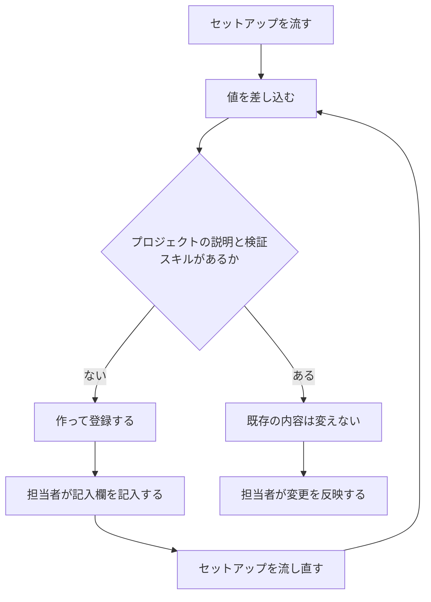

# プロジェクトごとの指示の書き方

ここは、プロジェクトに合わせて担当が記入して育てるひな形である。使用する言語・構成・検証コマンドは入っておらず、`[記入: …]` が記入欄で、書き終えたらかっこごと実際の内容に置き換える。

## 記入すること

担当は、セットアップが起票したタスクの順に、次の項目を記入する。

セットアップは「プロジェクトの説明と検証スキルを記入する」と「スクワッドの動きを試す」を、実行した人を担当にして起票する。リポジトリごとの「OWNER/REPO に AGENTS.md と作業別のルールを置く」は、スクワッドを担当にして backlog で起票する。前の二つを終えてから、リポジトリのタスクを todo にしてスクワッドへ渡す。作業の順と手順は、起票されたタスクの本文に従う。

- リポジトリごとに、そのリポジトリの `AGENTS.md` へ、目的と利用者・設計の入口・実際のディレクトリと依存方向を書く。外部との合意が要る契約・生成物とその正本・作業で守る制約も記入する
- 作業別のルールを、各リポジトリのものとして記入する。front matter の `paths` にある仮のパスを、リポジトリのルートから見た実際の glob に置き換える
- 必要ならルールを分けたり名前を変えたりして、`AGENTS.md` の対応表とリンクも合わせる。不要なファイルは対応表からも削除する
- プロジェクトに一つの検証スキルを用意し、リポジトリごとの節に実行する場所・必要な道具・環境・変更別のコマンド・成功の基準を書く。DB やサービスの専用環境と片付け、E2E と証拠、依存の監査も、そのリポジトリの方法を記入する
- 検証スキルの正本を育てる場所は一つに決める。認証情報の値は書かず、取得手順を書く
- `project.md` に、タスクの実行が最初に知ることと、リポジトリごとに何が入り、どんな仕事を受けるかを書く。リーダーが metadata の `repository` を決めるときに読む
- checkout 後にそのリポジトリの `AGENTS.md` とルールを読む案内を残す。hooks が自動で動くと仮定しない
- 記入したパス、コマンド、検証環境と片付けを実際のプロジェクトで確認する。使わない項目は対象外と分かるようにし、未記入を検証成功と扱わないようにする

同じ決まりを複数のファイルへ写さず、詳細の正本へリンクする。役の指示や共通スキルにはプロジェクト固有のことを足さず、ここから育てたリポジトリの指示、プロジェクトだけのスキル、プロジェクトの説明に置く。不要な項目は削除するか、対象外である理由を書く。

## 置き場所

ひな形の各ファイルは、プロジェクトの次の場所へ置く。

| この中のファイル | プロジェクトでの置き場所・用途 |
| --- | --- |
| [AGENTS.md](AGENTS.md) | リポジトリのルート。概要、構成、作業別のルールの入口、完了の条件 |
| [.agents/rules/code.md](.agents/rules/code.md) | 同じ相対パス。コードの作業で使うルールのひな形 |
| [.agents/rules/tests.md](.agents/rules/tests.md) | 同じ相対パス。テストの作業で使うルールのひな形 |
| [.agents/rules/docs.md](.agents/rules/docs.md) | 同じ相対パス。ドキュメントの作業で使うルールのひな形 |
| [.agents/rules/database.md](.agents/rules/database.md) | 同じ相対パス。DB を持つリポジトリだけに置く、DB を変える作業のルールのひな形で、記入の例を含む |
| [.agents/rules/ui.md](.agents/rules/ui.md) | 同じ相対パス。画面を持つリポジトリだけに置く、画面の作業のルールのひな形で、記入の例を含む |
| [.agents/review-paths](.agents/review-paths) | 作業先のリポジトリのルートからの `.agents/review-paths` に置く任意のファイル。マーク `重要` のないタスクのレビューの観点の対応を上書き・追加し、置かなければ原本の既定で選ぶ |
| [.agents/skills/verify/SKILL.md](.agents/skills/verify/SKILL.md) | プロジェクトに一つ登録する検証スキルのひな形。リポジトリごとの節を持つ |
| [verify-repository.md](verify-repository.md) | 上のスキルへ、選んだリポジトリごとに差し込む記入欄 |
| [project.md](project.md) | Multica のプロジェクトの説明の初期値。以後の説明の正本はプロジェクトで決めた場所に置く |

既存のファイルがあれば、内容を読み、必要な項目だけを取り入れる。まとめて上書きしない。この案内は書く人用なので、エージェントの指示として登録する必要はない。

## 差し込みと登録

セットアップは、流すたびにひな形へ値を差し込み、プロジェクトの説明と検証スキルがなければ作って登録する。記入と、既存の内容への変更の反映は、担当者が行う。

次の図は、セットアップの流れと、担当者が記入して流し直すまでを示す。

`project.md` の `{{project_name}}`、`{{repositories}}`、`{{repository_roles}}`、`{{project_key}}` はセットアップが値を差し込む。repositories は選んだ全リポジトリの一覧、repository_roles は各リポジトリの役割の記入表である。検証スキルの `{{repository_checks}}` には、`verify-repository.md` の `{{repository}}` を各リポジトリで展開し、見出しを一段下げた節を差し込む。

`[記入: …]` は自動で補わない。作業別のルールや AGENTS.md は担当者が記入するもので、役の条件のマークは使わない。

検証スキルの元の名前は `verify` である。Multica への登録名は `<プロジェクトの区別>-verify` となり、役のひな形の `skills: verify` はその登録名へ割り当てる。ひな形の front matter を含めて名前と説明を持つ形にしてあるが、コマンドはまだ記入されていない。プロジェクトで内容を育ててから使う。

セットアップはプロジェクトの説明とプロジェクトだけのスキルがなければ作り、すでにあれば変えない。更新時は担当者が育てた内容を失わないようにする。リポジトリのファイルの記入・採用は人が行い、既存の説明や登録済みの検証スキルへの変更の反映も、プロジェクトの担当者が行う。

リポジトリを増減したときは、「OWNER/REPO の増減を説明と検証スキルに反映する」のタスクで、担当者が既存の説明と検証スキルに反映する。新しいリポジトリの記入欄がなければ、登録された役の最新の一覧を見て足す。外したリポジトリの古い節が残っていても、書き込みを許す一覧にはならない。

プロジェクトの説明は、プロジェクトのタスクの実行には渡るが、オートパイロットの `run_only` には渡らない。`run_only` で必要になるリポジトリや許可の値は、役の指示とオートパイロットの指示に置く。プロジェクト・スクワッド・人の ID を、このひな形へ手書きする必要はない。

## 次に読むもの

セットアップの流し方と確認は、[導入・更新の手順](../manual.md) を読む。
